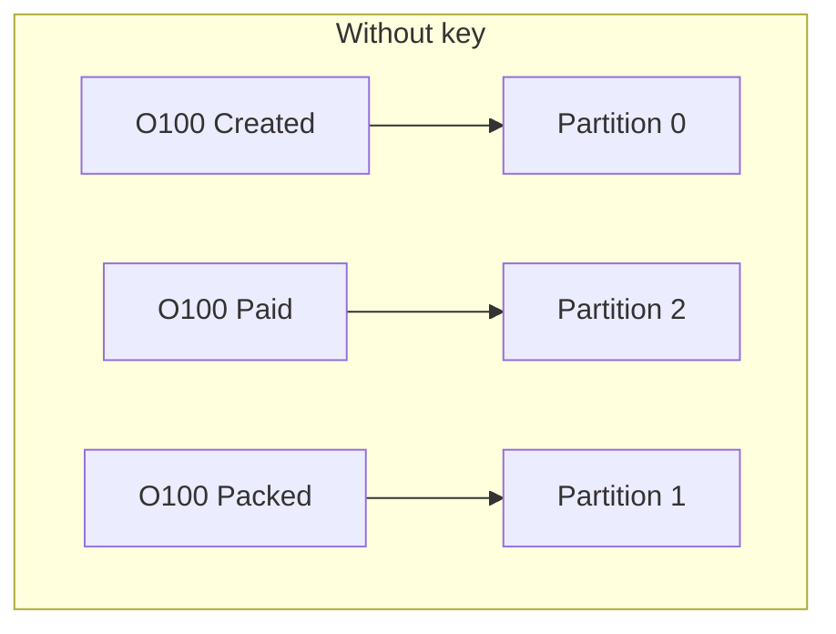
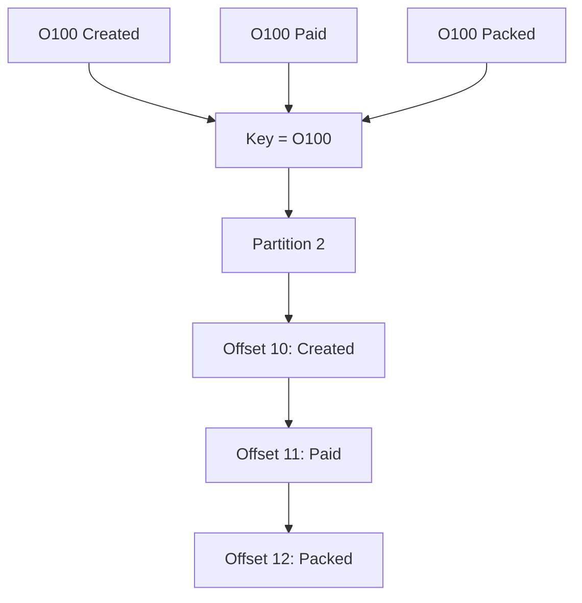

# Preserving order with record keys

Kafka only guarantees record order within **a single partition**. If changes to the same order, account, or device are written across multiple partitions, consumers have no shared order to know which change must be applied first. The common way to keep related records in the same partition is to use a **record key** representing the business entity.

For example, all events of order `O100` use `orderId = O100` as the key. With the default partitioner and an unchanged partition count, Kafka routes records with the same key to the same partition. The consumer reads the partition in offset order, enabling it to process the sequence `OrderCreated`, `OrderPaid`, `OrderPacked` in the order records were appended.

A record key establishes the condition for preserving per-entity order. It does not automatically sort events by business time, does not create a global order across partitions, and does not resolve multiple producers emitting events out of order. This article clarifies the necessary conditions from producer to consumer.

## 1. Why do record keys help preserve order?

Each Kafka partition is an independent log. The broker appends records to the end of the log and assigns monotonically increasing offsets. Consumers read records in offset order within that partition.

Suppose the `orders.events` topic has four partitions. If a producer sends events for `O100` without a key, the records can be distributed across different partitions. In that case, there is no ordering guarantee among them:



A consumer group can process the three partitions in parallel. `OrderPacked` may even be processed before `OrderPaid`, even though the application sent the events in the intended sequence.

If `orderId` is used as the key, records for the same order are routed to the same partition:



At this point, Kafka preserves the append order of the three records in partition 2. The consumer reads offsets 10, 11, and 12 in that order. Other orders with different keys can still be distributed to other partitions and processed in parallel.

## 2. Choosing keys by aggregate or business entity

The key should represent the object whose changes must be serialized. Some common choices:

| Data stream | Suggested key | Reason |
|---|---|---|
| Order lifecycle | `orderId` | State transitions of a single order must follow order. |
| Account transactions | `accountId` | Balance changes of a single account must be applied sequentially. |
| Device state | `deviceId` | Updates for a single device must follow sequence. |
| Customer profile | `customerId` | Changes for the same customer are processed on a single stream. |
| Configuration changelog | `configId` | The latest record for the same config resides in the same partition, also suitable for compaction. |

For example, an event can contain both `eventId` and `orderId`:

```java
import java.time.Instant;
import java.math.BigDecimal;

public record OrderEvent(
        String eventId,
        String orderId,
        long sequence,
        String type,
        Instant occurredAt,
        BigDecimal amount
) {}
```

The identifier fields serve different purposes:

- `eventId` uniquely identifies a single event emission, useful for deduplication and idempotency.
- `orderId` is the key to group events of the same aggregate into one partition.
- `sequence` expresses business order within the aggregate, helping consumers detect missing, duplicate, or out-of-order events.

Do not use `eventId` as the key if the goal is to group every event of an order together. Since each event has a different `eventId`, they can be routed to different partitions.

## 3. Key-based partitioning mechanism

When a producer does not specify a partition directly and the key is non-null, the default partitioner of the Kafka Java producer uses the serialized key bytes to compute the partition. Conceptually, it hashes the key and maps the result onto the current partition count.

With the same key bytes and the same partition count, the default partitioner yields a stable partition result. Therefore, if all producers serialize `O100` identically and the topic's partition count does not change, records with key `O100` will be placed in the same partition.

Conditions to keep the mapping stable:

1. **The key must be identical:** every event of the same aggregate uses the same key value.
2. **Serialization must be consistent:** producers use the same data type and key serialization method. For example, the string `O100` must produce the same byte sequence.
3. **Partitioners must be compatible:** custom partitioners must implement the same routing rule across all producers.
4. **Partition count must remain stable:** changing the number of partitions can cause the hash result to map to a different partition.
5. **No manual partition override:** if a producer specifies a partition, that partition takes precedence over key-based routing.

For example, two producers using `StringSerializer` and sending key `O100` to a topic with 8 partitions will both compute the same partition under the default partitioner. If one producer uses key `O100` and another uses key `o100`, the two key byte sequences differ and may land in two different partitions.

### What about null keys?

Kafka still allows sending records with a `null` key. In that case, the producer cannot use key hashing to group records by entity. Modern Kafka clients typically use sticky partitioning for keyless records to leverage batching; details depend on version and partitioner. You should not rely on the distribution of keyless records to guarantee per-aggregate order.

If business logic requires ordering or the topic uses log compaction by entity, provide a non-null key for the record.

## 4. Sending keyed events with Spring Kafka

In Spring Kafka, the `KafkaTemplate.send(topic, key, data)` overload is the direct way to send a record with a key:

```java
import java.util.concurrent.CompletableFuture;

import org.springframework.kafka.core.KafkaTemplate;
import org.springframework.kafka.support.SendResult;
import org.springframework.stereotype.Service;

@Service
public class OrderEventPublisher {

    private static final String TOPIC = "orders.events";

    private final KafkaTemplate<String, OrderEvent> kafkaTemplate;

    public OrderEventPublisher(KafkaTemplate<String, OrderEvent> kafkaTemplate) {
        this.kafkaTemplate = kafkaTemplate;
    }

    public CompletableFuture<SendResult<String, OrderEvent>> publish(
            OrderEvent event) {
        // Every event for the same order shares orderId as the record key.
        return kafkaTemplate.send(TOPIC, event.orderId(), event);
    }
}
```

In this example:

- `TOPIC` is the target event stream.
- `event.orderId()` is the key used to select the partition.
- `event` is the value serialized and stored in the record.
- `CompletableFuture` lets the caller track the asynchronous send result.

The example uses the return type of Spring Kafka 3.x and later. Spring Kafka 2.x uses `ListenableFuture` for `send` methods; check your project's dependency version when declaring the return type.

Serializer configuration must be compatible with the template's generic types:

```yaml
spring:
  kafka:
    bootstrap-servers: localhost:9092
    producer:
      key-serializer: org.apache.kafka.common.serialization.StringSerializer
      value-serializer: org.springframework.kafka.support.serializer.JsonSerializer
      acks: all
      properties:
        enable.idempotence: true
```

`StringSerializer` ensures `orderId` is converted into consistent key bytes. `JsonSerializer` serializes the event into a JSON value. The consumer must use a deserializer or message converter compatible with the event contract.

There is no need to compute the partition manually using `hashCode()` in the application. Let the Kafka producer partitioner perform routing, unless there is a special requirement and a custom partitioner has been thoroughly tested.

## 5. Keys do not sort events by business order

This is the most important limitation to understand: Kafka appends records in the order the producer sends them to the broker. The key only determines the target partition; the key does not state that `OrderCreated` must precede `OrderPaid`.

For example, two threads simultaneously send events for `O100`:

- Thread A creates `OrderCreated` first.
- Thread B creates `OrderPaid` afterward.
- However, Thread B calls `send()` first due to execution scheduling or an async queue.

Kafka can append `OrderPaid` before `OrderCreated`. Both records still reside in the same partition, but the order inside the partition reflects the order the broker received them rather than automatically restoring the intended business sequence.

To avoid this situation:

- Serialize event emission per aggregate if an aggregate has multiple concurrent update flows.
- Use an ordered publisher/outbox dispatcher per aggregate or partition.
- Attach an incrementing `sequence`/version to the event so consumers can detect out-of-order delivery.
- Apply optimistic locking or transactions at the data source to establish a valid change order before publishing.

If multiple services or multiple producer instances emit events for the same key, Kafka does not provide a global causal order across those producers. Append order depends on when the broker receives each record. When business requirements are strict, you need writer coordination or a sequence issued at the data source.

## 6. Producer retries and idempotence

Producers send asynchronously and may retry on transient errors. Without proper configuration, retrying an earlier batch can cause a later batch to be appended first, breaking send order.

With modern Kafka producers, enable idempotence so the broker identifies retries using the producer's sequence numbers and prevents duplicate writes from retries within the producer session. Illustrative configuration:

```yaml
spring:
  kafka:
    producer:
      acks: all
      retries: 2147483647
      properties:
        enable.idempotence: true
        max.in.flight.requests.per.connection: 5
```

Idempotence requires compatible settings. With modern Kafka clients, `acks=all`, `retries` greater than 0, and `max.in.flight.requests.per.connection` not exceeding 5 are appropriate settings for an idempotent producer. When idempotence is enabled, the producer can preserve batch ordering across in-flight requests using Kafka's sequence mechanism.

If idempotence is disabled and multiple concurrent requests are allowed, retries can reorder batches. Setting `max.in.flight.requests.per.connection=1` can prevent a later batch from overtaking an earlier batch in a non-idempotent configuration, at the cost of reduced throughput. Prefer enabling idempotence rather than relying on a single in-flight request limit if client and broker support it.

Producer idempotence does not replace `eventId` and does not prevent business-level duplicates when the application actively calls `send()` again for the same event, uses a different producer instance, or restarts after an ambiguous send outcome. Consumers should still have idempotency/deduplication mechanisms when side effects must not repeat.

## 7. Consumers process in partition order

Within a consumer group, each partition is assigned to at most one consumer member at a time. The consumer reads a partition's records in offset order. Because events with the same key land in the same partition, they can be processed sequentially on that consumer.

Example listener receiving `ConsumerRecord` to inspect key, partition, and offset:

```java
import org.apache.kafka.clients.consumer.ConsumerRecord;
import org.springframework.kafka.annotation.KafkaListener;
import org.springframework.stereotype.Component;

@Component
public class OrderEventListener {

    @KafkaListener(
            topics = "orders.events",
            groupId = "order-projection"
    )
    public void onOrderEvent(ConsumerRecord<String, OrderEvent> record) {
        OrderEvent event = record.value();

        System.out.printf(
                "orderId=%s, type=%s, partition=%d, offset=%d, sequence=%d%n",
                record.key(),
                event.type(),
                record.partition(),
                record.offset(),
                event.sequence()
        );

        // Update order state in record order.
    }
}
```

With synchronous listener processing, the container invokes the listener on the consumer thread in the order records are read from the partition. A single consumer may own multiple partitions; records across those partitions have no total order.

### Do not break order after receiving a record

If a listener receives A then B and pushes each record onto a shared thread pool, B can complete before A. Kafka still delivered the records in the correct offset order; it is the application's asynchronous processing that reordered the side effects.

If asynchronous processing is required, serialize work per partition or key, or use a sequence/version to prevent stale updates from overwriting newer state. Offset commits must also wait for prior records to finish; never commit past a record that has not been processed successfully.

## 8. Using sequence/version to verify business order

In systems with multiple producers or asynchronous processing, include a sequence/version in the event. For example, aggregate `O100` emits versions 1, 2, 3. The consumer stores the last applied version and only accepts the next version according to business rules.

Processing pseudocode:

```java
public void apply(OrderEvent event) {
    long currentVersion = orderRepository.findVersion(event.orderId());

    if (event.sequence() <= currentVersion) {
        // Stale or already processed event: ignore per idempotency policy.
        return;
    }

    if (event.sequence() != currentVersion + 1) {
        // Sequence gap: wait, retry, or route to recovery workflow.
        throw new OutOfOrderEventException(event.orderId(), event.sequence());
    }

    orderRepository.applyAndAdvanceVersion(event);
}
```

This is illustrative pseudocode. In a real application, checking the version and updating state must occur within the same transaction or use optimistic locking/conditional updates so two consumer threads cannot apply the same version concurrently. The policy for handling sequence gaps must be clearly defined: bounded retry, buffering pending events, replaying from source, or routing to an error flow.

Sequences do not make Kafka reorder records. They help the application detect and handle out-of-order or missing events.

## 9. Increasing partitions can change key mapping

With the default partitioner, the partition is calculated from the key and current partition count. When increasing the partition count, the mapping result for the same key can change.

Example:

| Phase | Partition count | Mapped partition for key `O100` |
|---|---:|---|
| Before scaling | 4 | Partition 2 |
| After scaling | 8 | Partition 6 |

The partition numbers above are illustrative only. What matters is that old records for `O100` remain in partition 2, while new records may go to partition 6. The two partitions are processed independently by consumers, so there is no shared order between old events and new events.

Before increasing partitions on a topic that requires key-based ordering, you must:

- Assess whether an ordering boundary between old and new data is acceptable.
- Use sequence/version to detect stale events arriving after newer events.
- Consider creating a new topic and performing a controlled migration if the processing chain must remain intact.
- Plan the cutover so there are no two concurrent write streams breaking aggregate order.

You cannot reduce the partition count directly on a Kafka topic. If you need to change topology downward or redesign the mapping, you usually have to create a new topic and migrate data through a separate process.

## 10. Timestamps do not replace record keys

Timestamps indicate a point in time attached to a record, whereas keys serve partition routing. Do not use timestamps as a substitute for keys when order must be preserved.

Several reasons:

- Clocks across multiple producers can drift.
- Multiple events can share the same timestamp.
- `CreateTime` reflects the producer-supplied timestamp; `LogAppendTime` reflects when the broker appended the record, yet neither establishes a total order across partitions.
- Consumers still must process by each partition's offset and cannot compare offsets across partitions to determine which event came first.

Use keys to group related events, offsets to determine record order within a partition, and sequence/version to verify business order when needed.

## 11. Testing key-based ordering

An integration test should verify both conditions:

1. Records for the same aggregate with the same key are written to the same partition.
2. When the producer sends them in order, the consumer reads them in offset order.

Example test pseudocode with Embedded Kafka:

```java
String orderId = "O100";

publisher.publish(new OrderEvent("E1", orderId, 1, "Created", now, total));
publisher.publish(new OrderEvent("E2", orderId, 2, "Paid", now, total));
publisher.publish(new OrderEvent("E3", orderId, 3, "Packed", now, total));

// Test consumer receives three records and verifies:
// - record.get(0).key() == "O100" and record.get(1), record.get(2) have the same key
// - partition of all three records is identical
// - offsets are strictly increasing
// - sequences are 1, 2, 3 respectively
```

This is an illustrative skeleton; a complete test needs to wait for the send futures to succeed or poll the test consumer with a finite timeout, use a dedicated group ID, and configure `auto.offset.reset=earliest` when the group has no committed offset yet. Do not use a fixed `Thread.sleep` to guess when records are ready.

Add tests when running multiple producer instances or when changing partition counts if the system depends on per-aggregate ordering. These tests help uncover wrong assumptions about key mapping and event emission order.

## 12. Common pitfalls

| Pitfall | Consequence | Resolution |
|---|---|---|
| Sending records without a key | Events for the same entity can land in multiple partitions. | Use the aggregate ID as the key. |
| Using `eventId` as the key | Each event can land in a different partition. | Use `orderId`, `accountId`, or the entity ID that needs serialization. |
| Producers serialize keys differently | The same entity can produce different key bytes. | Standardize key type and serializer. |
| Inconsistent manual partition assignment | The same key can be sent to multiple partitions. | Let the partitioner choose or use one uniform custom partitioner. |
| Multiple threads emit events for the same aggregate | The broker may receive events out of business order. | Serialize publishing or use sequence/version. |
| Producer retries without idempotence | Batch retries can affect order when multiple requests are in flight. | Enable idempotence and compatible producer settings. |
| Uncontrolled async processing in consumer | Side effects complete out of order even though records are delivered in order. | Serialize processing per partition/key and commit in order. |
| Scaling partitions without evaluating key mapping | Old and new events for the same key may sit in different partitions. | Perform controlled migration and check sequence/version. |
| Using timestamp as primary order | Timestamps can drift or collide, with no global order. | Rely on partition offsets and business sequence. |

## 13. Key takeaways

- Kafka only guarantees order within a single partition.
- Record keys help the partitioner route events of the same entity to the same partition.
- Choose an aggregate ID like `orderId`, `accountId`, or `deviceId` as the key; use a separate `eventId` for deduplication.
- Key mapping requires consistent key serialization and partitioning strategy, along with a stable partition count.
- Keys do not automatically sort events by business time; the broker appends records in the order received.
- Producer idempotence prevents retries from reordering batches within a producer's scope, but does not coordinate multiple independent producers.
- Consumers processing synchronously per partition preserve offset order; asynchronous processing must serialize side effects and commits.
- Sequence/version helps detect missing, duplicate, or out-of-order events.
- Increasing partitions can alter key mappings and disrupt an aggregate's ordering stream.

When designing a topic that requires order preservation, choose keys by aggregate, keep serialization/partitioning rules stable, configure an idempotent producer, and process consumers in partition order. If multiple producers or topology changes can cause events to arrive out of business order, add sequence/version and application-level coordination mechanisms.

## References

- [Apache Kafka — Producer Configurations](https://kafka.apache.org/documentation/#producerconfigs)
- [Apache Kafka — ProducerRecord API](https://kafka.apache.org/40/javadoc/org/apache/kafka/clients/producer/ProducerRecord.html)
- [Apache Kafka — KafkaProducer API](https://kafka.apache.org/40/javadoc/org/apache/kafka/clients/producer/KafkaProducer.html)
- [Spring for Apache Kafka — Sending Messages](https://docs.spring.io/spring-kafka/reference/kafka/sending-messages.html)
