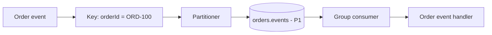

# Designing keys for aggregates or entities

A Kafka key determines which partition a record is routed to when the producer uses a key-based partitioner. If events belonging to the same business object must be read in order, choose a stable key representing that object. In many event-driven systems, the appropriate key is the **aggregate root** ID; for data streams not using the aggregate pattern, use the ID of the entity whose processing order must be preserved.

For example, the `OrderCreated`, `OrderPaid`, and `OrderCancelled` events of the same order typically use `orderId` as the key. As long as the partition count and partitioner remain unchanged, events with the same key are placed in the same partition; Kafka preserves append order within that partition. A consumer group can process different partitions in parallel, while events for a single order stay on one sequential stream.

Choosing a key is a decision about ordering boundaries, load distribution, and scalability. A key that is too broad can funnel too many events into one partition; a key that is too granular can split events of the same business unit across multiple partitions and lose required ordering.

## 1. What role does a Kafka key play?

A Kafka record can include a key, value, timestamp, and headers. The key provides routing data and record identity for several Kafka processing policies. With the default partitioner, when a record has a key, the producer computes the partition based on the serialized key and the topic's partition metadata.



Keys are typically used for three purposes:

- **Routing:** placing records with the same key into the same partition according to the current partitioner and partition count.
- **Ordering:** creating an ordered stream of records for the same key because Kafka guarantees order within a partition.
- **Compaction:** for topics with `cleanup.policy=compact`, Kafka uses the key to retain the latest state per key within each partition.

A key is not a distributed locking mechanism. It does not prevent two producers from concurrently emitting events for the same entity, does not determine business order on its own, and does not guarantee exactly-once consumer processing. It only routes records into a partition according to the chosen rule.

## 2. Aggregates and entities in key design

In Domain-Driven Design, an aggregate is the consistency boundary of a group of business objects. The aggregate root is the entry point for modifying aggregate state and enforcing aggregate invariants. If an event describes a state change of an aggregate, the aggregate root's ID is usually the natural key.

Example:

| Aggregate or entity | Events | Common key | Reason |
| --- | --- | --- | --- |
| Order | `OrderCreated`, `OrderPaid`, `OrderCancelled` | `orderId` | Order state changes must be processed in sequence |
| Account | `MoneyDeposited`, `MoneyWithdrawn` | `accountId` | Balance updates for the same account must follow order |
| Shopping cart | `ItemAdded`, `ItemRemoved`, `CartCheckedOut` | `cartId` | Cart state forms a per-cart stream |
| Inventory item | `StockReserved`, `StockReleased` | `sku` or `inventoryId` | Stock updates for the same item must be coordinated |
| Customer profile | `CustomerUpdated`, `CustomerAddressChanged` | `customerId` | Profile updates for the same customer need ordering |

An entity ID is not always the aggregate ID. If an entity lives inside an aggregate and its changes must stay consistent with the aggregate root, using the aggregate root's ID usually makes more sense. For example, `OrderLine` belongs to the `Order` aggregate; if changing a line item affects total amount and order status, the key should be `orderId` so all events of the order travel through one partition.

### 2.1. Choosing by invariant boundary

Start by asking: which changes must be observed in a single sequence to uphold business rules?

- If the invariant resides within an `Order`, choose `orderId`.
- If the invariant resides within an `Account`, choose `accountId`.
- If an aggregate has multiple child entities whose changes must be serialized, choose the aggregate root's ID.
- If two independent aggregates can change separately, do not merge them under one key merely because they hold a reference relationship.

An overly broad key reduces parallelism. For example, using `tenantId` as the key for every event of a tenant pushes all activity for that tenant into a single partition. In contrast, using `orderId` for order events lets different orders distribute across multiple partitions.

## 3. Why shouldn't eventId be used as the key?

Each event typically has a unique `eventId` to identify an event occurrence. If `eventId` is used as the Kafka key, each event normally has a different key and can be distributed across many partitions. That helps random load distribution, but does not group events of the same aggregate into one partition.

Unsuitable example if per-order ordering is needed:

```java
// Unsuitable for ordering by orderId:
kafkaTemplate.send("orders.events", event.eventId(), event);
```

Better example:

```java
// Events of the same order use the same key:
kafkaTemplate.send("orders.events", event.orderId(), event);
```

The fields serve different roles:

| Field | Role |
| --- | --- |
| `eventId` | Uniquely identifies a single event; supports deduplication, tracing, and idempotency |
| `aggregateId` | Identifies the aggregate emitting the event; commonly used as Kafka key for routing and ordering |
| `correlationId` | Links multiple events/commands within the same business flow |
| `causationId` | Indicates the event or command that caused the current event |

These IDs do not need to share the same value. Each ID should carry a stable meaning and be used for its proper purpose.

## 4. Example of aggregate-oriented event design

Suppose an Order system emits three event types:

```java
public record OrderCreated(
        String eventId,
        String orderId,
        String customerId,
        long aggregateVersion,
        Instant occurredAt
) {}

public record OrderPaid(
        String eventId,
        String orderId,
        long aggregateVersion,
        BigDecimal amount,
        Instant occurredAt
) {}

public record OrderCancelled(
        String eventId,
        String orderId,
        long aggregateVersion,
        String reason,
        Instant occurredAt
) {}
```

Each record type above is placed in its own Java file; declarations are shown together here to easily compare event structures.

The events share the same `orderId`, while each event has its own `eventId` and can carry an incrementing `aggregateVersion`. The producer sends all events with `orderId` as the key:

```java
@Service
public class OrderEventPublisher {

    private final KafkaTemplate<String, Object> kafkaTemplate;

    public OrderEventPublisher(KafkaTemplate<String, Object> kafkaTemplate) {
        this.kafkaTemplate = kafkaTemplate;
    }

    public CompletableFuture<SendResult<String, Object>> publish(
            String orderId,
            Object event
    ) {
        return kafkaTemplate.send("orders.events", orderId, event);
    }
}
```

The snippet illustrates a generic publisher for multiple event types; in real applications, consider an event envelope or explicit value type with matching serializer. Imports such as `Instant`, `BigDecimal`, `KafkaTemplate`, `SendResult`, and `CompletableFuture` are omitted to focus on the key.

Example records sent:

| Event | Key | Value contains |
| --- | --- | --- |
| `OrderCreated` | `ORD-100` | eventId, orderId, version 1, customerId |
| `OrderPaid` | `ORD-100` | eventId, orderId, version 2, amount |
| `OrderCancelled` | `ORD-100` | eventId, orderId, version 3, reason |

With the same topic, partition count, and partitioner, the three events are routed to the same partition. The consumer reads them in offset order within that partition.

## 5. Choosing keys for multi-entity relationships

A business operation can span multiple aggregates. For instance, transferring money from account A to account B. One transfer can create two effects: debiting A and crediting B.

No single Kafka key can place account A's event into A's partition, place account B's event into B's partition, and simultaneously guarantee a global order across the two partitions. Typically, each event is emitted under the aggregate being modified:

| Event | Modified aggregate | Key |
| --- | --- | --- |
| `MoneyWithdrawn` | Account A | `account-A` |
| `MoneyDeposited` | Account B | `account-B` |

If the two events need linking, use `transferId` as a `correlationId` or metadata in the value/header. Do not change both keys to `transferId` unless the desired ordering boundary is genuinely the transfer and you accept that different accounts may be co-located into the same partition by transfer.

For multi-aggregate workflows, use sagas or workflow orchestration to manage progress and compensation. Kafka keys provide ordering within a partition; they do not create atomic transactions or global order across multiple aggregates.

## 6. Designing composite keys

In multi-tenant systems, an ID may only be unique within a tenant. In that case, construct a composite key combining tenant and aggregate:

```text
tenant-42:order-100
tenant-42:order-101
tenant-77:order-100
```

A composite key distinguishes the same `orderId` across different tenants. Standardize key construction and apply the same rule across all producers.

Example:

```java
public record OrderKey(String tenantId, String orderId) {

    public String asKafkaKey() {
        return tenantId + ":" + orderId;
    }
}

String key = new OrderKey(tenantId, orderId).asKafkaKey();
kafkaTemplate.send("orders.events", key, event);
```

If ID components can contain the delimiter character, use an unambiguous encoding such as length-prefixing, standardized escaping, or canonical serialization. Do not concatenate strings naively if two distinct ID pairs could yield the exact same resulting string.

### 6.1. Do not use tenantId as the key if scaling per aggregate is needed

If `tenantId` is used as the key, all records for a tenant land in one partition. For a high-traffic tenant, that partition can become a hot partition while other partitions stay underutilized.

If the goal is per-order ordering within a tenant, use the composite key `tenantId + orderId`. This lets different orders within the same tenant spread across multiple partitions, while still grouping events of the same order into one partition.

## 7. Requirements for keys: stability and determinism

A good key should satisfy these properties:

- **Stable:** all events of the same aggregate use the same key throughout the lifecycle requiring order preservation.
- **Deterministic:** the same aggregate ID must produce the exact same key byte sequence on every producer instance.
- **Sufficient cardinality:** keys distribute workload across multiple partitions rather than concentrating on a few partitions.
- **No sensitive data:** keys often appear in logs, metrics, and admin tools, and can be observed by anyone permitted to read the topic.
- **Clear contract:** producers and consumers agree on encoding, normalization, and null handling.

Do not use `hashCode()` of an arbitrary Java object as a key without stable serialization. `hashCode()` may not represent the same byte sequence across languages or deployment versions. Use a standardized ID such as string-formatted UUIDs, fixed-encoding numeric IDs, or a composite key with an explicit schema.

### 7.1. Key serialization must be consistent

The Kafka partitioner operates on the serialized key. If producer A serializes an ID as UTF-8 while producer B uses another encoding or formatting style, the same logical ID can become different byte sequences and get routed differently.

For string keys, `StringSerializer` is a simple choice:

```yaml
spring:
  kafka:
    producer:
      key-serializer: org.apache.kafka.common.serialization.StringSerializer
      value-serializer: org.springframework.kafka.support.serializer.JsonSerializer
```

Standardize ID normalization. For example, UUIDs should use consistent lowercase/uppercase formatting; do not add whitespace or alter delimiters across different producers.

### 7.2. Avoid changing keys mid-lifecycle

If an aggregate switches its key from `orderId` to `customerId`, old events and new events may reside in different partitions. Changing keys can break ordering, shift partition affinity, and affect compaction.

If the key contract must change, treat it as a routing change with a migration plan. You can create a new topic version, emit events with a controlled cutover, or add version/sequence numbers so consumers detect out-of-order arrivals.

## 8. Key distribution and hot partitions

Keys need enough diversity so records distribute fairly evenly. If millions of events share one key, they will all funnel into one partition under a key-based partitioner. That partition can become a bottleneck even if the topic has dozens of partitions.

Example:

| Key choice | Consequence |
| --- | --- |
| `orderId` | Usually distributes well if order count is large and traffic is relatively even |
| `tenantId` | One large tenant can concentrate all load onto one partition |
| Constant `"orders"` | All events land in one partition; virtually no partition parallelism |
| `eventId` | Distribution may be even, but events of the same aggregate split across partitions |
| `customerId` | Suitable if ordering is required per customer; can get hot if one customer generates heavy volume |

There is a fundamental trade-off: the more events a key groups into one stream, the easier ordering is to manage, yet parallelism is bounded by the number of independent keys and load distribution.

### 8.1. Hot keys cannot be solved just by adding partitions

Increasing the partition count helps spread many distinct keys more broadly. However, the same key still must be routed consistently to one partition if simple ordering is desired. If a single aggregate emits events faster than one partition can handle, adding partitions does not automatically split that aggregate into parallel streams.

Options to consider:

- Optimize consumer processing for hot aggregates.
- Reduce unnecessary events or coalesce changes into batches.
- Re-examine aggregate boundaries if the domain model legitimately permits splitting invariants.
- If sacrificing strict order is acceptable, shard the workload with sequence/version numbers and explicit reconciliation mechanisms.

Do not split keys using a random suffix just to increase throughput if business logic still needs ordering among events of the same aggregate. That creates multiple partitions while simultaneously breaking the ordering the original key was protecting.

## 9. Keys, partition counts, and partition expansion

With the default partitioner, the partition is chosen from the key hash and current partition count. When increasing the partition count, the mapping can change:

\[
\text{partition} = \text{positiveHash}(keyBytes) \bmod N
\]

If `N` changes, a key can move to another partition. Kafka does not migrate old records; thus aggregate history may sit in an old partition while new events land in a new partition.

Example:

| Phase | Partition count | Key | Illustrative partition |
| --- | ---: | --- | ---: |
| Before expansion | 4 | `tenant-42:order-100` | 1 |
| After expansion | 6 | `tenant-42:order-100` | 5 |

If per-aggregate ordering matters, provision partition counts upfront or have a routing/migration strategy to preserve mappings for active aggregates. Do not treat adding partitions as a purely infrastructure-only operation.

## 10. Keys and compacted topics

With `cleanup.policy=compact`, Kafka retains the latest value per key within each partition. Therefore, the key must represent the exact object whose state is being compacted.

For example, topic `customer.current-state` holds the latest state of each customer:

```java
kafkaTemplate.send("customer.current-state", customerId, customerState);
```

State versions for the same `customerId` must be sent with the same key and routed to the same partition. If the key changes or partition mapping changes after expansion, versions for the same customer can be split across multiple partitions. The log cleaner compacts each partition independently and does not merge duplicate keys across partitions.

A record with a key and a `null` value can serve as a tombstone denoting state deletion. When using compacted topics, standardize key encoding and handle tombstones in consumers.

## 11. Producer example with aggregate keys in Spring Kafka

A publisher should accept the aggregate ID explicitly and derive the key in one centralized place, avoiding each service assembling keys under different conventions:

```java
package com.example.orders.messaging;

import java.util.Map;

// OrderEvent.java
public record OrderEvent(
        String eventId,
        String orderId,
        long aggregateVersion,
        String eventType,
        Map<String, Object> payload
) {}
```

```java
// OrderEventPublisher.java
package com.example.orders.messaging;

import java.util.concurrent.CompletableFuture;
import org.springframework.kafka.core.KafkaTemplate;
import org.springframework.kafka.support.SendResult;
import org.springframework.stereotype.Service;

@Service
public class OrderEventPublisher {

    private static final String TOPIC = "orders.events";

    private final KafkaTemplate<String, OrderEvent> kafkaTemplate;

    public OrderEventPublisher(KafkaTemplate<String, OrderEvent> kafkaTemplate) {
        this.kafkaTemplate = kafkaTemplate;
    }

    public CompletableFuture<SendResult<String, OrderEvent>> publish(
            OrderEvent event
    ) {
        String key = event.orderId();
        return kafkaTemplate.send(TOPIC, key, event);
    }
}
```

`OrderEvent` is a shared envelope in this example; a sealed interface or per-event-type schemas can be used instead. The snippet focuses on extracting `orderId` as the key; serializers must be configured compatibly with this envelope.

Check the metadata returned from the send result to confirm records landed in the expected partition in test environments:

```java
publisher.publish(event).whenComplete((result, error) -> {
    if (error != null) {
        log.error("Cannot publish order event {}", event.eventId(), error);
        return;
    }

    var metadata = result.getRecordMetadata();
    log.info("Published orderId={} partition={} offset={}",
            event.orderId(), metadata.partition(), metadata.offset());
});
```

The callback snippet assumes `log` is the SLF4J logger of the containing service.

In production, log event IDs and metadata at appropriate levels, avoiding sensitive payloads. A successful send result only confirms the producer received acknowledgment per the `acks` setting; it does not prove a consumer has processed the event.

## 12. Validating keys on the consumer

The consumer can obtain the key directly from `ConsumerRecord`:

```java
@KafkaListener(topics = "orders.events", groupId = "order-projection")
public void onOrderEvent(ConsumerRecord<String, OrderEvent> record) {
    String orderId = record.key();
    OrderEvent event = record.value();

    orderProjection.apply(orderId, event);
}
```

If the key is mandatory, validate for null and blank values. If keys may be null per the topic contract, the consumer must have an explicit handling branch. Do not extract the aggregate ID from the value and ignore the key if producers and consumers need to share the same routing contract.

Consumers can log the tuple `(topic, partition, offset, key, eventId)` for troubleshooting. The offset only has meaning within the partition, while `eventId` supports deduplication and the key links the record to the aggregate.

## 13. Multiple producers and event emission order

A stable key places events of the same aggregate into the same partition, yet if multiple producers emit events for one aggregate, log order is the order in which the broker appends received requests, not necessarily the intended business order.

For example, two instances concurrently emit `OrderPaid` and `OrderCancelled` for `ORD-100`. Both use the same key, so records enter the same partition; however, if the two requests run concurrently, the broker may append `OrderCancelled` before `OrderPaid`.

To protect business order:

- Allow only one authority to mutate the aggregate and emit events for it, or serialize commands per aggregate.
- Attach a monotonically increasing `aggregateVersion` to the event.
- Have consumers check the version before applying; detect missing or out-of-order events.
- Use idempotency to handle duplicates from retries or redelivery.
- If using a transactional outbox, write events in the same transaction as the aggregate update and relay them in the required order.

Producer idempotence prevents producer-retry duplicates within Kafka's supported scope, but does not automatically order events by business version across multiple instances.

## 14. Changing a key contract requires migration

Changing the key from `orderId` to `customerId`, adding `tenantId`, or changing encoding can route new records differently. Treat this as a topic contract change.

A migration plan can include:

1. Identify the reason for changing the key and the new ordering boundary.
2. Evaluate whether the old/new key groups multiple aggregates into one partition or splits one aggregate across partitions.
3. Assess impacts on consumers, compaction, retention, and partition counts.
4. If history and order must be preserved, create a new topic version or perform a migration with an explicit cutover.
5. Synchronize producers and consumers on a defined contract version.
6. Verify record metadata and key distribution after migration.
7. Monitor duplicates, out-of-order events, and consumer lag before retiring the old contract.

Do not silently change keys in a single deployment if consumers rely on ordering or compacted state of the old keys.

## 15. Common mistakes when choosing keys

| Choice or symptom | Issue | Resolution |
| --- | --- | --- |
| Using `eventId` as key for aggregate events | Events of the same aggregate can land in multiple partitions | Use aggregate/entity ID as key; keep `eventId` in value |
| Using a constant as key | All records pile into one partition | Choose a key with cardinality matching the ordering boundary |
| Using `tenantId` as key for all orders | Large tenants create hot partitions | Use composite key tenant + aggregate ID if per-aggregate ordering is needed |
| Using random suffixes to spread load | Events of the same aggregate are split across partitions | Only shard when explicit sequences and ordering merge mechanisms exist |
| Producers serialize the same ID differently | Same entity may be routed differently | Standardize key encoding and serializer across producers |
| Changing key while an aggregate is active | History and new events may reside in different partitions | Versioned contract migration and cutover |
| Expanding partitions and seeing same-key events in another partition | Hash/modulo shifts with partition count | Evaluate expansion and routing preservation strategy |
| Multiple producers emitting events out of order | Key only ensures same partition, not business order | Serialize commands or use aggregate version/outbox |
| Compacted topic retains multiple values for the same entity | Key or partition mapping is unstable | Keep keys and routing stable; migrate if changes are required |

## 16. Process for choosing a Kafka key for an aggregate/entity

When designing a new topic, follow these steps:

1. **Identify the event stream:** does the topic hold events for one aggregate type or multiple entity types?
2. **Identify invariants:** which events must be processed in sequence to protect business state?
3. **Select the ID:** use the aggregate root ID or entity ID matching that ordering boundary.
4. **Design composite keys:** if IDs are only unique per tenant, combine tenant ID and aggregate ID with an unambiguous encoding.
5. **Standardize serialization:** all producers use the same encoding, serializer, and ID representation.
6. **Evaluate load distribution:** inspect cardinality, key frequency, hot keys, and projected partition count.
7. **Check scalability:** evaluate key mapping when partition count changes and impact on ordering/compaction.
8. **Define event metadata:** keep `eventId`, `aggregateVersion`, and `correlationId` separate from the Kafka key.
9. **Test:** send multiple events for the same aggregate and verify key/partition; test multiple aggregates for distribution; test null keys and migrations.
10. **Monitor production:** measure records per partition, bytes in, consumer lag, key skew, and processing errors.

A well-chosen Kafka key represents the exact boundary where the application needs ordering, while distributing independent boundaries across partitions. When the key accurately reflects the aggregate or entity, producer routing, consumer ordering, and compaction all operate on one clear contract.

## 17. Self-check

1. Why is `aggregateId` usually more suitable as a Kafka key than `eventId`?
2. When should you use the aggregate root's ID instead of a child entity's ID?
3. If `tenantId` is used as the key for all events, what load distribution issue can arise?
4. Why can two events of the same aggregate with the same key still be appended out of business order with multiple producers?
5. How do you construct an unambiguous composite key in a multi-tenant system?
6. Why is a Java object's `hashCode()` not a stable key contract across multiple producers?
7. How do keys affect compacted topics and tombstones?
8. Why can increasing partitions or changing the key contract put events of the same aggregate into two different partitions?
9. When one operation modifies two aggregates, why can a single Kafka key not create a global order for both?
10. Which metrics help detect hot keys and partition skew?
