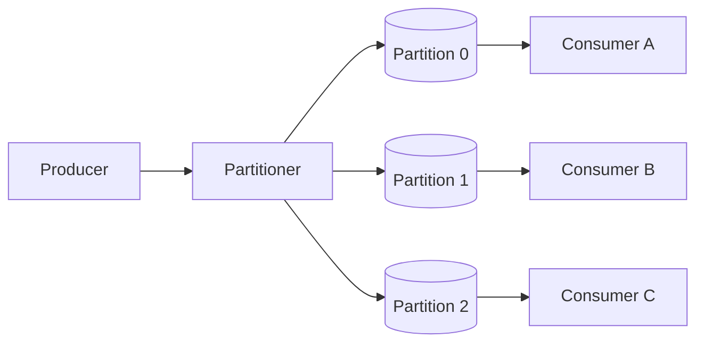
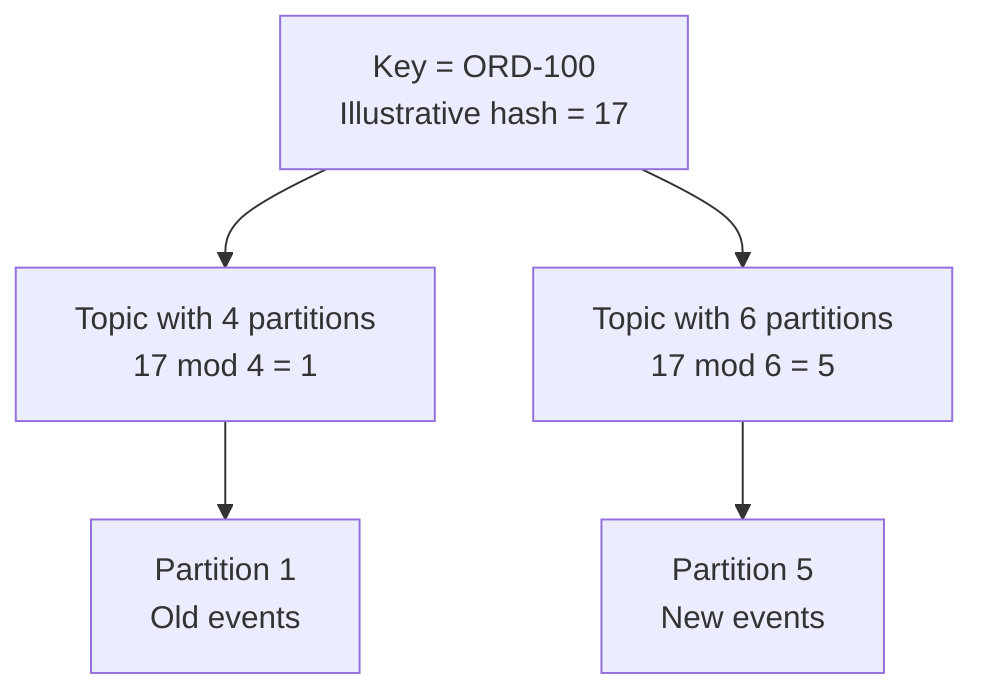

# How partition expansion affects routing

Increasing the partition count of a Kafka topic can expand parallel write and read capacity. However, this change also affects how producers route records by key. With the default partitioner, the partition is chosen based on the key's hash and the current partition count. When the partition count changes, the same key can be mapped to a different partition.

This deserves special attention if the application relies on per-entity event ordering, such as `OrderCreated`, `OrderPaid`, and `OrderCancelled` events for the same order. Old records remain in the original partition, while new records may enter a new partition. A consumer group can process the two partitions independently, so ordering between old and new events of the same key is no longer guaranteed.

## 1. Partitions determine record placement and parallelism

A topic is divided into partitions. Each partition is its own ordered log, stored and replicated across brokers by Kafka. Producers send records to a partition; consumer groups distribute partitions among consumer members.



Partitions serve three key roles:

- **Storage:** records are appended to a partition's log; offsets only have meaning within that partition.
- **Ordering:** Kafka preserves record order within a single partition. Kafka does not establish total order across multiple partitions.
- **Parallelism:** within the same consumer group, a partition is assigned to at most one consumer member at a time. The partition count bounds maximum group parallelism for that topic.

Adding partitions creates additional storage and parallel processing units. Yet it also alters an input to the routing algorithm, so evaluate both throughput and ordering before executing it.

## 2. How does a producer select a partition by key?

When sending a record, a producer determines the partition in one of these ways:

1. **Direct partition specification:** the application sends the record with an explicit partition number.
2. **Sending a key:** the partitioner chooses a partition based on the key; this is common when events of the same entity must stay in the same partition.
3. **No key:** the default partitioner typically uses sticky partitioning to group records into a partition over a send/batch window rather than guaranteeing stable per-entity routing.
4. **Custom partitioner:** the application supplies its own routing algorithm.

With Kafka's default partitioner and a non-null key, the partition is selected from the serialized key's hash and the current partition count. Conceptually:

\[
\text{partition} = \text{positiveHash}(\text{serializedKey}) \bmod N
\]

Where `N` is the topic's total partition count at the moment the producer routes the record. The exact algorithm depends on the Kafka client and configured partitioner; do not compute hashes manually in business code and assume it always matches every serializer/partitioner.

Example of a producer sending order events:

```java
kafkaTemplate.send("orders.events", event.orderId(), event);
```

`orderId` is the key. Events with the same key are typically routed to the same partition when partition count and partitioner configuration remain stable. Consumers read that partition's records in offset order.

If sending a record without a key:

```java
kafkaTemplate.send("orders.events", null, event);
```

Kafka has no entity identifier to maintain affinity. The default partitioner may select a partition using sticky/batching strategies; the application should not rely on this to keep events of the same order in sequence.

## 3. Increasing partitions changes key mapping

Suppose topic `orders.events` initially has four partitions. A key has an illustrative positive hash value of `17`:

\[
17 \bmod 4 = 1
\]

Records for that key are sent to partition 1. After expanding the topic to six partitions:

\[
17 \bmod 6 = 5
\]

That same key can now be routed to partition 5. This illustrates modulo arithmetic; the actual hash is determined by the Kafka client's serializer and partitioner.



Crucial point: Kafka only adds new partitions. It does not automatically move old records from partition 1 to partition 5. Consequently, history for the same key can split across two logs:

| Time | Partition count | Key | Chosen partition | Content |
| --- | ---: | --- | ---: | --- |
| Before expansion | 4 | `ORD-100` | 1 | `OrderCreated` |
| Before expansion | 4 | `ORD-100` | 1 | `OrderPaid` |
| After expansion | 6 | `ORD-100` | 5 | `OrderShipped` |

Consumers can read partition 5 before finishing partition 1, or vice versa. Kafka does not guarantee `OrderShipped` is always processed after `OrderPaid` simply because the producer sent it later. If business rules require per-order ordering, this change can break logic.

Not every key is guaranteed to change partitions after increasing the partition count. Some hashes may yield the same remainder under the new partition count; however, you cannot rely on that to preserve ordering across the entire keyspace.

## 4. Expansion does not redistribute old data

When partition count increases from `N` to `M` with `M > N`:

- Existing partitions remain intact with their existing data and offsets.
- Kafka creates additional partitions; new partitions initially contain no historical topic records.
- New records are routed by producers using current metadata and the active partitioner.
- Kafka does not automatically copy or repartition old records into the new partitions.
- Consumer groups using automatic subscriptions may rebalance to receive new assignments.

Producers need metadata about partition count to route records. Kafka clients refresh metadata using client mechanisms, so during a brief transition window some producer instances might not observe the updated metadata at the exact same instant. Let clients refresh metadata, monitor send errors, and verify actual partitions in record metadata; do not assume all producers switch to the new routing at one exact instant.

Example of a topic expanding from three to five partitions:

```text
Before expansion                After expansion
orders.events                   orders.events
  P0: old records                 P0: old records
  P1: old records                 P1: old records
  P2: old records                 P2: old records
                                  P3: new partition
                                  P4: new partition
```

Adding partitions does not rebalance existing stored data volume. If P0 already holds more data than P1 and P2, P3/P4 do not take over part of the old logs. They only receive new records if the partitioner routes records to them.

## 5. Impact on per-entity ordering

Kafka only guarantees ordering within a single partition. Many applications use keys like `orderId`, `customerId`, or `accountId` so events of the same entity enter the same partition.

Before expansion, suppose events for `ORD-100` all reside in P1:

```text
P1: OrderCreated -> OrderPaid -> OrderShipped
```

After expansion, the key may map to P4. Prior events remain in P1, while new events go to P4:

```text
P1: OrderCreated -> OrderPaid
P4: OrderShipped
```

The two partitions advance independently. Consumer groups have no built-in mechanism to merge these two logs into one `orderId` sequence. Thus, expansion can break the assumption that "the same key is always processed sequentially in one partition" for event chains spanning the change window.

### 5.1. Particularly order-sensitive scenarios

- **Order state:** `Created` must arrive before `Paid`, `Cancelled`, or `Shipped`.
- **Account balance:** debit/credit transactions for an `accountId` must be applied in order.
- **Inventory:** reserve, release, and ship events must maintain order per `sku` or warehouse.
- **Compacted topics:** multiple versions of the same key must land in the same partition for compaction to meaningfully retain the latest state per key.

For compacted topics, routing the same key across multiple partitions can leave each partition retaining its own final value. The log cleaner compacts per partition and does not deduplicate keys across partitions. Consequently, consumers may observe multiple surviving values for the same key.

### 5.2. Producer ordering still requires design

Even with a fixed partition count, having the same key in the same partition is not always sufficient to guarantee business order. Applications must account for:

- Multiple producer instances concurrently emitting events for the same entity.
- Multiple threads sending events calling `send()` in a different order than business order.
- Consumers offloading work to executors and completing tasks out of receipt order.
- Retries and error handlers causing a record to be reprocessed before progress continues.

When order matters, combine stable keys, ordered producer emission, sequential per-partition processing, and consumer idempotency.

## 6. Impact on consumer groups, assignments, and offsets

When a topic gains partitions, consumer groups subscribed via `subscribe()` detect updated metadata and may rebalance to distribute the new partitions among members. Some members may receive additional partitions; if partition count grows enough, the group can utilize previously idle consumer members.

Active parallel consumers in a group are bounded by assignable partitions. For example:

| Partition count | Consumer members | Max members with partitions |
| ---: | ---: | ---: |
| 3 | 2 | 2 |
| 3 | 5 | 3 |
| 6 | 5 | 5 |
| 6 | 8 | 6 |

After expansion, the group can raise parallelism, though actual gains depend on workload and target systems. If a database only tolerates two workers, raising partitions and concurrency to 20 may just increase load and contention.

### 6.1. New partitions and initial offsets

Offsets are tracked per group and partition. New partitions have no previously committed offsets from the group. When a consumer group receives a new partition assignment, `auto.offset.reset` applies if the group lacks a valid offset for that partition:

- `earliest`: starts from the earliest record still present in the new partition.
- `latest`: starts from the end of the new partition's log, receiving records written afterward.
- `none`: throws an error if no valid offset exists.

Since a new partition typically starts empty, `earliest` and `latest` initially point to the same position. Still, understand this policy if the consumer group may be created before producers write to the new partition or if the topic expands while running.

### 6.2. Consumers using manual assign()

Consumers using `subscribe()` participate in group management and receive automatic partition assignments from Kafka. Consumers using `assign()` specify partitions manually; they do not participate in automatic partition assignment in that way. When a topic expands partitions, applications using manual assignment must update their assignment list.

If a Spring Kafka listener uses `topicPartitions` to target specific partitions, inspect the listener configuration during topic expansion. Listeners are not guaranteed to automatically pick up new partitions when partition lists are declared statically.

## 7. Expanding partitions with Kafka CLI

You can increase partitions of an existing topic via `kafka-topics.sh`:

```bash
kafka-topics.sh \
  --bootstrap-server localhost:9092 \
  --alter \
  --topic orders.events \
  --partitions 12
```

This command sets the topic to 12 total partitions after the change, rather than adding 12 more partitions. If the topic currently has 6 partitions, it expands to 12; if it already has 12, nothing changes. Kafka allows increasing partitions, but does not support reducing an existing topic's partition count via normal alter operations.

Before and after the change, inspect metadata:

```bash
kafka-topics.sh \
  --bootstrap-server localhost:9092 \
  --describe \
  --topic orders.events
```

Inspect partition count, leaders, and replica assignments. Expanding partitions does not automatically guarantee optimal load distribution or replica placement across the cluster; monitor broker load afterward.

## 8. Expanding partitions with AdminClient

In Java, you can call the Kafka Admin API to increase partitions. `NewPartitions.increaseTo(12)` specifies the target total partition count:

```java
import java.util.Map;
import java.util.Properties;
import java.util.concurrent.TimeUnit;

import org.apache.kafka.clients.admin.AdminClient;
import org.apache.kafka.clients.admin.NewPartitions;

public class TopicPartitionManager {

    public void increaseOrdersTopicPartitions() throws Exception {
        Properties properties = new Properties();
        properties.put("bootstrap.servers", "localhost:9092");

        try (AdminClient admin = AdminClient.create(properties)) {
            admin.createPartitions(Map.of(
                    "orders.events", NewPartitions.increaseTo(12)
            )).all().get(10, TimeUnit.SECONDS);
        }
    }
}
```

In production, obtain bootstrap servers and security settings from environment configuration rather than hardcoding them in source code. The principal running `AdminClient` requires authorization to alter topic metadata/partitions. Because expanding partitions is an infrastructure change affecting routing, execute it through a controlled provisioning workflow.

`NewPartitions.increaseTo(12)` sets the resulting total partition count. If the topic already has more than 12 partitions, the operation fails; this API cannot reduce partitions.

## 9. Declaring partition counts when creating topics with Spring Kafka

When creating a new topic, declare the partition count using `NewTopic`:

```java
import org.springframework.context.annotation.Bean;
import org.springframework.context.annotation.Configuration;
import org.apache.kafka.clients.admin.NewTopic;
import org.springframework.kafka.config.TopicBuilder;

@Configuration
public class TopicConfiguration {

    @Bean
    NewTopic ordersTopic() {
        return TopicBuilder.name("orders.events")
                .partitions(12)
                .replicas(3)
                .build();
    }
}
```

`partitions(12)` specifies the desired partition count when provisioning a new topic. If the topic already exists, verify `KafkaAdmin` behavior in your Spring Kafka version; when actively increasing partitions on an existing topic, you can invoke `AdminClient.createPartitions()` as shown in the previous section. Do not treat changing the bean value as proof that the broker's partition count changed.

Do not let multiple services independently manage the partition count of one topic without clear conventions. Establish a single owner for topic administration and verify broker state after each provisioning step.

## 10. Custom partitioners and stable routing

If the default algorithm does not satisfy routing needs, producers can use a custom partitioner. A custom partitioner receives topic metadata, key/value, and available partitions to pick a partition.

A simple idea is maintaining a stable mapping from entity ID to partition. However, if the mapping uses modulo against the current partition count, keys can still remap when partition count changes. A custom partitioner does not automatically solve ordering; the algorithm must be designed alongside a scaling strategy.

Some options:

- **Retain old mappings for existing entities:** store or compute mappings against a fixed partition set. This preserves order, though those entities cannot utilize new partitions.
- **Consistent hashing or virtual buckets:** reduces the number of keys remapped when the partition set changes. Requires managing mappings and controlled bucket handovers; does not guarantee zero keys change partitions.
- **Explicit partition:** the application chooses the partition in `ProducerRecord`. Requires centralized mapping management and every producer following the exact same rule.
- **Version/sequence inside events:** consumers validate per-entity sequences, detect out-of-order arrivals, and buffer/reconcile when needed. This adds out-of-order detection and handling at the cost of extra complexity.

Example of specifying the partition directly with `KafkaTemplate`:

```java
// Explicitly send the event to partition 2.
kafkaTemplate.send("orders.events", 2, event.orderId(), event);
```

Specifying partitions explicitly can keep mappings stable, yet easily creates hot partitions if distribution is uneven. Ensure partition numbers are valid and all producers obey a single convention.

## 11. Strategies when partitions must expand while preserving ordering

If key-based ordering is mandatory, do not expand partitions directly without deciding how active keys will be handled. Several strategies exist:

### 11.1. Provision sufficient partitions upfront

This is usually the easiest approach to control. Estimate throughput, expected consumers, and growth over the topic's lifetime; create enough partitions from the beginning. You can run lower concurrency than the partition count and scale consumers gradually as load grows.

In return, extra partitions increase metadata, log segments, replication traffic, and management overhead even before full utilization.

### 11.2. Keep routing stable for existing keys

You can preserve mappings of existing entities to old partitions and route only new entities to new partitions. This keeps order for existing entities, while limiting their load to old partitions. A consistent rule across all producer instances is required to distinguish old vs. new entities.

If migrating an entity to a new partition, establish a clean handoff point: pause or fence old producers for that entity, wait for old records to process up to a defined mark, and then emit subsequent records to the new partition. If both partitions receive events for one entity during transition, ordering can break.

### 11.3. Create a new topic version and perform a controlled migration

When routing changes are unavoidable, create a new topic with more partitions, such as `orders.events.v2`. The migration process requires:

1. Finalizing the event schema and partitioning strategy for the new topic.
2. Defining how required historical data or snapshots will move.
3. Pausing or controlling producers to mark the final event boundary on the old topic.
4. Syncing history and ensuring new consumers know their starting point.
5. Switching producers to the new topic under a consistent cutover plan.
6. Monitoring consumer lag, duplicates, and ordering during the transition.
7. Decommissioning the old topic only after consumers and replay workflows no longer depend on it.

Simultaneous dual-writing to both topics can create out-of-order or missing events without transaction/outbox mechanisms and a clear cutover. Do not simply rename the topic in config and assume data transitioned safely.

### 11.4. Use sequence/version to protect business logic

If consumers might receive events from multiple partitions, events can carry a per-entity incrementing `aggregateVersion` or sequence:

```java
public record OrderEvent(
        String eventId,
        String orderId,
        long aggregateVersion,
        String eventType
) {}
```

The consumer persists the entity's current version and only applies the event with the next expected version. Early arrivals can be buffered or retried; events with lower versions may be duplicates and ignored under idempotency rules. This protects business state against out-of-order delivery, though it requires designing storage, timeouts, and missing-event handling.

## 12. Other factors to evaluate before expansion

### 12.1. Throughput and hot keys

Expanding partitions only increases throughput when load can distribute to new partitions. If most records use one hot key, records still concentrate on the same partition. You cannot split one key across multiple partitions while relying on simple partition ordering.

### 12.2. Consumer concurrency and downstream systems

New partitions may allow adding consumer members, yet databases, HTTP APIs, or downstream services can become bottlenecks. Raising partitions and concurrency together can spike concurrent requests beyond what target systems tolerate.

### 12.3. Replication and broker resources

Each partition has a leader and replicas. Adding partitions increases metadata, log segments, indexes, leader assignments, replication traffic, and recovery work. Monitor CPU, disk, network, open file descriptors, partitions per broker, and leader balance.

### 12.4. Consumer group rebalances

Consumer groups using `subscribe()` may rebalance when detecting new partitions. Rebalances temporarily alter assignments and can dip throughput. If deploying multiple replicas concurrently with expansion, coordinate rollout schedules to avoid overlapping membership changes.

### 12.5. Retention and compaction

New partitions have their own logs; retention and cleanup apply per partition. With `retention.bytes`, limits apply per partition, so total logical capacity can scale up with partition count. For compacted topics, keys must route stably to the same partition so compaction retains the true latest state per key.

## 13. Process for evaluating and executing partition expansion

Before increasing partitions, follow these steps:

1. **Identify the reason:** is the consumer group bottlenecked on parallelism, is a partition hot, is producer throughput limited, or is the bottleneck downstream?
2. **Measure current state:** per-partition throughput, key distribution, consumer lag, processing time, broker resources, and leader balance.
3. **Check ordering:** does the topic require key-based ordering? Are there compacted topics or consumers assuming one key stays in one partition?
4. **Assess routing:** identify the partitioner, key serializer, null keys, explicit partitions, and custom partitioners.
5. **Calculate remapping impact:** sample critical keys and compare before/after partition mappings against the planned partition count.
6. **Choose a strategy:** pre-create, preserve old mappings, migrate to a new topic, or accept controlled ordering shifts.
7. **Execute the change:** use a topic administration workflow with proper permissions; do not modify live without a business rollback plan.
8. **Verify:** describe the topic, check leader/replica assignments, group membership, partition mappings, and consumer lag.
9. **Monitor post-change:** watch key distribution, throughput, rebalances, duplicates, event ordering, and downstream load.

Partition expansion cannot be reversed by reducing the topic's partition count. If the outcome is unsuitable, the typical fallback is creating a new topic and migrating data according to plan rather than deleting newly added partitions to revert.

## 14. Common errors when expanding partitions

| Symptom | Common cause | Resolution |
| --- | --- | --- |
| Events with the same key appear in two partitions | Key was remapped due to changed partition count | Check partitioner and choose mapping preservation or migration strategy |
| Consumer processes events out of order | Old events in old partition, new events in new partition | Use sequence/version or controlled routing cutover |
| New partitions receive no records | Key distribution has not routed records there, or producer metadata is stale | Check producer metadata, key distribution, and partitioner |
| Partitions increased but throughput did not | Hot key, downstream bottleneck, or consumer concurrency unchanged | Measure per-partition load and target systems |
| Some consumers have no assignment | More consumer members than partitions | Adjust concurrency or evaluate partition count |
| Consumer group rebalances after expansion | Group detects new partitions and redistributes assignments | Monitor rebalances and ensure listeners tolerate pause/restart |
| Compacted topic retains multiple final values for the same key | Same key written to multiple partitions; compaction runs per partition | Keep key routing stable or migrate to a new topic |
| CLI reports partition cannot be altered | Requested partition count is less than or equal to current count, or missing permissions | Verify partition count and topic admin ACLs |

## 15. Self-check

1. Why can the same key be routed to a different partition after increasing the partition count?
2. Does Kafka automatically move old records to new partitions during expansion?
3. Why can key remapping break per-entity ordering?
4. How are `retention.bytes` and compacted topics affected when partition count increases?
5. If a consumer group has 10 members while the topic only has 6 partitions, at most how many members receive partitions?
6. Why does a hot key not automatically balance load just by adding partitions?
7. When should you preserve old mappings, and when should you create a new topic version?
8. If using `assign()` or Spring `topicPartitions`, what must be updated when the topic expands partitions?
9. Why is reducing partition count not a standard rollback operation?

Expanding partitions is a routing and ordering change, not merely a throughput tweak. Clearly identify which keys require ordering, which partitioner is used, and how consumers process events before making the change. Understanding remapping, assignments, offsets, and compaction allows you to pick the right scaling strategy without violating business assumptions.
