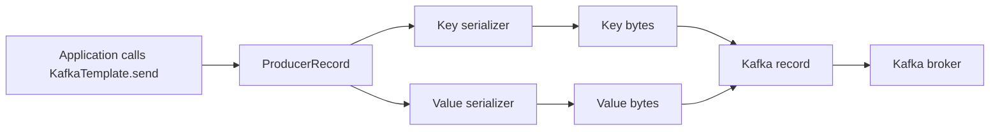

# Declaring a Value Serializer

Kafka stores the key and value of every record as bytes. On the producer side, the **value serializer** is responsible for converting the object sent by the application into a `byte[]` before the record is transmitted to the broker. In Spring Boot, this serializer is declared via `spring.kafka.producer.value-serializer`; in the Kafka Producer API, the corresponding property is `value.serializer`.

Choosing the right value serializer ensures the producer sends data in a format the consumer can decode. For example, `String` values can use `StringSerializer`, pre-encoded payloads can use `ByteArraySerializer`, and Java objects commonly use a JSON serializer or a schema-based serializer such as Avro. Producer and consumer must agree on byte format, schema, and data version management.

## 1. Where Does the Value Serializer Operate?

When the application calls `KafkaTemplate.send(...)`, Spring Kafka delegates the request to the Kafka producer. The producer uses the key serializer to encode the key and the value serializer to encode the payload. The resulting bytes are written into the record sent to the partition.



`value-serializer` is responsible solely for encoding the value portion. It does not select the topic, determine the consumer group, or commit offsets. Partition selection typically depends on the key and partitioner; the value serializer does not replace the key serializer.

In the Kafka Java client, serializers implement the `org.apache.kafka.common.serialization.Serializer<T>` interface:

```java
public interface Serializer<T> {
    byte[] serialize(String topic, T data);
}
```

The actual interface also includes lifecycle methods such as `configure(...)` and `close()` with default implementations in modern Kafka clients. During serialization, the serializer receives the topic name and value object, returning a byte array. If the value is `null`, standard serializers return `null` so the producer creates a record with a `null` value.

## 2. Declaring the Value Serializer in Spring Boot

Spring Boot maps `spring.kafka.producer.value-serializer` to the Kafka producer's serializer property. For example, an application sending event objects as JSON:

```yaml
spring:
  kafka:
    bootstrap-servers: localhost:9092
    producer:
      key-serializer: org.apache.kafka.common.serialization.StringSerializer
      value-serializer: org.springframework.kafka.support.serializer.JsonSerializer
```

In this configuration:

- `StringSerializer` converts `String` keys into bytes.
- Spring Kafka's `JsonSerializer` converts object values into JSON bytes.
- `bootstrap-servers` provides the broker address for the producer to connect to.

Example payload:

```java
import java.math.BigDecimal;
import java.time.Instant;

public record OrderCreatedEvent(
        String eventId,
        String orderId,
        Instant occurredAt,
        BigDecimal total
) {}
```

The publisher can send the object directly:

```java
import org.springframework.kafka.core.KafkaTemplate;
import org.springframework.stereotype.Service;

@Service
public class OrderEventPublisher {

    private final KafkaTemplate<String, OrderCreatedEvent> kafkaTemplate;

    public OrderEventPublisher(
            KafkaTemplate<String, OrderCreatedEvent> kafkaTemplate) {
        this.kafkaTemplate = kafkaTemplate;
    }

    public void publish(OrderCreatedEvent event) {
        kafkaTemplate.send("orders.events", event.orderId(), event);
    }
}
```

`KafkaTemplate<String, OrderCreatedEvent>` expresses the key/value types at the Java level. Generic types improve readability and provide compile-time checking; the runtime serializer is chosen by the producer factory configuration. Declaring generics does not automatically turn an object into JSON if the producer is not configured with a JSON serializer.

## 3. Choosing a Serializer by Value Type

Each serializer fits a different payload type and data contract:

| Value in application | Serializer | Sent data |
|---|---|---|
| `String` | `org.apache.kafka.common.serialization.StringSerializer` | String bytes using the serializer's supported encoding (UTF-8 by default). |
| `byte[]` | `org.apache.kafka.common.serialization.ByteArraySerializer` | Pre-built byte array produced by the application. |
| Java object/DTO/Java `record` | `org.springframework.kafka.support.serializer.JsonSerializer` | JSON bytes, optionally with Spring Kafka type headers. |
| Avro object or `GenericRecord` | `io.confluent.kafka.serializers.KafkaAvroSerializer` (Confluent) | Avro binary per serializer schema mechanism and Schema Registry. |
| Custom format | Custom implementation of `Serializer<T>` | Bytes following a system-defined wire format. |

No single serializer is best for every system. Choose based on readability, performance, schema evolution, cross-language compatibility, and supporting infrastructure.

### StringSerializer

Use `StringSerializer` when the value is a simple string, such as a status code or plain text:

```yaml
spring:
  kafka:
    producer:
      value-serializer: org.apache.kafka.common.serialization.StringSerializer
```

Send example:

```java
kafkaTemplate.send("system.notifications", "maintenance-started");
```

This serializer does not automatically convert arbitrary objects into JSON. If the value is `OrderCreatedEvent`, `StringSerializer` cannot be used directly unless the application explicitly converts the object into a string beforehand and declares the template with the matching value type.

### ByteArraySerializer

Use `ByteArraySerializer` when the application already produced a byte array via another encoding library or when the payload is already in a specific binary format:

```yaml
spring:
  kafka:
    producer:
      value-serializer: org.apache.kafka.common.serialization.ByteArraySerializer
```

Example:

```java
byte[] payload = objectMapper.writeValueAsBytes(event);
kafkaTemplate.send("orders.events.raw", event.orderId(), payload);
```

Here, JSON is produced by `ObjectMapper`, not `ByteArraySerializer`. The serializer simply forwards the byte array to the Kafka producer. The consumer must know the exact byte format that was generated.

### Spring Kafka's JsonSerializer

For DTOs or Java `record`s, `JsonSerializer` is often a straightforward option in Spring applications. It uses Jackson to convert objects into JSON bytes:

```yaml
spring:
  kafka:
    producer:
      value-serializer: org.springframework.kafka.support.serializer.JsonSerializer
```

Spring Kafka's `JsonSerializer` can add type information to Kafka headers to help consumers determine the target type. To keep the JSON contract independent of Java class names or polyglot consumers, you can disable type headers:

```yaml
spring:
  kafka:
    producer:
      properties:
        spring.json.add.type.headers: false
```

When type headers are disabled, the consumer must know the target type via configuration or a separate schema mechanism. For example, Spring Kafka's `JsonDeserializer` can be configured with an appropriate default value type. Do not disable type headers without agreeing on how consumers determine the schema or data type.

JSON is readable and convenient for integration, but field changes require careful management. Avoid renaming fields, changing data types, or deleting fields still used by older consumers without a compatibility plan. Design dedicated event DTOs instead of directly serializing persistence entities that may change alongside database schemas.

### Avro Serializer and Schema Registry

In multi-service or polyglot systems, Avro combined with Schema Registry lets producers and consumers share versioned schemas. When using Confluent Platform, the serializer dependency must be added to the project and its repository/version must match your deployment ecosystem.

Example configuration:

```yaml
spring:
  kafka:
    producer:
      value-serializer: io.confluent.kafka.serializers.KafkaAvroSerializer
      properties:
        schema.registry.url: http://localhost:8081
```

This serializer is not part of Spring Kafka core. The application needs the corresponding Confluent dependency and an available Schema Registry. Consumers must use a compatible Avro deserializer and matching schema access rules. Registry compatibility policies should match how producers and consumers are deployed, such as backward or full compatibility.

## 4. Configuring the Serializer in Java

If you are not using Spring Boot or need to construct a producer factory manually, you can declare the serializer via Kafka producer properties:

```java
import java.util.HashMap;
import java.util.Map;

import org.apache.kafka.clients.producer.ProducerConfig;
import org.apache.kafka.common.serialization.StringSerializer;
import org.springframework.context.annotation.Bean;
import org.springframework.context.annotation.Configuration;
import org.springframework.kafka.core.DefaultKafkaProducerFactory;
import org.springframework.kafka.core.KafkaTemplate;
import org.springframework.kafka.core.ProducerFactory;
import org.springframework.kafka.support.serializer.JsonSerializer;

@Configuration
public class KafkaProducerConfiguration {

    @Bean
    ProducerFactory<String, OrderCreatedEvent> orderProducerFactory() {
        Map<String, Object> properties = new HashMap<>();
        properties.put(ProducerConfig.BOOTSTRAP_SERVERS_CONFIG, "localhost:9092");
        properties.put(ProducerConfig.KEY_SERIALIZER_CLASS_CONFIG, StringSerializer.class);
        properties.put(ProducerConfig.VALUE_SERIALIZER_CLASS_CONFIG, JsonSerializer.class);

        return new DefaultKafkaProducerFactory<>(properties);
    }

    @Bean
    KafkaTemplate<String, OrderCreatedEvent> orderKafkaTemplate(
            ProducerFactory<String, OrderCreatedEvent> orderProducerFactory) {
        return new KafkaTemplate<>(orderProducerFactory);
    }
}
```

In this configuration, `ProducerConfig.VALUE_SERIALIZER_CLASS_CONFIG` is the constant for the `value.serializer` property. `DefaultKafkaProducerFactory` creates the Kafka producer with the declared serializer. If using Spring Boot auto-configuration, `application.yml` is usually sufficient; manual producer factories and templates are unnecessary unless an isolated configuration is desired.

## 5. Implementing a Custom Value Serializer

When no built-in serializer fits the data format, you can implement `Serializer<T>`. Example of a minimal JSON serializer using Jackson:

```java
import com.fasterxml.jackson.core.JsonProcessingException;
import com.fasterxml.jackson.databind.ObjectMapper;
import com.fasterxml.jackson.datatype.jsr310.JavaTimeModule;
import org.apache.kafka.common.errors.SerializationException;
import org.apache.kafka.common.serialization.Serializer;

public class OrderEventSerializer implements Serializer<OrderCreatedEvent> {

    private final ObjectMapper objectMapper =
            new ObjectMapper().registerModule(new JavaTimeModule());

    @Override
    public byte[] serialize(String topic, OrderCreatedEvent event) {
        if (event == null) {
            return null;
        }

        try {
            return objectMapper.writeValueAsBytes(event);
        }
        catch (JsonProcessingException exception) {
            throw new SerializationException(
                    "Unable to serialize OrderCreatedEvent for topic " + topic,
                    exception
            );
        }
    }
}
```

Registering the custom serializer:

```yaml
spring:
  kafka:
    producer:
      value-serializer: com.example.kafka.OrderEventSerializer
```

When writing a custom serializer, pay attention to:

- Handling `null` per convention; do not turn a `null` value into the string `"null"` if the topic requires tombstones.
- Returning bytes conforming to a documented wire format so consumers can decode them.
- Throwing a `SerializationException` with a clear cause when payload conversion fails.
- Avoiding unsynchronized shared mutable state. Producers may invoke serializers from send threads; the serializer should be safe under Kafka client lifecycle management.
- Closing resources inside `close()` if the serializer opens dedicated resources.

When using Jackson, configure `ObjectMapper` consistently with the event schema. In Spring applications, if you need Boot's customized Jackson modules, consider the built-in serializer or construct a serializer with an explicitly configured mapper rather than creating a bare default mapper as in the minimal example above.

## 6. Null Values and Tombstone Records

Kafka allows records with a non-`null` key and a `null` value. On a topic with `cleanup.policy=compact`, this record is called a **tombstone** and indicates deletion of the key's current state.

Example of sending a tombstone with `KafkaTemplate`:

```java
kafkaTemplate.send("customer-state", customerId, null);
```

The value serializer must preserve `null` semantics. Standard Kafka/Spring serializers handle `null` values according to convention. Custom serializers should return `null` when `data` is `null`.

Distinguish three cases:

| Application value | Meaning in Kafka |
|---|---|
| Java `null` | `null` value; can act as a tombstone when key is non-null and topic is compacted. |
| String `"null"` | Value consists of the character bytes for `null`, not a tombstone. |
| JSON document `null` serialized to bytes | JSON payload representing `null`; not equivalent to a Kafka `null` value if the serializer produces a byte array. |

If a compacted topic uses tombstones to delete state, specifically test the `null`-sending branch and ensure consumers recognize `null` values to delete corresponding data.

## 7. Value Serializers Must Be Compatible with Consumers

A serializer only encodes data on the producer side. The consumer needs a matching deserializer to turn bytes back into the data type the application processes.

| Producer value serializer | Matching consumer value deserializer |
|---|---|
| `StringSerializer` | `StringDeserializer` |
| `ByteArraySerializer` | `ByteArrayDeserializer` |
| Spring Kafka `JsonSerializer` | Spring Kafka `JsonDeserializer` or compatible JSON converter |
| Confluent `KafkaAvroSerializer` | Confluent `KafkaAvroDeserializer` |
| Custom serializer | Custom deserializer understanding the same wire format |

Example JSON consumer in Spring Boot:

```yaml
spring:
  kafka:
    consumer:
      key-deserializer: org.apache.kafka.common.serialization.StringDeserializer
      value-deserializer: org.springframework.kafka.support.serializer.JsonDeserializer
      properties:
        spring.json.value.default.type: com.example.orders.OrderCreatedEvent
        spring.json.trusted.packages: com.example.orders
```

This is an illustrative configuration for a consumer using a default type. If the producer sends type headers, the consumer can use that information per deserializer configuration; if type headers are disabled, declare a target type or another schema mechanism. Trust only the necessary packages instead of widening trusted packages arbitrarily.

Both sides must agree on:

- Byte format and encoding.
- Field names, data types, and null rules.
- Type headers or schema IDs if used.
- Compatibility rules when adding, changing, or removing fields.
- Producer and consumer deployment strategy when old and new versions coexist.

Never assume that both sides using JSON is enough to guarantee compatibility. Changing a JSON field from a number to a string can still break decoding on older consumers.

## 8. Common Errors When Declaring a Value Serializer

| Symptom | Cause | Resolution |
|---|---|---|
| `SerializationException` on send | Serializer does not support actual value type or data cannot be converted. | Check generic types, payload, and declared serializer. |
| `ClassCastException` or type error during serialization | `KafkaTemplate`/producer factory type mismatches actual object. | Align key/value types across template, factory, and `send` calls. |
| Consumer reports deserialization error | Consumer uses a deserializer incompatible with the producer's format. | Pick a compatible serializer/deserializer pair and inspect schema. |
| Consumer cannot resolve JSON type | Type headers disabled or mismatched, consumer lacks default type. | Configure type mapping/default type or use a schema registry. |
| Using `StringSerializer` for DTOs | Serializer only accepts strings and does not auto-serialize Java objects. | Use `JsonSerializer`, a schema serializer, or convert objects to strings intentionally. |
| Tombstones do not work | Application sends `"null"` string or custom serializer produces bytes for `null`. | Send Java `null` as value with a valid key. |
| Avro serializer fails to start | Missing dependency, Schema Registry URL, or auth config. | Verify Confluent libraries and environment-specific Registry configuration. |
| Schema change breaks older consumers | Field change incompatible with running consumers. | Apply schema evolution and run compatibility checks before deployment. |

Serialization errors can be thrown synchronously inside the `send()` call before the record ever reaches the broker. Therefore, in addition to observing futures/callbacks, handle synchronous exceptions at the producer call site and log appropriate payload/topic metadata without exposing sensitive data.

## 9. Testing Value Serializers

Unit tests should verify that the serializer produces the expected byte format and handles `null` per convention. Example with a custom serializer:

```java
import static org.assertj.core.api.Assertions.assertThat;

import java.math.BigDecimal;
import java.time.Instant;
import java.nio.charset.StandardCharsets;
import org.junit.jupiter.api.Test;

class OrderEventSerializerTest {

    private final OrderEventSerializer serializer = new OrderEventSerializer();

    @Test
    void serializesEventAsJson() {
        OrderCreatedEvent event = new OrderCreatedEvent(
                "E100", "O100", Instant.parse("2026-01-01T10:00:00Z"),
                new BigDecimal("125.50")
        );

        byte[] bytes = serializer.serialize("orders.events", event);
        String json = new String(bytes, StandardCharsets.UTF_8);

        assertThat(json).contains("\"eventId\":\"E100\"");
        assertThat(json).contains("\"orderId\":\"O100\"");
    }

    @Test
    void preservesNullValue() {
        assertThat(serializer.serialize("customer-state", null)).isNull();
    }
}
```

In a complete test suite, add round-trip tests: serialize the event and deserialize it with the consumer's deserializer, then compare key fields. For JSON/Avro, maintain fixtures of older schemas or payloads to test upgrade compatibility.

## 10. Takeaways

- A value serializer converts value objects into bytes before the producer sends records to Kafka.
- Spring Boot uses `spring.kafka.producer.value-serializer`; the Kafka client uses `value.serializer`.
- Choose `StringSerializer`, `ByteArraySerializer`, `JsonSerializer`, an Avro serializer, or a custom serializer based on data type and wire format contract.
- `KafkaTemplate<K, V>` generics do not pick the serializer; the producer factory must be configured accordingly.
- Producer and consumer must use compatible serializer/deserializer pairs and agree on schemas, encoding, and `null` semantics.
- JSON type headers can assist with type resolution; if disabled, consumers need a default type or another schema contract.
- A `null` value with a key on a compacted topic can be a tombstone; custom serializers must preserve `null`.
- Test serialize/deserialize round-trips and schema compatibility before deploying changes.

When declaring a value serializer, start from the payload type and how consumers will read that data. Select the matching serializer, configure it in `application.yml` or the producer factory, align the wire format with consumers, and test normal payloads as well as `null` and older schemas. This forms the foundation for producers to send data that other services can decode reliably.

## References

- [Apache Kafka — Serializer API](https://kafka.apache.org/40/javadoc/org/apache/kafka/common/serialization/Serializer.html)
- [Apache Kafka — Producer Configurations](https://kafka.apache.org/documentation/#producerconfigs)
- [Spring for Apache Kafka — Serialization, Deserialization, and Message Conversion](https://docs.spring.io/spring-kafka/reference/kafka/serdes.html)
- [Spring Boot — Kafka Properties](https://docs.spring.io/spring-boot/appendix/application-properties/index.html#application-properties.integration.spring.kafka.producer.value-serializer)
- [Confluent — Kafka Avro Serializer and Deserializer](https://docs.confluent.io/platform/current/schema-registry/fundamentals/serdes-develop/serdes-avro.html)
