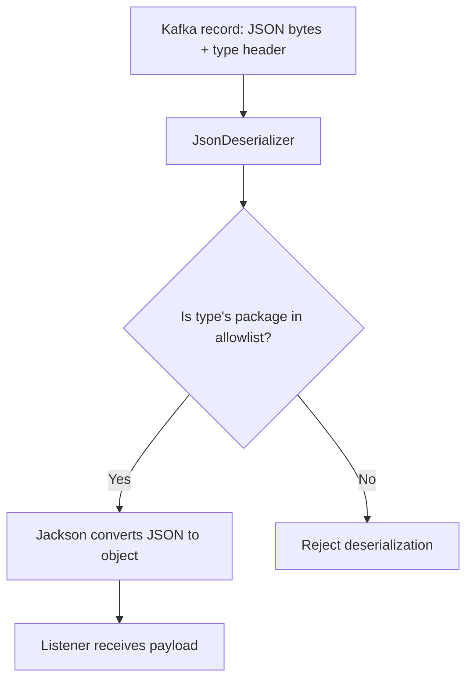

# Trusted Packages in JSON Deserialization

Spring Kafka provides `JsonDeserializer` to convert JSON inside Kafka records into Java objects. When a serializer sends type headers, the deserializer can use the class name in the header to determine which object type to instantiate. Because type headers originate from the record, the consumer must restrict which packages are permitted as target types.

`spring.json.trusted.packages` is the package allowlist for `JsonDeserializer`. This setting prevents records from requesting deserialization into classes outside the packages trusted by the application. Declare the packages containing the event DTOs that the consumer actually uses; avoid opening everything with `*` in production.

## 1. Why Does the JSON Deserializer Need Trusted Packages?

Kafka stores keys and values as bytes. Producers serialize objects into JSON, send the bytes in a record, and may attach metadata describing the Java type. By default, Spring Kafka's `JsonSerializer` can write type information into Kafka headers, for example:

| Header | Purpose |
|---|---|
| `__TypeId__` | Primary type of the serialized object |
| `__ContentTypeId__` | Element type inside a container or collection type |
| `__KeyTypeId__` | Map key type when the serialized value has a map structure |

When `JsonDeserializer` reads a record, it can use the type header to look up the Java class to instantiate. Without package restrictions, a record from an untrusted source could instruct the consumer to instantiate classes outside the intended event model.

Trusted packages limit the scope of classes that type metadata is allowed to reference. For example, a consumer only accepts event types in `com.acme.orders.events` and `com.acme.shared.events`.



The package allowlist is one layer of target-type control. It does not replace Kafka ACLs, producer authentication, schema checks, or business data validation.

## 2. Configuring Trusted Packages in application.yml

Consider an application receiving order events. The DTOs reside in two packages controlled by the application:

```text
com.acme.orders.events
  OrderCreated
  OrderCancelled

com.acme.shared.events
  EventMetadata
```

Declare the deserializer and allowlist in Spring Boot:

```yaml
spring:
  kafka:
    bootstrap-servers: ${KAFKA_BOOTSTRAP_SERVERS:localhost:9092}
    consumer:
      group-id: order-projection
      key-deserializer: org.apache.kafka.common.serialization.StringDeserializer
      value-deserializer: org.springframework.kafka.support.serializer.JsonDeserializer
      properties:
        spring.json.trusted.packages: com.acme.orders.events,com.acme.shared.events
        spring.json.value.default.type: com.acme.orders.events.OrderCreated
```

`spring.json.trusted.packages` accepts a comma-separated list of packages. With YAML, a string value like the one above is passed by Spring Boot into Kafka consumer properties for Spring Kafka to configure `JsonDeserializer`.

`spring.json.value.default.type` specifies the default value type when no matching type header is present or when the application uses a fixed-type strategy. If a record carries a type header and the consumer allows header usage, the type header can determine the actual class. The following sections distinguish these two cases.

The listener can receive the POJO directly:

```java
@Component
public class OrderListener {

    @KafkaListener(topics = "orders.created.v1")
    public void onOrderCreated(OrderCreated event) {
        // Handle the deserialized event.
    }
}
```

The listener parameter type must be compatible with the class instantiated by the deserializer. If the listener expects `OrderCreated` while the producer sends a type header pointing to a different class, configure type mappings or separate deserialization strategies explicitly.

## 3. Trust Only the Packages the Application Needs

An allowlist configuration should be specific and have clear ownership:

```yaml
spring:
  kafka:
    consumer:
      properties:
        spring.json.trusted.packages: com.acme.orders.events,com.acme.common.events
```

Select packages according to these principles:

- Include only packages containing event classes the consumer needs to deserialize.
- Prefer packages belonging to source code or internal libraries controlled by your organization.
- Avoid trusting overly broad root packages if they contain many classes unrelated to message contracts.
- When adding a new event type, update the allowlist intentionally and review the change alongside the schema.
- Use consistent package conventions and type mappings across producers and consumers when sharing event contracts.

In Spring Kafka, a trusted package may also cover subpackages according to the library's package-matching rules. Therefore, declaring a broad root package such as `com.acme` may grant a wider scope than a specific event package. Choose the narrowest root that satisfies your requirements.

Do not use `*` as a quick fix for `not in the trusted packages` errors. A wildcard opens the scope to every package and defeats class-level allowlist restrictions.

## 4. Trusted Packages and Type Headers

Spring Kafka's `JsonSerializer` typically adds type headers so `JsonDeserializer` knows the data type. When a consumer uses type headers, processing generally follows these steps:

1. The producer serializes the object to JSON.
2. The serializer adds type metadata to record headers.
3. The consumer reads the type header, such as `__TypeId__`.
4. `JsonDeserializer` resolves the corresponding class.
5. The deserializer checks whether the class's package is trusted.
6. If permitted, Jackson instantiates the object; otherwise, deserialization fails.

For example, a record has a header pointing to `com.acme.orders.events.OrderCreated`. If the allowlist includes `com.acme.orders.events`, the class can be accepted. If the header points to `com.external.unexpected.SomeType`, the deserializer rejects it because the package is not in the allowlist.

The error message typically reports that the class is not in the trusted packages. When you encounter this error, inspect the actual type header and the package class sent by the producer. Never work around it by adding `*` before identifying where the type header originated.

## 5. When Receiving Only One Fixed JSON Type

If a topic carries only one event type and the consumer always wants to deserialize into a fixed class, you can disable type header usage and set a default type:

```yaml
spring:
  kafka:
    consumer:
      value-deserializer: org.springframework.kafka.support.serializer.JsonDeserializer
      properties:
        spring.json.value.default.type: com.acme.orders.events.OrderCreated
        spring.json.trusted.packages: com.acme.orders.events
        spring.json.use.type.headers: false
```

With this configuration, the deserializer uses `OrderCreated` as the target value type and does not pick a class from type headers. This fits when the topic contract is fixed and the producer should not dictate the Java class on the consumer.

Disabling type headers does not mean skipping JSON deserialization. The consumer still deserializes JSON into the target class configured in the application. In this mode, the target class comes from local configuration rather than record type headers, so trusted-package checks mainly matter when the deserializer uses type metadata to select a class. If type headers are re-enabled later, ensure the allowlist is declared properly.

If a topic carries multiple event types, do not set a single default type and expect every payload to automatically convert to its respective class. Use type mapping or split topics/listeners by schema.

## 6. Using Type Mapping Instead of Full Class Names in Headers

Type mapping lets the serializer write a short alias instead of a fully qualified class name. The consumer maps the alias back to its local class. This reduces coupling to the Java packages of sending and receiving services.

Example with two events:

```java
package com.acme.orders.events;

public record OrderCreated(String eventId, String orderId) {
}
```

```java
package com.acme.orders.events;

public record OrderCancelled(String eventId, String orderId, String reason) {
}
```

Type mapping configuration for the consumer:

```yaml
spring:
  kafka:
    consumer:
      value-deserializer: org.springframework.kafka.support.serializer.JsonDeserializer
      properties:
        spring.json.trusted.packages: com.acme.orders.events
        spring.json.type.mapping: order-created:com.acme.orders.events.OrderCreated,order-cancelled:com.acme.orders.events.OrderCancelled
```

The producer can also configure the matching mapping to write aliases into headers:

```yaml
spring:
  kafka:
    producer:
      value-serializer: org.springframework.kafka.support.serializer.JsonSerializer
      properties:
        spring.json.type.mapping: order-created:com.acme.orders.events.OrderCreated,order-cancelled:com.acme.orders.events.OrderCancelled
```

The producer maps the class to an alias when writing headers; the consumer maps the alias to a class in the receiving application. Aliases must match between both sides. The consumer still requires trusted packages for the mapped classes.

In a multi-service architecture, both sides can use different Java packages while sharing the same contract. Each service declares aliases mapped to its own local classes. Consumers do not need the same package names as producers when type mappings are properly defined.

## 7. Configuring via Java ConsumerFactory

If the application does not use Spring Boot auto-configuration or needs a custom `ConsumerFactory`, you can set trusted packages directly in consumer properties:

```java
@Configuration
public class KafkaConsumerConfiguration {

    @Bean
    public ConsumerFactory<String, OrderCreated> consumerFactory() {
        Map<String, Object> properties = new HashMap<>();
        properties.put(ConsumerConfig.BOOTSTRAP_SERVERS_CONFIG, "localhost:9092");
        properties.put(ConsumerConfig.GROUP_ID_CONFIG, "order-projection");
        properties.put(
                ConsumerConfig.KEY_DESERIALIZER_CLASS_CONFIG,
                StringDeserializer.class);
        properties.put(
                ConsumerConfig.VALUE_DESERIALIZER_CLASS_CONFIG,
                JsonDeserializer.class);
        properties.put(
                JsonDeserializer.VALUE_DEFAULT_TYPE,
                OrderCreated.class.getName());
        properties.put(
                JsonDeserializer.TRUSTED_PACKAGES,
                "com.acme.orders.events,com.acme.shared.events");
        properties.put(JsonDeserializer.USE_TYPE_INFO_HEADERS, false);

        return new DefaultKafkaConsumerFactory<>(properties);
    }
}
```

The constants `JsonDeserializer.VALUE_DEFAULT_TYPE`, `TRUSTED_PACKAGES`, and `USE_TYPE_INFO_HEADERS` help prevent property-name typos. Import the appropriate Kafka/Spring Kafka classes and use a Spring Kafka version that supports these constants.

When configuring via `JsonDeserializer` constructors or setters, avoid mixing inconsistent configuration styles. Some constructors/fluent APIs mark the deserializer as directly configured; in that case, property maps may not apply as expected. Choose one clear configuration style and test the actual consumer.

## 8. Trusted Packages When the Key Is Also JSON

Kafka record keys and values can use different deserializers. If the key is also a JSON object processed by Spring Kafka's `JsonDeserializer`, configure the default key type with `spring.json.key.default.type`. The package allowlist is still configured via `spring.json.trusted.packages` for `JsonDeserializer`.

Example configuring key and value as two distinct object types:

```yaml
spring:
  kafka:
    consumer:
      key-deserializer: org.springframework.kafka.support.serializer.JsonDeserializer
      value-deserializer: org.springframework.kafka.support.serializer.JsonDeserializer
      properties:
        spring.json.key.default.type: com.acme.orders.keys.OrderKey
        spring.json.value.default.type: com.acme.orders.events.OrderCreated
        spring.json.trusted.packages: com.acme.orders.keys,com.acme.orders.events,com.acme.shared.events
```

`spring.json.key.default.type` specifies the default key type; `spring.json.value.default.type` specifies the default value type. `spring.json.trusted.packages` is the allowlist property of `JsonDeserializer`, so include the packages required for all JSON deserializers in use. If the key uses `StringDeserializer`, no key-specific package needs to be added.

Configure keys as JSON objects only when explicitly required. String keys are usually easier to inspect, work well with partitioners, and integrate with a wider range of Kafka tools.

## 9. Organizing Safe and Stable Event Packages

Do not couple event contracts to internal service implementation packages. A manageable structure might look like:

```text
com.acme
  shared
    events
      EventMetadata.java
  orders
    events
      OrderCreated.java
      OrderCancelled.java
  billing
    application
    infrastructure
```

Classes under `events` represent the exchange contract between producer and consumer. Packages like `application` or `infrastructure` hold internal implementation details and should not be trusted solely to deserialize an event.

When multiple services share an event contract library, manage library versions and schema compatibility explicitly. Trusted packages should reflect only the permitted contract packages, not the entire namespace of every dependency on the classpath.

Type mapping aliases decouple type names in Kafka headers from implementation packages. Even with aliases, the consumer must still resolve a valid target class and trust the package containing that class.

## 10. Trusted Packages Do Not Replace Validation

A class belonging to a trusted package only means type headers are allowed to reference that class. It does not prove the payload is valid in business terms.

After deserialization, the application must still verify:

- Required fields exist and carry valid values.
- `eventId`, aggregate ID, and timestamps follow valid formats.
- Enum or status values belong to supported sets.
- The schema version is compatible with the consumer.
- Payload and collection sizes stay within allowed bounds.
- The event is valid given the current business state.

For instance, a DTO can deserialize cleanly even with a blank `orderId` or negative `amount`. Those constraints must be checked via Bean Validation or domain logic after conversion.

Do not treat trusted packages as an authorization mechanism. Producers still require authentication and ACLs to write to topics; consumers still require ACLs to read topics and groups. The allowlist only restricts target packages when `JsonDeserializer` interprets type metadata.

## 11. Risks of Wildcards or Overly Broad Packages

Example configuration to avoid using casually:

```yaml
spring:
  kafka:
    consumer:
      properties:
        spring.json.trusted.packages: "*"
```

A wildcard permits type metadata to point to classes in any package loadable by the application. This removes the package restriction layer and increases risk exposure when records arrive from untrusted producers or topics writable by unexpected principals.

Preferred options:

| Configuration | Assessment |
|---|---|
| `com.acme.orders.events` | Narrow scope, appropriate if only order events are expected |
| `com.acme.shared.events,com.acme.orders.events` | Explicitly permits two required contract groups |
| `com.acme` | Broader, may include many unnecessary subpackages |
| `*` | Trusts every package; avoid in production |

Never add a package just to push a failing message through. Inspect which type header the producer sent, whether that event belongs to a supported contract, and whether the topic contains unexpected payload types.

## 12. When Producers Do Not Send Type Headers

Non-Spring Kafka producers or serializers without type metadata may emit plain JSON lacking `__TypeId__`. In that case, the consumer needs to know the target type via a default type or a deserializer configured with a fixed target type.

Example for a topic carrying only `OrderCreated`:

```yaml
spring:
  kafka:
    consumer:
      value-deserializer: org.springframework.kafka.support.serializer.JsonDeserializer
      properties:
        spring.json.value.default.type: com.acme.orders.events.OrderCreated
        spring.json.use.type.headers: false
        spring.json.trusted.packages: com.acme.orders.events
```

If a topic carries multiple schemas without type headers, a different strategy is needed to distinguish types, such as:

- Dedicating each topic to one event type with listeners using their own default type.
- Including a discriminator field like `eventType` in the payload and routing via a custom deserializer/converter.
- Using a schema registry or a serialization format with schema IDs.

Do not guess object types solely from topic names if a topic can contain multiple record types or undergo incompatible schema changes.

## 13. Common Errors When Configuring Trusted Packages

**`not in the trusted packages` error:** the type header points to a class outside the allowlist. Check the class name and add the proper package if it is a valid event contract.

**Package added yet error persists:** the consumer may be using a different `ConsumerFactory` or `JsonDeserializer`, a property may have the wrong prefix, or the type header may point to another package. Verify the active runtime configuration and factory used by the listener.

**Mixing up key/value properties:** `spring.json.key.default.type` sets the default key type; `JsonDeserializer`'s package allowlist is declared via `spring.json.trusted.packages`.

**Default type not used:** type headers still take precedence. If the topic has a fixed type, consider `spring.json.use.type.headers: false` alongside an explicit default type.

**Multiple event classes with only one default type declared:** split listeners/topics or use appropriate type mappings.

**Producer and consumer disagree on type mapping:** aliases fail to resolve to the expected class. Synchronize aliases across both sides and inspect actual headers.

**Using `*` to bypass errors:** the allowlist no longer restricts classes. Find the root cause of the type header rather than opening all packages.

**JSON deserializes fine but business logic fails:** trusted packages do not validate contents. Add DTO and domain validation.

**Event package changed after refactoring:** type headers carry old fully qualified class names that no longer resolve. Use stable type mappings or preserve compatibility during transitions.

## 14. Testing Trusted Packages

Tests should verify that classes inside the allowlist deserialize and classes outside the allowlist are rejected. You can test `JsonDeserializer` directly or run integration tests with a Kafka broker.

Example testing the deserializer with a fixed target type:

```java
JsonDeserializer<OrderCreated> deserializer =
        new JsonDeserializer<>(OrderCreated.class, false)
                .trustedPackages("com.acme.orders.events");

deserializer.configure(Map.of(), false);

OrderCreated event = deserializer.deserialize(
        "orders.created.v1",
        "{\"eventId\":\"evt-1\",\"orderId\":\"order-42\"}"
                .getBytes(StandardCharsets.UTF_8));

assertThat(event.orderId()).isEqualTo("order-42");
```

The constructor with `useHeadersIfPresent=false` illustrates deserializing to a fixed target type without reading the class from type headers. Constructor/fluent APIs may vary across Spring Kafka versions; use signatures compatible with your project's dependency.

For type header tests, construct a `__TypeId__` header pointing to a class in an allowed package and another pointing to a disallowed package. Verify the former succeeds and the latter raises a deserialization error. Do not merely check that the property exists in YAML; verify the actual deserializer receives the expected configuration.

Cases to include:

- Packages in the allowlist are accepted.
- Packages outside the allowlist are rejected.
- Missing type headers with properly configured default types succeed.
- `use.type.headers=false` keeps the consumer on the fixed target type.
- Type mapping aliases resolve to the right classes.
- Malformed JSON or missing business fields are handled via appropriate error handling/validation.
- When both key and value are JSON objects, the allowlist covers valid packages for both types.

## 15. Production Checklist

- `JsonDeserializer` is used only where JSON needs to be deserialized into Java objects.
- `spring.json.trusted.packages` contains only event packages controlled by the application.
- Wildcard `*` is not used in production without an explicit risk assessment.
- It is clear whether the consumer uses type headers or a fixed default type.
- When using multiple event types, type mappings are defined and synchronized between producer and consumer.
- If the key is also a JSON object, `spring.json.key.default.type` is configured and key packages are included in `spring.json.trusted.packages`.
- Contract packages are stable and do not depend on internal producer implementation classes.
- Producers and consumers are protected by appropriate authentication and ACLs.
- Payloads are validated after deserialization; the allowlist does not replace validation.
- Tests cover valid packages, invalid packages, type headers, and default types.
- Deserialization errors are monitored with topic/partition/offset recorded for investigation without logging sensitive data.

Trusted packages restrict which packages `JsonDeserializer` is allowed to use when turning type metadata into Java classes. Keep the allowlist narrow, apply default types or type mappings per contract, and validate payloads after deserialization. Combining these practices with Kafka ACLs, schema compatibility, and business validation makes JSON messaging flows far easier to govern.
