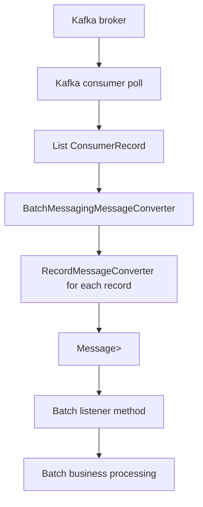

# BatchMessagingMessageConverter

In Spring Kafka, a consumer can receive multiple records in a single `poll()`. If the listener is configured in batch mode, Spring Kafka converts that list of records into a Spring `Message` containing a list of payloads so the method can process the entire batch of data.

**BatchMessagingMessageConverter** is the converter designed for this flow. It converts each record in the batch, then collects the payloads and corresponding metadata so the listener receives `List<T>` or `Message<List<T>>`.

This converter belongs on the consumer side. It is not a producer serializer, does not combine a batch of records into a single JSON array on Kafka, and does not decide how the Kafka client groups network requests into batches.

## 1. Batch listeners and message converters

With a record listener, each method invocation typically processes one record:

```java
@KafkaListener(topics = "order-events")
public void listen(OrderCreated event) {
    orderService.process(event);
}
```

With a batch listener, the container takes multiple records from a single poll and invokes the method once with a list of payloads:

```java
@KafkaListener(
    topics = "order-events",
    containerFactory = "batchKafkaListenerContainerFactory"
)
public void listen(List<OrderCreated> events) {
    orderService.processBatch(events);
}
```

Conversion flow:



Components have distinct responsibilities:

| Component | Responsibility |
|---|---|
| Kafka `Deserializer` | Converts key/value bytes into the initial Java type |
| `RecordMessageConverter` | Converts a single Kafka record into a Spring message or corresponding payload |
| `BatchMessageConverter` | Converts a list of records into a batch message |
| `BatchMessagingMessageConverter` | Implements `BatchMessageConverter`, optionally delegating per-record conversion to a `RecordMessageConverter` |
| Batch listener | Receives the payload list and performs processing |

The key point is that **the deserializer runs before the message converter**. For example, `StringDeserializer` turns value bytes into `String`; then `StringJsonMessageConverter` can convert the JSON String into a DTO matching the listener's parameter type.

## 2. When should you use BatchMessagingMessageConverter?

Batch listeners are suitable when batch processing reduces the cost of service calls or data writes:

- Writing multiple events to a database using batch inserts.
- Calling an API that supports sending multiple objects in one request.
- Computing aggregations over a group of records.
- Processing data in windows or business batches.
- Reducing overhead when record volume is high and business logic can process in batches.

For example, instead of calling a repository multiple times:

```java
for (OrderCreated event : events) {
    orderRepository.save(toEntity(event));
}
```

It can be turned into a batch operation:

```java
orderRepository.saveAll(
    events.stream()
        .map(this::toEntity)
        .toList()
);
```

Batching is not always faster. If each record needs independent processing, individual retries, or low latency, a record listener may be a better fit. Large batches also increase memory usage, per-poll processing time, and the amount of data that must be reprocessed when an error occurs.

## 3. Configuring the batch listener container factory

First, enable batch mode on `ConcurrentKafkaListenerContainerFactory` and register the batch converter.

The example below uses Spring Boot to retain the common Kafka settings already applied by auto-configuration:

```java
import org.springframework.boot.autoconfigure.kafka.ConcurrentKafkaListenerContainerFactoryConfigurer;
import org.springframework.context.annotation.Bean;
import org.springframework.context.annotation.Configuration;
import org.springframework.kafka.config.ConcurrentKafkaListenerContainerFactory;
import org.springframework.kafka.core.ConsumerFactory;
import org.springframework.kafka.support.converter.BatchMessagingMessageConverter;
import org.springframework.kafka.support.converter.StringJsonMessageConverter;

@Configuration
public class KafkaBatchConfiguration {

    @Bean
    ConcurrentKafkaListenerContainerFactory<String, String>
    batchKafkaListenerContainerFactory(
            ConcurrentKafkaListenerContainerFactoryConfigurer configurer,
            ConsumerFactory<String, String> consumerFactory) {

        var factory =
            new ConcurrentKafkaListenerContainerFactory<String, String>();

        configurer.configure(factory, consumerFactory);

        factory.setBatchListener(true);
        factory.setBatchMessageConverter(
            new BatchMessagingMessageConverter(
                new StringJsonMessageConverter()
            )
        );

        return factory;
    }
}
```

Meaning of each step:

1. Create a factory dedicated to batch listeners.
2. Use `configurer.configure(...)` to apply Spring Boot settings such as consumer properties, error handlers, and shared defaults supported by the configurer.
3. Call `setBatchListener(true)` so the container passes the list of records from a poll to the listener.
4. Call `setBatchMessageConverter(...)` to specify how to convert the record list into a batch message.
5. Pass `StringJsonMessageConverter` as the record converter so each JSON String is converted into a DTO before being collected into the list.

If not using Spring Boot, you can instantiate the factory directly and call `setConsumerFactory(...)`, then configure batch mode, converter, ack mode, and error handler as needed. When creating the factory manually, explicitly configure the properties normally managed by Boot's configurer.

**Version note:** `StringJsonMessageConverter` is the API name commonly used in Spring Kafka 3.x. With Spring Kafka 4.x, use `JacksonJsonMessageConverter` corresponding to Jackson 3. Choose a converter matching the major versions of Spring Kafka and Jackson in your project.

## 4. Configuring the deserializer for JSON String

The factory example above takes `ConsumerFactory<String, String>`, meaning the Kafka consumer returns keys and values as Strings.

Spring Boot configuration:

```yaml
spring:
  kafka:
    bootstrap-servers: localhost:9092

    consumer:
      group-id: order-batch-service
      auto-offset-reset: earliest
      key-deserializer: org.apache.kafka.common.serialization.StringDeserializer
      value-deserializer: org.apache.kafka.common.serialization.StringDeserializer

    producer:
      key-serializer: org.apache.kafka.common.serialization.StringSerializer
      value-serializer: org.apache.kafka.common.serialization.StringSerializer
```

If only one group of listeners needs batch mode, you can keep the default listener in record mode and only specify `containerFactory = "batchKafkaListenerContainerFactory"` on batch methods. In that case, you do not have to set `spring.kafka.listener.type: batch` application-wide.

The producer in the example sends JSON already represented as a String. For instance:

```java
String json = objectMapper.writeValueAsString(event);

kafkaTemplate.send(
    "order-events",
    event.orderId(),
    json
);
```

The consumer executes in order:

1. `StringDeserializer` converts value bytes into a String.
2. `StringJsonMessageConverter` reads the JSON String.
3. The converter determines the target type from the listener's payload parameter.
4. `BatchMessagingMessageConverter` collects the converted payloads into a list.

If the producer sends JSON bytes using a different serializer, ensure those bytes are compatible with the consumer's deserializer. Do not configure `JsonDeserializer` to produce DTOs and then use a converter as if the payload were still a JSON String.

The DTO used in the example can be a simple Java record:

```java
public record OrderCreated(
    String orderId,
    String customerId
) {
}
```

If the consumer already uses `JsonDeserializer` to create `OrderCreated`, you can use `new BatchMessagingMessageConverter()` to collect the existing objects. In that case, the factory and consumer factory should use matching generic types, such as `ConcurrentKafkaListenerContainerFactory<String, OrderCreated>` and `ConsumerFactory<String, OrderCreated>`.

## 5. Receiving List<DTO> in the listener

Once the batch factory is configured, the listener can receive a list of DTOs:

```java
import java.util.List;

import org.springframework.kafka.annotation.KafkaListener;
import org.springframework.messaging.handler.annotation.Payload;
import org.springframework.stereotype.Component;

@Component
public class OrderBatchListener {

    private final OrderApplicationService orderService;

    public OrderBatchListener(OrderApplicationService orderService) {
        this.orderService = orderService;
    }

    @KafkaListener(
        topics = "order-events",
        groupId = "order-batch-service",
        containerFactory = "batchKafkaListenerContainerFactory"
    )
    public void listen(@Payload List<OrderCreated> events) {
        if (events.isEmpty()) {
            return;
        }

        orderService.processBatch(events);
    }
}
```

`@Payload` clarifies that the parameter is the batch payload. For a method with only a single payload parameter, Spring can infer the parameter's role without this annotation; however, using `@Payload` makes the method signature easier to read.

The list size is not fixed. A single listener invocation may receive fewer records than `max.poll.records` due to available data, poll timing, assigned partitions, or fetch limits.

Do not assume each listener invocation always has an exact fixed number of records.

## 6. Converting each record in the batch

`BatchMessagingMessageConverter` can accept a `RecordMessageConverter` in its constructor:

```java
new BatchMessagingMessageConverter(
    new StringJsonMessageConverter()
);
```

This allows applying the same conversion logic to each individual record:

| Input record | After record converter |
|---|---|
| Record A, value is JSON String | `OrderCreated` A |
| Record B, value is JSON String | `OrderCreated` B |
| Record C, value is JSON String | `OrderCreated` C |

The batch converter collects the results into a payload list:

```java
List<OrderCreated> events = List.of(
    eventA,
    eventB,
    eventC
);
```

It does not merge three JSON objects into one JSON array and write it back to Kafka. Each record remains a separate Kafka record with its own key, partition, offset, and headers.

If the consumer already uses `JsonDeserializer` to create `OrderCreated`, the batch converter can take the already-deserialized objects and collect them. In that case, there is no need to add a JSON String converter to parse the payload again.

## 7. Receiving per-record metadata

When a listener receives a batch, metadata such as key, partition, offset, and topic can be mapped into lists parallel to the payload.

Example:

```java
import java.util.List;

import org.springframework.kafka.annotation.KafkaListener;
import org.springframework.kafka.support.KafkaHeaders;
import org.springframework.messaging.handler.annotation.Header;
import org.springframework.messaging.handler.annotation.Payload;

@KafkaListener(
    topics = "order-events",
    containerFactory = "batchKafkaListenerContainerFactory"
)
public void listen(
        @Payload List<OrderCreated> events,
        @Header(KafkaHeaders.RECEIVED_KEY) List<String> keys,
        @Header(KafkaHeaders.RECEIVED_PARTITION) List<Integer> partitions,
        @Header(KafkaHeaders.OFFSET) List<Long> offsets) {

    for (int i = 0; i < events.size(); i++) {
        OrderCreated event = events.get(i);

        String key = keys.get(i);
        Integer partition = partitions.get(i);
        Long offset = offsets.get(i);

        // Trace event by key, partition, and offset.
    }
}
```

The header lists are mapped in the same order as the payload list. Thus, `events.get(i)`, `keys.get(i)`, `partitions.get(i)`, and `offsets.get(i)` all represent the record at position `i`.

Commonly used headers:

| Header | Value in batch |
|---|---|
| `KafkaHeaders.RECEIVED_KEY` | List of keys |
| `KafkaHeaders.RECEIVED_PARTITION` | List of partitions |
| `KafkaHeaders.OFFSET` | List of offsets |
| `KafkaHeaders.RECEIVED_TOPIC` | List of topics |
| `KafkaHeaders.RECEIVED_TIMESTAMP` | List of timestamps |

Keys can be null if the producer did not send a key. When a topic allows keyless records, handle null elements in the key list rather than assuming every key exists.

Do not assume records in a batch belong to the same partition. A single poll can return records from multiple partitions owned by the consumer.

## 8. Receiving Message<List<T>> and converted headers

If you need to keep the payload and Spring message headers in a single parameter, you can receive `Message<List<OrderCreated>>`:

```java
import java.util.List;

import org.springframework.kafka.annotation.KafkaListener;
import org.springframework.kafka.support.KafkaHeaders;
import org.springframework.messaging.Message;

@KafkaListener(
    topics = "order-events",
    containerFactory = "batchKafkaListenerContainerFactory"
)
public void listen(Message<List<OrderCreated>> message) {
    List<OrderCreated> events = message.getPayload();

    Object convertedHeaders = message.getHeaders()
        .get(KafkaHeaders.BATCH_CONVERTED_HEADERS);

    // convertedHeaders contains converted metadata for each record.
}
```

`KafkaHeaders.BATCH_CONVERTED_HEADERS` can contain a list of header maps corresponding to each record when the batch converter builds the message. The exact type and contents depend on the converter and header mapping configuration.

This access pattern is useful when you need per-record metadata without declaring many `@Header` parameters. Check that the header exists before casting and read only the fields you need.

If only the payload is needed, `List<OrderCreated>` is simpler and less coupled to header structure.

## 9. Using raw ConsumerRecord when full control is needed

You can let a batch listener accept a list of `ConsumerRecord`s directly:

```java
import java.util.List;

import org.apache.kafka.clients.consumer.ConsumerRecord;
import org.springframework.kafka.annotation.KafkaListener;

@KafkaListener(
    topics = "order-events",
    containerFactory = "batchKafkaListenerContainerFactory"
)
public void listen(
        List<ConsumerRecord<String, String>> records) {

    for (ConsumerRecord<String, String> record : records) {
        String key = record.key();
        String rawJson = record.value();

        int partition = record.partition();
        long offset = record.offset();
        String topic = record.topic();

        // Manually process payload and metadata of each record.
    }
}
```

When receiving `ConsumerRecord`, the listener works with data processed by the Kafka deserializer but not yet converted to a DTO via a message converter as in the earlier example. This is a good choice when you need to:

- Read exact metadata for each record.
- Choose how to parse dynamically based on topic or headers.
- Keep the raw payload to inspect malformed data.
- Control the order of conversion and processing yourself.

There is no need to accept raw records if business logic only needs DTOs. A payload list keeps the method concise and separates business logic from the Kafka API.

## 10. Distinguishing batch converter from batch listener and producer batching

Three concepts are frequently confused:

| Concept | Meaning |
|---|---|
| Batch listener | Container invokes the listener with a group of records from a single poll |
| `BatchMessagingMessageConverter` | Converts a list of records into a Spring message and payload list |
| Producer batching | Kafka producer groups multiple records into per-partition network requests/batches to optimize throughput |

`BatchMessagingMessageConverter` does not enable batch listening on behalf of the factory. You must call `setBatchListener(true)` or configure the appropriate batch type. Conversely, enabling a batch listener does not by itself determine how JSON will be converted into DTOs.

Producer batching is controlled by settings such as `batch.size`, `linger.ms`, and the producer buffer. They are not settings of `BatchMessagingMessageConverter`.

## 11. Deserialization and conversion errors in batches

It is important to identify at which stage an error occurs:

| Stage | Error example | Handling direction |
|---|---|---|
| Kafka deserialization | Bytes cannot be converted into String or DTO | Check serializer/deserializer; consider `ErrorHandlingDeserializer` |
| Record message conversion | Invalid JSON String or mismatch with DTO | Check converter, schema, and parameter type |
| Batch message conversion | One record fails conversion while the converter collects the batch | Check exception, failing record, and error handler |
| Business processing | An event violates a business rule | Define retry, skip, or DLT policy |

Deserialization errors happen before the record converter receives a Java value. You can wrap the actual deserializer with `ErrorHandlingDeserializer` to turn error details into headers for Spring Kafka to handle.

Example configuring a wrapped String deserializer:

```yaml
spring:
  kafka:
    consumer:
      key-deserializer: org.springframework.kafka.support.serializer.ErrorHandlingDeserializer
      value-deserializer: org.springframework.kafka.support.serializer.ErrorHandlingDeserializer
      properties:
        spring.deserializer.key.delegate.class: org.apache.kafka.common.serialization.StringDeserializer
        spring.deserializer.value.delegate.class: org.apache.kafka.common.serialization.StringDeserializer
```

If the listener needs to identify the exact failing record, consider accepting raw records or checking the error headers supplied by `ErrorHandlingDeserializer`. Do not assume every conversion failure automatically indicates the failing record's index in the payload list.

With a batch listener, an exception can cause the entire batch to be treated as failed. When per-record retry or recovery is needed, you can use `DefaultErrorHandler` and throw `BatchListenerFailedException` with the failing record's index from listener logic. When an error occurs before the method is invoked, identifying the record to recover depends on the stage and the exception/header details supplied by the converter.

## 12. Business error handling in batch listeners

A batch listener should define a clear policy when one record in the batch fails:

- Retry the whole batch when operations can be safely re-executed.
- Use `BatchListenerFailedException` to indicate the index of the failing record when the listener has identified that record.
- Route the failing record to a DLT once retries are exhausted.
- Use idempotency so previously processed records do not create duplicate side effects when the batch is replayed.

Illustrative example identifying the failing record:

```java
import java.util.List;

import org.springframework.kafka.listener.BatchListenerFailedException;

public void processBatch(List<OrderCreated> events) {
    for (int i = 0; i < events.size(); i++) {
        try {
            orderService.process(events.get(i));
        }
        catch (RuntimeException exception) {
            throw new BatchListenerFailedException(
                "Cannot process order event",
                exception,
                i
            );
        }
    }
}
```

`BatchListenerFailedException` must be used alongside an error handler that supports batch handling, such as `DefaultErrorHandler`. The index must be the 0-based position in the current batch list. Do not derive the index from the Kafka offset, because an offset does not equal the element index in the batch.

If processing a batch within a single database transaction, decide whether the transaction spans the entire batch or each record. Rolling back the entire batch may cause previously successful records to be redelivered; therefore, side effects must be idempotent or transactions must match the proper business boundary.

## 13. Batch size and performance

Batch size depends on how many records Kafka returns in a poll and on consumer configuration. Key properties:

```yaml
spring:
  kafka:
    consumer:
      max-poll-records: 200
      properties:
        max.poll.interval.ms: 300000
```

- `max.poll.records` caps the maximum number of records returned by the consumer in one poll.
- `max.poll.interval.ms` caps the interval between polls before the group may consider the consumer no longer making progress and trigger a rebalance.
- Fetch size and the number of assigned partitions also affect how much data can be received in a single poll.

If batch processing takes too long, the consumer may exceed `max.poll.interval.ms`. Partitions may then be revoked and assigned to another consumer, causing in-flight records to be redelivered.

Do not raise `max.poll.records` solely to get larger batches. Measure processing time, throughput, memory, and latency before tuning.

## 14. Ordering in batches

Kafka preserves record ordering within each partition. A batch listener can receive records from multiple partitions in the same poll.

This means:

- Records from the same partition are returned by the consumer in partition order.
- No global order is guaranteed across partitions.
- Do not re-sort the batch by timestamp if business logic requires preserving partition order.
- If elements in the batch are processed in parallel, side effects may complete out of record order.

For example, if events for the same `orderId` are sent by the producer to the same partition, the consumer receives them in partition order. However, if the listener submits each event to a multi-threaded executor, `OrderPaid` might finish before `OrderCreated`. When business ordering is required, process sequentially per key or partition and use versions/sequences to detect out-of-order events.

## 15. Testing BatchMessagingMessageConverter

Integration tests with Embedded Kafka can verify that JSON Strings are converted into a DTO list. Assert over the aggregate of received events rather than assuming every poll always yields the same batch size.

A test listener can store each batch into a queue:

```java
import java.util.List;
import java.util.concurrent.BlockingQueue;
import java.util.concurrent.LinkedBlockingQueue;
import java.util.concurrent.TimeUnit;

import org.springframework.kafka.annotation.KafkaListener;
import org.springframework.stereotype.Component;

@Component
public class OrderBatchCapture {

    private final BlockingQueue<List<OrderCreated>> batches =
        new LinkedBlockingQueue<>();

    @KafkaListener(
        id = "order-batch-capture",
        topics = "order-events",
        groupId = "order-batch-test",
        containerFactory = "batchKafkaListenerContainerFactory"
    )
    public void capture(List<OrderCreated> events) {
        batches.add(List.copyOf(events));
    }

    public List<OrderCreated> poll(long timeout, TimeUnit unit)
            throws InterruptedException {
        List<OrderCreated> batch = batches.poll(timeout, unit);
        return batch == null ? List.of() : batch;
    }
}
```

Test sending three events as JSON Strings:

```java
import java.time.Duration;
import java.util.ArrayList;
import java.util.List;
import java.util.concurrent.TimeUnit;

import com.fasterxml.jackson.databind.ObjectMapper;
import org.junit.jupiter.api.BeforeEach;
import org.junit.jupiter.api.Test;
import org.springframework.beans.factory.annotation.Autowired;
import org.springframework.boot.test.context.SpringBootTest;
import org.springframework.kafka.config.KafkaListenerEndpointRegistry;
import org.springframework.kafka.core.KafkaTemplate;
import org.springframework.kafka.test.context.EmbeddedKafka;
import org.springframework.kafka.test.utils.ContainerTestUtils;

import static org.assertj.core.api.Assertions.assertThat;

@SpringBootTest(properties = {
    "spring.kafka.consumer.key-deserializer=org.apache.kafka.common.serialization.StringDeserializer",
    "spring.kafka.consumer.value-deserializer=org.apache.kafka.common.serialization.StringDeserializer",
    "spring.kafka.producer.key-serializer=org.apache.kafka.common.serialization.StringSerializer",
    "spring.kafka.producer.value-serializer=org.apache.kafka.common.serialization.StringSerializer",
    "spring.kafka.consumer.auto-offset-reset=earliest",
    "spring.kafka.consumer.group-id=order-batch-test"
})
@EmbeddedKafka(
    partitions = 1,
    topics = "order-events",
    bootstrapServersProperty = "spring.kafka.bootstrap-servers"
)
class OrderBatchListenerTest {

    @Autowired
    private KafkaTemplate<Object, Object> kafkaTemplate;

    @Autowired
    private ObjectMapper objectMapper;

    @Autowired
    private OrderBatchCapture capture;

    @Autowired
    private KafkaListenerEndpointRegistry registry;

    @BeforeEach
    void waitForListenerAssignment() {
        ContainerTestUtils.waitForAssignment(
            registry.getListenerContainer("order-batch-capture"),
            1
        );
    }

    @Test
    void convertsJsonRecordsToDtoBatch() throws Exception {
        List<OrderCreated> expected = List.of(
            new OrderCreated("order-1", "customer-1"),
            new OrderCreated("order-2", "customer-2"),
            new OrderCreated("order-3", "customer-3")
        );

        for (OrderCreated event : expected) {
            kafkaTemplate.send(
                "order-events",
                event.orderId(),
                objectMapper.writeValueAsString(event)
            ).get(10, TimeUnit.SECONDS);
        }

        List<OrderCreated> received = new ArrayList<>();
        long deadline = System.nanoTime() + Duration.ofSeconds(10).toNanos();

        while (received.size() < expected.size()
                && System.nanoTime() < deadline) {
            long remaining = deadline - System.nanoTime();
            List<OrderCreated> batch =
                capture.poll(remaining, TimeUnit.NANOSECONDS);

            received.addAll(batch);
        }

        assertThat(received)
            .extracting(OrderCreated::orderId)
            .containsExactlyInAnyOrder("order-1", "order-2", "order-3");
    }
}
```

The `OrderCreated` constructors in the test are simplified examples; adjust them to your project's actual DTO. The test uses a single partition to simplify observation. With multiple partitions, do not assert global order across events.

If you want to test header lists, send records with keys and verify that each key, partition, and offset corresponds to the payload at the same index. If you want to test conversion failures, send invalid JSON and verify the error handler/DLT according to your test configuration.

## 16. Common pitfalls

| Symptom | Possible cause | Resolution |
|---|---|---|
| Listener receives a single DTO instead of `List<DTO>` | Factory is running in record mode | Call `setBatchListener(true)` or select the batch factory |
| Listener receives `List<String>` instead of DTOs | Record converter for JSON conversion is not configured | Register `BatchMessagingMessageConverter` with a JSON record converter |
| Converter bean not picked up | Converter was attached to a different factory | Check `containerFactory` on `@KafkaListener` |
| Null payload or conversion error | Deserializer and converter data types do not match | Check the chain bytes → deserializer → record converter |
| Header list does not match payload size | Wrong header read or custom converter/header mapping | Verify per-record corresponding headers |
| One failing event retries the entire batch | Error handler is treating the batch as one unit | Use `BatchListenerFailedException` and configure `DefaultErrorHandler` appropriately |
| Consumer rebalances during batch processing | Processing time exceeds `max.poll.interval.ms` | Reduce batch size, optimize processing, or adjust poll interval |
| Test intermittently receives only part of the batch | One poll may return fewer records than sent | Collect across multiple polls using a queue and timeout |

## 17. Implementation checklist

- Enabled batch mode on the right listener container factory.
- Attached `BatchMessagingMessageConverter` to the factory used by the listener.
- Selected a `RecordMessageConverter` compatible with the value type after deserialization.
- Aligned producer serializer, consumer deserializer, and converter.
- Avoided confusing the batch converter with producer batching or JSON arrays.
- Verified header lists align with the payload list when metadata is needed.
- Considered `List<ConsumerRecord<K,V>>` if native metadata or parsing control is needed.
- Designed an error handler supporting both batch failures and per-record failures.
- Measured processing time to avoid exceeding `max.poll.interval.ms`.
- Tested payloads, headers, conversion errors, and rebalances.

## 18. Key takeaways

- `BatchMessagingMessageConverter` converts a list of Kafka records into a batch Spring message.
- It can use a `RecordMessageConverter` to convert each record individually before collecting payloads.
- `setBatchListener(true)` enables batch listening; configuring a converter does not enable this mode automatically.
- Listeners can receive `List<T>`, `Message<List<T>>`, or a list of raw `ConsumerRecord`s.
- Metadata such as key, partition, and offset can be mapped into lists parallel to the payload.
- A batch can contain records from multiple partitions; Kafka only guarantees order within each partition.
- Conversion errors and business errors must be handled by the appropriate error handler.
- Larger batches improve throughput for some workloads, but increase processing time and retry scope.

When the batch factory, record converter, and listener signature are configured properly, Spring Kafka can convert each record into a DTO and collect them into a payload list. This lets the listener process multiple events in a single call while retaining the metadata needed for tracing and error recovery.

