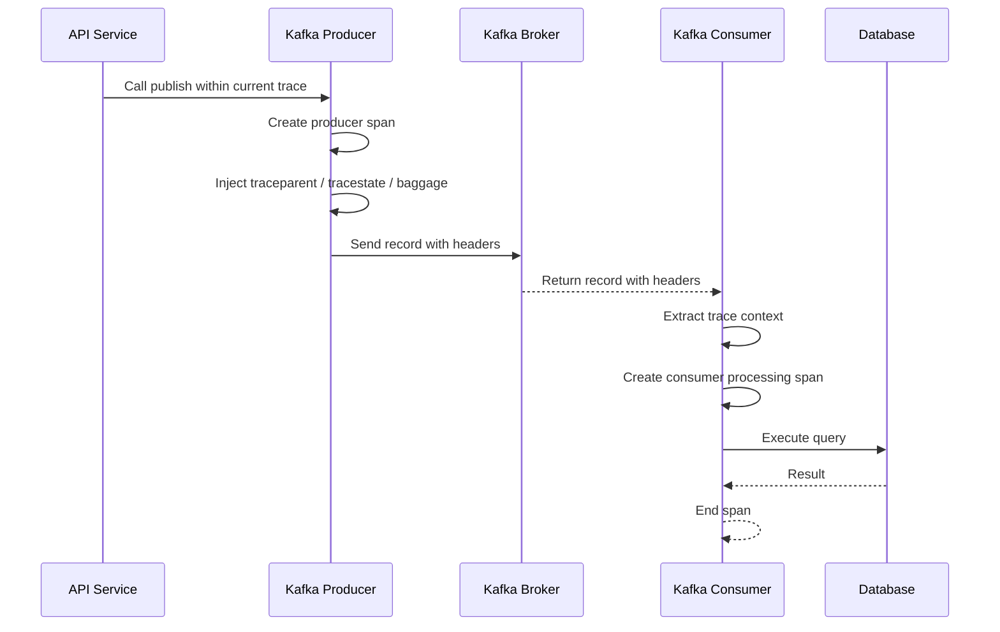

# Headers containing trace context

In a Spring Kafka application, a message often traverses multiple services: an API receives a request, a business service emits an event, and a consumer updates data or calls another service. When a step is slow or fails, individual service logs are not enough to see the entire journey. Distributed tracing solves this by linking related spans into a single trace.

Trace context is propagated via Kafka record headers. The producer injects context into headers before sending; the consumer extracts context from headers upon receiving the record and creates a span for the processing work. With Spring Kafka, Micrometer Observation and Micrometer Tracing can automate most of this when configured properly. Understanding header structure and how propagation works helps verify cross-service traces, handle async flows, and avoid broken traces.

## 1. Trace, span, and trace context

A trace represents the journey of a request or workflow across multiple components. A trace consists of one or more spans; each span represents an operation with a start time, end time, attributes, and status.

For example, an order creation request emits a Kafka event, which a consumer then processes:

```text
HTTP request
  └── API span
        └── Kafka producer span
              └── Kafka consumer span
                    └── Database span
```

Spans can reside across different processes and hosts. Trace context carries the identifiers and information required to link new spans to the active trace.

Key concepts:

| Component | Meaning |
|---|---|
| Trace ID | Identifies the trace across services |
| Span ID | Identifies a specific span |
| Parent span ID | The parent span from which the current span was created |
| Trace flags | Control flags such as sampled |
| Trace state | Extended state used by tracing vendors |
| Baggage | Key/value pairs propagated across multiple services beyond trace ID |

Trace context is not business payload. It is metadata for observability and activity correlation.

## 2. W3C Trace Context in Kafka headers

W3C Trace Context is the common standard for propagating trace context across systems. Two key headers are `traceparent` and `tracestate`.

`traceparent` has the structure:

```text
version-trace-id-parent-id-trace-flags
```

Example:

```text
traceparent: 00-4bf92f3577b34da6a3ce929d0e0e4736-00f067aa0ba902b7-01
```

Meaning:

| Part | Example | Role |
|---|---|---|
| Version | `00` | Format version |
| Trace ID | `4bf92f3577b34da6a3ce929d0e0e4736` | 16-byte ID represented by 32 hex characters |
| Parent ID | `00f067aa0ba902b7` | 8-byte Span ID represented by 16 hex characters |
| Trace flags | `01` | Sampled bit enabled in the example |

The `tracestate` header carries vendor-specific tracing extension info. Applications should normally let a standard propagator manage it instead of parsing or assembling strings manually.

Baggage is propagated via the `baggage` header, typically as a W3C-standard key/value list. For instance, it can carry tenant tier or a non-sensitive region code. Baggage does not replace trace ID and should be bounded because it can travel across many services.

In Kafka, these headers are pairs of names and byte arrays. W3C requires text-formatted values; when interacting directly with Kafka headers, encode/decode UTF-8 strictly per standard.

## 3. How is trace context propagated through Kafka?

Basic propagation flow:



Producer and consumer do not share memory or threads. Kafka headers serve as the bridge to propagate context across process boundaries.

A trace can contain many spans and many services. When the consumer extracts context properly, the message-processing span is linked to the trace started at the producer. If context is lost, the consumer may start an independent new trace, preventing the tracing UI from showing the complete journey.

## 4. Distinguishing trace context from correlation ID

Trace ID and correlation ID often appear together but serve different purposes:

| Value | Purpose | Who manages it? |
|---|---|---|
| Trace ID | Links spans within a distributed trace | Tracing SDK/propagator |
| Span ID | Identifies an operation within a trace | Tracing SDK |
| Correlation ID | Finds and correlates a request or business workflow | Application |
| Event ID | Identifies an event for deduplication or auditing | Domain/application |
| Aggregate ID | Identifies an entity, often used as Kafka key | Domain/application |

Do not use correlation ID in place of `traceparent`. A correlation ID can outlive a trace or link multiple traces; trace context also carries parent-child relationships, sampling, and vendor state.

Both correlation ID and trace context can be propagated:

- `traceparent`, `tracestate`, `baggage`: managed by tracing propagation.
- `correlation-id`: defined by the application.
- `event-id`, `aggregate-id`: part of the message contract if required by business logic.

Do not create duplicate header names or overwrite trace context injected by the framework. If the application manages correlation IDs itself, clearly define creation source, scope, and preservation across retries.

## 5. Spring Kafka Observation support

Spring Kafka integrates Micrometer Observation for sending via `KafkaTemplate` and processing via listener containers. When observation is enabled and the application has an appropriate Micrometer Tracing bridge, the tracing implementation can automatically inject/extract trace context via record headers.

Key configuration points:

- Enable observation on `KafkaTemplate`.
- Enable observation on listener container properties.
- Provide `ObservationRegistry` to the template and container.
- Add a Micrometer Tracing bridge, such as the OpenTelemetry bridge.
- Configure an exporter to send spans to a tracing backend if centralized trace viewing is needed.

Example configuring the template and listener factory:

```java
import org.springframework.context.annotation.Bean;
import org.springframework.context.annotation.Configuration;
import org.springframework.boot.autoconfigure.kafka.ConcurrentKafkaListenerContainerFactoryConfigurer;
import org.springframework.kafka.config.ConcurrentKafkaListenerContainerFactory;
import org.springframework.kafka.core.ConsumerFactory;
import org.springframework.kafka.core.KafkaTemplate;
import org.springframework.kafka.core.ProducerFactory;
import io.micrometer.observation.ObservationRegistry;

@Configuration
class KafkaObservationConfiguration {

    @Bean
    KafkaTemplate<String, OrderEvent> orderKafkaTemplate(
            ProducerFactory<String, OrderEvent> producerFactory,
            ObservationRegistry observationRegistry) {

        KafkaTemplate<String, OrderEvent> template =
                new KafkaTemplate<>(producerFactory);

        template.setObservationRegistry(observationRegistry);
        template.setObservationEnabled(true);
        return template;
    }

    @Bean
    ConcurrentKafkaListenerContainerFactory<String, OrderEvent>
    orderListenerFactory(
            ConcurrentKafkaListenerContainerFactoryConfigurer configurer,
            ConsumerFactory<String, OrderEvent> consumerFactory) {

        var factory =
                new ConcurrentKafkaListenerContainerFactory<String, OrderEvent>();

        configurer.configure(factory, consumerFactory);
        factory.getContainerProperties().setObservationEnabled(true);
        return factory;
    }
}
```

The example illustrates Spring Kafka APIs that support observation. In Spring Boot applications, prefer auto-configuration/configurer to retain shared consumer, converter, error handler, and observation registry settings. If creating a factory or template manually, verify they receive the proper `ObservationRegistry` from the application context; enabling the observation flag without a registry/tracing bridge is not enough to export traces.

When using the default factory created by Spring Boot, observation can be configured via `spring.kafka.template.observation-enabled` and `spring.kafka.listener.observation-enabled` if the Boot version in use supports these properties. Property names and binding capabilities depend on the Spring Boot/Spring Kafka version; check the configuration metadata matching your project's dependencies.

## 6. Dependencies for Micrometer Tracing and OpenTelemetry

With Spring Boot 3, an application typically uses Actuator, a Micrometer Tracing bridge, and an OTLP exporter. Example Maven dependencies using Spring Boot dependency management:

```xml
<dependencies>
    <dependency>
        <groupId>org.springframework.boot</groupId>
        <artifactId>spring-boot-starter-actuator</artifactId>
    </dependency>

    <dependency>
        <groupId>io.micrometer</groupId>
        <artifactId>micrometer-tracing-bridge-otel</artifactId>
    </dependency>

    <dependency>
        <groupId>io.opentelemetry</groupId>
        <artifactId>opentelemetry-exporter-otlp</artifactId>
    </dependency>
</dependencies>
```

Spring Boot manages compatible library versions via its BOM. Do not manually pick Micrometer or OpenTelemetry versions misaligned with the Spring Boot version in use.

A minimal configuration can set sampling and the OTLP endpoint per environment:

```yaml
management:
  tracing:
    sampling:
      probability: 0.1
  otlp:
    tracing:
      endpoint: http://localhost:4318/v1/traces
```

The example OTLP HTTP endpoint typically uses port 4318. If the collector uses OTLP gRPC or a custom endpoint, configure according to the protocol and deployment environment. Do not enable 100% sampling in production just to observe every request if traffic is high; choose an appropriate sampling policy and use logs/metrics to supplement.

`management.tracing.sampling.probability` controls the proportion of sampled traces in simple configurations. Sampling affects exported spans, but you should not manually edit `traceparent` to force the sampled flag when using a standard propagator.

## 7. Enabling observation via application.yml

In Spring Boot versions supporting these properties, observation can be enabled for the template and listener:

```yaml
spring:
  kafka:
    template:
      observation-enabled: true
    listener:
      observation-enabled: true

management:
  tracing:
    sampling:
      probability: 0.1
```

Observation creates instrumentation points for Kafka operations; the Micrometer Tracing bridge converts observations into spans and performs propagation using the configured propagator. Simply enabling observation does not create a backend to store traces. A suitable exporter and collector/backend are required to view traces out-of-process.

If using a custom `KafkaTemplate` or custom listener factory, verify those beans have matching observation configuration. Property configuration applies to auto-configured beans but does not necessarily modify application-declared custom beans automatically.

## 8. Reading trace context from Kafka headers

In most applications, let Micrometer Tracing or an OpenTelemetry propagator perform injection/extraction. Do not parse `traceparent` manually with substrings because you would have to handle version, length, invalid characters, and standard compliance rules.

If you need to inspect headers while debugging, you can read native headers:

```java
import java.nio.charset.StandardCharsets;

import org.apache.kafka.clients.consumer.ConsumerRecord;
import org.apache.kafka.common.header.Header;

void logTraceHeaders(ConsumerRecord<String, OrderEvent> record) {
    Header traceparent =
            record.headers().lastHeader("traceparent");

    Header tracestate =
            record.headers().lastHeader("tracestate");

    String traceparentValue = traceparent == null
            ? null
            : new String(
                    traceparent.value(),
                    StandardCharsets.UTF_8
            );

    String tracestateValue = tracestate == null
            ? null
            : new String(
                    tracestate.value(),
                    StandardCharsets.UTF_8
            );

    log.debug(
            "Kafka trace headers: traceparent={}, tracestatePresent={}",
            traceparentValue,
            tracestateValue != null
    );
}
```

This example is only for observation/debugging. `tracestate` may contain vendor-specific data; consider logging only its presence instead of logging it verbatim. Trace IDs can also be sensitive correlation data under internal security policies.

Kafka allows multiple headers with the same name. For standard propagation headers, ensure a record has only one valid value per field. If injecting manually, remove old values before adding a new one; do not append multiple conflicting `traceparent` headers.

## 9. Propagating baggage and data limits

Baggage is a set of key/value pairs propagated alongside trace context. It is useful when a value is needed for observability across multiple services, such as `tenant-tier` or `region`. Baggage is not a place to store payloads or large business data.

Principles:

- Only propagate fields genuinely needed for tracing or observability routing.
- Never put passwords, access tokens, emails, phone numbers, or personal data into baggage.
- Limit the number of keys, lengths, and total size.
- Never use baggage as an authorization mechanism; consumers must authenticate using dedicated security mechanisms.
- Avoid high-cardinality values if they are placed into metrics or indexes.
- Check the propagator's allowlist rules to only propagate approved baggage keys.

Baggage can be forwarded across many services and Kafka topics. A value that seems internal to the producer may appear in logs, trace backends, or downstream services. Treat baggage as metadata with broad propagation scope.
## 10. Manual propagation with OpenTelemetry

Only use manual propagation when the application does not use automatic instrumentation or has a special flow requiring separate control. If Spring Kafka Observation already injects/extracts trace context, do not inject again with custom code; doing so can create duplicate headers or corrupt the parent context.

OpenTelemetry provides `TextMapPropagator` to inject/extract context per the configured standard. Do not manually construct `traceparent` strings.

Example injecting the current context into a `ProducerRecord`:

```java
import io.opentelemetry.api.OpenTelemetry;
import io.opentelemetry.context.Context;
import io.opentelemetry.context.propagation.TextMapPropagator;
import io.opentelemetry.context.propagation.TextMapSetter;
import org.apache.kafka.clients.producer.ProducerRecord;
import org.apache.kafka.common.header.Headers;

import java.nio.charset.StandardCharsets;

class KafkaTraceHeaderInjector {

    private final TextMapPropagator propagator;

    private static final TextMapSetter<Headers> SETTER =
            (headers, key, value) -> {
                headers.remove(key);
                headers.add(
                        key,
                        value.getBytes(StandardCharsets.UTF_8)
                );
            };

    KafkaTraceHeaderInjector(OpenTelemetry openTelemetry) {
        this.propagator =
                openTelemetry.getPropagators().getTextMapPropagator();
    }

    <K, V> ProducerRecord<K, V> inject(
            String topic,
            K key,
            V value) {

        ProducerRecord<K, V> record =
                new ProducerRecord<>(topic, key, value);

        propagator.inject(Context.current(), record.headers(), SETTER);
        return record;
    }
}
```

Call the injector while inside the context of the span to be propagated:

```java
ProducerRecord<String, OrderEvent> record =
        traceHeaderInjector.inject("orders", orderId, event);

kafkaTemplate.send(record);
```

This example injects the currently active context. In a production application, the producer operation should also have its own span; let Spring Kafka Observation create the producer span if tracing is enabled. The manual injector above only demonstrates carrying the current context via headers.

The consumer needs to extract using `TextMapGetter`:

```java
import io.opentelemetry.api.OpenTelemetry;
import io.opentelemetry.api.trace.Span;
import io.opentelemetry.api.trace.SpanKind;
import io.opentelemetry.api.trace.Tracer;
import io.opentelemetry.context.Context;
import io.opentelemetry.context.Scope;
import io.opentelemetry.context.propagation.TextMapGetter;
import io.opentelemetry.context.propagation.TextMapPropagator;
import org.apache.kafka.clients.consumer.ConsumerRecord;
import org.apache.kafka.common.header.Header;
import org.apache.kafka.common.header.Headers;

import java.nio.charset.StandardCharsets;
import java.util.ArrayList;
import java.util.List;
import java.util.function.Consumer;

class KafkaTraceHeaderExtractor {

    private final TextMapPropagator propagator;
    private final Tracer tracer;

    private static final TextMapGetter<Headers> GETTER =
            new TextMapGetter<>() {
                @Override
                public Iterable<String> keys(Headers headers) {
                    List<String> keys = new ArrayList<>();
                    for (Header header : headers) {
                        keys.add(header.key());
                    }
                    return keys;
                }

                @Override
                public String get(Headers headers, String key) {
                    Header header = headers.lastHeader(key);
                    if (header == null || header.value() == null) {
                        return null;
                    }

                    return new String(
                            header.value(),
                            StandardCharsets.UTF_8
                    );
                }
            };

    KafkaTraceHeaderExtractor(
            OpenTelemetry openTelemetry,
            Tracer tracer) {
        this.propagator =
                openTelemetry.getPropagators().getTextMapPropagator();
        this.tracer = tracer;
    }

    void process(
            ConsumerRecord<String, OrderEvent> record,
            Consumer<OrderEvent> handler) {
        Context extracted = propagator.extract(
                Context.current(),
                record.headers(),
                GETTER
        );

        Span span = tracer.spanBuilder("orders.process")
                .setParent(extracted)
                .setSpanKind(SpanKind.CONSUMER)
                .startSpan();

        try (Scope scope = span.makeCurrent()) {
            handler.accept(record.value());
        }
        catch (RuntimeException exception) {
            span.recordException(exception);
            span.setStatus(
                    io.opentelemetry.api.trace.StatusCode.ERROR
            );
            throw exception;
        }
        finally {
            span.end();
        }
    }
}
```

This example illustrates using the OpenTelemetry API; dependencies, beans, and business services must be injected according to application structure. If already using Spring Kafka Observation, do not manually create a consumer span for the same listener, as that will generate duplicate spans.

## 11. Context propagation across executors and callbacks

Context is typically held in a thread-local scope. When an application hands work off to a thread pool, the new thread does not automatically inherit the submitting thread's context.

Example needing to preserve context when handing off to an executor:

```java
import io.opentelemetry.context.Context;
import java.util.concurrent.Executor;

Executor contextAwareExecutor =
        Context.taskWrapping(applicationExecutor);

contextAwareExecutor.execute(() -> {
    orderService.processAsync(event);
});
```

`Context.taskWrapping` wraps the task so that the context active at submission is restored when the task runs. With Micrometer Context Propagation, a corresponding context snapshot mechanism can be used. Choose a single mechanism consistent with your application's tracing stack.

`CompletableFuture` callbacks can also run on another thread. If a callback logs or creates child spans, capture the context before registering the callback:

```java
import io.opentelemetry.context.Context;
import io.opentelemetry.context.Scope;

Context captured = Context.current();

kafkaTemplate.send("orders", orderId, event)
        .whenComplete((result, exception) -> {
            try (Scope scope = captured.makeCurrent()) {
                if (exception != null) {
                    log.error("Kafka publish failed", exception);
                }
                else {
                    log.info("Kafka publish completed");
                }
            }
        });
```

The snippet above restores context for the callback; it does not replace producer observation or send error handling. Do not keep a scope open across multiple threads or beyond the future's lifetime. A scope must be closed on the same thread that opened it.

## 12. How do retries, retry topics, and dead-letters preserve trace context?

Spring Kafka can carry headers through retry and dead-letter flows, but applications must verify their configuration and version in use. Retry headers such as delivery attempt, exception class, or exception message serve a different purpose than trace context.

When a record is retried:

- The initial trace context can be preserved to link reprocessing attempts with the original event.
- Each processing attempt can create a new span to observe individual attempts.
- With retry topics, the producer sends the record to another topic; tracing instrumentation can create a new producer span and the retry consumer creates a new processing span.
- When moving to a DLT, original headers and error-describing headers can coexist; avoid unintentionally overwriting `traceparent`.
- When replaying a DLT after hours or days, consider creating a new trace and linking to the original trace rather than extending a long-finished trace.

Do not assume every custom header is preserved untouched across every serializer, interceptor, retry recoverer, or bridge. Write integration tests to confirm `traceparent`, `tracestate`, correlation ID, and event ID are present after each path.

If retry topics alter business ordering, traces only help observe the journey; they do not fix event ordering. Ordering and retry policies must be designed separately.

## 13. Sampling and broken traces

Sampling decides which traces/spans are recorded and exported. If a trace is sampled out, some backends may not display the trace even though the message still carries trace context. Do not conclude propagation is broken solely because a trace is missing from the UI.

Common causes of broken traces:

| Symptom | Possible cause | How to check |
|---|---|---|
| Producer has a span, consumer starts a new trace | Header was not injected or not extracted | Check `traceparent` in the record and Observation config |
| Consumer span lacks expected parent | Consumer uses wrong propagator or invalid header | Check consistent bridge and propagator across services |
| Traces only appear for some requests | Sampling or exporter filter | Check sampling policy and collector |
| Spans disappear after executor | Context was not propagated across thread boundary | Use context propagation or snapshots |
| Two unlinked traces appear for one message | Manual and automatic propagation conflict or trace header was overwritten | Use only one inject/extract mechanism |
| Old trace appears on DLT replay | Replay preserved historical context | Define new trace / link-to-original policy |

Identical Trace IDs indicate linkage, but to verify proper parent-child relationships, also inspect span ID, parent span ID, and span kind in the tracing backend.

## 14. Testing trace context in Kafka headers

Test at least two layers:

1. Unit tests for header helper logic if the application injects/extracts manually.
2. Integration tests with a test broker to confirm headers are actually sent, stored, and received back by the consumer.

Example checking native headers on a record:

```java
import static org.assertj.core.api.Assertions.assertThat;

import java.nio.charset.StandardCharsets;
import org.apache.kafka.clients.consumer.ConsumerRecord;
import org.apache.kafka.common.header.Header;
import org.junit.jupiter.api.Test;

class TraceHeaderTest {

    @Test
    void recordContainsTraceparentHeader() {
        ConsumerRecord<String, String> record =
                new ConsumerRecord<>("orders", 0, 10L, "order-101", "{}");

        record.headers().add(
                "traceparent",
                "00-4bf92f3577b34da6a3ce929d0e0e4736-00f067aa0ba902b7-01"
                        .getBytes(StandardCharsets.UTF_8)
        );

        Header header = record.headers().lastHeader("traceparent");

        assertThat(header).isNotNull();
        assertThat(new String(
                header.value(),
                StandardCharsets.UTF_8
        )).startsWith("00-");
    }
}
```

This unit test only verifies header operations. Integration tests must publish a record via `KafkaTemplate`, consume from the broker, and check both the header and exported spans/traces. If using Spring Kafka Observation, verify producer and consumer spans are created and properly related in a test tracing registry or test exporter.

Do not only assert that the header exists; verify the value is parseable by the propagator, there are no conflicting duplicate headers, and context is restored across executors if the application processes asynchronously.

## 15. Common pitfalls

| Error | Cause | How to handle |
|---|---|---|
| `traceparent` missing | Observation not enabled or missing tracing bridge | Check KafkaTemplate, container, and dependencies |
| Header present but traces do not link | Consumer does not extract context or propagator standard differs | Use the same W3C propagator on producer/consumer |
| Duplicate headers | Manual injection running alongside automatic instrumentation | Choose one propagation mechanism |
| Consumer span lacks parent | Context not active when listener runs or malformed header | Check listener observation and headers |
| Trace lost after async executor | New thread lacks context | Use context-aware executor/snapshot |
| Logs leak baggage | Passing sensitive data or logging raw headers | Allowlist and bound baggage |
| DLT replay attaches to very old trace | Historical trace header preserved as-is | Set policy to start new trace and link to original trace |
| Only partial trace visible | Sampling or exporter/collector filter | Check sampling and export pipeline |

## 16. Trace context implementation checklist

1. Use W3C Trace Context or a unified propagator across services.
2. Enable Spring Kafka Observation for templates and listener containers.
3. Provide a Micrometer Tracing bridge and exporter compatible with Spring Boot.
4. Let the framework inject/extract context automatically whenever possible.
5. Do not manually parse or construct `traceparent` when a propagator is present.
6. Propagate a separate correlation ID if business needs request correlation.
7. Use context propagation when handing work off to executors or callbacks.
8. Verify trace context across retry topics and DLTs.
9. Bound baggage and never put sensitive data into headers.
10. Test headers, parent-child spans, and sampling in integration environments.

Trace context in Kafka headers connects producer and consumer operations into a single observable journey. Spring Kafka Observation combined with Micrometer Tracing can automate propagation; when manual handling is needed, use an OpenTelemetry propagator rather than manipulating header strings manually. Combining proper configuration, cross-thread context propagation, and explicit retry/replay policies makes cross-service tracing much more reliable.
