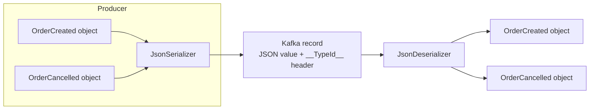

# Headers containing type information

When sending Java objects over Kafka using JSON, the producer must convert objects into bytes before the broker stores the record. The consumer receives bytes and needs to know which data type to reconstruct. Spring Kafka supports transmitting type information via Kafka headers added by `JsonSerializer` and read by `JsonDeserializer` during deserialization.

Type information headers are especially useful when a topic carries multiple event types, such as `OrderCreated` and `OrderCancelled`. The producer can write the class name or an alias into a header; the consumer uses that information to select the corresponding Java type. This approach allows one listener to receive multiple event types, but requires strict management of the type contract, allowed deserialization packages, and cross-service compatibility.

## 1. Why is type information needed?

Kafka stores keys and values as byte arrays. The broker does not understand Java objects, class names, or JSON structures. Serializers and deserializers at both ends must agree on how to convert data.

Suppose a producer sends two events to the same topic `orders.events`:

```java
import java.math.BigDecimal;

public record OrderCreated(
        String eventId,
        String orderId,
        BigDecimal total
) {}

public record OrderCancelled(
        String eventId,
        String orderId,
        String reason
) {}
```

The two record types are two separate Java files; imports and packages are omitted to focus on the payload. The listener uses pattern matching in `instanceof`, syntax available from Java 16 onward.

The JSON of the two events can have different structures. If the consumer only declares a fixed type such as `OrderCreated`, it cannot automatically tell that another JSON payload is `OrderCancelled` without an additional convention.

Spring Kafka can add the `__TypeId__` header to tell the consumer the serialized value type. During deserialization, `JsonDeserializer` reads this header and selects the corresponding class, provided the class is allowed and has a valid mapping.



Type information is metadata about the payload's Java type. It does not replace an event schema, is not a business event type, and does not automatically guarantee two services have the same class version.

## 2. Default type information headers

Spring Kafka `JsonSerializer` can write the following headers:

| Header | Meaning |
| --- | --- |
| `__TypeId__` | Primary type of the serialized value, usually a class name or alias |
| `__ContentTypeId__` | Element type inside a container/generic type when additional info is needed |
| `__KeyTypeId__` | Key type inside a `Map`-shaped payload; this is not the Kafka record key |

For ordinary event objects, the primary header to care about is `__TypeId__`. Content/key type headers are useful for collection, map, or generic key/value payloads that need further description.

These headers are Kafka record headers, separate from the JSON value. A record can be visualized as follows:

```text
Topic: orders.events
Key: ORD-100
Value: {"eventId":"evt-1","orderId":"ORD-100","total":125000}
Headers:
  __TypeId__: order-created
  trace-id: 8f1c...
```

Header values are stored as byte arrays. With type mapping, `__TypeId__` can contain an alias such as `order-created`; without mapping, it usually contains the fully qualified class name.

## 3. JsonSerializer adding type headers

Spring Kafka's `JsonSerializer` can automatically add type information headers. Under default configuration, the serializer adds type headers so `JsonDeserializer` on the consumer can infer the Java type from metadata.

Example of a producer sending multiple event types through the same template:

```java
package com.example.orders.messaging;

import java.util.concurrent.CompletableFuture;
import org.springframework.kafka.core.KafkaTemplate;
import org.springframework.kafka.support.SendResult;
import org.springframework.stereotype.Service;

@Service
public class OrderEventPublisher {

    private final KafkaTemplate<String, Object> kafkaTemplate;

    public OrderEventPublisher(KafkaTemplate<String, Object> kafkaTemplate) {
        this.kafkaTemplate = kafkaTemplate;
    }

    public CompletableFuture<SendResult<String, Object>> publish(
            String orderId,
            Object event
    ) {
        return kafkaTemplate.send("orders.events", orderId, event);
    }
}
```

When sending `OrderCreated`, the serializer inspects the runtime type of the object and writes the corresponding type information. When sending `OrderCancelled`, the header reflects the type of the second event. The consumer can receive the value as `Object` and handle it according to its actual type after deserialization.

If you want to disable type headers on the producer, you can configure:

```yaml
spring:
  kafka:
    producer:
      properties:
        "[spring.json.add.type.headers]": false
```

When disabled, consumers cannot rely on `__TypeId__` generated by this producer to select classes. The application must have another way to determine the type, such as configuring a fixed target type or using an event envelope with an `eventType` field.

## 4. JsonDeserializer reading type headers

`JsonDeserializer` can read type information from headers and instantiate the corresponding object. Example consumer configuration for a topic with multiple event types:

```yaml
spring:
  kafka:
    consumer:
      group-id: order-projection
      enable-auto-commit: false
      key-deserializer: org.apache.kafka.common.serialization.StringDeserializer
      value-deserializer: org.springframework.kafka.support.serializer.JsonDeserializer
      properties:
        "[spring.json.use.type.headers]": true
        "[spring.json.trusted.packages]": com.example.orders.events
```

With this configuration, the deserializer uses type headers to determine the class and only trusts the declared package. The listener can accept `Object`:

```java
@KafkaListener(topics = "orders.events", groupId = "order-projection")
public void onOrderEvent(Object event) {
    if (event instanceof OrderCreated created) {
        orderProjection.onCreated(created);
    } else if (event instanceof OrderCancelled cancelled) {
        orderProjection.onCancelled(cancelled);
    } else {
        throw new IllegalArgumentException(
                "Unsupported order event type: " + event.getClass().getName()
        );
    }
}
```

This listener assumes the deserializer already converted the JSON into one of the matching event classes. If the header is missing, the deserializer can use a configured default target type; if no specific type is configured, the payload may be produced as a map structure such as `LinkedHashMap`. Invalid aliases, missing classes, or untrusted packages can fail right in the deserialization phase, before the listener method is invoked.

## 5. Fully qualified class names and cross-service coupling

Without configuring aliases, the type header may contain the fully qualified class name, for example:

```text
com.example.orders.events.OrderCreated
```

When the consumer uses this header, it needs a class with the exact matching name and the package must be trusted. This couples the Kafka contract to the producer's Java package structure.

Suppose the producer changes its package from:

```text
com.example.orders.events.OrderCreated
```

to:

```text
com.company.ordering.contract.OrderCreated
```

Older consumers may fail to find the class in the new header. Simply refactoring an internal package on the producer can break consumers even though JSON fields did not change.

For independently deployed services, do not default to internal Java class names as a long-term data contract. Type mapping decouples the wire type name from each service's actual packages.

## 6. Type mapping with aliases

Spring Kafka supports mapping between aliases and classes. An alias is a stable type name written into the header; each side maps that alias to its own local class.

For example, the producer has classes in package `com.example.orders.events`:

```yaml
spring:
  kafka:
    producer:
      properties:
        "[spring.json.type.mapping]": "order-created:com.example.orders.events.OrderCreated,order-cancelled:com.example.orders.events.OrderCancelled"
```

When serializing `OrderCreated`, the `__TypeId__` header contains `order-created`; for `OrderCancelled`, the header contains `order-cancelled`.

The consumer can use its own classes in package `com.example.billing.contract` while understanding the same aliases:

```yaml
spring:
  kafka:
    consumer:
      properties:
        "[spring.json.use.type.headers]": true
        "[spring.json.type.mapping]": "order-created:com.example.billing.contract.OrderCreated,order-cancelled:com.example.billing.contract.OrderCancelled"
        "[spring.json.trusted.packages]": com.example.billing.contract
```

Both sides do not need the same package or the same class name. What must align are the aliases and compatible JSON structure.

| Side | Alias | Local class |
| --- | --- | --- |
| Producer | `order-created` | `com.example.orders.events.OrderCreated` |
| Consumer | `order-created` | `com.example.billing.contract.OrderCreated` |
| Producer | `order-cancelled` | `com.example.orders.events.OrderCancelled` |
| Consumer | `order-cancelled` | `com.example.billing.contract.OrderCancelled` |

Mappings must exist on both producer and consumer when the two sides use different packages. The producer uses the mapping to write aliases; the consumer uses the mapping to resolve aliases into classes it knows.

## 7. Complete type header configuration via application.yml

A combined producer and consumer example can be written as follows:

```yaml
spring:
  kafka:
    bootstrap-servers: ${KAFKA_BOOTSTRAP_SERVERS:localhost:9092}

    producer:
      key-serializer: org.apache.kafka.common.serialization.StringSerializer
      value-serializer: org.springframework.kafka.support.serializer.JsonSerializer
      properties:
        "[spring.json.add.type.headers]": true
        "[spring.json.type.mapping]": "order-created:com.example.orders.events.OrderCreated,order-cancelled:com.example.orders.events.OrderCancelled"

    consumer:
      group-id: order-projection
      enable-auto-commit: false
      key-deserializer: org.apache.kafka.common.serialization.StringDeserializer
      value-deserializer: org.springframework.kafka.support.serializer.JsonDeserializer
      properties:
        "[spring.json.use.type.headers]": true
        "[spring.json.remove.type.headers]": true
        "[spring.json.type.mapping]": "order-created:com.example.billing.contract.OrderCreated,order-cancelled:com.example.billing.contract.OrderCancelled"
        "[spring.json.trusted.packages]": com.example.billing.contract
```

Properties under `spring.kafka.producer.properties` are passed to the serializer; properties under `spring.kafka.consumer.properties` are passed to the deserializer. Wrapping keys in square brackets ensures Spring Boot preserves dotted property names when binding the map.

`spring.json.add.type.headers` controls whether the serializer adds type headers. `spring.json.use.type.headers` controls whether the deserializer uses headers to choose the target type. `spring.json.type.mapping` defines aliases. `spring.json.trusted.packages` restricts which packages may be deserialized.

## 8. Trusted packages and deserialization safety

Type headers can influence which class the deserializer attempts to instantiate. If a consumer blindly trusts every class specified in records, data from an untrusted producer could cause the application to instantiate unexpected objects.

Spring Kafka `JsonDeserializer` supports a list of trusted packages. Example:

```yaml
spring:
  kafka:
    consumer:
      properties:
        "[spring.json.trusted.packages]": com.example.billing.contract,com.example.shared.events
```

Only add packages containing valid event types that the consumer expects to receive. Avoid using the `*` wildcard in production systems unless there is an explicitly evaluated reason. Restricting trusted packages narrows the scope of types the deserializer is allowed to instantiate.

Type mapping aliases also help limit the event types a consumer understands. However, aliases do not replace schema checks, payload validation, or topic write access control. Producers still need proper authentication and authorization; consumers still must handle deserialization errors and invalid events.

## 9. Using a default type when not relying on headers

Not every topic carries multiple event types. If a topic only carries a single fixed payload type, the consumer can configure a default target type and ignore type headers:

```yaml
spring:
  kafka:
    consumer:
      value-deserializer: org.springframework.kafka.support.serializer.JsonDeserializer
      properties:
        "[spring.json.use.type.headers]": false
        "[spring.json.value.default.type]": com.example.billing.contract.OrderCreated
        "[spring.json.trusted.packages]": com.example.billing.contract
```

With this configuration, the deserializer uses `OrderCreated` as the target type instead of reading the type from `__TypeId__`. This approach fits when the topic contract guarantees every value shares the same schema/type.

If a topic carries multiple event types while type headers are disabled, another mechanism is needed to distinguish them. A common pattern is a fixed event envelope:

```java
public record EventEnvelope(
        String eventId,
        String eventType,
        int schemaVersion,
        String aggregateId,
        JsonNode payload
) {}
```

The consumer deserializes every record into `EventEnvelope`, then selects a handler based on `eventType` and `schemaVersion`. This avoids coupling consumers to producer Java class names and works easily with non-Java clients.

## 10. Keeping or removing type headers after deserialization

In modern Spring Kafka versions, `JsonDeserializer` removes type information headers by default after using them to determine the target type. Therefore, a listener receiving the deserialized object may no longer see `__TypeId__` in `ConsumerRecord.headers()`.

If you need to keep the header for logging, tracing, or forwarding records, you can set:

```yaml
spring:
  kafka:
    consumer:
      properties:
        "[spring.json.remove.type.headers]": false
```

Keeping the header does not alter the deserialized payload; it merely retains metadata in record headers so the listener or downstream layers can read it. If there is no need to reuse type headers, leaving removal enabled by default prevents unnecessarily leaking internal metadata into other processing flows.

## 11. Reading type headers manually

In some situations where you need to inspect raw metadata or dispatch handlers manually, a listener can accept `ConsumerRecord` and read `__TypeId__`:

```java
package com.example.billing.consumer;

import java.nio.charset.StandardCharsets;
import org.apache.kafka.clients.consumer.ConsumerRecord;
import org.apache.kafka.common.header.Header;
import org.slf4j.Logger;
import org.slf4j.LoggerFactory;
import org.springframework.kafka.annotation.KafkaListener;
import org.springframework.stereotype.Component;

@Component
public class OrderHeaderInspector {

    private static final Logger log =
            LoggerFactory.getLogger(OrderHeaderInspector.class);

    @KafkaListener(topics = "orders.events", groupId = "order-header-inspector")
    public void inspect(ConsumerRecord<String, Object> record) {
        Header typeHeader = record.headers().lastHeader("__TypeId__");
        String typeId = typeHeader == null
                ? null
                : new String(typeHeader.value(), StandardCharsets.UTF_8);

        log.info("topic={}, partition={}, offset={}, typeId={}",
                record.topic(), record.partition(), record.offset(), typeId);
    }
}
```

`lastHeader()` returns the last header with the matching name; if absent, the result is `null`. Because the deserializer may strip type headers by default, reading the header inside a listener requires configuring `spring.json.remove.type.headers=false`.

Do not use raw header values as the sole basis for executing sensitive actions. Check aliases against an allowed list and validate the payload against the event schema.

## 12. One topic carrying multiple event types

With type mapping, a single topic can carry multiple event types. The consumer can receive `Object` and dispatch by class:

```java
@KafkaListener(topics = "orders.events", groupId = "order-projection")
public void onEvent(Object event) {
    if (event instanceof OrderCreated created) {
        orderProjection.onCreated(created);
        return;
    }

    if (event instanceof OrderCancelled cancelled) {
        orderProjection.onCancelled(cancelled);
        return;
    }

    throw new IllegalArgumentException(
            "Unsupported event type: " + event.getClass().getName()
    );
}
```

Define explicit behavior for new event types that the consumer does not recognize yet. You can route them to a dead-letter/quarantine topic, record metrics, and alert instead of letting the listener loop infinitely. Do not silently ignore unknown events if doing so causes lost business updates.

If using `ConsumerRecord<String,Object>`, the consumer can also read key, partition, offset, and headers for tracing. However, type headers have already been used by the deserializer and may have been removed; configure retaining headers if you need to inspect them after deserialization.

## 13. When to use type headers, when to use an event envelope?

| Criterion | Type information header | Event envelope with `eventType` |
| --- | --- | --- |
| Purpose | Helps Jackson/Spring Kafka pick a Java class during deserialization | Data contract describing event type and schema version |
| Java coupling | Can depend on class names or alias mappings | Can be independent of Java packages/classes |
| Polyglot | Non-Java clients must manually understand header conventions | Easy to share if the envelope/schema is published |
| Versioning | Aliases do not inherently manage schema versions | Can carry explicit `schemaVersion` or schema ID |
| Configuration | `JsonSerializer`/`JsonDeserializer` and type mapping | Deserialize fixed envelope, then dispatch by event type |
| Suitable cases | Spring Kafka services sharing type mapping conventions | Multi-language systems, long-lived event contracts, or explicit versioning needs |

Both approaches can coexist: the envelope is the business contract, while type headers are deserialization-helper metadata in certain Java consumers. Avoid letting Java class names become the sole contract between independent services.

## 14. Compatibility when adding event types or changing classes

When adding a new event type to a topic:

1. Choose a stable alias, e.g., `order-refunded`.
2. Update the producer's mapping to write the alias.
3. Update the consumer's mapping before or at the same time the producer starts emitting the new type.
4. Ensure the consumer class's package is in trusted packages.
5. Test the new event alongside existing events to verify deserialization and dispatch.
6. Define behavior for older consumers that do not recognize the new alias yet.

When changing a class package without changing its schema, you can keep the alias and update consumer/producer mappings according to deployment versions. This avoids changing the type ID value on the wire.

When changing fields or data types in JSON, type mapping does not solve schema compatibility. Design rules for adding/removing fields, default values, schema versions, and test older consumers with new payloads.

## 15. Testing type information headers

Integration tests should verify both the JSON value and type headers. Important cases:

- Producer sends `OrderCreated`, header contains alias `order-created`.
- Producer sends `OrderCancelled`, header contains alias `order-cancelled`.
- Consumer maps aliases to the right local classes even when producer and consumer packages differ.
- Missing header when consumer does/does not have a default type.
- Unmapped alias or untrusted package.
- `remove.type.headers=true` and `false` produce the expected post-deserialization header outcome.
- Producer disables `add.type.headers` while consumer is still configured to handle via default type or envelope.
- Consumer receives an unsupported event type and handles the error per policy.

Example checking raw headers after sending:

```java
var result = kafkaTemplate.send("orders.events", "ORD-100", event)
        .get(10, TimeUnit.SECONDS);

assertThat(result.getRecordMetadata().topic()).isEqualTo("orders.events");
```

The snippet above only checks send metadata. To inspect actual headers, use a test Kafka consumer reading `ConsumerRecord` directly and assert `record.headers().lastHeader("__TypeId__")`; or use a test consumer with the matching deserializer and inspect the instantiated object. If the deserializer strips headers, read raw records using `ByteArrayDeserializer` or temporarily set `remove.type.headers=false` for inspection tests.

## 16. Common pitfalls

| Symptom | Common cause | How to handle |
| --- | --- | --- |
| `ClassNotFoundException` or type resolution failure | Header contains a class name the consumer lacks | Use alias mapping or provide compatible contract classes |
| `The class ... is not in the trusted packages` | Event package is not trusted | Add the specific package to `spring.json.trusted.packages` |
| Consumer creates `LinkedHashMap` instead of event class | Type header missing, disabled, or deserializer falls back to default target type | Check `add.type.headers`, `use.type.headers`, and default type |
| Alias fails to resolve | Producer/consumer mappings are out of sync | Synchronize aliases and mappings on both sides |
| Listener cannot read `__TypeId__` | Deserializer already removed the header after using it | Set `spring.json.remove.type.headers=false` if retention is needed |
| Producer sends new type and old consumers fail | Consumer does not know the new alias/class yet | Deploy mapping/handler before emitting new type or use an envelope with fallback |
| Package rename breaks consumers | Header contains a fully qualified class name | Use stable aliases and update mappings |
| Type headers do not protect schema | Type ID only picks the class, does not validate JSON compatibility | Use schema versions, validation, and contract tests |

## 17. Process for designing type information for a topic

1. Determine whether the topic holds one payload type or multiple event types.
2. If there is only one type, consider a default type without relying on headers.
3. If there are multiple types in Spring Kafka, decide between type headers or an envelope.
4. If using type headers across independent services, prefer aliases over fully qualified class names.
5. Configure `JsonSerializer` to add headers and `JsonDeserializer` to use headers as needed.
6. Restrict `trusted.packages` to allowed event packages.
7. Decide whether to keep or remove headers after deserialization.
8. Synchronize mappings and deploy consumers before producers emit new types.
9. Test type mapping, class resolution, missing headers, unknown types, and schema compatibility.
10. Monitor deserialization errors, unsupported event types, and dead-letter rates in production.

Type information headers help Spring Kafka reconstruct the right object types from JSON, especially when a topic carries multiple event types. To use them reliably across services, manage aliases as part of the contract, restrict allowed deserialization classes, and separate type-selection metadata from the event's business schema.

## 18. Self-check

1. What role does `__TypeId__` play when `JsonSerializer` and `JsonDeserializer` work together?
2. Why can fully qualified class names in type headers create coupling between producer and consumer?
3. How do type mapping aliases solve differing package names?
4. How do `spring.json.add.type.headers` and `spring.json.use.type.headers` differ in which side uses them?
5. Why should `spring.json.trusted.packages` be restricted?
6. How does `spring.json.remove.type.headers` affect reading headers in a listener?
7. When a topic holds only a single payload type, why can you use `spring.json.value.default.type` and ignore type headers?
8. What advantages does an event envelope with `eventType` and `schemaVersion` have in polyglot systems?
9. What needs to be updated before a producer emits a new event type alias?
10. Why do type headers not replace schema compatibility and payload validation?
