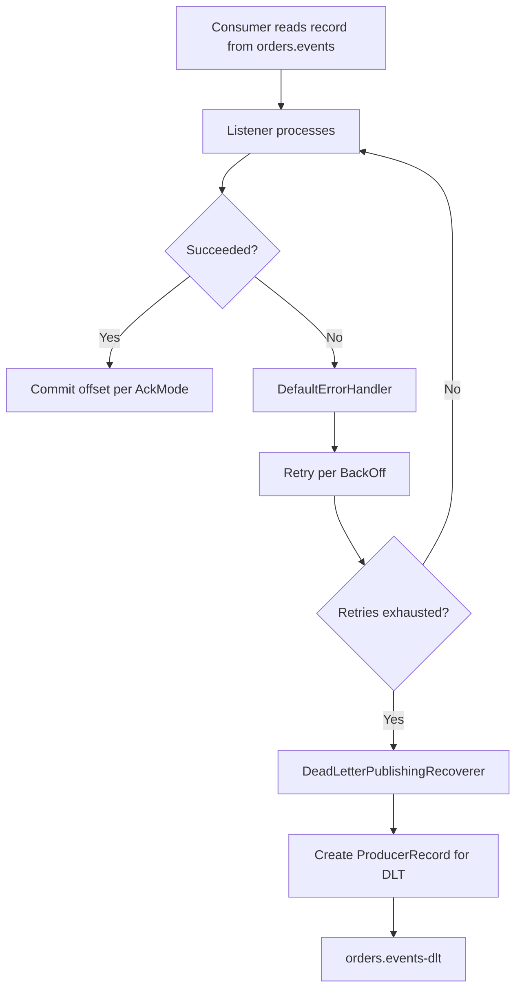

# Headers in dead-letter records

When a Kafka record cannot be processed successfully after the configured number of retries, applications typically send that record to a **dead-letter topic (DLT)** for investigation or later reprocessing. Spring Kafka provides `DeadLetterPublishingRecoverer` to publish failed records to the target topic. The forwarded record still carries the original payload and headers; additionally, the recoverer appends metadata indicating where the record came from and which error sent it to the DLT.

This metadata is crucial in operations: DLT consumers can identify the original topic, partition, offset, failing consumer group, and related exception without guessing from the DLT topic name. This article focuses on dead-letter record header structure, how to read, customize, and control size as well as sensitive data.

## 1. How is a dead-letter record created?

`DeadLetterPublishingRecoverer` is typically invoked by `DefaultErrorHandler` after retries are exhausted or an exception is classified as non-retryable. The recoverer creates a new `ProducerRecord` and sends it to the DLT.

By default, the target topic is named `<originalTopic>-dlt` and the target partition matches the original record's partition. Therefore, if using the default destination resolver, the DLT needs at least as many partitions as the source topic. You can customize the resolver to route to a different topic/partition.



A dead-letter record typically carries:

- Key and value of the original record, except when deserialization fails and raw bytes must be restored.
- Original Kafka headers.
- `KafkaHeaders.DLT_*` headers added by Spring Kafka.
- Custom headers added by the application or retry infrastructure.

The timestamp of the record sent to the DLT is the timestamp of the new publish operation. The original timestamp is stored separately in the `KafkaHeaders.DLT_ORIGINAL_TIMESTAMP` header; do not use the DLT record's timestamp to infer when the source record was created.

## 2. Standard DLT headers

Spring Kafka provides constants in `org.springframework.kafka.support.KafkaHeaders`. Using constants instead of typing header names manually prevents typos and clarifies the metadata's intent.

### Headers describing the value exception

| Constant | Meaning |
|---|---|
| `KafkaHeaders.DLT_EXCEPTION_FQCN` | Fully qualified class name of the exception that caused the record to fail. |
| `KafkaHeaders.DLT_EXCEPTION_CAUSE_FQCN` | Fully qualified class name of the exception cause, if present; available since Spring Kafka 2.8. |
| `KafkaHeaders.DLT_EXCEPTION_MESSAGE` | Exception description message. |
| `KafkaHeaders.DLT_EXCEPTION_STACKTRACE` | Exception stack trace. |

The exception is usually `ListenerExecutionFailedException` when an error occurs inside `@KafkaListener`, but may be another exception type depending on where the failure occurred and the recovery mechanism.

### Headers describing the original record

| Constant | Meaning |
|---|---|
| `KafkaHeaders.DLT_ORIGINAL_TOPIC` | Original topic name. |
| `KafkaHeaders.DLT_ORIGINAL_PARTITION` | Original partition. |
| `KafkaHeaders.DLT_ORIGINAL_OFFSET` | Original offset in the source partition. |
| `KafkaHeaders.DLT_ORIGINAL_TIMESTAMP` | Original timestamp of the record. |
| `KafkaHeaders.DLT_ORIGINAL_TIMESTAMP_TYPE` | Original timestamp type, such as `CreateTime` or `LogAppendTime`. |
| `KafkaHeaders.DLT_ORIGINAL_CONSUMER_GROUP` | Consumer group that failed to process the record; available since Spring Kafka 2.8. |

These headers enable tracing the source record even after the record has traversed multiple retry or DLT topics.

### Dedicated headers for key deserialization failures

When key deserialization fails, Spring Kafka provides a separate group of headers:

| Constant | Meaning |
|---|---|
| `KafkaHeaders.DLT_KEY_EXCEPTION_FQCN` | Exception class of the key deserialization error. |
| `KafkaHeaders.DLT_KEY_EXCEPTION_MESSAGE` | Message of the key deserialization error. |
| `KafkaHeaders.DLT_KEY_EXCEPTION_STACKTRACE` | Stack trace of the key deserialization error. |

This group only appears when a key deserialization failure occurs. There is no corresponding `DLT_KEY_EXCEPTION_CAUSE_FQCN` in the standard header set.

## 3. Distinguishing original headers and DLT headers

Original headers are metadata sent with the record by the initial producer, such as `event-type`, `correlation-id`, `trace-id`, or `schema-version`. `DeadLetterPublishingRecoverer` preserves these headers when moving the record to the DLT, then appends DLT headers.

Example of an initial record:

| Header | Illustrative value |
|---|---|
| `event-type` | `OrderCreated` |
| `correlation-id` | `corr-82f1` |
| `schema-version` | `2` |

After moving to the DLT, the record may additionally have:

| DLT Header | Illustrative value |
|---|---|
| `kafka_dlt-original-topic` | `orders.events` |
| `kafka_dlt-original-partition` | Source partition |
| `kafka_dlt-original-offset` | Source offset |
| `kafka_dlt-exception-fqcn` | Exception class |
| `kafka_dlt-exception-message` | Error message |

Names shown in the table follow current prefixes; in code, use `KafkaHeaders.DLT_ORIGINAL_TOPIC`, `KafkaHeaders.DLT_EXCEPTION_FQCN`, and corresponding constants. Actual values of every Kafka header are stored as `byte[]`; text headers can be decoded with UTF-8. For numeric headers or application-defined headers, use the exact encoding agreed upon by the header producer.

Do not confuse `KafkaHeaders.DLT_ORIGINAL_TOPIC` with `KafkaHeaders.ORIGINAL_TOPIC` from the retry-topic infrastructure. The `DLT_*` set describes records published to a dead-letter topic; the `ORIGINAL_*` set can be used in non-blocking retry flows to preserve the initial source across retry topics.

## 4. Reading DLT headers with ConsumerRecord

When a DLT consumer needs to inspect original metadata, accept `ConsumerRecord` to access Kafka headers directly:

```java
import java.nio.charset.StandardCharsets;

import org.apache.kafka.clients.consumer.ConsumerRecord;
import org.apache.kafka.common.header.Header;
import org.springframework.kafka.support.KafkaHeaders;
import org.springframework.kafka.annotation.KafkaListener;
import org.springframework.stereotype.Component;

@Component
public class OrderDltListener {

    @KafkaListener(
            topics = "orders.events-dlt",
            groupId = "orders-dlt-inspector"
    )
    public void inspect(ConsumerRecord<?, ?> record) {
        String originalTopic = readTextHeader(
                record, KafkaHeaders.DLT_ORIGINAL_TOPIC);
        String exceptionType = readTextHeader(
                record, KafkaHeaders.DLT_EXCEPTION_FQCN);
        String exceptionMessage = readTextHeader(
                record, KafkaHeaders.DLT_EXCEPTION_MESSAGE);

        System.out.printf(
                "dltTopic=%s, originalTopic=%s, originalPartitionHeaderPresent=%s, " +
                "exception=%s, message=%s%n",
                record.topic(),
                originalTopic,
                record.headers().lastHeader(KafkaHeaders.DLT_ORIGINAL_PARTITION) != null,
                exceptionType,
                exceptionMessage
        );
    }

    private String readTextHeader(ConsumerRecord<?, ?> record, String name) {
        Header header = record.headers().lastHeader(name);
        return header == null
                ? null
                : new String(header.value(), StandardCharsets.UTF_8);
    }
}
```

This example reads text headers. Do not mechanically apply `new String(..., UTF_8)` to every header; partition, offset, or timestamp values may be binary-encoded. Use the exact encoding for your Spring Kafka version and specific header, or use helpers/APIs available in your project's version.

`ConsumerRecord<?, ?>` suits DLT inspection listeners because the value may be a deserialized object or raw `byte[]` in case the source record failed deserialization. If declaring `ConsumerRecord<String, OrderEvent>`, ensure the DLT consumer has a deserializer compatible with every value type that could be published to that topic.

## 5. Configuring DeadLetterPublishingRecoverer

Example configuring blocking retries with `DefaultErrorHandler` and a recoverer:

```java
import org.apache.kafka.common.TopicPartition;
import org.springframework.context.annotation.Bean;
import org.springframework.context.annotation.Configuration;
import org.springframework.kafka.core.KafkaTemplate;
import org.springframework.kafka.listener.DeadLetterPublishingRecoverer;
import org.springframework.kafka.listener.DefaultErrorHandler;
import org.springframework.util.backoff.FixedBackOff;

@Configuration
public class KafkaErrorConfiguration {

    @Bean
    DefaultErrorHandler kafkaErrorHandler(
            KafkaTemplate<Object, Object> dltKafkaTemplate) {

        DeadLetterPublishingRecoverer recoverer =
                new DeadLetterPublishingRecoverer(
                        dltKafkaTemplate,
                        (record, exception) -> new TopicPartition(
                                record.topic() + "-dlt",
                                record.partition()
                        )
                );

        // 2 retries after the initial delivery: 3 attempts total.
        return new DefaultErrorHandler(
                recoverer,
                new FixedBackOff(1_000L, 2L)
        );
    }
}
```

`KafkaTemplate<Object, Object>` here represents a template configured with serializers capable of handling the key/value types the recoverer will send. If the DLT can contain both deserialized POJOs and raw `byte[]` from deserialization errors, configure an appropriate template/serializer; Spring Kafka also supports providing multiple templates selected by value type.

When using Spring Boot, a `DefaultErrorHandler` bean can be applied to the auto-configured listener container factory. With a custom factory, attach the handler via `factory.setCommonErrorHandler(...)`.

When using a destination resolver like the example, the `orders.events-dlt` topic must have partitions matching the source partitions. If you want Kafka to choose a partition automatically, the resolver can return a `TopicPartition` with a negative partition per API rules; verify the exact behavior of the Spring Kafka version in use.

## 6. Adding custom headers with headersFunction

Applications can add business context to dead-letter records, such as an error classification code, processing service name, or correlation ID. The simplest way is using `setHeadersFunction()`:

```java
import java.nio.charset.StandardCharsets;

import org.apache.kafka.common.header.Headers;
import org.apache.kafka.common.header.internals.RecordHeader;
import org.apache.kafka.common.header.internals.RecordHeaders;

recoverer.setHeadersFunction((record, exception) -> {
    Headers headers = new RecordHeaders();

    headers.add(new RecordHeader(
            "failure-category",
            classify(exception).getBytes(StandardCharsets.UTF_8)
    ));
    headers.add(new RecordHeader(
            "failed-service",
            "order-service".getBytes(StandardCharsets.UTF_8)
    ));

    return headers;
});
```

The function receives the original record and exception, returning a set of headers added to the outbound record. Kafka allows multiple headers with the same name, so custom headers may be appended to already existing values.

Since Spring Kafka 2.8.4, `addHeadersFunction()` can be used to register multiple functions without overwriting an already registered function. Since 2.9.5, `DeadLetterPublishingRecoverer.SingleRecordHeader` allows replacing values of the same name with a single new value when using a header function. This is useful for status headers that should only have one current value.

## 7. Removing or modifying headers that should not be forwarded

`headersFunction` only adds headers. If you need to remove or modify original headers copied to the DLT, subclass `DeadLetterPublishingRecoverer` and override `createProducerRecord()`:

```java
import org.apache.kafka.clients.consumer.ConsumerRecord;
import org.apache.kafka.clients.producer.ProducerRecord;
import org.apache.kafka.common.TopicPartition;
import org.apache.kafka.common.header.Headers;
import org.springframework.kafka.listener.DeadLetterPublishingRecoverer;

DeadLetterPublishingRecoverer recoverer = new DeadLetterPublishingRecoverer(dltKafkaTemplate) {

    @Override
    protected ProducerRecord<Object, Object> createProducerRecord(
            ConsumerRecord<?, ?> record,
            TopicPartition topicPartition,
            Headers headers,
            byte[] key,
            byte[] value) {

        // Do not forward internal headers or headers containing sensitive info.
        headers.remove("authorization");
        headers.remove("internal-routing");

        return super.createProducerRecord(
                record, topicPartition, headers, key, value);
    }
};
```

The `headers` passed in already contain the original headers and standard DLT headers generated for the record. Therefore, you can filter them before constructing the final `ProducerRecord`. If you need to rename or change a value, remove the old header and add the normalized value.

Do not remove necessary tracing headers if operational workflows depend on them. Clearly define which headers are allowed across service boundaries and which headers are strictly internal.

## 8. Managing headers across multiple retries or DLTs

Kafka allows multiple headers with the same name. When a failed record is republished across multiple retry topics or DLTs, headers can accumulate on each hop. In particular, stack traces can be long; records carrying multiple stack traces risk exceeding message size limits and causing `RecordTooLargeException`.

`DeadLetterPublishingRecoverer` has two properties to manage existing headers:

| Property | Meaning | Recoverer default |
|---|---|---|
| `appendOriginalHeaders` | Whether to append additional original-source headers when those headers already exist. | `true`. |
| `stripPreviousExceptionHeaders` | Whether to remove old exception headers before adding new exception info. | `true` since Spring Kafka 2.8. |

The two properties address two different goals:

- You can keep the history of topics/partitions a record traversed by appending original headers.
- Usually you only want the latest exception to prevent old stack traces from bloating the record.

With the non-blocking retry infrastructure (`@RetryableTopic`), the framework configures `appendOriginalHeaders=false` by default to keep only the first set of original headers; `stripPreviousExceptionHeaders` follows the recoverer default. This default differs from a standalone recoverer created and used directly. When customizing, check the actual retry infrastructure configuration rather than assuming both cases match.

Example customizing the recoverer created by the retry-topic infrastructure:

```java
import org.springframework.context.annotation.Configuration;
import org.springframework.kafka.retrytopic.RetryTopicConfigurationSupport;

@Configuration
class RetryTopicConfiguration extends RetryTopicConfigurationSupport {

    @Override
    protected void configureCustomizers(CustomizersConfigurer customizersConfigurer) {
        customizersConfigurer.customizeDeadLetterPublishingRecoverer(recoverer -> {
            recoverer.setAppendOriginalHeaders(true);
            recoverer.setStripPreviousExceptionHeaders(false);
        });
    }
}
```

Only retain the full exception history when there is a specific investigative need and record size limits have been evaluated. In many systems, keeping the first original headers along with the latest exception is sufficient for operations.

## 9. Choosing which standard headers are added

Since Spring Kafka 2.8.4, selected standard headers can be omitted via `excludeHeader(...)`. For instance, if stack traces are too large or must not leave the service:

```java
import org.springframework.kafka.listener.DeadLetterPublishingRecoverer.HeaderNames;

recoverer.excludeHeader(HeaderNames.HeadersToAdd.EX_STACKTRACE);
```

The `HeadersToAdd` enum names are logical header identifiers; actual Kafka header names are provided by Spring Kafka. You can customize the entire exception header creation via `setExceptionHeadersCreator(...)`; when using this mechanism, standard exception headers are replaced by application-supplied content.

Weigh investigative needs before excluding `DLT_EXCEPTION_STACKTRACE`. If you need error classification without sending long stack traces, you can keep the exception class/message and add a short application-managed error code.

## 10. Headers from ErrorHandlingDeserializer

When using `ErrorHandlingDeserializer`, key/value deserialization errors are temporarily stored in dedicated deserializer headers:

- `ErrorHandlingDeserializer.KEY_DESERIALIZER_EXCEPTION_HEADER`.
- `ErrorHandlingDeserializer.VALUE_DESERIALIZER_EXCEPTION_HEADER`.

These headers contain Java-serialized exceptions. By default, they are not preserved verbatim in records published to the DLT; the recoverer generates standard DLT exception headers to describe the failure.

When using `ErrorHandlingDeserializer`, Spring Kafka can restore the original malformed raw bytes into the DLT record's key/value. Raw values have been restored since Spring Kafka 2.3; cases where both key and value fail are supported since 2.7. If you truly need to retain the original `ErrorHandlingDeserializer` exception headers, you can call `setRetainExceptionHeader(true)` on the recoverer.

Only retain Java-serialized exception headers when the DLT consumer has a specific need and trusts the data source. Do not deserialize arbitrary Java objects from untrusted topics. Normally, standard DLT exception headers are sufficient for investigation without keeping the original serialized exception objects.

## 11. Reading multiple duplicate headers

`Headers.lastHeader(name)` returns the last value with the matching name. If you need to inspect all values, use `headers(name)` to iterate over duplicate headers:

```java
import java.nio.charset.StandardCharsets;

record.headers().headers(KafkaHeaders.DLT_EXCEPTION_MESSAGE)
        .forEach(header -> {
            String message = new String(
                    header.value(), StandardCharsets.UTF_8);
            log.info("DLT exception message: {}", message);
        });
```

This example is useful when the system intentionally retains exception history. If the recoverer strips previous exception headers, usually only the latest value remains. When appending headers across multiple hops, multiple values with the same name may be present.

## 12. Security and header size

A DLT often retains failed data longer than business topics and may be accessed by various operational tools. Original headers and exceptions can inadvertently contain information that should not be spread:

- `authorization` headers, tokens, or internal credentials.
- Headers containing emails, phone numbers, or personally identifiable data.
- Exception messages that may include SQL, internal URLs, request parameters, or input data.
- Stack traces that can expose packages, class names, system structure, and deployment paths.

Apply the following principles:

1. Only forward headers serving correlation, tracing, schema, or failure investigation.
2. Remove credentials and internal routing headers before publishing to the DLT.
3. Limit or omit stack traces if required by size and security policies.
4. Set appropriate DLT retention and access permissions because DLTs may contain failed payloads and sensitive metadata.
5. Monitor record sizes and `RecordTooLargeException` errors, especially across multiple retry rounds.
6. Use `lastHeader()` when only the final state is needed; iterate over all headers when history is needed and size costs are acceptable.

## 13. Testing DLT headers

Integration tests should send a controlled failing record, let the error handler route it to the DLT, then read the DLT and verify:

- Key/value are preserved or properly restored on deserialization failures.
- Required business headers such as `correlation-id` still exist.
- `DLT_ORIGINAL_TOPIC`, `DLT_ORIGINAL_PARTITION`, and `DLT_ORIGINAL_OFFSET` accurately describe the source record location.
- `DLT_EXCEPTION_FQCN` and `DLT_EXCEPTION_MESSAGE` describe the expected failure.
- Sensitive headers have been stripped.
- Multiple exception stack traces do not accumulate unintentionally.

Example checking header presence:

```java
Header originalTopic = dltRecord.headers()
        .lastHeader(KafkaHeaders.DLT_ORIGINAL_TOPIC);
Header exceptionType = dltRecord.headers()
        .lastHeader(KafkaHeaders.DLT_EXCEPTION_FQCN);

assertThat(originalTopic).isNotNull();
assertThat(exceptionType).isNotNull();
assertThat(new String(originalTopic.value(), StandardCharsets.UTF_8))
        .isEqualTo("orders.events");
```

This is an illustrative assertion snippet; a complete test should await the DLT record using a finite-timeout poll, use a dedicated consumer group, and verify DLT delivery confirmation. Do not use fixed `Thread.sleep` to guess when the record appears.

## 14. Common pitfalls

| Symptom | Cause | How to handle |
|---|---|---|
| `DLT_*` headers missing | Record was sent by a custom recoverer not adding standard headers or listener reads wrong header name. | Check `DeadLetterPublishingRecoverer` and use `KafkaHeaders.DLT_*`. |
| Record not found on matching DLT partition | DLT has fewer partitions than source topic or destination resolver returns invalid partition. | Create DLT with sufficient partitions or customize partition resolver. |
| Exception headers appear multiple times | Record was republished across multiple retries/DLTs with history appending enabled. | Configure `appendOriginalHeaders` and `stripPreviousExceptionHeaders` appropriately. |
| DLT publish fails due to oversized record | Stack trace headers or retry history accumulated too much. | Exclude stack traces, strip previous exceptions, or bound custom headers. |
| DLT consumer fails to deserialize value | DLT contains both deserialized objects and raw `byte[]` from deserialization errors. | Use serializers/deserializers or multiple `KafkaTemplate`s matching the value types. |
| `ErrorHandlingDeserializer` exception header missing | Recoverer removes this header by default. | Only enable `setRetainExceptionHeader(true)` if genuinely needed and source is trusted. |
| Correlation header lost after entering DLT | Header mapper/custom recoverer filtered the header or producer never created it. | Check original headers, mapper, and `createProducerRecord()` override logic. |
| DLT contains credentials or sensitive data | Recoverer preserves original headers by default. | Strip sensitive headers before building the DLT producer record. |

## 15. Takeaways

- `DeadLetterPublishingRecoverer` preserves original headers and appends `KafkaHeaders.DLT_*` headers.
- `DLT_ORIGINAL_*` helps trace the original topic, partition, offset, timestamp, and consumer group.
- `DLT_EXCEPTION_*` describes the exception; `DLT_KEY_EXCEPTION_*` is dedicated to key deserialization failures.
- Kafka headers have type `byte[]` and allow multiple values with the same name; use `lastHeader()` for the latest value or iterate `headers(name)` to read history.
- `setHeadersFunction()` adds metadata; subclass `createProducerRecord()` when removing or modifying copied headers.
- `appendOriginalHeaders` and `stripPreviousExceptionHeaders` control header accumulation across retries; retry-topic infrastructure has its own defaults.
- `ErrorHandlingDeserializer` exception headers are stripped by default when publishing to DLT; the recoverer can restore raw bytes of failed records.
- Always filter credentials, personal data, and unnecessary stack traces; monitor DLT record sizes.

When designing a DLT, treat headers as part of the operational contract: keep enough information to trace source records and classify errors, while bounding history and sensitive data. DLT consumers should read headers using `KafkaHeaders` constants, decode byte values with the proper encoding, and have a replay procedure after the root cause is fixed.

## References

- [Spring for Apache Kafka — Publishing Dead-letter Records](https://docs.spring.io/spring-kafka/reference/kafka/annotation-error-handling.html#publishing-dead-letter-records)
- [Spring for Apache Kafka — Managing Dead Letter Record Headers](https://docs.spring.io/spring-kafka/reference/kafka/annotation-error-handling.html#managing-dead-letter-record-headers)
- [Spring for Apache Kafka — Retry Topic Failure Header Management](https://docs.spring.io/spring-kafka/reference/retrytopic/features.html#failure-header-management)
- [Spring Kafka — KafkaHeaders API](https://docs.spring.io/spring-kafka/api/org/springframework/kafka/support/KafkaHeaders.html)
- [Spring Kafka — DeadLetterPublishingRecoverer API](https://docs.spring.io/spring-kafka/api/org/springframework/kafka/listener/DeadLetterPublishingRecoverer.html)
