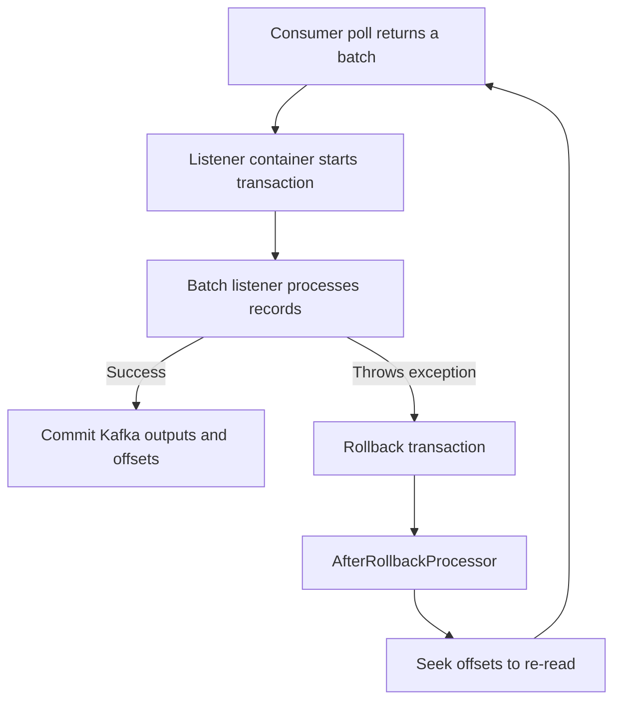

# AfterRollbackProcessor for batches

When a `@KafkaListener` processes an entire batch inside a Kafka transaction and throws an exception, the transaction rolls back. Spring Kafka invokes `AfterRollbackProcessor` after rollback to reset uncommitted offsets for re-reading or perform recovery. With batch listeners, the key nuance is that the container usually only knows the batch failed, not which exact record within the batch caused the error. Consequently, the default behavior is to re-read the entire batch.

This lesson focuses on `DefaultAfterRollbackProcessor`, how batches get redelivered, and how to enable batch-level recovery in Spring Kafka 3.2 and later. This is part of building reliable messaging flows: retries must be bounded, offsets must be handled accurately, and throughput should not suffer prolonged degradation from one failing batch.

## 1. Where does AfterRollbackProcessor sit in the processing flow?

`AfterRollbackProcessor` participates only in transactional flows. With Kafka transactions, the listener container starts a transaction before invoking the listener. When the listener succeeds, records sent via `KafkaTemplate` join the transaction and source offsets are sent into the same transaction to commit. If the listener throws an exception, the transaction fails; Kafka outputs and offsets in that transaction are not committed. After rollback, the container invokes `AfterRollbackProcessor`.

Basic flow:



`DefaultAfterRollbackProcessor` is the default implementation. For record listeners, it can seek the partition back to the failing record so that record is redelivered. For batch listeners, the container lacks reliable per-record failure details, so by default it seeks to redeliver the entire batch. Records the listener already processed before the exception occurred can also reappear.

`AfterRollbackProcessor` differs from `DefaultErrorHandler` in usage context:

| Component | Primary context | Role |
|---|---|---|
| `AfterRollbackProcessor` | Listener runs in a transaction and the transaction rolled back | Post-rollback offset handling, retries, or recovery |
| `DefaultErrorHandler` | Container handles listener errors via the error-handler mechanism | Retries, backoff, and recovery when not relying on transaction rollback |

If you configure a custom error handler on a transactional container, the handler must rethrow exceptions to the container when you want the transaction to roll back. If the handler catches the error and returns normally, rollback may not occur and `AfterRollbackProcessor` will not run as expected.

## 2. Why is the whole batch redelivered by default?

Suppose one `poll()` returns 5 orders. The listener processes them sequentially and hits an error on the third order:

```text
First batch:      [A, B, C, D, E]
                         ^
                         C caused an error

Transaction: rollback
Redelivered batch: [A, B, C, D, E]
```

The container receives an exception from the listener call for the entire batch. It cannot deduce that A and B completed safely, C failed, and D and E have not run yet. Therefore, `DefaultAfterRollbackProcessor` defaults to seeking so the batch is re-read. The redelivery can include records that succeeded during the prior attempt.

This directly affects throughput and correctness:

- **Increased duplicate work:** A and B may be reprocessed even though they did not fail.
- **Increased latency:** one bad record can stall the rest of the batch while awaiting retries.
- **Risk of duplicate side effects:** if the listener calls APIs, writes files, or updates an external system, actions completed before the Kafka rollback are not automatically undone.
- **Larger batches widen the replay scope:** the larger the batch, the higher the cost of reprocessing non-failing records.

Therefore, record processing logic inside a batch should be idempotent. Use event IDs or business keys as deduplication keys, store processing state inside the target system's own transaction whenever possible, and avoid irreversible side effects before knowing the transaction has committed.

Example listener:

```java
@KafkaListener(
        topics = "orders",
        containerFactory = "transactionalBatchFactory"
)
public void consume(List<ConsumerRecord<String, Order>> records) {
    for (ConsumerRecord<String, Order> record : records) {
        orderService.apply(record.value());
    }
}
```

If `apply()` throws an exception on any record, the transaction for that listener invocation rolls back. Under default batch handling, the records in the batch are redelivered. Do not assume `BatchListenerFailedException` will tell `AfterRollbackProcessor` which record failed: that exception is normally used to report failure position to `DefaultErrorHandler`; `AfterRollbackProcessor` still handles the batch after rollback.

## 3. Whole-batch recovery starting in Spring Kafka 3.2

Starting with Spring Kafka 3.2, you can enable recovery to skip a persistently failing batch using:

```java
containerProperties.setBatchRecoverAfterRollback(true);
```

This is recovery at the **whole-batch** level. The framework still cannot pinpoint individual failing records. Once `BackOff` retries are exhausted, the recoverer is invoked for each record in the batch; after recovery succeeds, the offsets for the records in the batch are committed. If using a dead-letter topic (DLT), this means even records that succeeded before the error occurred can be sent to the DLT alongside the batch.

For batch recovery to complete properly in a transactional flow, configure `DefaultAfterRollbackProcessor` with `commitRecovered = true` and supply a transaction-capable `KafkaTemplate`. The processor uses a post-rollback recovery transaction to publish recovered records and commit source offsets. The example below assumes the listener container is configured with a `KafkaTransactionManager` and `transactionalKafkaTemplate` uses a transaction-enabled `ProducerFactory`:

```java
@Bean
ConcurrentKafkaListenerContainerFactory<String, Order> transactionalBatchFactory(
        ConsumerFactory<String, Order> consumerFactory,
        KafkaTemplate<Object, Object> transactionalKafkaTemplate) {

    var factory = new ConcurrentKafkaListenerContainerFactory<String, Order>();
    factory.setConsumerFactory(consumerFactory);
    factory.setBatchListener(true);

    var dltRecoverer = new DeadLetterPublishingRecoverer(transactionalKafkaTemplate);

    var afterRollbackProcessor = new DefaultAfterRollbackProcessor<String, Order>(
            (record, exception) -> dltRecoverer.accept(record, exception),
            new FixedBackOff(1_000L, 2L),
            transactionalKafkaTemplate,
            true
    );

    factory.setAfterRollbackProcessor(afterRollbackProcessor);
    factory.getContainerProperties().setBatchRecoverAfterRollback(true);

    return factory;
}
```

In this example:

- `FixedBackOff(1_000L, 2L)` waits 1 second between retries and allows 2 retries after the initial delivery—at most 3 batch attempts total.
- `DeadLetterPublishingRecoverer` sends each recovered record to the DLT. The default resolver appends `-dlt` to the source topic name and preserves the source partition; thus the DLT needs enough matching partitions.
- `commitRecovered = true` requires passing `KafkaTemplate` to the processor. The template must use a transactional configuration so DLT sends and source offsets commit within the recovery transaction.
- `setBatchRecoverAfterRollback(true)` enables batch-level recovery. Without enabling this property, the default remains batch redelivery and the framework will not skip failing batches.

If the recoverer throws an exception, the processor seeks so the batch is redelivered. This prevents committing source offsets when sending the record to be recovered fails. Monitor DLT publish failures and ensure the DLT exists with compatible serializers, sufficient partitions, and proper retention policies.

## 4. When do you need to handle individual records in a batch?

Whole-batch recovery fits when business rules allow sending an entire failing batch to a reprocessing flow or skipping an unprocessable batch. If only one record fails while the remaining records should proceed normally, pushing the entire batch to a DLT can deny valid records their normal processing path.

In that case, consider `BatchToRecordAdapter` (available since Spring Kafka 2.4.2). The container still fetches batches from Kafka, yet the adapter invokes the listener one record at a time. This enables per-record error handling and recovery, such as using `DeadLetterPublishingRecoverer` for the bad record while other records continue under configured policy. Another option is simply using a record listener if business logic does not require batching.

| Need | Suitable approach |
|---|---|
| Simplicity, willing to redeliver the whole batch on error | Default `DefaultAfterRollbackProcessor` |
| Skip a persistently failing batch after bounded retries | Spring Kafka 3.2+, `setBatchRecoverAfterRollback(true)` and processor configured with recovery transaction |
| Isolate the failing record and keep processing remaining records | `BatchToRecordAdapter` or a record listener |

## 5. Operational checks

**Size batches according to retry cost.** Large batches improve per-poll efficiency, yet widen the replay scope when one record fails. Monitor p95/p99 processing time, rollback counts, and reprocessed record counts to tune `max.poll.records` and batch logic.

**Set deliberate retry limits.** Infinite retries can stall a partition indefinitely on invalid data or misconfiguration. Finite `BackOff` paired with a DLT lets the main stream progress after batch recovery. Conversely, transient infrastructure issues may need longer backoff and alerting before routing a batch to a DLT.

**Align timeouts.** Batch processing time, backoff waits, and transaction duration must fit within `max.poll.interval.ms` and `transaction.timeout.ms`. If a transaction expires while the listener is running, the consumer or producer can be fenced and recovery will not behave like an ordinary rollback.

**Design repeatable side effects.** A Kafka transaction protects Kafka outputs and offsets in the same transaction. It does not automatically roll back a REST call or an independent database transaction. Use idempotency keys, outbox/inbox tables, or transaction coordination suited to the target system.

**Inspect DLT contents.** With batch-level recovery, the DLT can contain many valid records alongside the failing one. Preserve source metadata such as topic, partition, offset, exception, and correlation ID for classification, investigation, and controlled replay.

## 6. Illustrative scenario

A consumer receives a batch of 100 orders. The 27th record fails because the pricing service is temporarily unresponsive. The listener already processed 26 records before the exception occurred.

1. The current transaction rolls back; Kafka outputs and offsets in the transaction are not committed.
2. With default settings, `AfterRollbackProcessor` seeks and the batch is redelivered. The first 26 records may run again, so `orderService.apply()` must handle duplicates.
3. If batch recovery from Spring Kafka 3.2 is enabled with a backoff allowing 2 retries, the batch can be delivered up to 3 times.
4. If it still fails and recovery is configured, the recoverer sends all 100 records to the DLT; source offsets are committed inside the recovery transaction once recovery operations succeed.
5. The consumer moves on to subsequent data. A separate workflow can triage the DLT, fix the root cause, and replay the orders that need processing.

If the business requirement is to send only the 27th order to the DLT while continuing to process 28–100 normally, whole-batch recovery is the wrong fit. Use `BatchToRecordAdapter` or a record listener to isolate errors per record.

## 7. Key takeaways

- `AfterRollbackProcessor` runs after a listener transaction rolls back.
- For batch listeners, the default behavior redelivers the entire batch because the container does not know which record failed.
- Since Spring Kafka 3.2, `setBatchRecoverAfterRollback(true)` allows whole-batch recovery after retries are exhausted; configure `DefaultAfterRollbackProcessor` with `commitRecovered = true` and a transactional `KafkaTemplate` to commit recovered records and source offsets together in a recovery transaction.
- Batch recovery routes or skips the entire batch. To recover only the failing record, use `BatchToRecordAdapter` or a record listener.
- Design idempotency, retries, DLT handling, and batch size together to curb duplicate processing and protect throughput.

## References

- [Spring for Apache Kafka — Handling Exceptions, After Rollback Processor section](https://docs.spring.io/spring-kafka/reference/kafka/annotation-error-handling.html)
- [Spring for Apache Kafka — Transactions with Batch Listeners](https://docs.spring.io/spring-kafka/reference/kafka/transactions.html)
- [Spring for Apache Kafka — Listener Container Properties](https://docs.spring.io/spring-kafka/reference/kafka/container-props.html)
