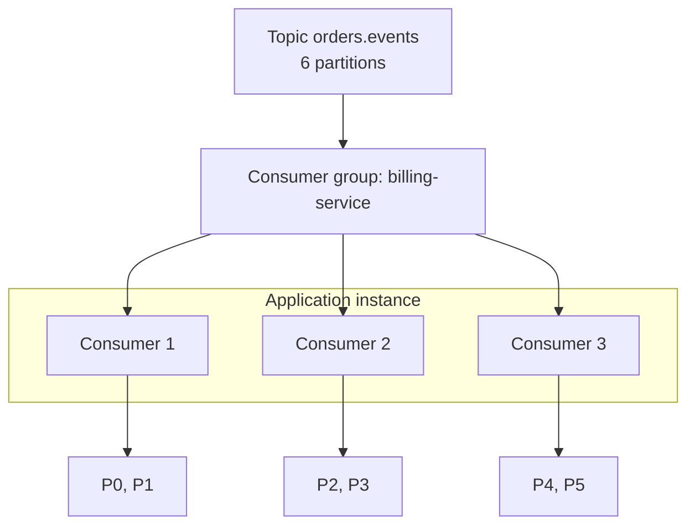
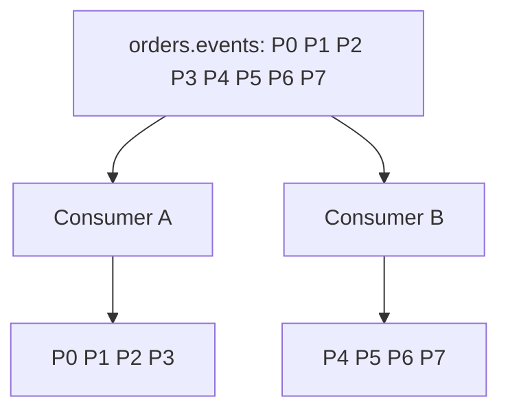

# Limiting Concurrency by Partition Count

In Spring Kafka, `concurrency` specifies how many consumers a listener container creates per application instance. Each consumer joins a consumer group and is assigned one or more partitions by Kafka. Because a partition is assigned to at most one consumer member in the same group at a time, the partition count limits the level of parallelism the group can exploit.

If a topic has six partitions but the entire application creates only two consumer members, each consumer must read multiple partitions. If the application creates ten consumer members, at most six consumers can receive partitions of that topic; the remaining four consumers have no partitions to process. Increasing concurrency beyond the partition count does not allow multiple consumers to read the same partition in parallel.

When running multiple replicas, concurrency per replica must be factored in. For a single topic and a single consumer group sharing the same subscription:

\[
\text{Total consumer members} =
\text{Replica count} \times \text{Concurrency per replica}
\]

\[
\text{Max consumers with partitions} =
\min(\text{Total consumer members},\text{Partition count})
\]

This is the theoretical limit for one topic that members subscribe to together. Actual assignments also depend on the topic list, partition assignor, and subscription configuration.

## 1. Partitions Are the Parallelism Limit of a Consumer Group

Each partition is an independent ordered log. A consumer group distributes partitions across consumer members so multiple partitions can be read concurrently.



With a six-partition topic and three consumer members, a balanced assignment can assign two partitions to each consumer. Kafka does not split a partition across two consumers in the same group, so each partition has only one owner at a time.

This means:

- One consumer can receive multiple partitions.
- One partition is not processed concurrently by multiple consumer members in the same group.
- Different partitions can be processed in parallel.
- Adding more consumers is only useful when there are unassigned partitions available for new consumers.

`concurrency` is not the number of threads created per partition. With a concurrent listener container, Spring Kafka creates multiple child containers; each child manages a Kafka consumer and its own processing thread.

## 2. Relationship Between Partition Count and Concurrency

Suppose topic `orders.events` has six partitions, and all consumers join group `billing-service`:

| Consumer members | Topic partitions | Parallelism capacity |
| ---: | ---: | --- |
| 1 | 6 | One consumer processes all six partitions |
| 2 | 6 | Up to two consumers process concurrently |
| 3 | 6 | Up to three consumers process concurrently |
| 6 | 6 | Up to six consumers process concurrently |
| 8 | 6 | Up to six consumers have partitions; two consumers are idle |

For one topic and consumers with the same subscription, the number of consumer members that can actually receive partitions is limited by the partition count. If `consumerCount > partitionCount`, excess members receive no partitions.

A consumer assigned multiple partitions still has only a single poll and listener processing thread for that child container. Records from partitions read by the consumer may be interleaved across polls, yet the listener method normally still runs on the container thread; a consumer with four partitions must not be understood as four workers running concurrently.

### 2.1. Example Table When Running a Single Instance

Topic has six partitions and the application has one replica:

| `concurrency` | Consumers created | Max consumers with partitions | Idle consumers |
| ---: | ---: | ---: | ---: |
| 1 | 1 | 1 | 0 |
| 2 | 2 | 2 | 0 |
| 3 | 3 | 3 | 0 |
| 6 | 6 | 6 | 0 |
| 8 | 8 | 6 | 2 |

When concurrency is one, that consumer can be assigned all six partitions. Raising it to three allows up to three consumer threads working on different partitions. Raising from six to eight does not increase the number of partitions that can be processed in parallel.

### 2.2. Idle Consumers Still Have Overhead

A consumer without partitions is still a created member/container. It can maintain connections, heartbeats, and client resources, even though it reads no records from that topic. Creating more consumers than partitions can increase memory, socket, and thread overhead as well as rebalance complexity without increasing throughput.

## 3. Accounting for Application Replicas

The `concurrency` property applies to each listener container in each application instance. If multiple pods or VMs are deployed with the same `group.id`, the total consumer member count is the product of replica count and concurrency per replica.

Example topic with six partitions:

| Replicas | Concurrency per replica | Total consumer members | Max consumers with partitions | Min idle consumers |
| ---: | ---: | ---: | ---: | ---: |
| 1 | 2 | 2 | 2 | 0 |
| 2 | 2 | 4 | 4 | 0 |
| 2 | 3 | 6 | 6 | 0 |
| 3 | 3 | 9 | 6 | 3 |
| 4 | 2 | 8 | 6 | 2 |

With two replicas, each with `concurrency=3`, the group has six consumer members in total. Six partitions can be distributed across six members if all members share the same subscription and the assignor distributes accordingly.

If you scale the application from two to four replicas while keeping concurrency at three, total members grow from six to twelve. With a six-partition topic, at most six members receive partitions; the remaining members do not increase parallelism for this topic.

## 4. Useful Concurrency Estimation Formulas

For a single topic and group, the following notation can be used:

- `P`: partition count of the topic.
- `R`: number of running application replicas.
- `C`: concurrency per replica for the listener.
- `M = R × C`: total group consumer members created by the listener.

Maximum number of consumers that can be assigned partitions:

\[
A_{max} = \min(P,M)
\]

Number of consumers without partitions in the simple case:

\[
I = \max(0,M-P)
\]

Example: `P=12`, `R=3`, `C=2` gives `M=6`, `Amax=6`, `I=0`. If raised to `C=5`, `M=15`, `Amax=12`, `I=3`.

This is an estimation method for a single topic with identical subscriptions. For a listener subscribing to multiple topics, the assignable partitions equal the total partitions across subscribed topics; however, the partition assignor and how members subscribe can cause actual assignments to be uneven or leave idle consumers even when total partitions exceed member count.

The formula `M = R × C` applies to one listener endpoint. If the application has multiple endpoints sharing the same group ID, add up consumer members created by all endpoints (plus consumers from other replicas/services in the group) before comparing against the partition count.

## 5. Configuring Concurrency in Spring Kafka

Spring Kafka allows configuring concurrency on the factory or overriding it on each `@KafkaListener`.

### 5.1. Default Configuration in application.yml

```yaml
spring:
  kafka:
    bootstrap-servers: ${KAFKA_BOOTSTRAP_SERVERS:localhost:9092}
    consumer:
      group-id: billing-service
      enable-auto-commit: false
      key-deserializer: org.apache.kafka.common.serialization.StringDeserializer
      value-deserializer: org.springframework.kafka.support.serializer.JsonDeserializer
      properties:
        "[spring.json.trusted.packages]": com.example.messaging.event
        "[spring.json.value.default.type]": com.example.messaging.event.OrderCreated
    listener:
      concurrency: 3

app:
  kafka:
    topic:
      orders: orders.events
```

`spring.kafka.listener.concurrency` is the default concurrency Spring Boot configures on the listener container factory. If no custom value is set on the annotation or factory, the listener uses this default concurrency. The common default value is one consumer.

### 5.2. Overriding Concurrency on @KafkaListener

A listener can declare its own concurrency:

```java
import com.example.messaging.event.OrderCreated;
import com.example.messaging.service.BillingService;
import org.springframework.kafka.annotation.KafkaListener;
import org.springframework.stereotype.Component;

@Component
public class OrderCreatedListener {

    private final BillingService billingService;

    public OrderCreatedListener(BillingService billingService) {
        this.billingService = billingService;
    }

    @KafkaListener(
            id = "ordersBillingListener",
            topics = "${app.kafka.topic.orders}",
            groupId = "billing-service",
            concurrency = "6"
    )
    public void onOrderCreated(OrderCreated event) {
        billingService.handle(event);
    }
}
```

The `concurrency` value on the annotation overrides the factory default for that listener endpoint. In this example, the listener creates six consumers per application instance. Running three replicas can produce 18 group members in total.

### 5.3. Using Environment-Based Property Placeholders

You do not need to hardcode concurrency in source code. You can use a placeholder:

```java
@KafkaListener(
        id = "ordersBillingListener",
        topics = "${app.kafka.topic.orders}",
        groupId = "billing-service",
        concurrency = "${app.kafka.listener.orders-concurrency:3}"
)
public void onOrderCreated(OrderCreated event) {
    billingService.handle(event);
}
```

`application.yml`:

```yaml
app:
  kafka:
    listener:
      orders-concurrency: 3
```

The production environment can override it via an environment variable:

```text
APP_KAFKA_LISTENER_ORDERS_CONCURRENCY=6
```

The value must be a valid positive integer. Changing an environment variable of a running process does not automatically change the number of already-created consumers; typically you need to update the configuration and restart/roll out instances following your deployment process.

### 5.4. Configuring with ConcurrentKafkaListenerContainerFactory

If creating a factory manually, set the default concurrency with `setConcurrency`:

```java
package com.example.messaging.config;

import com.example.messaging.event.OrderCreated;
import org.springframework.context.annotation.Bean;
import org.springframework.context.annotation.Configuration;
import org.springframework.kafka.config.ConcurrentKafkaListenerContainerFactory;
import org.springframework.kafka.core.ConsumerFactory;

@Configuration
public class KafkaListenerConfiguration {

    @Bean
    public ConcurrentKafkaListenerContainerFactory<String, OrderCreated>
            kafkaListenerContainerFactory(
                    ConsumerFactory<String, OrderCreated> consumerFactory
            ) {
        var factory =
                new ConcurrentKafkaListenerContainerFactory<String, OrderCreated>();
        factory.setConsumerFactory(consumerFactory);
        factory.setConcurrency(3);
        return factory;
    }
}
```

The annotation can override the default three consumers with `concurrency="6"` for a listener needing higher throughput. When multiple listeners share the factory, any listener without an override uses the factory's default value.

## 6. A Consumer Can Receive Multiple Partitions

Having more partitions than consumers is not an error. This is how Kafka normally distributes load: one consumer member receives multiple partitions and reads them within the same poll loop.

Example of a topic with eight partitions and a group with two consumers:



Each consumer polls data from its assigned partitions. Once the consumer finishes processing a record from one partition, it can proceed to process a record from another partition. That does not mean listener invocations within the same consumer run in parallel automatically.

If you increase consumers from two to four, each consumer can receive fewer partitions. This can improve throughput if CPU, I/O, and target systems can handle higher parallelism.

## 7. Limits When a Listener Subscribes to Multiple Topics

If a listener subscribes to multiple topics, the consumer group distributes partitions of those topics across members. The total partition count of the subscription sets the theoretical upper bound on active members.

Example of a listener subscribing to three topics, each with two partitions:

| Topic | Partition count |
| --- | ---: |
| `orders.events` | 2 |
| `payments.events` | 2 |
| `shipments.events` | 2 |
| Total | 6 |

Theoretically, up to six consumer members can be assigned partitions. However, assignment outcomes also depend on the partition assignor and each member's subscription.

### 7.1. Partition Assignor Affects Distribution

Kafka has multiple partition assignment strategies. For example, `RangeAssignor` divides partitions by ranges within each topic; when multiple topics have the same partition layout, some members may receive multiple partitions while other members receive none. `RoundRobinAssignor` distributes cyclically across the partition set and often produces a more even assignment when subscriptions match. Cooperative/sticky assignors prioritize minimizing partition movement during rebalances.

Do not simply sum partitions across multiple topics and assume every consumer will get a partition. Inspect the group's actual assignments and each member's subscription.

### 7.2. Multiple Listeners Sharing the Same Group ID

If multiple `@KafkaListener` endpoints subscribe to the same topic and share the same `groupId`, consumers from those containers join the same group and split partitions/records among themselves. They do not receive full copies of every record.

If two business flows need to independently receive all events, they must use separate group IDs. Each group can receive all partitions of the topic and maintain independent offset progress.

## 8. Distinguishing Concurrency from Other Settings

Several configurations are frequently confused with concurrency:

| Setting | Controls | Does Not Mean |
| --- | --- | --- |
| `concurrency` | Number of consumer members created by the listener container per instance | Number of partitions or records processed simultaneously within one partition |
| `max.poll.records` | Maximum records returned in a single `poll()` call per consumer | Number of consumers or threads |
| `max.poll.interval.ms` | Maximum time between polls before a member may be considered stalled | Commit wait time or consumer count |
| `fetch.min.bytes` | Minimum data the broker waits for before returning a fetch response (subject to timeout) | Number of assigned partitions |
| `group.id` | Consumer group identifier | Number of replicas or consumers |
| Partition count | Number of independent logs of the topic | Number of consumers created by the application |

`max.poll.records` can cause a consumer to receive more records in a single poll, but the listener still runs on the consumer/container thread according to the configured processing mode. To increase parallelism across partitions, check partition count and consumer member count.

## 9. Concurrency and Ordering Within a Partition

Kafka guarantees record ordering within each partition. Within the same consumer group, a partition is assigned to one consumer member at a time, so the consumer can process the partition's records in offset order.

If the producer uses `orderId` as the key:

```java
kafkaTemplate.send("orders.events", event.orderId(), event);
```

events for the same order are usually routed to the same partition as long as partition count and partitioner remain stable. Increasing concurrency does not cause events in the same partition to be processed in parallel by multiple consumers.

If the listener dispatches work to an executor and returns immediately, asynchronous tasks can complete out of order or the container can commit offsets before work completes. To process asynchronously, design explicit acknowledgement, backpressure, and per-key sequencing.

## 10. What Problems Arise When Concurrency Exceeds Partition Count?

For example, a topic has four partitions, the application runs three replicas, and each replica configures concurrency of three:

\[
M = 3 \times 3 = 9\text{ consumer members}
\]

\[
A_{max} = \min(4,9)=4
\]

At most four members receive partitions; at least five members have no partitions in a simple single-topic assignment. Creating nine consumers does not produce nine useful processing threads for a four-partition topic.

Possible impacts:

- Increased threads, sockets, and consumer client resources.
- More members participating in group coordination.
- Rebalances can take longer when member count is large.
- Logs and metrics become harder to read due to many idle members.
- Throughput does not increase because partition count remains unchanged.

In some multi-topic/assignor scenarios, the number of idle consumers may differ from the simple calculation. Inspect actual assignments to determine the exact count.

## 11. When Should You Increase Partitions Instead of Concurrency?

If consumer member count already equals or exceeds the topic's partition count and consumer lag keeps growing, raising concurrency usually will not solve the topic's parallelism limit. You may need to evaluate increasing partitions, but first identify the bottleneck.

Increasing partitions may be appropriate when:

- The consumer group needs more units of parallelism and the workload can be distributed across many keys.
- One consumer currently handles too many partitions and cannot keep up with write rates.
- Producer throughput needs more partitions to distribute records and batches.

Increasing partitions may not help when:

- A hot key accounts for most traffic and always lands on the same partition.
- A downstream database/API is the bottleneck.
- The listener is slow due to sequential service calls or lock contention.
- The producer does not distribute keys evenly.

Increasing partitions can also alter key-based routing and affect ordering. Evaluate the partitioner, key contract, compacted topics, and consumers before doing so.

## 12. Monitoring Assignments and Consumer Groups

After changing concurrency, verify actual consumer member counts and partitions assigned to each member:

```bash
kafka-consumer-groups.sh \
  --bootstrap-server localhost:9092 \
  --describe \
  --group billing-service
```

The output typically displays consumer ID, host, client ID, topic, partition, current offset, log end offset, and lag. From this you can determine:

- How many members have joined the group.
- Which partitions are assigned to which members.
- Which members have no partition assignments (check additional group describe flags/metrics depending on Kafka version).
- Which partitions hold the concentrated consumer lag.
- Whether load is evenly distributed or has hot partitions.

Metrics to monitor:

| Metric/Observation | Meaning |
| --- | --- |
| Consumer group member count | Number of consumer members that have joined the group |
| Partition assignment | Mapping between members and partitions |
| Records consumed rate | Rate at which consumers read records |
| Consumer lag | Distance between group offset and log end offset |
| Listener processing time | Time to process a record or batch |
| Rebalance count/duration | Frequency and duration of group partition reassignments |
| CPU, memory, thread count | Cost of increased concurrency on the application |
| Downstream latency/error | Whether target systems can handle the new level of parallelism |

If member count increases without throughput increasing, check partition assignments, key skew, consumer lag, and downstream processing time before scaling further.

## 13. Testing Concurrency Limits

You can use `@EmbeddedKafka` or Testcontainers to test listeners with varying partition counts and concurrency levels.

A test scenario:

1. Create topic `orders.events` with three partitions.
2. Start the listener with `concurrency="5"` and a dedicated group ID.
3. Wait for the consumer group to stabilize and receive assignments.
4. Verify at most three consumer members receive partitions of the topic; the other two members have no partitions.
5. Send records to all three partitions and use `CountDownLatch` to confirm the listener receives the data.
6. Re-run with concurrency set to two to observe each consumer receiving multiple partitions.
7. Check consumer lag and processing time under the same workload.

When testing assignments, do not assume a specific partition is always assigned to a specific consumer ID because the assignor can distribute differently. Assert total assignment count and verify each partition appears only once in the group.

Do not rely solely on fixed `Thread.sleep()` for synchronization. Wait for assignments using `ContainerTestUtils.waitForAssignment()` or timeout polling, and use latches/queues to synchronize with the listener.

## 14. Common Pitfalls

| Symptom | Common Cause | Resolution |
| --- | --- | --- |
| Concurrency increased but assigned consumer count does not increase | Consumer members already equal or exceed partition count | Check partition count and group assignment |
| Some consumers receive no partitions | Total consumers exceed assignable partitions or assignor distributes unevenly | Reduce concurrency, check assignor and subscriptions |
| Consumer lag remains high despite adding replicas | Low partition count, hot partition, or slow downstream | Measure per-partition lag, key distribution, and downstream latency |
| One consumer processes multiple partitions | Fewer consumer members than partitions | Increase concurrency if resources and partitions allow |
| Multiple replicas create too many consumers | Multiplying concurrency by replicas without checking partitions | Calculate total members before scaling |
| Consumer group rebalances frequently | Pod scaling, restarts, or consumers failing to poll on time | Monitor rebalances, listener processing, and `max.poll.interval.ms` |
| One partition has much higher lag | Hot key, skewed data distribution, or a partition with slow records | Inspect keys and workload per partition |
| Multiple listeners do not receive event copies | They share the same group ID and split partitions | Use separate group IDs for each business flow needing fan-out |

## 15. Process for Choosing Concurrency by Partition Count

1. Identify the topic the listener subscribes to and its current partition count.
2. Identify the expected replica count in the deployment environment.
3. Choose concurrency per replica; calculate total consumer members as `replicas × concurrency`.
4. Compare total members with partition count; identify potentially idle members.
5. Check other listeners in the same group and multi-topic subscriptions.
6. Review the partition assignor to understand actual distribution behavior.
7. Configure concurrency via factory or `@KafkaListener`/property placeholders.
8. Observe assignments, lag, throughput, rebalances, and downstream load.
9. Only increase partitions if the bottleneck truly lies in partition count and impact on key routing/ordering has been evaluated.
10. Re-test with representative load before broad rollout.

Concurrency is useful when it exploits independent partitions the topic already has. Calculate total consumers across all replicas and verify actual assignments to avoid creating extra idle consumers. Once all partitions are utilized, the next step is investigating key distribution, processing time, and target system capacity before deciding to expand the topic.

## 16. Self-Check

1. Why is a partition assigned to at most one consumer member within the same group?
2. A topic has six partitions, two replicas, and concurrency four per replica: how many consumer members exist and at most how many members have partitions?
3. Why does increasing concurrency from six to ten for a six-partition topic not increase topic parallelism?
4. Does one consumer assigned four partitions mean four listener methods run concurrently?
5. When a listener subscribes to multiple topics, why is total partition count insufficient to conclude assignments will be balanced?
6. How does `concurrency` differ from `max.poll.records`?
7. When should you increase partitions instead of increasing concurrency?
8. Why can a hot key cause high lag on one partition even when other partitions are idle?
9. If two listeners with the same group ID subscribe to the same topic, do they receive copies or split records?
10. Which metrics should be monitored after increasing concurrency?
