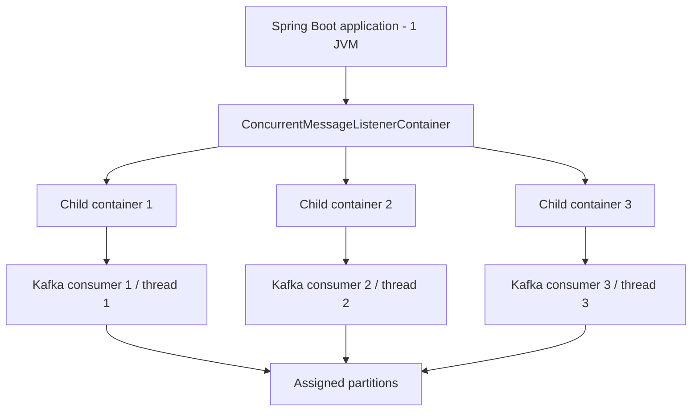

# Scaling Consumers Within a Single JVM with Spring Kafka

Within a single JVM, Spring Kafka can increase the number of consumers using the listener container's `concurrency` setting. A `ConcurrentMessageListenerContainer` manages multiple child `KafkaMessageListenerContainer` instances; each child container creates and manages its own Kafka consumer. This allows a single application instance to consume multiple partitions in parallel without running additional JVMs or pods.

Concurrency only creates additional consumers and processing threads inside the current process. It does not create more partitions, does not enable a single partition to be processed by multiple consumers in the same group, and does not guarantee linear throughput scaling. Useful parallelism depends on the number of assigned partitions, processing time, CPU/I/O resources, and how the listener processes records.

## 1. What Does Scaling Within a Single JVM Mean?

With a simple listener container, one container typically manages one Kafka consumer. When using `ConcurrentKafkaListenerContainerFactory`, Spring Kafka creates a concurrent container that can manage multiple child containers. Each child container runs its own consumer and performs polling on its consumer thread.



For example, an `order-service` instance has listener concurrency set to `3`:

- Spring creates one concurrent container for the endpoint.
- The parent container manages three child containers.
- Each child container creates one Kafka consumer.
- All three consumers join the listener's consumer group.
- Kafka assigns the partitions in the subscription to the three consumers.

These consumers still reside in the same JVM, sharing heap, CPU, connection pools, and the application's singleton beans. This is horizontal scaling inside a single process using multiple consumer threads.

## 2. Configuring Concurrency on the Listener Container Factory

A common approach is setting the default concurrency on `ConcurrentKafkaListenerContainerFactory`:

```java
@Configuration
public class KafkaListenerConfiguration {

    @Bean
    public ConcurrentKafkaListenerContainerFactory<String, OrderCreated>
            kafkaListenerContainerFactory(
                    ConsumerFactory<String, OrderCreated> consumerFactory) {

        var factory = new ConcurrentKafkaListenerContainerFactory<String, OrderCreated>();
        factory.setConsumerFactory(consumerFactory);
        factory.setConcurrency(3);
        return factory;
    }
}
```

Every endpoint using this factory uses a default concurrency of `3`, unless the endpoint provides its own value. The bean name `kafkaListenerContainerFactory` is typically the default name `@KafkaListener` looks for when `containerFactory` is not declared.

With Spring Boot, you can set the default concurrency for the auto-configured factory via configuration:

```yaml
spring:
  kafka:
    listener:
      concurrency: 3
```

If declaring a custom factory, check that bean's configuration. Do not assume custom factories automatically inherit every value from Spring Boot's default factory.

## 3. Overriding Concurrency for a Single `@KafkaListener`

A listener can override the factory's concurrency using the `concurrency` attribute:

```java
@KafkaListener(
        id = "orders-listener",
        topics = "orders",
        groupId = "orders-service",
        concurrency = "5"
)
public void onOrder(OrderCreated event) {
    orderService.process(event);
}
```

In this example, the endpoint requests five consumers in the application instance, even though the default factory may be configured with concurrency `3`. Because the annotation attribute is a string, placeholders can be used:

```yaml
app:
  kafka:
    listeners:
      orders:
        concurrency: 5
```

```java
@KafkaListener(
        id = "orders-listener",
        topics = "orders",
        groupId = "orders-service",
        concurrency = "${app.kafka.listeners.orders.concurrency:3}"
)
public void onOrder(OrderCreated event) {
    orderService.process(event);
}
```

The concurrency value is used when Spring creates the endpoint/container. Changing the property in a configuration file after the application is already running does not automatically increase or decrease the current number of consumers. For normal configuration changes, redeploy the instance; if runtime adjustment is required, use container management APIs appropriate to the version with a clear rebalance plan.

## 4. Relationship Between Concurrency and Partitions

Kafka assigns partitions to consumers within the same group. In a stable assignment state, a partition is assigned to at most one consumer in the group at a time. Therefore, useful concurrency is capped by the total number of partitions the group can read.

For example, topic `orders` has six partitions:

| Concurrency in one JVM | Consumers created | Typical outcome |
|---:|---:|---|
| 1 | 1 | One consumer can receive all six partitions |
| 2 | 2 | Two consumers split six partitions |
| 3 | 3 | Three consumers split six partitions |
| 6 | 6 | Potentially one partition per consumer |
| 8 | 8 | At least two consumers have no assigned partitions |

Exact assignment depends on the partition assignor, subscriptions, and other consumers in the group. The table illustrates parallelism limits and does not guarantee each consumer receives an equal number of partitions.

If concurrency exceeds the number of assignable partitions, excess consumers are still created but process no records until partitions are assigned to them. Increasing concurrency from `6` to `12` does not make a six-partition topic process in twelve parallel streams.

## 5. When a Listener Subscribes to Multiple Topics

Concurrency should be compared against the total number of partitions in the group's subscription, not just one topic's partition count. For example, a listener subscribes to `orders` with six partitions and `payments` with three partitions, giving a total subscription of nine partitions.

```java
@KafkaListener(
        topics = {"orders", "payments"},
        groupId = "business-projection",
        concurrency = "4"
)
public void onBusinessEvent(BusinessEvent event) {
    projectionService.apply(event);
}
```

With nine total partitions and four consumers, consumers can receive multiple partitions. There is no guarantee that every consumer receives partitions from both topics or the same number of partitions.

When a listener subscribes to multiple topics, check total partitions and traffic per topic. One high-traffic topic can dominate processing time even if its partition count is not the majority. If two streams have different throughput or lifecycle requirements, separating listeners and factories can make independent tuning easier.

## 6. How Does a Consumer Thread Process Partitions?

Each child container runs one Kafka consumer. Kafka consumer is not thread-safe, and polling, committing, seeking, or other consumer operations must follow the Kafka/Spring Kafka threading model.

In a standard synchronous record listener, the consumer thread polls records and invokes the listener on the child container's processing thread. If a consumer is assigned multiple partitions, it can receive records from multiple partitions in the same poll; the listener processes those records on that consumer thread.

Example:

```text
JVM: order-service

Consumer thread 1 -> partition 0, partition 3
Consumer thread 2 -> partition 1, partition 4
Consumer thread 3 -> partition 2, partition 5
```

A consumer can own multiple partitions, but the same partition is not processed concurrently by two consumers of the same group in a stable assignment. Kafka guarantees record ordering within each partition; it does not guarantee global ordering across multiple partitions.

Do not pass the same `KafkaConsumer` to multiple self-created threads. If parallel processing inside the listener is needed, design explicit handoff, acknowledgement, and commit mechanisms rather than calling the Kafka consumer directly from another executor.

## 7. How Does Concurrency Affect Ordering?

Kafka only guarantees record ordering within a single partition. Increasing concurrency allows different partitions to be processed in parallel, so completion order across partitions can vary.

Example of a topic with two partitions:

```text
Partition 0: A1 -> A2 -> A3
Partition 1: B1 -> B2 -> B3
```

Consumer thread 1 may process `A1`, `A2`, `A3` while consumer thread 2 processes `B1`, `B2`, `B3` concurrently. The application should not assume a global completion order like `A1, B1, A2, B2, ...` or any fixed interleaving.

If events for the same aggregate must stay ordered, the producer should use the same key so those events go to the same partition. When the consumer processes synchronously per partition, partition record order matches the log. If you offload records to a thread pool and process asynchronously, completion order can be inverted even though Kafka delivered records in order.

Concurrency does not break ordering inside a Kafka partition; decoupling processing from the consumer thread is what can break business ordering or cause commits ahead of unfinished records.

## 8. Listener Beans Must Be Thread-Safe

When concurrency is greater than `1`, multiple child containers can invoke the same method on the same singleton Spring bean. Therefore, the listener must be safe under concurrent multi-threaded access.

Unsafe example:

```java
@Component
public class OrderListener {

    private String currentOrderId;

    @KafkaListener(topics = "orders", concurrency = "3")
    public void onOrder(OrderCreated event) {
        currentOrderId = event.orderId();
        orderService.process(currentOrderId);
    }
}
```

`currentOrderId` is shared mutable state. Two threads can overwrite each other's value. Use local variables for per-invocation data:

```java
@Component
public class OrderListener {

    @KafkaListener(topics = "orders", concurrency = "3")
    public void onOrder(OrderCreated event) {
        String orderId = event.orderId();
        orderService.process(orderId);
    }
}
```

Principles:

- Prefer stateless listeners; keep record data in local variables.
- Do not use mutable fields to store temporary state for a single invocation.
- If shared caches or counters are needed, choose thread-safe structures and define consistency semantics clearly.
- Injected services must also be safe under concurrent calls.
- Verify connection pools, HTTP clients, and database pools have enough capacity to serve the added threads.
- Do not assume a listener bean gets a separate instance per consumer.

Increasing concurrency often exposes race conditions that rarely appeared when the listener had a single consumer. Inspect shared state before enabling high concurrency.

## 9. Batch Listeners and Concurrency

If the factory enables batch mode, each consumer still polls independently, but the listener receives a batch of records instead of one record at a time. Concurrency creates multiple consumers; each consumer can receive and process batches for its assigned partitions.

Factory example:

```java
@Bean
ConcurrentKafkaListenerContainerFactory<String, OrderCreated>
        batchKafkaListenerContainerFactory(
                ConsumerFactory<String, OrderCreated> consumerFactory) {

    var factory = new ConcurrentKafkaListenerContainerFactory<String, OrderCreated>();
    factory.setConsumerFactory(consumerFactory);
    factory.setBatchListener(true);
    factory.setConcurrency(3);
    return factory;
}
```

Listener receiving a batch:

```java
@KafkaListener(
        topics = "orders",
        groupId = "order-batch",
        containerFactory = "batchKafkaListenerContainerFactory"
)
public void onOrders(List<ConsumerRecord<String, OrderCreated>> records) {
    for (ConsumerRecord<String, OrderCreated> record : records) {
        orderService.process(record.value());
    }
}
```

Actual batch size depends on available data, `max.poll.records`, partition assignment, and poll timing; concurrency does not mean every consumer receives the same number of records. If a batch takes too long to process, the consumer can exceed `max.poll.interval.ms` and be considered inactive.

Batch processing requires explicit design for partial failures: if one record in a batch fails, the acknowledgement policy, error handler, and commit behavior determine which records are retried or recovered. Increasing concurrency does not replace a batch error-handling strategy.

## 10. Tuning Concurrency by Workload Type

There is no single optimal concurrency value for all listeners. Start from partition count and processing characteristics.

| Workload | Initial Choice | What to Monitor |
|---|---|---|
| I/O-bound, waiting on database/API | Can increase consumers if partitions and pools allow | Connection pool, downstream latency, timeouts, lag |
| CPU-bound, heavy computation | Start near CPU cores allocatable to the app, then measure | CPU saturation, GC, processing time |
| Fast processing, light load | Low concurrency may already suffice | Consumer lag and throughput |
| Large batches, long processing | Balance concurrency with per-poll duration and `max.poll.interval.ms` | Poll interval, batch duration, rebalances |
| Dependent on external system with quotas | Cap concurrency to downstream capacity | Rate limits, 429/503 errors, connection saturation |

For I/O-bound listeners, more consumer threads can help utilize wait time. However, if the database only has a 10-connection pool while the listener creates 30 querying threads, raising concurrency can increase queuing and timeouts instead of throughput.

For CPU-bound listeners, thread counts exceeding CPU capacity can increase context switching and GC. Measure throughput, p95/p99 processing latency, and CPU utilization rather than looking only at consumer count.

## 11. Distinguishing `concurrency`, `max.poll.records`, and `max.poll.interval.ms`

These three settings solve different problems:

| Setting | Layer | Meaning |
|---|---|---|
| `concurrency` | Spring Kafka listener container | Number of consumers/child containers for an endpoint on one instance |
| `max.poll.records` | Kafka consumer | Maximum records returned in a single poll |
| `max.poll.interval.ms` | Kafka consumer | Maximum time between polls before the consumer is considered stalled |

Configuration example:

```yaml
spring:
  kafka:
    consumer:
      properties:
        max.poll.records: 100
        max.poll.interval.ms: 300000
    listener:
      concurrency: 3
```

`max.poll.records=100` does not mean each consumer always receives 100 records; returned record count also depends on available data and partition assignment. If synchronous record processing takes too long, total time to process records from one poll can exceed `max.poll.interval.ms`.

Do not raise `max.poll.interval.ms` to mask stuck processing without investigating the cause. Also do not raise `max.poll.records` just to exploit concurrency; large batches can prolong processing time and increase memory usage.

## 12. Concurrency and Rebalance

When new consumers join or leave a group, Kafka may rebalance to redistribute partitions. Raising concurrency from `1` to `4` adds group members and typically triggers a rebalance. Similarly, stopping the application or changing instance count can alter partition assignments.

During a rebalance:

- Consumers may pause receiving records while assignments are updated.
- Partitions can move from one consumer thread to another.
- Offset commits and processing stop points affect whether records may be redelivered.
- Too-frequent rebalances can reduce throughput.

If a listener processes slowly, check `max.poll.interval.ms`, batch processing time, and time to the next poll. If the application experiences repeated consecutive rebalances, check group coordinator logs, consumer membership, processing duration, and session/heartbeat settings suitable for the Kafka version.

High concurrency does not by itself cause continuous rebalances; membership changes, consumers failing to poll in time, or connection errors are the causes to investigate.

## 13. Client ID and Observing Individual Consumers

Setting `clientIdPrefix` on a listener helps distinguish consumers created by the same endpoint:

```java
@KafkaListener(
        id = "orders-listener",
        topics = "orders",
        groupId = "orders-service",
        clientIdPrefix = "orders-consumer",
        concurrency = "3"
)
public void onOrder(OrderCreated event) {
    orderService.process(event);
}
```

Spring Kafka appends a suffix so child consumers have distinct client IDs. Exact naming may vary by version, but the goal is avoiding duplicate client IDs and enabling observation of individual consumers.

When inspecting on brokers or metrics, distinguish:

- `group.id`: consumer group sharing offsets and partition assignments.
- `client.id`: client identifier for logs/metrics.
- Listener `id`: endpoint identifier in the Spring Kafka registry.
- `concurrency`: number of child consumers for the endpoint within one JVM.

Do not use `clientIdPrefix` in place of `groupId`. Changing client ID does not create a new consumer group and does not reset offsets.

## 14. Scaling Multiple Listeners in the Same JVM

An application can have multiple endpoints with different concurrency levels:

```java
@Component
public class ApplicationListeners {

    @KafkaListener(
            id = "orders-listener",
            topics = "orders",
            groupId = "orders-service",
            concurrency = "4"
    )
    public void onOrder(OrderCreated event) {
        orderService.process(event);
    }

    @KafkaListener(
            id = "payments-listener",
            topics = "payments",
            groupId = "payments-service",
            concurrency = "2"
    )
    public void onPayment(PaymentCreated event) {
        paymentService.process(event);
    }
}
```

In this example, the JVM creates four consumers for the orders endpoint and two consumers for the payments endpoint. Each endpoint has its own group ID and subscription. Total consumers in the process is six, while the partition ceiling is calculated separately per endpoint's group and subscription.

Total concurrency across all listeners affects thread count, memory, connection pools, and downstream resources. Do not optimize each listener in isolation while ignoring total JVM load.

## 15. Scaling in One JVM vs. Scaling Across Multiple JVMs

Single-JVM concurrency and running multiple instances both increase a group's consumer count, but they differ in resource scope and failure domain.

| Criterion | Increasing Concurrency in One JVM | Increasing JVM/Pod Count |
|---|---|---|
| Consumer count | Increases with listener concurrency | Increases with instance count times concurrency per instance |
| Resources | Shares CPU, heap, and connection pools of one JVM | Can use independent resources across multiple nodes |
| Failure domain | One JVM crash can take down all consumers of that instance | One instance failing usually does not stop other instances |
| Deployment | No extra replicas needed | Requires orchestration/deployment of multiple replicas |
| Partition limit | Total group consumers still capped by partitions | Total group consumers across all instances still capped by partitions |
| Best suited for | Exploiting one instance's CPU and I/O | Increasing resource capacity and fault tolerance |

Example topic with twelve partitions:

- One JVM, concurrency `4`: up to four consumers in the group from that instance.
- Three JVMs, each concurrency `2`: six consumers total in the group.
- Six JVMs, each concurrency `3`: eighteen consumers created; at least six consumers cannot receive partitions if the group only subscribes to twelve partitions.

Adding instances does not remove the partition limit. If more consumers running in parallel are needed, evaluate adding partitions and the impact of changing partition count on key ordering/partitioning.

## 16. Offloading to an Executor and Asynchronous Processing

A common pattern to increase throughput is having the consumer thread receive a record and submit work to an `ExecutorService`. This can increase parallelism of business logic, but introduces ordering and offset risks.

Example of an approach not to use carelessly:

```java
@KafkaListener(topics = "orders", concurrency = "3")
public void onOrder(OrderCreated event) {
    executor.submit(() -> orderService.process(event));
    // Listener returns before work completes.
}
```

If the listener returns and the container commits the offset before the task finishes, the application can lose processing if the JVM stops after committing. If the task later fails, Kafka may not redeliver the record because the offset was already committed.

If an asynchronous listener is needed, use the return type/acknowledgement mechanisms supported by your Spring Kafka version and verify exact commit timing. Do not call `KafkaConsumer` or acknowledgement objects arbitrarily from executor threads. Queue bounds/backpressure are needed to prevent consuming faster than processing and exhausting the heap.

In many cases, increasing listener container concurrency and keeping processing synchronous on the consumer thread is simpler and easier for offset guarantees than building an additional thread pool.

## 17. Measuring Single-JVM Scaling Effectiveness

Before increasing concurrency, measure a baseline; after each change, compare the same workload type over the same duration.

Metrics to monitor:

- Consumer lag by group/topic/partition.
- Record throughput and average, p95/p99 processing time.
- Active consumer count and partition assignments.
- Rebalance count and rebalance duration.
- JVM CPU, heap, GC pauses, and thread count.
- Database connection pool usage, HTTP pool, timeouts, and rate limits.
- Poll duration and time between polls.
- Retries, DLT, and record processing errors.

Example benchmark table:

| Concurrency | Throughput | Processing p95 | CPU | End-of-run lag |
|---:|---:|---:|---:|---:|
| 1 | Record measurement | Record measurement | Record measurement | Record measurement |
| 2 | Record measurement | Record measurement | Record measurement | Record measurement |
| 4 | Record measurement | Record measurement | Record measurement | Record measurement |
| 6 | Record measurement | Record measurement | Record measurement | Record measurement |

Do not choose concurrency solely by peak instantaneous throughput. If throughput rises while p99 latency, downstream errors, or rebalances surge, the new configuration may reduce overall stability.

## 18. Practical Concurrency Selection Workflow

A workflow you can apply:

1. Determine the number of partitions in the subscription and existing consumers across the entire group.
2. Measure a baseline with low concurrency, usually starting at `1`.
3. Increase in steps, such as `2`, `3`, `4`, within the partition limit.
4. Measure throughput, lag, p95/p99, CPU, GC, and downstream load.
5. Verify the listener is thread-safe and produces no duplicate side effects on rebalance.
6. Check per-poll processing time against `max.poll.interval.ms`.
7. Pick the lowest value that meets throughput/lag goals with acceptable resource usage and stability.
8. Test restarts, rebalances, and instance scaling to confirm real behavior.

For example, if a topic has eight partitions, concurrency `1` cannot keep up with backlog, concurrency `4` meets the target, and concurrency `8` brings no further improvement while increasing CPU, you can select `4`. This is only an example of reading benchmark results; decisions must rely on your system's measurements.

## 19. Common Pitfalls When Scaling Within a Single JVM

**Increasing concurrency beyond partition count:** excess consumers receive no partitions. Check partition assignments before increasing further.

**Assuming concurrency is total application threads:** it is the number of child consumers for an endpoint; the application also has web, scheduler, producer, executor, and other threads.

**Non-thread-safe listener beans:** shared mutable fields cause race conditions. Use local variables or properly synchronized state.

**Insufficient database pool:** multiple consumers querying simultaneously exhaust the connection pool. Tune the pool or cap concurrency to downstream capacity.

**Broken business ordering:** records handed off to an executor finish out of order. Keep per-partition processing or design explicit sequencing.

**Committing before async processing finishes:** tasks can be lost after offsets are committed. Use supported async acknowledgement mechanisms and test crash/restart scenarios.

**Frequent rebalances:** poll processing takes too long, consumers disconnect, or membership fluctuates. Check poll intervals, processing times, and group logs.

**Raising `max.poll.records` instead of concurrency:** the two settings serve different purposes. Tune based on batch size and processing duration.

**Using the same group ID when independent processing is needed:** instances/listeners split partitions instead of each receiving all records. Use separate groups for each independent capability.

**Ignoring total JVM load:** multiple high-concurrency listeners compete for CPU, heap, and connection pools. Monitor total process resources.

## 20. Production Checklist

- Partition counts for all subscribed topics are known.
- Total group consumers across all JVMs/pods are calculated, not just the current instance.
- Concurrency does not exceed useful parallelism without a specific operational reason.
- Listeners and called services are safe when multiple threads run concurrently.
- Database/HTTP connection pools have sufficient capacity for the consumer count.
- Key/partition strategy preserves required business ordering.
- `max.poll.records` and `max.poll.interval.ms` match processing times.
- Batch or asynchronous handoff has a clear acknowledgement/commit strategy.
- Metrics exist for consumer lag, partition assignments, rebalances, latency, throughput, and JVM resources.
- Multiple concurrency levels have been benchmarked with a representative workload.
- Restart/rebalance and record reprocessing behavior have been tested.
- A plan exists to add partitions or scale to more JVMs if one instance runs out of resources.

Scaling within a single JVM via concurrency increases the number of consumers and poll threads of a listener container. Choose concurrency based on partition assignments, thread safety, and downstream capacity; measure results using lag, throughput, latency, and resource utilization. When a single JVM hits CPU, heap, or failure-domain limits, scaling across multiple instances may be more appropriate, while total group consumers must still be designed around partition counts.
