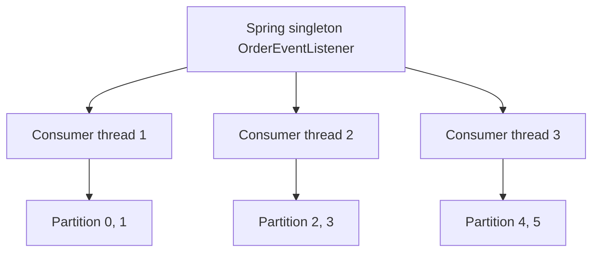

# Listener Thread Safety

When increasing the `concurrency` of a Spring Kafka listener container, multiple consumer threads can invoke the same listener at the same time. This enables parallel processing across partitions, but also exposes shared-data access bugs if the listener or an injected service holds mutable state that is not thread-safe.

In Spring, beans have singleton scope by default. A bean annotated with `@KafkaListener` is typically used as the handler target for all child consumers created by the concurrent container. Therefore, when configuring `concurrency = 3`, do not assume Spring creates three independent copies of the listener bean. Design the listener as a component that can be called concurrently.

## 1. Why Must Listeners Be Thread-Safe?

`ConcurrentMessageListenerContainer` creates multiple child `KafkaMessageListenerContainer` instances. Each child container has its own consumer and consumer thread. Consumers in the same group receive different partitions, yet they can concurrently invoke the same listener object.



For example, a topic has six partitions and the listener uses `concurrency=3`. Kafka can assign two partitions to each consumer. Three threads can invoke `onOrderEvent()` concurrently on the same `OrderEventListener` instance.

Thread safety is the ability of an object to be used concurrently by multiple threads without corrupting state or producing incorrect results. A listener may work properly with a single consumer, yet develop race conditions when concurrency increases or when multiple listener containers share a service.

## 2. How Are Listeners Typically Shared?

Example of a Spring-managed listener:

```java
import org.springframework.kafka.annotation.KafkaListener;
import org.springframework.stereotype.Component;

@Component
public class OrderEventListener {

    private final OrderApplicationService orderService;

    public OrderEventListener(OrderApplicationService orderService) {
        this.orderService = orderService;
    }

    @KafkaListener(
            id = "orderListener",
            topics = "orders.events",
            groupId = "order-projection",
            concurrency = "3"
    )
    public void onOrderEvent(OrderCreatedEvent event) {
        orderService.handle(event);
    }
}
```

In this example, Spring creates one singleton bean `OrderEventListener`. The concurrent listener container can invoke `onOrderEvent()` from multiple consumer threads. The method is safe if it does not modify unprotected shared state and `OrderApplicationService` along with its collaborators are also safe under concurrent calls.

Do not inspect only the listener class. Thread safety is a property across the entire call graph: a listener can be stateless yet still hit race conditions if a service, cache, mapper, or helper it calls contains shared mutable state.

Situations that can create concurrent access:

- A `@KafkaListener` uses `concurrency` greater than 1.
- Multiple listener containers invoke the same singleton service.
- One bean has multiple `@KafkaListener` methods invoked from different containers.
- A listener delegates to an executor or `@Async` to run work off the consumer thread.
- The application runs multiple instances; each instance has its own in-memory state while writing concurrently to an external data store.

## 3. Prefer Stateless Listeners

The simplest design is keeping the listener stateless: inject only immutable dependencies and use local variables within each method invocation. Local variables live on the current thread's stack frame, so they cannot be overwritten by other invocations.

```java
import org.springframework.kafka.annotation.KafkaListener;
import org.springframework.stereotype.Component;

@Component
public class PaymentEventListener {

    private final PaymentApplicationService paymentService;

    public PaymentEventListener(PaymentApplicationService paymentService) {
        this.paymentService = paymentService;
    }

    @KafkaListener(
            topics = "payments.events",
            groupId = "payment-projection",
            concurrency = "4"
    )
    public void onPayment(PaymentEvent event) {
        String paymentId = event.paymentId();
        long amountInCents = event.amountInCents();

        paymentService.apply(paymentId, amountInCents);
    }
}
```

`paymentId` and `amountInCents` are invocation-local variables. The listener does not hold the in-flight event in a field, does not reuse a mutable buffer across threads, and does not manually manage consumers.

Stateless does not mean the whole system has no state. Business state can live in a database, cache, or state store with proper synchronization and transaction mechanisms. The listener should simply coordinate processing that state via collaborators designed for concurrent access.

## 4. Race Condition Example with a Mutable Field

A common mistake is using a `HashMap` or `ArrayList` as a field and updating it from the listener:

```java
import java.util.HashMap;
import java.util.Map;

@Component
public class UnsafeOrderListener {

    private final Map<String, Integer> processedCounts = new HashMap<>();

    @KafkaListener(
            topics = "orders.events",
            groupId = "order-counter",
            concurrency = "4"
    )
    public void onOrder(OrderEvent event) {
        Integer count = processedCounts.get(event.orderId());
        processedCounts.put(event.orderId(), count == null ? 1 : count + 1);
    }
}
```

This code has two problems:

1. `HashMap` does not support concurrent reads and writes from multiple threads.
2. Even if replaced with `ConcurrentHashMap`, the `get()` followed by `put()` sequence is still not an atomic update. Two threads can both read 5 and both write 6, losing an increment.

The result can be wrong without necessarily throwing an exception. This is why race conditions are often hard to catch with sequential tests.

## 5. Using Thread-Safe Data Structures Properly

If an in-memory counter is needed for metrics or observability, use concurrent structures and atomic operations:

```java
import java.util.concurrent.ConcurrentHashMap;
import java.util.concurrent.ConcurrentMap;
import java.util.concurrent.atomic.LongAdder;

import org.springframework.kafka.annotation.KafkaListener;
import org.springframework.stereotype.Component;

@Component
public class OrderMetricListener {

    private final ConcurrentMap<String, LongAdder> counts =
            new ConcurrentHashMap<>();

    @KafkaListener(
            topics = "orders.events",
            groupId = "order-metrics",
            concurrency = "4"
    )
    public void onOrder(OrderEvent event) {
        counts.computeIfAbsent(event.type(), key -> new LongAdder())
                .increment();
    }
}
```

`ConcurrentHashMap.computeIfAbsent()` creates or retrieves the counter safely under concurrent access; `LongAdder` fits high-frequency concurrently updated counters.

However, state in this example exists only in the memory of a single application instance. It is lost on restart and is not automatically synchronized across multiple instances. Do not use this counter as a source of business truth such as account balances or official order counts. For business data, use database transactions, optimistic locking, atomic updates, or a state store with appropriate guarantees.

## 6. Thread-Safe Collaborators and Shared Resources

A stateless listener can still invoke a non-thread-safe service. When reviewing a listener, check every injected dependency.

| Component | Safe Usage |
|---|---|
| Spring `KafkaTemplate` | Can be shared across threads; the factory-managed Kafka producer supports concurrent use. |
| Kafka `Consumer` | Do not share one instance across threads; consumers are managed by the listener container and used on their own consumer thread. |
| Shared mutable `HashMap`, `ArrayList`, `StringBuilder` | Do not read/write concurrently without proper synchronization. Use local variables or appropriate concurrent structures. |
| `JdbcTemplate` and Spring Data repositories | Generally designed for shared injection; transactions and business state still need proper handling. Do not keep a mutable `Connection` in a field. |
| JPA `EntityManager` / Hibernate `Session` | Do not share persistence context instances across threads. Use Spring-managed proxy/transaction-bound mechanisms. |
| Fully configured `ObjectMapper` | Can be shared for read/write operations after configuration completes; do not mutate configuration while processing. |
| `SimpleDateFormat` | Not thread-safe; use immutable `DateTimeFormatter` or create a separate formatter per invocation. |
| Custom caches/services | Inspect implementations, underlying libraries, and state mutation; singleton does not automatically mean thread-safe. |

Do not store `KafkaConsumer`, `EntityManager`, Hibernate `Session`, JDBC `Connection`, or a mutable request context in a listener field for reuse across invocations. These objects have specific lifecycles or thread constraints.

## 7. Protecting State When Mutable State Is Truly Needed

If mutable state cannot be eliminated, select a protection mechanism based on data scope and contention levels.

### Atomics and Concurrent Collections

Use `AtomicInteger`, `AtomicLong`, `LongAdder`, or `ConcurrentHashMap` when operations match their semantics. When multiple operations must stay consistent together, a single atomic field is insufficient to protect multi-field invariants.

### `synchronized` or Lock

A lock can protect a critical section:

```java
private final Object stateLock = new Object();
private final Map<String, OrderState> states = new HashMap<>();

public void updateState(String orderId, OrderState nextState) {
    synchronized (stateLock) {
        states.put(orderId, nextState);
    }
}
```

The lock protects map operations, but all threads sharing one lock must wait on each other. Putting `synchronized` on the entire listener method can nullify consumer concurrency and cause processing time to exceed `max.poll.interval.ms`.

Keep critical sections short; do not perform HTTP calls, database calls, or wait on I/O while holding a lock. If per-key locking is needed, carefully design lock lifecycles and cleanup to prevent memory leaks or deadlocks. Do not build a custom per-key lock registry if database transactions or partitioning already solve the requirement.

### Immutable Objects

Prefer immutable objects for configuration and data passed between threads. Java `record`s, `final` fields, and immutable collections reduce the number of states that can change after publishing an object to another thread. Note that `final` only fixes the reference; if the reference points to a mutable collection, its contents can still change.

## 8. Partition Ordering and Thread Safety Are Two Different Concerns

Within a consumer group, a partition is assigned to at most one consumer member at a time. With a synchronous listener, the consumer thread invokes the listener sequentially for records it receives from a partition. This is the foundation for processing records in order within a partition.

However, that does not make every field of the listener thread-safe:

- A listener can process multiple partitions concurrently via multiple child consumers.
- Multiple listener containers or different consumer groups can call the same singleton service concurrently.
- Multiple application instances have separate in-memory state while updating the same database.
- A listener can hand off work to an executor, causing multiple records to run concurrently even when they come from the same partition.

If keys are used to route events of the same aggregate into the same partition, records for that aggregate are normally processed sequentially by one consumer in the group, provided key mapping and partition count remain stable and the listener does not break ordering via async handoff. Different keys can still be processed in parallel across different partitions.

Thread-safe collections only protect data structures inside the process. They do not guarantee business ordering, do not create distributed transactions, and do not stop two application instances from updating the same database row concurrently.

## 9. Caution When Offloading Processing to an Executor or `@Async`

A common scaling pattern is having the listener receive a record and push work to a thread pool:

```java
@KafkaListener(topics = "orders.events", groupId = "order-worker")
public void onOrder(OrderEvent event) {
    executor.execute(() -> orderService.handle(event));
}
```

This code returns immediately after submitting the task. The listener container may consider the invocation completed normally and commit offsets per `AckMode`, while actual work is still running. If the task later fails, the exception does not automatically flow back to the listener container to trigger retries as in synchronous processing.

Additionally, two events from the same partition can be submitted in order yet finish out of order. This corrupts side-effect ordering and causes offset commits not to reflect completed work.

If asynchronous processing is required:

1. Choose an async listener model supported by your Spring Kafka version, or design controlled manual acknowledgement.
2. Acknowledge/commit a record only after its corresponding work finishes successfully.
3. Bound in-flight tasks, queue capacity, and backpressure; do not use an unbounded executor.
4. Ensure records with the same key/partition complete in order if business rules require it.
5. Handle exceptions inside the worker and route errors to the designed retry/DLT mechanism.
6. Do not assume the consumer thread's transaction context propagates automatically to executor threads.

With modern Spring Kafka versions supporting async listener return types, verify acknowledgement semantics and out-of-order completion behavior for your exact framework version. Configuring async acknowledgements can cause the container to hold later completed offsets until earlier offsets are acknowledged; that alone does not guarantee business side effects are ordered.

Since Spring Kafka 3.2, asynchronous return types such as `CompletableFuture` and Reactor `Mono` are supported for listeners. When used properly, the container tracks completion and exceptions of the async result; acknowledgement behavior is adjusted to acknowledge only upon completion. This is a better choice than submitting a task and returning directly, though you still need to check your version's semantics and ensure business ordering when multiple results finish out of order.

## 10. Transactions and Databases Under Concurrent Listeners

Listeners frequently update databases. When concurrency is greater than 1, multiple transactions can update related data simultaneously. Choose persistence-layer protections:

- Use transactions for groups of operations that must commit together in the database.
- Use optimistic locking (`@Version`) to detect two invocations updating the same entity concurrently.
- Use atomic update statements or unique constraints when appropriate.
- Use idempotency keys/event IDs to prevent applying the same event multiple times after retries or redelivery.
- Use transaction isolation and database locks per business requirements, rather than relying on `synchronized` in a single JVM to protect data across multiple instances.

Example of an entity with optimistic locking:

```java
import jakarta.persistence.Entity;
import jakarta.persistence.Id;
import jakarta.persistence.Version;

@Entity
public class AccountBalance {

    @Id
    private String accountId;

    private long balanceInCents;

    @Version
    private long version;

    // Getters and business methods.
}
```

When two transactions read the same version and both update it, the later-writing transaction can receive an `OptimisticLockingFailureException`. The application must decide whether to retry the transaction, reload state, and apply events in business order. Optimistic locking detects conflicts; it does not automatically reorder events.

Spring transactions typically bind resources to the running thread. If a listener offloads work to another thread, the consumer thread's transaction does not automatically wrap work on the new thread. Open an appropriate transaction on the worker or use an explicitly supported processing model.

## 11. `ThreadLocal` and Per-Thread State

`ThreadLocal` is sometimes used to hold per-thread context, but listener containers reuse consumer threads over long lifetimes. Failing to call `remove()` after processing leaves stale data that can leak into subsequent invocations on the same thread.

Do not use `ThreadLocal` to store the current event or long-lived business state. If tracing/security libraries provide per-thread context, use the library's built-in integration and ensure context is cleared at the end of each invocation. When handing off to an executor, context does not propagate automatically to another thread unless a dedicated propagation mechanism is configured.

## 12. Testing Thread Safety

Sequential unit tests are not enough to catch all race conditions. Test with multiple concurrent invocations and integration tests with multiple consumer threads.

### Testing Services with Multiple Threads

For shared in-memory state, spawn multiple concurrent tasks with `ExecutorService` and `CountDownLatch`, then verify invariants after all tasks finish. Use barriers/latches to maximize the chance threads hit update sections simultaneously; do not rely on `Thread.sleep` to induce race conditions.

### Integration Testing with Embedded Kafka or Testcontainers

A useful integration test should:

1. Create a multi-partition topic.
2. Start the listener with `concurrency` greater than 1.
3. Send enough records so multiple consumers have concurrent work.
4. Record peak concurrent active invocations using `AtomicInteger`/`LongAdder` in a test probe.
5. Verify no lost or duplicate updates per the test's contract.
6. If per-key ordering is required, send multiple events with the same key and verify sequence/side effects remain valid.
7. Stop the container and wait for invocations to finish to avoid thread leaks in tests.

Example probe measuring concurrency inside a listener:

```java
import java.util.concurrent.atomic.AtomicInteger;

public final class ConcurrencyProbe {

    private final AtomicInteger active = new AtomicInteger();
    private final AtomicInteger maxActive = new AtomicInteger();

    public void enter() {
        int current = active.incrementAndGet();
        maxActive.accumulateAndGet(current, Math::max);
    }

    public void exit() {
        active.decrementAndGet();
    }

    public int maxActive() {
        return maxActive.get();
    }
}
```

In the test, the listener calls `enter()` before processing and `exit()` in `finally`. Use a latch to hold running invocations in a controlled synchronization window; then assert `maxActive()` is greater than 1 when the topic has enough partitions and concurrency allows. The probe is solely for testing, not a business synchronization mechanism.

## 13. Common Pitfalls

| Symptom | Cause | Resolution |
|---|---|---|
| Counter or cache has wrong values when concurrency increases | Listener mutates a field using a non-thread-safe collection or non-atomic sequence. | Use stateless design, atomic operations, or appropriate concurrent structures. |
| Listener has `synchronized` yet throughput does not increase | All consumer threads are serialized through a single lock. | Shrink the critical section or move state to an appropriate persistence mechanism. |
| Database throws optimistic locking failures | Multiple invocations update the same entity/version concurrently. | Handle conflicts/retries and enforce business sequencing. |
| Record is committed while background processing fails | Listener submits a task and returns before the worker completes. | Use controlled async listeners/acknowledgements; propagate errors and commit after completion. |
| Events with the same key complete out of order | Executor processes in parallel or multiple producers emit out of sequence. | Serialize by key/partition and validate sequence/version. |
| Tests only pass when single-threaded | Tests do not induce contention or verify concurrent invariants. | Use barriers/latches and integration tests with multiple consumers. |
| Data leaks across invocations | Using `ThreadLocal` or mutable fields without resetting. | Use local variables; clear context/thread-locals in `finally`. |
| Sharing a `KafkaConsumer` across multiple threads | Kafka consumer is not thread-safe. | Let the Spring listener container own the consumer; never share instances manually. |

## 14. Thread-Safe Listener Design Checklist

- The listener bean can be invoked concurrently; fields hold only immutable dependencies or state with explicit protection.
- No events, buffers, mutable collections, or per-invocation contexts are stored in shared fields.
- All injected services, caches, and helpers have been evaluated for thread safety.
- `KafkaConsumer`, `EntityManager`, `Session`, or JDBC `Connection` are never shared across threads.
- `KafkaTemplate` and thread-safe collaborators are used according to their contracts.
- If async handoff is used, ordering, acknowledgement, commit, retry, and backpressure are explicitly defined.
- Business state uses database transactions, optimistic locking, atomic updates, or appropriate multi-instance mechanisms.
- Tests run with concurrency greater than 1 and verify business invariants.

## 15. Key Takeaways

- `concurrency` creates multiple child consumers and consumer threads; threads can invoke the same singleton listener bean.
- Do not assume each consumer thread receives its own listener copy.
- Prefer stateless listeners, local variables, and thread-safe dependencies.
- Shared mutable `HashMap`/`ArrayList` easily causes race conditions; use atomic/concurrent structures when appropriate.
- `KafkaTemplate` can be shared; `KafkaConsumer` must not be shared across threads.
- A partition is assigned to only one consumer in a group at a time, yet the listener can still be called concurrently for different partitions.
- Thread safety does not automatically guarantee business ordering or consistency across multiple application instances.
- Async handoff can commit offsets before work completes and invert side-effect ordering.
- Use transactions, optimistic locking, idempotency, and sequences/versions to protect business state.
- Test with multiple threads and multiple partitions, using latches/barriers instead of fixed delays.

When increasing Spring Kafka concurrency, treat the listener and all collaborators as components called concurrently. Keep listeners stateless, store business state in storage mechanisms with appropriate guarantees, and test both race conditions and processing order. This approach lets you scale consumers without turning concurrency bugs into hard-to-trace data corruption.

## References

- [Spring for Apache Kafka — Message Listener Containers](https://docs.spring.io/spring-kafka/reference/kafka/receiving-messages/message-listener-container.html)
- [Spring for Apache Kafka — Thread Safety and Listener Containers](https://docs.spring.io/spring-kafka/reference/kafka/thread-safety.html)
- [Apache Kafka — KafkaConsumer API](https://kafka.apache.org/40/javadoc/org/apache/kafka/clients/consumer/KafkaConsumer.html)
- [Apache Kafka — KafkaProducer API](https://kafka.apache.org/40/javadoc/org/apache/kafka/clients/producer/KafkaProducer.html)
