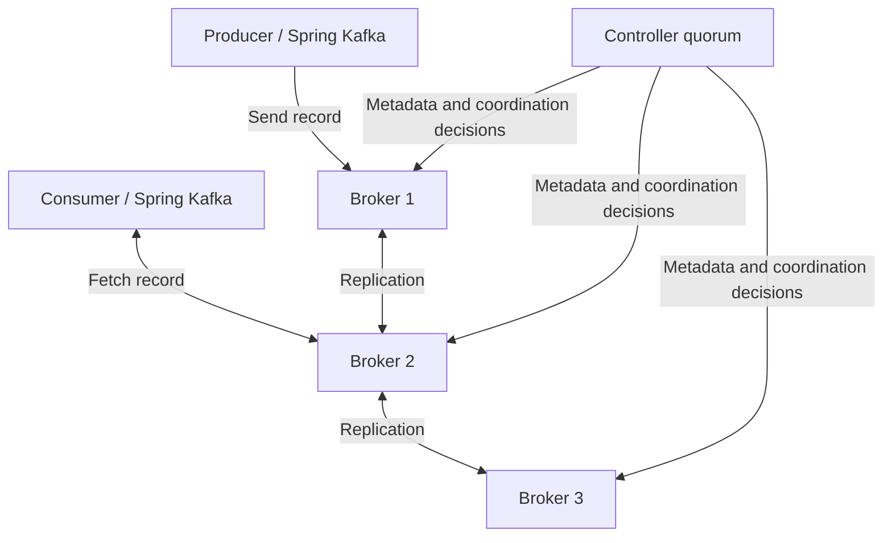
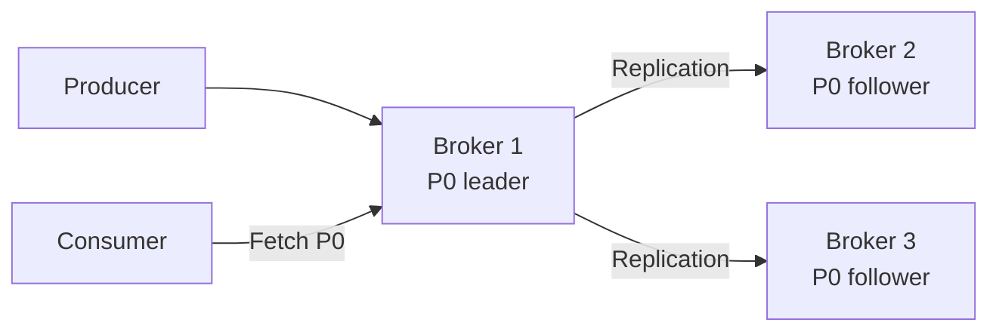

# Cluster, broker, and controller

Kafka is designed as a distributed system. An application can send and receive events through a single connection address, but behind that address lies a **cluster** of multiple **brokers** with mechanisms to coordinate metadata and distribute data across nodes. To operate Spring Kafka reliably, you need to understand which broker stores data, which controller manages cluster state, and how clients find the right broker.

## 1. Overview: what roles make up a cluster?

A **Kafka cluster** is a collection of Kafka processes working together to provide an event storage and streaming system. These processes typically run across multiple machines or containers to distribute load and tolerate failures.

Three concepts to distinguish:

- **Cluster** is the entire Kafka system working together.
- **Broker** is a data-serving node: it receives records from producers, stores partitions, serves consumers, and participates in replication.
- **Controller** is the role that manages metadata and coordinates cluster state changes, such as brokers joining/leaving the cluster or partition leader changes.

You can think of two planes of responsibility:

- **Data plane**: producers and consumers exchange records directly with brokers.
- **Control plane**: the controller coordinates state and metadata so brokers know how the cluster is organized.

The controller is not an intermediary server that every record must pass through. When a producer sends a record, the data request is sent to the broker currently acting as the leader of the target partition.

### Role diagram



This simplified diagram illustrates logical roles. In a KRaft deployment, the controller can run on dedicated nodes or in the same process as a broker depending on configuration. The record path remains producer/consumer to broker.

## 2. Broker: the data-serving node

Each broker is a Kafka process with an identifier in the cluster. A broker is responsible for storing and serving the partitions assigned to it.

A broker's main responsibilities include:

1. **Receiving records from producers**: the broker validates the request, determines the partition, and appends the record to the partition log if it is the partition leader.
2. **Storing partition logs**: records are appended sequentially to the log on disk. Kafka preserves record order within a single partition.
3. **Serving consumers**: consumers send fetch requests to the broker holding the partition replica they need to read.
4. **Replication**: brokers holding follower replicas pull data from the leader to maintain multiple copies of a partition.
5. **Participating in consumer group management**: a broker is selected as the group coordinator for each consumer group to handle group membership, heartbeats, and partition assignment.

A broker is typically configured with a unique identifier, such as `node.id` in KRaft mode. This identifier helps Kafka distinguish nodes; it is not the network address clients use to connect.

### One broker does not equal one partition

A single broker can store multiple partitions across multiple topics. Conversely, replicas of the same partition are distributed across different brokers when the cluster has enough nodes and appropriate replication configuration.

For example, topic `order-events` has 3 partitions and a replication factor of 3:

| Partition | Brokers hosting replicas | Role at a given point in time |
|---|---|---|
| P0 | Broker 1, 2, 3 | One leader, two followers |
| P1 | Broker 2, 3, 1 | One leader, two followers |
| P2 | Broker 3, 1, 2 | One leader, two followers |

This table only illustrates the distribution. Kafka can elect different leaders for each partition; there is no rule that Broker 1 is always the leader.

### Leader and follower brokers

For each partition, under normal operation only one replica acts as the **leader**. Producers write to the leader; consumers also read from the leader under the common default mechanism. The remaining replicas are **followers**, continuously catching up with the leader's log.



If the broker hosting the leader fails, Kafka can elect another eligible replica as leader. Thus the partition continues serving requests after the cluster completes the failover process.

## 3. Controller: managing metadata and cluster state

Kafka needs a component that knows which brokers are alive, which partitions reside on which brokers, and which replica is acting as leader. That component is the **controller**.

The controller handles cluster-level changes, such as:

- Tracking brokers registering, disconnecting, or leaving the cluster.
- Managing metadata for topics, partitions, replicas, and related configurations.
- Coordinating partition leader changes during failures or when the cluster needs rebalancing.
- Propagating metadata changes so brokers update their internal state.

The controller works with **metadata**, meaning information describing the cluster. Metadata differs from business records inside a topic. For example, topic name, partition count, replica assignments, and the current leader are metadata; an `OrderCreated` event is a data record.

### Active controller and controller quorum in KRaft

In modern Kafka architecture using **KRaft**, Kafka manages metadata with a group of controllers coordinating via a Raft-based quorum mechanism. One member acts as the **active controller** to process metadata changes. The remaining members maintain copies of the metadata and can take over if the active controller fails.

A metadata change is only considered committed when it achieves quorum. With an odd-sized quorum of 3 members, a majority of 2 members is normally required to confirm. Therefore:

- One controller can fail while the cluster retains the ability to coordinate.
- If too many members are lost such that a majority no longer remains, new metadata changes may stall until quorum is restored.
- The number and placement of controllers should be designed to avoid placing all members in the same failure domain.

In KRaft, metadata is written to the metadata log and maintained by the controllers in the quorum. Brokers receive metadata updates to refresh their state. This metadata log is separate from the business event logs of topics.

Kafka previously had a ZooKeeper-based architecture to store and coordinate metadata. When reading documentation or configurations of older clusters, you may encounter ZooKeeper and legacy controller terminology. With KRaft deployments, the quorum controller role is handled by Kafka itself, without requiring ZooKeeper.

### Must the controller be a separate machine?

No. KRaft supports two common deployment modes:

- **Combined mode**: a single node serves both broker and controller roles. This is convenient for development, testing, or small systems.
- **Dedicated controller mode**: controller nodes focus solely on metadata coordination, while brokers focus on serving data. This provides better resource and failure-domain isolation for production-grade clusters.

Regardless of the mode used, distinguish the logical roles: brokers serve records; the controller manages metadata and cluster state.

## 4. Do not confuse the controller with a partition leader

This is a common confusion because both involve leadership roles:

| Concept | Scope | Responsibility |
|---|---|---|
| Active controller | Entire cluster | Coordinates metadata changes and cluster state |
| Partition leader | Single partition | Handles writes and serves reads for that partition per configuration |
| Consumer group coordinator | Single consumer group | Manages members, heartbeats, and partition assignment for the group |

A cluster has only one active controller at a time in the KRaft model, but it can have many partition leaders simultaneously. Each partition has its own leader, and partition leaders can reside on different brokers.

The **group coordinator** is also a distinct role. It is assumed by a broker and manages the consumer group protocol. The controller does not directly coordinate each consumer poll or handle offset commits on behalf of the group coordinator.

## 5. Replication, ISR, and fault tolerance

Replication gives a partition multiple copies across different brokers. Kafka uses replication to reduce the risk of data loss and maintain availability when a broker fails.

Key terms:

- **Replication factor**: total number of replicas for a partition, including the leader. A replication factor of 3 means one leader and two followers.
- **Follower**: a replica that copies the log from the leader to stay caught up with data.
- **ISR (In-Sync Replicas)**: the set of replicas keeping up with the leader according to Kafka's criteria. A replica that falls too far behind can be removed from the ISR and re-added once it catches up.
- **Under-replicated partition**: a partition with replicas not fully caught up, usually a sign to investigate broker health or network issues.

When a producer configures `acks=all`, the leader broker waits for replicas in the ISR to acknowledge according to Kafka's conditions before returning success. `min.insync.replicas` sets the minimum ISR threshold for a write with `acks=all` to be accepted. For example, a replication factor of 3 and `min.insync.replicas=2` allows writes when at least two replicas remain in the ISR; if the number of replicas in the ISR drops below the threshold, the producer may receive an error rather than writing with lower durability.

This configuration is a trade-off between write availability and data protection. It does not replace monitoring replication, distributing brokers across failure domains, and handling errors in the application.

### When a leader is lost

Suppose P0 has its leader on Broker 1 and followers on Broker 2 and Broker 3:

1. Broker 1 loses connectivity.
2. The controller detects that the broker is no longer active and coordinates electing a new leader from eligible replicas.
3. A follower currently in the ISR, such as Broker 2, can be elected as the new leader.
4. Brokers and clients receive the new metadata.
5. Producers and consumers resume working with the new leader after updating metadata and reconnecting.

If no eligible replica remains, the partition may become temporarily unavailable. Allowing election of an out-of-ISR replica (unclean leader election) can increase availability but risks losing records that replica had not yet received. This is an operational decision to weigh against the system's data requirements.

## 6. How do clients find brokers using bootstrap servers?

An application does not need to know each partition's leader in advance. Clients only need one or a few reachable **bootstrap servers** addresses:

1. The producer or consumer connects to a broker in the bootstrap list.
2. The broker returns the required cluster metadata, including topics, partitions, and relevant broker addresses.
3. The client identifies the broker hosting the leader of the partition it needs to access.
4. The client sends produce or fetch requests directly to that broker.
5. When metadata changes, the client refreshes its information and can reconnect to the new leader.

Therefore, `bootstrap.servers` is the starting point for cluster discovery, not a mandatory proxy for all traffic.

### Spring Boot configuration

Example Spring Kafka application connecting to a three-broker cluster:

```yaml
spring:
  kafka:
    bootstrap-servers:
      - kafka-1.example.internal:9092
      - kafka-2.example.internal:9092
      - kafka-3.example.internal:9092
    consumer:
      group-id: billing-service
      auto-offset-reset: earliest
```

Listing multiple bootstrap servers helps clients still initialize connections if one address is unavailable. The addresses must be reachable from the environment where the application runs.

Producer using `KafkaTemplate`:

```java
@Service
public class OrderEventPublisher {

    private final KafkaTemplate<String, OrderCreated> kafkaTemplate;

    public OrderEventPublisher(
            KafkaTemplate<String, OrderCreated> kafkaTemplate) {
        this.kafkaTemplate = kafkaTemplate;
    }

    public void publish(OrderCreated event) {
        kafkaTemplate.send(
            "order-events",
            event.orderId(),
            event
        );
    }
}
```

Consumer using `@KafkaListener`:

```java
@Component
public class BillingEventListener {

    @KafkaListener(
        topics = "order-events",
        groupId = "billing-service"
    )
    public void onOrderCreated(OrderCreated event) {
        // Process order event
    }
}
```

Spring Kafka manages creating producers/consumers and interacting with the Kafka client. The Kafka client performs metadata discovery and connects to the appropriate broker. The application does not need to manually look up partition leaders in business code.

### Important note about advertised listeners

A broker can listen on one internal address while advertising a different address to clients through its listener configuration. After bootstrapping, clients use the broker addresses that the cluster publishes in metadata.

Therefore, network configuration must ensure advertised addresses are reachable from where the application runs. This is a common issue when running Kafka in Docker, Kubernetes, VMs, or behind NAT: the client connects to the bootstrap address but then fails to connect to the advertised broker address.

When encountering connection errors, check all of the following:

- The `spring.kafka.bootstrap-servers` list.
- Broker listeners and `advertised.listeners`.
- DNS, ports, firewalls, and network routes from the application to each broker.
- Security configurations such as TLS or SASL if required by the cluster.

## 7. Choosing an appropriate topology

A test cluster on a personal machine can run a single broker to learn how to send and receive records. However, a single broker cannot fully demonstrate the fault-tolerance benefits of multi-node replication.

For environments requiring high availability, design the number of brokers and controllers based on load, replication factor, failure domains, and recovery objectives. Practical guidelines:

- Place replicas of the same partition on different brokers; if possible, distribute brokers across independent failure domains.
- Ensure the controller quorum has enough members and is not concentrated on the same machine or failure domain.
- Monitor disconnected brokers, controller quorum, under-replicated partitions, ISR, and request latency.
- Use multiple bootstrap servers reachable from the application.
- Test advertised listeners from the actual Spring Boot runtime environment, not just from the machine running Kafka.
- Choose `acks`, `min.insync.replicas`, and replication factor according to data durability requirements and tolerance for write interruptions.

## 8. Checklist when connecting Spring Kafka to a cluster

When the application cannot send or receive events, check in order:

1. Are the brokers running and can the application reach at least one bootstrap server?
2. Are brokers advertising the correct hostname and port reachable by the application?
3. Does the topic already exist, and are its partition count and replication factor appropriate?
4. Are partition leaders elected and is the ISR healthy?
5. Is the controller quorum operational and able to process metadata changes?
6. Does the consumer group have a valid coordinator, members, and partition assignments?
7. If errors occur when a broker stops or restarts, can clients refresh metadata and connect to the new leader?

These questions help distinguish network/connection errors, metadata errors, replication errors, and consumer group errors. Do not blame the controller for every Kafka error: an application might reach the control plane yet fail to reach a broker endpoint returned in metadata, or a partition might lack a leader due to insufficient replication eligibility.

## 9. Key takeaways

- A cluster is the entire Kafka system; a broker is a data-serving node.
- The controller manages metadata and coordinates cluster state changes.
- Producers and consumers exchange records directly with brokers, typically the partition leader.
- Active controller, partition leader, and group coordinator are three distinct roles.
- KRaft uses a controller quorum to maintain metadata; the metadata log is separate from business record logs.
- Bootstrap servers help clients discover the cluster; advertised listeners determine whether clients can reach brokers after discovery.
- Replication, ISR, `acks`, and `min.insync.replicas` work together to control data durability when brokers fail.

Once you understand these roles, Spring Kafka configurations such as `bootstrap-servers`, producer, consumer, and listener make much clearer sense: Spring Kafka provides the application-side integration API, while the Kafka cluster handles routing, storage, replication, and node coordination.

