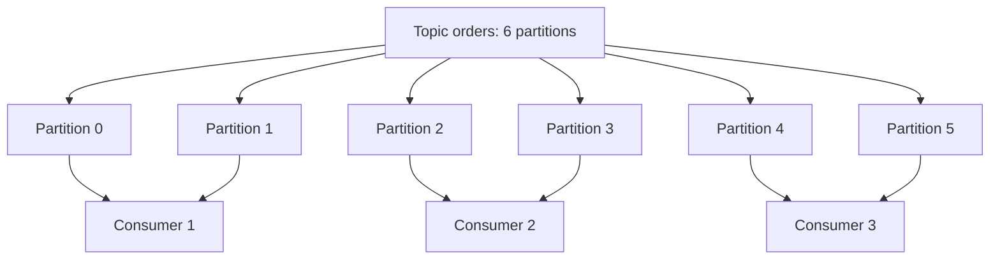

# Partitions and units of parallelism in Kafka

In Kafka, a **partition is both the unit of ordered storage and the unit of work distribution for consumers**. A topic can consist of multiple partitions. Producers write records to partitions; consumer groups split reading those partitions among their members. Therefore, how partitions are divided and how keys are chosen directly affect processing order, scalability, and load balancing in a Spring Kafka application.

This lesson focuses on the relationship between topics, partitions, offsets, and consumer groups, and then applies those concepts to `KafkaTemplate` and `@KafkaListener`.

## 1. Topics, partitions, and records

A topic is the logical name of an event stream, such as `orders`, `payments`, or `inventory-events`. A topic's data is divided into one or more partitions. Each partition is an append-only log: new records are appended to the end of the log and given an offset identifying their position within that partition.

A Kafka record typically has the following components:

| Component | Meaning |
|---|---|
| Key | Key used to route the record to a partition; may be empty |
| Value | Event payload |
| Headers | Key-value metadata, such as correlation ID or event type |
| Timestamp | Time associated with the record per producer/broker configuration |
| Partition | Partition holding the record |
| Offset | Position of the record within that partition |

For example, topic `orders` has three partitions:

```text
Topic: orders

Partition 0:  offset 0 -> offset 1 -> offset 2 -> offset 3 -> ...
Partition 1:  offset 0 -> offset 1 -> offset 2 -> ...
Partition 2:  offset 0 -> offset 1 -> offset 2 -> offset 3 -> ...
```

Offsets are only meaningful within a single partition. `orders-0` at offset `12` and `orders-1` also at offset `12` are two distinct records. Kafka does not maintain a global offset sequence across the entire topic, so offsets cannot be used to infer absolute ordering across partitions.

### A partition is an ordered log

Kafka guarantees record order inside a single partition by offset. If record A has a smaller offset than record B in partition P, a consumer reading partition P sequentially will encounter A before B.

Kafka does not guarantee total ordering across partitions. For example, an event in `orders-0` might be processed by a consumer before or after an event in `orders-1`, depending on polling schedules and processing speed. Timestamps of two records do not establish a global processing order.

This leads to an important design rule: **if events must be processed in order, route them to the same partition**. In most cases, producers achieve this by sending the same key for events belonging to the same business entity.

### Replicas are not additional partitions

A partition can be replicated across multiple brokers to increase fault tolerance. One replica is elected leader; the remaining replicas follow data from the leader. Producers and consumers normally interact with the leader according to Kafka's protocol.

The replication factor provides redundant copies when a broker fails. It does not increase the number of logical partitions and does not increase how many consumers in the same group can process in parallel. To increase parallelism within a consumer group, look at the number of partitions the group subscribes to.

## 2. Keys determine partitions and ordering scope

When sending a record, a producer can specify the topic and value, or include a key as well. With Kafka's default partitioner, a keyed record is typically routed based on a hash of the key and the current partition count. Consequently, records with the same key normally land in the same partition as long as partition configuration remains unchanged.

The partitioner receives the key after the serializer converts it into bytes. Therefore, producers writing to the same topic must serialize keys consistently and compatibly. If two services send the same order ID but serialize it into different byte sequences, Kafka may compute different partitions. The value serializer governs payload encoding; when a record has a key, the key is what drives routing in the default partitioner.

In Spring Kafka, `KafkaTemplate` lets you pass the key directly:

```java
@Service
public class OrderEventPublisher {

    private final KafkaTemplate<String, OrderCreated> kafkaTemplate;

    public OrderEventPublisher(
            KafkaTemplate<String, OrderCreated> kafkaTemplate) {
        this.kafkaTemplate = kafkaTemplate;
    }

    public void publish(OrderCreated event) {
        kafkaTemplate.send("orders", event.orderId(), event);
    }
}
```

In this example, `orderId` is the key. Events for the same order, such as `OrderCreated`, `OrderPaid`, and `OrderShipped`, will be routed to the same partition if they use the same key and partitioning remains unchanged. Consumers can read those events in the order written to the partition.

Choose the key based on the **unit that requires business ordering**:

| Need | Suitable key | Effect |
|---|---|---|
| Preserve event order per order | `orderId` | Events for one order stay in the same partition |
| Preserve inventory changes per product | `productId` or `sku` | Changes for one product are serialized into one stream |
| Preserve transactions per account | `accountId` | One account gets one sequential stream |
| Distribute load when entity ordering is not needed | Business-appropriate key or no key | Can distribute more broadly, depending on the partitioner |

Keys with low cardinality or skewed distribution can cause one partition to receive excessive data. For example, if every record uses the key `VIETNAM`, they may all concentrate in a single partition. The remaining partitions sit mostly idle, even if the total partition count is large.

If no key is provided, the partitioner chooses a partition according to producer policy and the version/configuration in use. Do not rely on any specific ordering among keyless records. When precise routing is needed, you can configure a custom partitioner or specify a partition in the send API, though only when the application genuinely owns the distribution rules.

### Increasing partitions can change where a key lands

With the default partitioner, key routing depends on the partition count. When you increase the number of partitions, a key may map to a different partition. Old records for the key remain in the old partition, while new records may go to the new partition. At that point, there is no longer a single stream guaranteeing order across the key's entire history.

Therefore, plan the partition count when designing the topic. If business logic strictly depends on per-key ordering, treat increasing partitions as an architectural change: assess impact, plan a migration or new topic, and test ordering across the transition.

## 3. Consumer groups split partitions for parallel processing

A consumer group is a set of consumers sharing the same `group.id` to read topics. Kafka assigns partitions to consumers in the group. At any stable point in time, a partition is assigned to at most one consumer within the same group. One consumer can be assigned multiple partitions.

For example, a topic has six partitions and the `order-projection-v1` group has three consumers:



The diagram illustrates one possible assignment; the actual split depends on the partition assignor and the consumers currently in the group.

If there are two consumers in the group, each may be assigned three partitions. If there are six consumers, each may receive one partition. If there are eight consumers, at least two consumers will have no partitions to read from this topic during that time. Adding consumers beyond the partition count does not increase parallelism for the topic.

For a single topic and a group subscribing to all partitions of that topic, the number of consumers actually doing work at a time cannot exceed the partition count. Calculate this limit based on the total assignable partitions in the subscription when a group reads multiple topics.

### Different groups read independently

The constraint that a partition belongs to at most one consumer applies within the same group. Another group can still read all partitions of that topic using its own offsets.

For example:

```text
Topic orders
  ├── group: order-projection-v1  -> update order view
  ├── group: billing-service     -> generate billing data
  └── group: analytics-service   -> aggregate metrics
```

All three groups receive the same event stream with independent reading progress. This is how Kafka lets multiple services consume the same event without the producer sending separate messages to each service.

## 4. Offsets and consumer progress

An offset identifies a record's position within a partition. A consumer group stores committed offsets separately per partition to know where the next read should begin.

The committed offset usually represents the **next position to read**, not the offset of the last processed record. For example, if a consumer successfully processes record offset `41` and commits `42`, the next read begins at offset `42`.

Do not treat offsets as a count of records seen. Compaction, transactions, and internal record types can leave gaps in observed offsets. Consumers must rely on the records and offsets Kafka provides rather than assuming offsets are always contiguous.

### Committing too early vs. committing too late

- If you commit the offset before processing finishes, the application can miss processing a record if the process stops after the commit but before business work completes.
- If processing finishes without committing, the application can re-read the record after a restart or rebalance. This creates duplicate processing.

For typical workloads, applications usually commit only after the listener completes successfully and design handlers to be idempotent. Idempotent means processing the same event multiple times does not corrupt business state, for instance by using `eventId` as a deduplication key.

Spring Kafka provides several acknowledgment modes. With `AckMode.RECORD`, the container commits after the listener successfully processes each record; with `AckMode.BATCH`, the container commits after finishing the batch returned by a single poll. When the container manages commits, `enable-auto-commit=false` is commonly set so Kafka client auto-commit does not interfere with processing progress.

Basic configuration example:

```yaml
spring:
  kafka:
    consumer:
      group-id: order-projection-v1
      enable-auto-commit: false
      auto-offset-reset: earliest
    listener:
      ack-mode: record
      concurrency: 3
```

`auto-offset-reset` is only applied when the group does not yet have a valid offset (or the offset is no longer available). `earliest` requests starting from the earliest retained data; `latest` starts from newly written data. This setting does not automatically reset a group that already has an offset back to the start of the topic.

If a listener calls external systems outside Kafka, such as writing to a database or calling an API, the Kafka commit and the external system transaction do not automatically become a single atomic transaction. The application must handle cases where the database write succeeds but the Kafka commit fails, or vice versa. Idempotency, inbox/outbox patterns, and appropriate retry mechanisms help manage these situations. Kafka transactions can guarantee exactly-once semantics for certain Kafka read-process-write flows under appropriate configuration, but they do not automatically make external side effects outside Kafka exactly-once.

## 5. Configuring concurrency in Spring Kafka

Spring Kafka creates a listener container to manage consumers and invoke `@KafkaListener` methods. The `concurrency` property specifies how many child consumers/containers a listener container can run.

Example listener reading topic `orders`:

```java
@Component
public class OrderEventListener {

    @KafkaListener(
            topics = "orders",
            groupId = "order-projection-v1"
    )
    public void onOrderEvent(ConsumerRecord<String, OrderCreated> record) {
        String orderId = record.key();
        int partition = record.partition();
        long offset = record.offset();

        // Update projection for the order.
        // Ensure the operation can be safely reprocessed.
    }
}
```

Combined with `spring.kafka.listener.concurrency: 3`, the application runs up to three consumers for this listener container. If the topic has six partitions and only one application instance, the three consumers can share the six partitions. If the topic only has two partitions, at most two consumers get partitions to read; the remaining consumer stays idle.

When running multiple application instances, concurrency applies per instance. For example, two instances with concurrency three each create six consumers total in the same group. If the topic has six partitions, this achieves maximum parallelism for that topic in the group. If you scale to three instances, each still creates three consumers for nine total; three consumers will have no assigned partitions when the group is stable.

You can visualize this basic limit as follows:

```text
Max busy consumers <= partitions assigned to group

Example:
  6 partitions, 3 consumers  -> up to 3 busy consumers
  6 partitions, 6 consumers  -> up to 6 busy consumers
  6 partitions, 9 consumers  -> up to 6 busy consumers
```

This is the parallelism limit at the consumer layer. It does not mean the system always hits peak throughput: speed also depends on record size, processing time, I/O, database latency, poll configuration, network, and broker load.

### One consumer assigned multiple partitions still processes sequentially per thread

A consumer can be assigned multiple partitions. The Kafka client tracks reading position separately per partition. With a standard synchronous listener, the container invokes the listener on the consumer's processing thread; do not assume multiple partitions assigned to one consumer will automatically run in parallel inside business code.

If you offload records to a thread pool for asynchronous processing, you must manage completion order and offsets per partition. Never commit past a record that has not finished processing, because upon restart that record could be skipped. If business logic requires per-key ordering, concurrent processing must preserve the order of records sharing the same key.

## 6. Rebalancing when group membership changes

Kafka can reassign partitions when consumers join, leave the group, lose connectivity, or change subscriptions. This process is called a rebalance. During a rebalance, partitions may be revoked from old consumers and assigned to new ones.

Rebalancing is a normal mechanism for a group to adapt to application scaling and failures. However, it can briefly interrupt consumption. If a listener takes too long to process, fails to poll in time, or restarts frequently, the group can rebalance repeatedly and lose throughput.

To reduce impact:

- Keep processing time per batch within limits compatible with `max.poll.interval.ms`.
- Tune `max.poll.records` based on processing time and application resources.
- Shut down consumers/containers cleanly in the lifecycle so Kafka revokes partitions orderly.
- Design idempotent processing because records may be re-read after a rebalance or restart.
- Monitor rebalance frequency, lag, and listener processing time in operations.

Spring Kafka manages the listener container lifecycle and participates in the Kafka client's rebalance protocol. Applications still need to handle shutdowns, retries, and duplicate processing properly at the business layer.

## 7. Choosing partition counts for a topic

The partition count determines the maximum parallelism a consumer group can exploit, but creating too many partitions carries operational overhead. Each partition requires metadata, log files, broker resources, and replica management work. As partition counts grow, rebalancing and consumer management can also become more complex.

When choosing a partition count, consider all of the following together:

1. **Target throughput:** records per second, record size, and expected processing rate per consumer.
2. **Required parallelism:** how many consumers you want to run in a group now and during load spikes.
3. **Key distribution:** number of keys, load skew, and risk of a hot key concentrating on one partition.
4. **Ordering requirements:** which business unit must be processed sequentially and whether the key keeps those events in the same partition.
5. **Broker resources:** number of topics, replication factor, storage capacity, and Kafka cluster operational limits.
6. **Growth plan:** projected growth in consumers or throughput, accounting for the impact of later increasing partitions.

There is no fixed formula that fits every topic. Start by measuring real throughput in a production-like environment, then adjust partitions and concurrency based on lag, processing time, and broker utilization.

### Distinguishing three commonly confused parameters

| Parameter | What it determines | What it does not determine |
|---|---|---|
| Partition count | Number of data streams that can be independently assigned in a topic | Number of replicas storing data |
| Replication factor | Number of copies of each partition | Consumer group parallelism |
| Consumer concurrency | Number of child consumers/containers running for a listener in one instance | Number of partitions a topic has |

For example, a topic with 12 partitions and a replication factor of 3 still has 12 logical partitions. Each partition can have three replicas, yet a typical consumer group still assigns each partition to at most one consumer at a time.

## 8. Monitoring partitions, consumers, and lag

In operations, you need to know which partition is receiving load, which consumer holds which partition, and how far behind the group is relative to the latest data.

You can use the Kafka CLI to inspect topic metadata:

```bash
kafka-topics.sh \
  --bootstrap-server localhost:9092 \
  --describe \
  --topic orders
```

Command to describe a consumer group:

```bash
kafka-consumer-groups.sh \
  --bootstrap-server localhost:9092 \
  --describe \
  --group order-projection-v1
```

Consumer group output typically shows partitions, current offset, log end offset, and lag. Lag is the distance between the group's committed position and the end position recorded by the broker for the partition; exact interpretation depends on tooling and group state. Continuously growing lag can indicate slow consumer processing, insufficient partitions/consumers, retry errors, or downstream bottlenecks.

In a Spring Kafka application, log or emit metrics with useful fields such as topic, partition, offset, key or event ID, and processing duration. These fields help trace a specific record when an error occurs. Avoid logging full sensitive payloads.

## 9. Testing partitioning behavior

Partition testing should verify actual producer and consumer behavior rather than only checking that a listener was invoked.

Scenarios worth including in integration tests:

- Send multiple records with the same key and verify they are written to the same partition.
- Send records with different keys and observe distribution; do not assume they always split evenly.
- Create a topic with fewer partitions than concurrency and verify active consumers are bounded by partition count.
- Start multiple consumers in the same group and check that partitions are assigned without two consumers in the same group reading the same partition concurrently in a steady state.
- Stop one consumer and observe rebalancing and resumption from committed offsets.
- Make a listener fail before committing to verify retries, reprocessing, and idempotency.

You can use Testcontainers to test against a real Kafka broker in the test environment, or `@EmbeddedKafka` when appropriate for your project's Spring Kafka version. For time-dependent tests, use timeout-based wait conditions instead of fixed `Thread.sleep`.

## 10. Design example: order events topic

Suppose a system emits `OrderCreated`, `OrderPaid`, and `OrderCancelled` events. The requirement is that events for the same order must be processed in order.

A suitable design:

1. Use topic `orders`.
2. Choose `orderId` as the key for all events of an order.
3. Choose the partition count based on throughput and target parallelism of consumer groups.
4. Each consuming service uses a separate group, such as `order-projection-v1`, `billing-service`, and `analytics-service`.
5. Configure concurrency according to partition count and expected instance count.
6. Make handlers idempotent to tolerate record redelivery.
7. Monitor per-partition lag to detect hot keys or imbalanced partitions.

With this design, events with the same `orderId` are placed in the same partition, allowing consumers to preserve processing order for that order. Two different orders can land in different partitions and be processed in parallel. If one order generates an unusually large volume of events, the partition holding that order can still become a bottleneck; increasing the partition count cannot split a single key intentionally kept in one partition.

If the actual requirement is to preserve order across all orders of the same customer, the key must change to `customerId`. In that case all orders for that customer share one partition, which may reduce parallelism. Keys must reflect the exact business ordering scope, not just a convenient entity name.

## 11. Common design mistakes

**Adding consumers without increasing partitions:** the number of consumers able to receive partitions does not increase, leaving extra resources idle.

**Using a single key for every record:** data concentrates in one partition, creating a hot partition and capping throughput despite having many partitions.

**Omitting a key when ordering is required:** events of the same entity may scatter across partitions, preventing consumers from relying on Kafka to preserve business order.

**Assuming offsets are unique across a topic:** offsets are only unique within a partition; tracing a record requires combining topic, partition, and offset.

**Confusing replication factor with partition count:** adding replicas improves fault tolerance, not consumer parallelism.

**Committing offsets before processing finishes:** the application may skip business work if it crashes after committing.

**Processing asynchronously while committing past unfinished records:** on restart, incomplete records may be skipped. Manage completion ordering and per-partition commits separately.

**Increasing partitions without evaluating keys:** new records for a key may route to a different partition, breaking ordering assumptions across history.

## 12. Design checklist

Before taking a topic into production, be able to answer these questions:

- How many partitions does the topic have, and what throughput, concurrency, or ordering requirement justifies that number?
- Which entity needing ordering does the key represent? Is key distribution at risk of skew?
- Are the consumer groups truly the applications that need to read the same event stream independently?
- Does the total consumer count per group match the partition count and instance count?
- Do `enable-auto-commit` and the acknowledgment mode align with business processing?
- Is the handler safe if a record is read again?
- Does the application monitor lag, rebalances, listener errors, and processing time per partition?
- Has the operations team assessed the impact if partition count ever needs to increase?

When these questions are answered clearly, partitioning becomes an intentional design decision: it defines ordering boundaries, parallelism limits, and how consumer groups scale as load grows.
