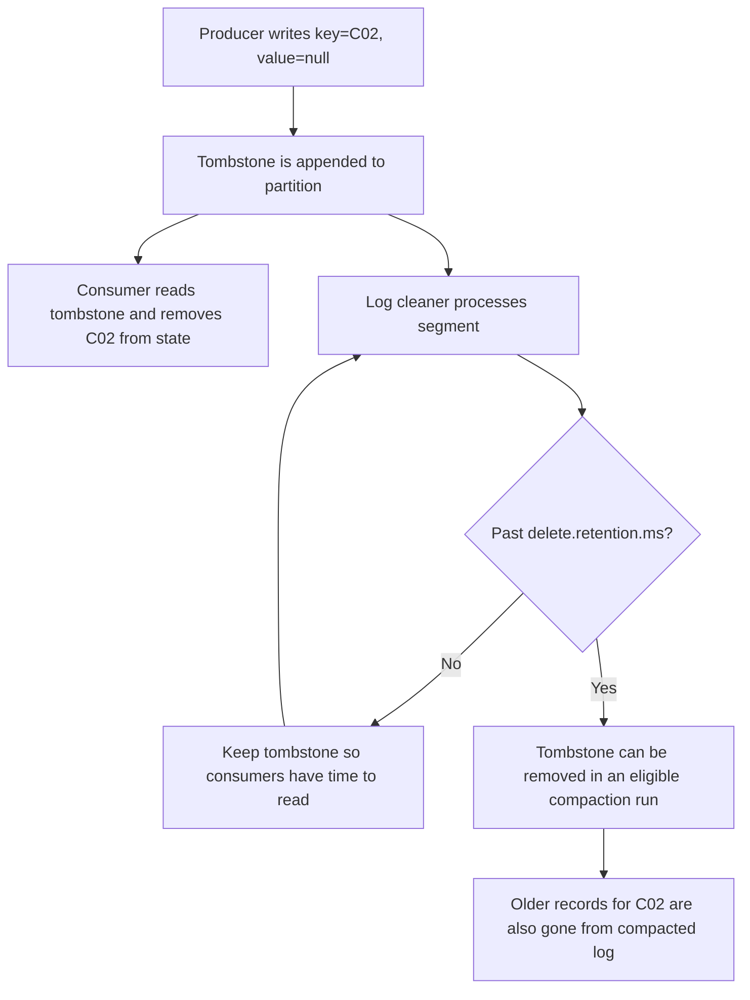

# Compaction and tombstone records

Kafka is often used to store a chronological stream of events. However, some data streams primarily require the **latest state of each entity**: a store's current configuration, a customer's latest profile, or a device's status. If every historical version were kept forever, consumers would have to read and merge vast numbers of obsolete records each time they rebuilt state.

**Log compaction** solves this problem by retaining the latest record per key within each partition. When you need to represent deleting a key from the current state, the producer sends a **tombstone record**: a record with a key and a `null` value. Compaction and tombstones are commonly paired to build topics acting as changelogs or replayable state stores.

## 1. What is log compaction?

Kafka appends records sequentially to each partition's log. For topics using the `compact` policy, Kafka runs a background log cleaner process to remove older versions sharing the same key. Once compaction finishes, the log retains the latest version of every surviving key, along with recent records not yet eligible for cleaning.

For example, topic `customer-state` receives the following records. The `key` column is the customer ID, and `value` is the serialized state:

| Offset | Key | Value | Meaning |
|---:|---|---|---|
| 0 | `C01` | `{"name":"An","city":"Hue"}` | Create initial state for C01 |
| 1 | `C02` | `{"name":"Binh","city":"Da Nang"}` | Create state for C02 |
| 2 | `C01` | `{"name":"An","city":"Hanoi"}` | Update C01 |
| 3 | `C03` | `{"name":"Chi","city":"Can Tho"}` | Create state for C03 |
| 4 | `C02` | `null` | Delete C02 via tombstone |
| 5 | `C01` | `{"name":"An","city":"HCMC"}` | Update C01 again |

After the cleaner processes eligible segments, the log may retain only the corresponding latest records:

| Original offset | Key | Remaining value | Status |
|---:|---|---|---|
| 3 | `C03` | `{"name":"Chi","city":"Can Tho"}` | C03 still exists |
| 4 | `C02` | `null` | Tombstone for C02 still within retention window |
| 5 | `C01` | `{"name":"An","city":"HCMC"}` | C01 still exists with latest data |

Offsets retain their original positions. Kafka does not renumber remaining records, so consumers can observe gaps between offsets. The table above illustrates the conceptual outcome; compaction runs asynchronously and does not guarantee immediate log reduction right after each send.

## 2. Kafka compaction works per key and per partition

Compaction has several important characteristics:

1. **Keys are compared within each partition.** Kafka keeps the latest version of a key inside that partition. The cleaner does not merge records with the same key across two different partitions.
2. **Keys must be stable.** Producers should use the same key serialization rules and partitioning strategy for an entity. With the default partitioner and a non-`null` key, records sharing a key normally enter the same partition as long as partition count and routing settings remain unchanged.
3. **Keyless records are not compacted by key.** If a record is sent with a `null` key, Kafka has no identifier to determine which version supersedes another.
4. **The cleaner runs in the background.** Compaction processes eligible segments; multiple versions of a key may coexist in the log for a while. Consumers must never assume a topic holds strictly one record per key at every moment.
5. **Offsets and within-partition order are preserved.** Removed records leave offset gaps, yet Kafka never alters the relative order of remaining records. Kafka does not guarantee total order across partitions.

The second point becomes especially critical when increasing partition counts or changing partitioners. A key might route to a new partition while older versions remain in the old partition. Because compaction runs per partition, the topic could retain multiple versions of that key in different partitions. Design stable partitioning when a topic is used to restore state by key.

## 3. Tombstone records for deleting keys

In a compacted topic, a record with a **non-`null` key and a `null` value** is called a tombstone. It indicates that the current state for that key has been deleted.

For example, to delete customer `C02`'s state, the producer sends:

```text
key   = C02
value = null
```

A tombstone is not JSON containing `null`, the string `"null"`, or an object with a `deleted: true` field. It is a Kafka record whose value payload is genuinely absent (`null`). Kafka uses this marker to distinguish a deletion from an ordinary value.

### Lifecycle of a tombstone

A tombstone must remain long enough for consumers to read and recognize the deletion. The `delete.retention.ms` setting defines how long Kafka keeps the delete marker before it becomes eligible for removal in a subsequent compaction cycle.

You can visualize the lifecycle as follows:



Once the cleaner removes the tombstone, older versions of that key can also be gone. After this point, a consumer re-reading the topic from the beginning will no longer see C02 or its tombstone; this means C02 is absent from the current state reconstructed from the topic.

`delete.retention.ms` is not how long an application must wait before deleting data from its database. It is the retention window for the delete marker inside the compacted log. This value must be long enough for a consumer to bootstrap or recover from an old offset and read to the end of the log. If a consumer cannot finish reading the log within the tombstone retention window, it might miss the deletion marker while rebuilding a snapshot. Therefore, choose this retention based on expected maximum consumer recovery time.

### Tombstones differ from business deletion events

`CustomerDeleted` is a business event carrying a payload describing a customer's deletion. If sent with a non-`null` value to a compacted topic, Kafka treats it as the latest value for the key and preserves it like any other value.

A tombstone, by contrast, instructs removing the key from materialized state. If a system needs both audit history and current state, it can publish `CustomerDeleted` events to an append-only history topic and send tombstones to a compacted state topic. The two streams serve different purposes.

## 4. Configuring a compacted topic

The property governing the cleanup policy is `cleanup.policy`:

| Value | Behavior |
|---|---|
| `delete` | Deletes old segments per topic or broker retention policy. This is the common default. |
| `compact` | Retains the latest version per key in each partition; tombstones are kept for `delete.retention.ms`. |
| `compact,delete` | Applies both compaction and retention-based segment deletion. Choose when old data is allowed to expire over time. |

Example creating the topic with Spring Kafka:

```java
import org.apache.kafka.clients.admin.NewTopic;
import org.apache.kafka.common.config.TopicConfig;
import org.springframework.context.annotation.Bean;
import org.springframework.context.annotation.Configuration;
import org.springframework.kafka.config.TopicBuilder;

@Configuration
public class KafkaTopicConfiguration {

    @Bean
    NewTopic customerStateTopic() {
        return TopicBuilder.name("customer-state")
                .partitions(6)
                .replicas(1) // Example for local environment; in production, choose based on cluster.
                .config(
                        TopicConfig.CLEANUP_POLICY_CONFIG,
                        TopicConfig.CLEANUP_POLICY_COMPACT
                )
                .config(TopicConfig.DELETE_RETENTION_MS_CONFIG, "86400000")
                .config("min.compaction.lag.ms", "60000")
                .build();
    }
}
```

In this example, the topic uses `compact`, retains tombstones for at least the configured one-day window (`86400000` milliseconds), and sets a minimum compaction lag of one minute. These are illustrative values, not a universal production configuration. On multi-broker clusters, set the replication factor according to broker count and availability requirements.

Common configurations to consider:

| Configuration | Meaning |
|---|---|
| `cleanup.policy` | Select `compact`, `delete`, or both combined. |
| `delete.retention.ms` | Duration to retain tombstones before they become eligible for cleanup. |
| `min.compaction.lag.ms` | Minimum time a record must remain uncompacted before it can be compacted. |
| `max.compaction.lag.ms` | Bound on how long a record can wait before becoming eligible for compaction; cleaner execution still depends on capacity and operational conditions. |
| `min.cleanable.dirty.ratio` | Dirty-to-total log ratio threshold at which the log cleaner considers processing a segment. |
| `retention.ms` | Data retention duration under the `delete` policy; when combining `compact,delete`, old segments can still be deleted by retention. |

For a topic using only `compact`, do not set `retention.ms` expecting it to govern how long every key lives. When `delete` is also enabled, retention can wipe out even the latest state of a key if the segment holding that state expires. Combine both policies only when business requirements genuinely permit data expiration.

## 5. Sending values and tombstones with Spring Kafka

Suppose topic `customer-state` stores current customer state. The key is `customerId`, and the value is the latest snapshot.

```java
import java.math.BigDecimal;
import java.util.concurrent.CompletableFuture;

import org.springframework.kafka.core.KafkaTemplate;
import org.springframework.kafka.support.SendResult;
import org.springframework.stereotype.Service;

record CustomerSnapshot(
        String customerId,
        String name,
        String city,
        BigDecimal creditLimit
) {}

@Service
public class CustomerStatePublisher {

    private static final String TOPIC = "customer-state";

    private final KafkaTemplate<String, CustomerSnapshot> kafkaTemplate;

    public CustomerStatePublisher(
            KafkaTemplate<String, CustomerSnapshot> kafkaTemplate) {
        this.kafkaTemplate = kafkaTemplate;
    }

    public CompletableFuture<SendResult<String, CustomerSnapshot>> publish(
            CustomerSnapshot snapshot) {
        return kafkaTemplate.send(TOPIC, snapshot.customerId(), snapshot);
    }

    public CompletableFuture<SendResult<String, CustomerSnapshot>> delete(
            String customerId) {
        // A null value creates a tombstone for key customerId.
        return kafkaTemplate.send(TOPIC, customerId, null);
    }
}
```

`KafkaTemplate.send(topic, key, value)` accepts `null` as the value argument to produce a tombstone. The key must still be non-null. Producer configuration needs key and value serializers compatible with the data types. With Spring Kafka's JSON serializer, a `null` value is sent as a null Kafka value; consumers must distinguish that case from an ordinary snapshot object.

The example returns a `CompletableFuture` so callers can track send outcomes and handle failures. In real applications, do not treat calling `send` as proof the broker persisted the record; observe send results according to the pipeline's reliability requirements.

## 6. Handling tombstones on the consumer

The consumer needs both the key and the value to distinguish updates from deletions. Using `ConsumerRecord` grants direct access to both fields:

```java
import org.apache.kafka.clients.consumer.ConsumerRecord;
import org.springframework.kafka.annotation.KafkaListener;
import org.springframework.stereotype.Component;

@Component
public class CustomerStateListener {

    private final CustomerStateStore stateStore;

    public CustomerStateListener(CustomerStateStore stateStore) {
        this.stateStore = stateStore;
    }

    @KafkaListener(
            topics = "customer-state",
            groupId = "customer-state-projector"
    )
    public void onRecord(
            ConsumerRecord<String, CustomerSnapshot> record) {

        String customerId = record.key();
        CustomerSnapshot snapshot = record.value();

        if (snapshot == null) {
            stateStore.delete(customerId);
            return;
        }

        stateStore.upsert(customerId, snapshot);
    }
}
```

Here `CustomerStateStore` abstracts the state storage target, such as a database or cache. When the value is non-null, the consumer updates state for the key. When the value is `null`, the consumer deletes the corresponding state. Processing should be idempotent so redelivery after retries or restarts does not corrupt results.

If a listener only accepts a `CustomerSnapshot` payload parameter, the application may lack enough context to distinguish a tombstone and identify the key to delete. For compacted topics, prefer receiving `ConsumerRecord` or an equivalent input type that preserves both key and null value.

When rebuilding state from scratch, consumers typically use a new consumer group or appropriate offset configuration to read from the start of the log. They apply records sequentially: upsert for values, delete for tombstones. Because compaction is asynchronous, a consumer may encounter multiple versions of the same key; processing in partition order with idempotent operations ensures the final state converges to the latest version.

## 7. When should you use a compacted topic?

Compacted topics fit when you need a replayable changelog to construct current state:

- Latest state of customers, orders, or devices.
- Active configuration keyed by `configId`.
- An `entityId → current value` map serving as a cache or materialized view.
- Changelogs for state stores or stream processing pipelines.

A compacted topic does not replace an event log used for auditing. After compaction, intermediate versions may be removed; thus, you cannot rely on it to query every historical change that ever happened. If full history is required, maintain a separate append-only topic or appropriate audit store.

## 8. Common mistakes and how to avoid them

| Mistake | Consequence | How to prevent |
|---|---|---|
| Sending keyless records | Kafka cannot compact versions by entity. | Choose a stable key meaningful to the stored state. |
| Using different keys for the same entity | Versions are not compacted as a single logical stream. | Standardize keys and serializers across all producers. |
| Assuming compaction happens right after `send` | Consumers may read multiple versions of the same key. | Write consumers that tolerate repeated updates and process in partition order. |
| Sending `"null"` or JSON `null` instead of a Kafka null value | Record becomes a normal value rather than a tombstone. | Send Java `null` as value with a valid key. |
| Consumer ignores records with null values | Deleted state may resurrect during state rebuilds. | Handle tombstones as delete operations. |
| `delete.retention.ms` is too short | Slow-recovering consumers may miss deletion markers. | Set retention longer than expected maximum recovery time. |
| Using `compact,delete` without considering retention | Segments holding latest state can expire over time. | Enable `delete` only if data expiration is acceptable. |
| Arbitrarily changing partition counts or partitioners | The same key can appear in different partitions. | Plan partitioning and migration for state-storing topics. |

## 9. Key takeaways

- `cleanup.policy=compact` instructs Kafka to keep the latest version per key within each partition.
- Compaction runs in the background rather than deduplicating immediately; offsets are preserved, so logs can have gaps.
- A tombstone is a record with a non-`null` key and a `null` value, used to mark a key as deleted from compacted state.
- `delete.retention.ms` keeps tombstones long enough for consumers to observe deletes before the marker becomes eligible for removal.
- Producers must use stable keys; consumers must handle `null` values as deletions.
- Compacted topics suit restoring latest state; append-only event logs suit preserving full history.

When designing a compacted topic, clearly define which entity the key represents, how consumers will rebuild state, and what the maximum recovery duration is. Those three decisions govern partitioning choices, tombstone publishing, and the `delete.retention.ms` value.
