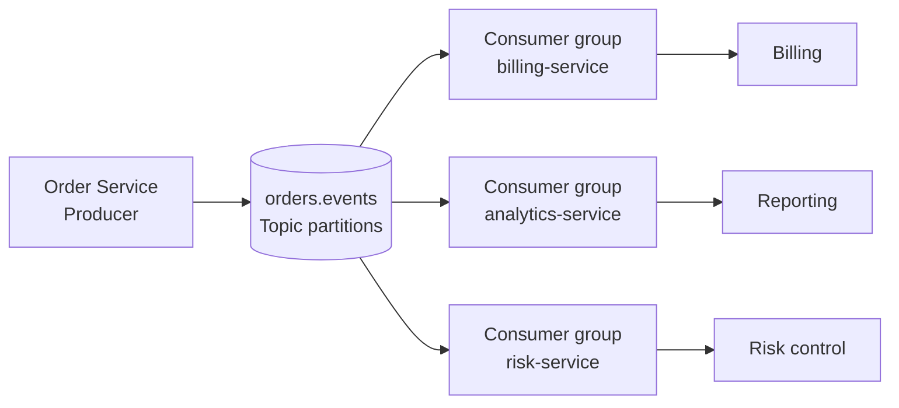
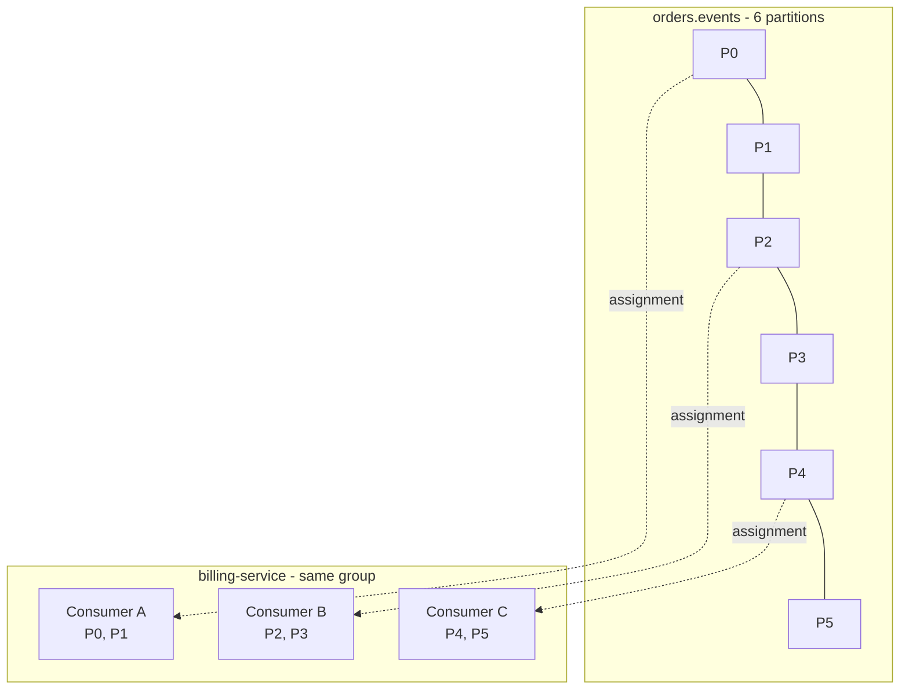

# Consumer groups as logical subscribers

In Kafka, a single topic can serve multiple applications simultaneously. When an order is created, the billing service needs to process payment, the analytics service needs to update reports, and the risk control service may need to evaluate the transaction. All of these applications need to read the `OrderCreated` event, yet each has its own purpose, speed, and processing progress.

Kafka uses a **consumer group** to represent a logical subscriber to an event stream. Each group has its own identity, tracks its own read offsets, and can consist of one or more consumer instances sharing partitions. Multiple groups can read the same topic independently of one another. As a result, a producer only needs to publish one record into Kafka; each application receives events at its own pace without the producer calling each application directly.

This concept is foundational when building messaging applications with Spring Kafka. `group.id` identifies the logical subscriber, while `@KafkaListener` and the listener container create and manage the consumer instances participating in that subscription.

## 1. A consumer group is a logical subscriber

Distinguish three levels:

- **Topic** is the record stream stored by Kafka. Records live in the topic's partitions.
- **Consumer group** is a logical group sharing a `group.id` identity and sharing the group's reading progress for each partition.
- **Consumer instance** is a process or active consumer within a group. Multiple instances in the same group split partitions to process in parallel.

For example, topic `orders.events` contains order events. The system has three subscribers:

| Consumer group | Purpose | Progress managed independently? |
| --- | --- | --- |
| `billing-service` | Process payments | Yes |
| `analytics-service` | Update reports | Yes |
| `risk-service` | Analyze risk | Yes |

Each group reads the same stream of records while maintaining its own offsets. If `billing-service` has processed up to offset 120, that does not advance the offsets of `analytics-service` or `risk-service`. Each subscriber can read fast, slow, pause, or restart according to its own needs, as long as records remain within the topic's retention period.



This is the fan-out pattern at the consumer group layer: a record is stored once in Kafka's log, yet multiple groups can read that record using independent offsets. Kafka does not need to make a physical copy of the entire topic for each group. Groups store reading state, while record data stays in partition logs according to retention or compaction policies.

## 2. `group.id` defines subscriber identity

`group.id` is the identifier of a consumer group. Consumers sharing the same `group.id`, cluster, and subscription/group management mechanism join the same group. Kafka uses this identity to manage membership, distribute partitions, and store committed offsets. If an application assigns partitions manually with `assign()`, the consumer does not participate in group member distribution this way.

How you set `group.id` directly affects how applications receive data:

| How `group.id` is set | Behavior |
| --- | --- |
| Billing replicas all use `billing-service` | They share partitions and share progress for one billing subscriber |
| Analytics uses `analytics-service` | Analytics becomes a separate subscriber and reads the topic's records independently |
| Changing group from `billing-service` to `billing-service-v2` | Kafka treats this as a new group; the new group does not inherit committed offsets from the old group |
| Each pod uses a different group ID even though all run Billing | Each pod becomes an independent subscriber and may read the entire dataset instead of sharing load |

Therefore, if the goal is scaling one application across multiple replicas, all replicas must share the same group ID. If two applications must each receive every record independently, they must use different group IDs.

### 2.1. A group ID is not an instance ID

Do not append a random token or pod name to `group.id` when you want replicas to share work. For instance, `billing-service-pod-01`, `billing-service-pod-02`, and `billing-service-pod-03` create three separate groups. Each group can read the entire topic, causing the same order to be processed multiple times by different subscribers.

Typically, keep the group ID stable per application and environment:

```text
billing-service-dev
billing-service-staging
billing-service-prod
```

If environments share a Kafka cluster, environment suffixes keep them from accidentally joining the same group. Within the same environment, all Billing replicas must still share a single value.

`group.id` is also not a security boundary or user identity. Topic read permissions and group usage permissions are controlled via Kafka's authentication, authorization, and ACL mechanisms. Setting a different group ID does not grant extra access rights.

## 3. Consumers in the same group share partitions

A topic is divided into multiple partitions. Within a consumer group, Kafka distributes partitions across consumer members. At any given time, each partition is assigned to at most one consumer in the same group. One consumer can receive multiple partitions; a single partition is not processed simultaneously by two members of the same group under standard group assignment.

Suppose a topic has six partitions:

| Consumer members in group | Illustrative distribution | Members without a partition |
| ---: | --- | ---: |
| 1 | Consumer A gets P0, P1, P2, P3, P4, P5 | 0 |
| 2 | A gets P0, P1, P2; B gets P3, P4, P5 | 0 |
| 3 | A gets P0, P1; B gets P2, P3; C gets P4, P5 | 0 |
| 6 | Each consumer gets one partition | 0 |
| 8 | Six consumers get partitions, two consumers remain unassigned | 2 |

This is only an illustrative distribution; actual assignment depends on the partition assignor and group state. The number of consumers able to work in parallel on a topic within one group is bounded by the partition count. Adding consumers beyond the partition count does not increase parallelism for that topic.



The key principle is **same group shares load; different groups read independently**. These serve two distinct goals:

- Run three Billing replicas with the same `billing-service` to share payment processing load.
- Run Billing and Analytics with two different group IDs so both applications receive every event.

If Billing and Analytics were placed into the same group, Kafka would treat them as members of one subscriber. A partition is assigned to only one member in the group at a time; thus the two applications would split records instead of both receiving every record. That is normally a misconfiguration when two applications must process independently.

## 4. Offsets are managed separately per group

An offset is a record's position within a partition. Kafka stores committed progress per **consumer group and partition** pair. You can picture reading state as a multi-dimensional table:

| Group | Partition | Committed offset (illustrative) |
| --- | --- | ---: |
| `billing-service` | `orders.events-0` | 120 |
| `billing-service` | `orders.events-1` | 85 |
| `analytics-service` | `orders.events-0` | 95 |
| `analytics-service` | `orders.events-1` | 140 |

Billing is further ahead on partition 0, whereas Analytics is further ahead on partition 1. This is normal because each application has its own processing workload and pace.

When a consumer commits offset `120`, by convention the stored offset is the next position to read, meaning the consumer has already processed records prior to that position. So when inspecting logs or admin tools, understand that the committed offset is the resumption point, not necessarily the offset of the last processed record.

Committed offsets are normally stored in Kafka's internal `__consumer_offsets` topic. Applications should use the Kafka client or appropriate administrative tools to view and adjust offsets; never edit records in this internal topic directly.

### 4.1. Where does a new group start reading?

When a group does not yet have a valid offset for a partition, the Kafka client uses `auto.offset.reset` to pick a starting position. Two common values:

- `earliest`: start from the earliest readable record remaining in the partition.
- `latest`: start from the end of the log, meaning receive new records written after the group begins reading.

This setting does not overwrite a valid committed offset. If the group already has an offset, the consumer resumes from that progress. `auto.offset.reset` applies when no valid offset exists, such as when a group runs for the first time or its committed offset falls outside the retained data range.

To make an application re-read from the beginning, explicitly reset offsets or use a new group ID, while checking retention and business idempotency. Merely changing `auto.offset.reset` in configuration will not rewind a group that already has valid offsets back to the start of the topic.

### 4.2. One lagging group does not stall another group

Each group has its own offsets and consumer lag. If Billing slows down, `billing-service` lag grows; Analytics can still continue reading and committing offsets for `analytics-service`. The two groups do not share reading progress.

However, records in Kafka are still subject to the topic's retention policy. If one group lags too long and needed records expire past retention, that group may no longer be able to read those old records. During design, choose retention long enough for the outages or backlogs the system must tolerate.

## 5. Group membership and rebalancing

A consumer group is not a static list of consumers. Consumers can join, leave, or lose connectivity. When membership or partition counts change, Kafka needs to redistribute partitions across members; this process is called a **rebalance**.

Situations that can trigger a rebalance include:

- A new instance starts up and joins the group.
- An instance shuts down cleanly or crashes.
- A consumer fails to send heartbeats on time or violates configured poll limits.
- Partitions are added to a topic or the group's subscription changes.
- A member is considered inactive and removed from the group.

Kafka has a group coordinator that manages membership, group state, and assignment coordination. A partition assignor decides which partition is assigned to which member. During a rebalance, old assignments are adjusted; under some strategies, redistribution can briefly pause processing.

### 5.1. How does rebalancing affect the application?

Suppose `billing-service` has three instances and the topic has six partitions. When a fourth instance joins, Kafka can redistribute the six partitions across four members. Some partitions move to the new instance; existing instances must wrap up or yield processing according to the consumer group protocol.

Rebalancing is necessary for a group to adapt to changes, yet occurring too frequently can reduce throughput and increase latency. Applications should:

- Keep processing time per batch compatible with poll settings and consumer limits.
- Monitor heartbeats, session timeouts, `max.poll.interval.ms`, and rebalance logs.
- Avoid restarting many replicas simultaneously unless necessary.
- Choose an appropriate partition assignor. Cooperative assignment can reduce how many partitions must be revoked at once compared to eager assignment in compatible setups.
- Consider static membership (`group.instance.id`) when the deployment environment provides stable instance identities and you want to reduce rebalances during brief restarts.

Static membership must never be configured with duplicate IDs across simultaneously running instances. If an old instance has not left the group yet while a new instance uses the same static ID, the group may have to wait or fence the old member according to timeouts and membership rules.

## 6. Configuring consumer groups in Spring Kafka

Spring Boot lets you set a default group ID in `application.yml`. The example below configures Billing to join the `billing-service` group:

```yaml
spring:
  kafka:
    bootstrap-servers: localhost:9092
    consumer:
      group-id: billing-service
      enable-auto-commit: false
      auto-offset-reset: earliest
      key-deserializer: org.apache.kafka.common.serialization.StringDeserializer
      value-deserializer: org.apache.kafka.common.serialization.StringDeserializer
```

In this example, `group-id` is Billing's subscriber identity. `enable-auto-commit: false` lets Spring Kafka's listener container and acknowledgment config manage when offsets are committed. `auto-offset-reset: earliest` applies when the group has no valid offset, rather than causing an already-running group to re-read from the start.

### 6.1. Using `@KafkaListener` with the default group ID

If a listener does not specify `groupId`, it can use the default group ID from consumer configuration:

```java
@Component
public class BillingListener {

    private final BillingService billingService;

    public BillingListener(BillingService billingService) {
        this.billingService = billingService;
    }

    @KafkaListener(topics = "orders.events")
    public void onOrderCreated(String payload) {
        billingService.handle(payload);
    }
}
```

When deploying multiple replicas of the Billing application, all replicas share the `billing-service` configuration. The listener container on each replica creates consumer members joining the same group; Kafka distributes partitions among the members.

### 6.2. Specifying `groupId` directly on the listener

You can specify an explicit group ID per listener via the `groupId` attribute:

```java
@Component
public class OrderEventListeners {

    private final BillingService billingService;
    private final AnalyticsService analyticsService;

    public OrderEventListeners(
            BillingService billingService,
            AnalyticsService analyticsService
    ) {
        this.billingService = billingService;
        this.analyticsService = analyticsService;
    }

    @KafkaListener(
            topics = "orders.events",
            groupId = "billing-service",
            concurrency = "3"
    )
    public void bill(String payload) {
        billingService.handle(payload);
    }

    @KafkaListener(
            topics = "orders.events",
            groupId = "analytics-service"
    )
    public void analyze(String payload) {
        analyticsService.record(payload);
    }
}
```

The two listeners above create two independent logical subscribers. `billing-service` has concurrency 3, meaning the listener container can spin up three consumers to share partitions within the same group. `analytics-service` is a separate group and therefore receives records with its own offsets. If the topic has fewer partitions than Billing's consumers, some consumers will receive no partitions and will not add parallelism.

When setting `groupId` directly on `@KafkaListener`, that value identifies the group for that listener. This is useful when a single application hosts multiple listeners reading the same topic for independent business workflows. Ensure all replicas of the same listener still use the same group ID value.

### 6.3. Scaling a group via concurrency or multiple replicas

Spring Kafka supports increasing consumer members via listener container `concurrency` or by running multiple application replicas. For example:

```java
@KafkaListener(
        topics = "orders.events",
        groupId = "billing-service",
        concurrency = "4"
)
public void consume(String payload) {
    billingService.handle(payload);
}
```

`concurrency = "4"` creates up to four consumer members for that listener container. If the application runs two replicas and each creates concurrency 4, the group can have eight members total. How many members actually receive partitions still depends on partition count, subscription, and assignment.

Increasing concurrency within the same group fits when one business function needs to share load. To add an independent application processing every record, create a listener or application with a different group ID. Never increase concurrency by generating random group IDs per consumer.

## 7. Choosing a group model based on business requirements

Two questions help determine the group ID:

1. Are instances performing the same job and simply splitting records among themselves? If yes, they belong to the same group.
2. Must applications receive and process every record independently? If yes, each application needs its own group.

Example design for an order system:

| Deployment component | Group ID | Purpose |
| --- | --- | --- |
| Billing replicas 1, 2, 3 | `billing-service` | Share payment processing load |
| Analytics replicas 1, 2 | `analytics-service` | Share report update load |
| Risk processor | `risk-service` | Read independently to evaluate risk |
| Standalone data verification tool | `orders-audit` | Read independently for reconciliation |

All of these groups can subscribe to `orders.events`. If one group pauses, the others keep reading at their own pace. When the paused group resumes, it continues from its committed offsets as long as those offsets remain valid and data is still retained.

### 7.1. Common design mistakes

- **Using a separate group ID per pod:** turns every pod into an independent subscriber, causing duplicate processing of the entire stream instead of load sharing.
- **Sharing one group ID across two independent business flows:** makes them split partitions and records; neither flow receives every event anymore.
- **Changing group ID on deployment without a plan:** the new group does not inherit the old group's offsets and may replay lots of data or skip history depending on `auto.offset.reset`.
- **Scaling consumers past the partition count:** leaves idle members without increasing topic parallelism.
- **Assuming one group's offsets affect another group:** each group has independent progress; monitor lag per group.
- **Ignoring retention:** a slow group can lose access to older records once data ages past storage limits.
- **Treating group ID as an access-control mechanism:** group IDs do not replace authentication, authorization, or ACLs.

## 8. Monitoring and operating consumer groups

In production, observe each group as an operational unit. Useful metrics include:

| Metric | Question to answer |
| --- | --- |
| Member count in group | Are enough consumers active, or are members repeatedly leaving? |
| Partition assignment | How are partitions distributed? Are any members unassigned? |
| Per-partition consumer lag | How many records behind the log end is the group? |
| Commit rate and commit failures | Is progress being recorded steadily? |
| Rebalance rate and rebalance duration | Is the group frequently destabilizing? |
| Processing latency and error rate | Is the application processing records fast and reliably? |

Lag must be inspected per group and per partition. One topic can have multiple groups in very different states: Billing nearly caught up, Analytics lagging by a few thousand records, and Risk paused for an incident fix. Looking at topic health alone will not reveal each subscriber's state.

When investigating a lagging group, check in order: partition count and assignment; active member count; processing time per record; errors and retries; downstream write capacity; offset commits; and remaining retention. If adding members does not improve lag, the bottleneck may lie in the partition limit or a dependency like a database, not just consumer count.

## 9. Consumer group design workflow

When adding a new subscriber to a topic, follow these steps:

1. Determine whether the subscriber is an independent business flow or a scaling replica of an existing flow.
2. Choose a stable `group.id` by application name and environment; replicas of the same subscriber share one ID.
3. Choose enough partitions for expected parallelism and check key distribution to preserve required ordering.
4. Define the initial reading policy (`earliest` or `latest`) for new groups and replay procedures when needed.
5. Select acknowledgment, commit, retry, and idempotent handling so the application tolerates record redelivery.
6. Set retention long enough for the expected backlog processing time or outage window of the slowest subscriber.
7. Monitor lag, assignments, rebalances, processing errors, and commit rates separately per group.

Consumer groups decouple reading progress and purpose across applications, while partition assignment scales a single application across multiple consumer members. Understanding both dimensions lets you design Kafka pipelines where one event serves multiple independent business domains, each scaling, replaying, and operating according to its own needs.

## 10. Self-check

1. If three Billing replicas must split order processing, should they use one or three `group.id` values? Why?
2. Why does Analytics need a separate group ID if it also must receive all records that Billing received?
3. A group has six partitions and eight consumer members. How many members at most can be assigned partitions at the same time?
4. When a new group starts reading, what does `auto.offset.reset=earliest` mean? Does this setting rewind a group that already has valid offsets back to the start of the topic?
5. Why does Billing lagging not necessarily cause Analytics to lag as well?
6. If an application's `group.id` is changed during a deployment, what must be checked regarding offsets and potential data replay?
7. Under what situations does a rebalance occur, and how can it affect throughput?
