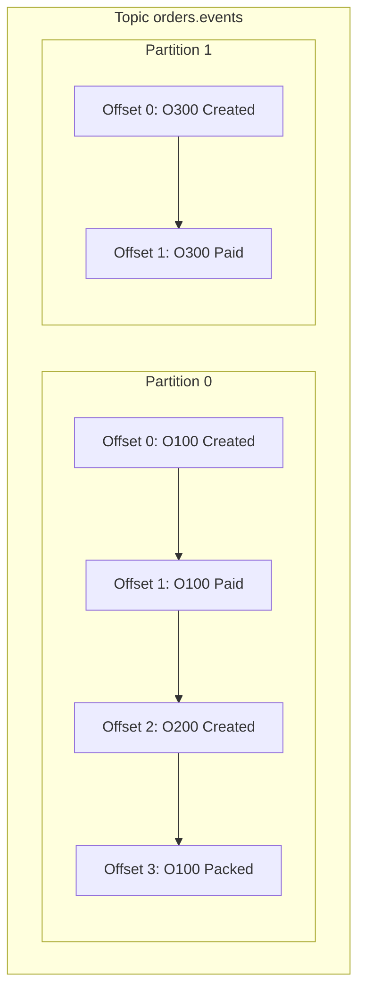
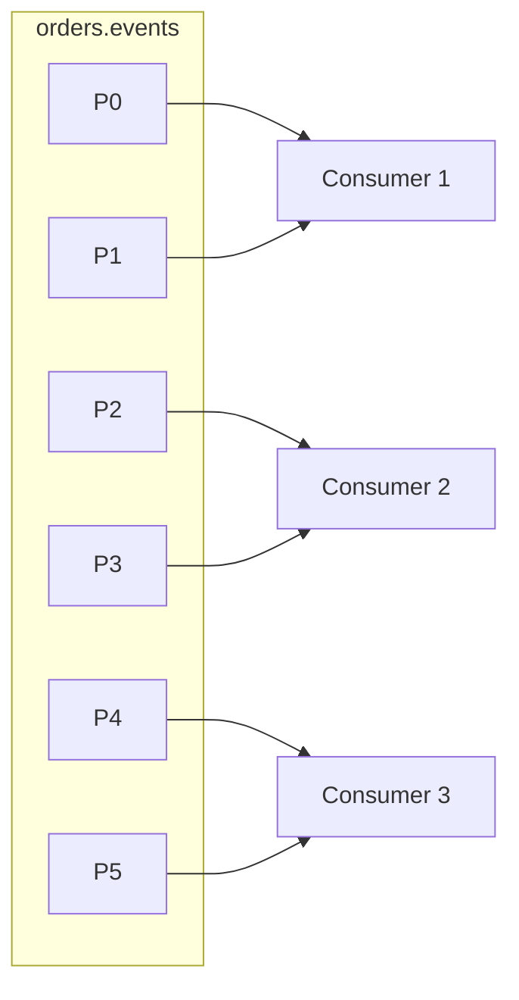

# Record ordering within a partition

Kafka is designed to store and read records in order within each partition. This provides the foundation for processing sequences of changes to the same entity, such as consecutive states of an order or transactions on an account. However, Kafka's ordering guarantee has a clear boundary: **Kafka preserves order within a single partition, and does not create a total order across multiple partitions**.

To leverage this guarantee properly, producers must route related records to the same partition, consumers must process them in the order received, and retry mechanisms must not inadvertently allow a later record to overtake an earlier one. This article explains those conditions and how to apply them in Spring Kafka.

## 1. Within what scope does Kafka guarantee ordering?

Each partition is an append-only log. When the broker appends a record to a partition, the record receives an increasing offset. The offset defines the record's position in that partition and reflects append order:

| Partition | Offset | Key | Value |
|---|---:|---|---|
| P0 | 0 | `O100` | `OrderCreated` |
| P0 | 1 | `O100` | `OrderPaid` |
| P0 | 2 | `O200` | `OrderCreated` |
| P0 | 3 | `O100` | `OrderPacked` |
| P1 | 0 | `O300` | `OrderCreated` |
| P1 | 1 | `O300` | `OrderPaid` |

In P0, consumers read in offset order 0, 1, 2, 3. For order `O100`, the records `OrderCreated`, `OrderPaid`, and `OrderPacked` appear in the exact append order in P0. In P1, `O300` also has its own order of offset 0 followed by offset 1.

You cannot conclude whether `OrderCreated` in P0 occurred before or after `OrderCreated` in P1 from offsets alone, because an offset only has meaning within its own partition. Kafka does not provide a global offset across an entire topic. If multiple partitions receive records concurrently, interleaving order across partitions is not guaranteed.



Each partition has an independent order. A topic with a single partition can establish a single append order for all records in the topic, at the cost of bounding parallel processing and write throughput to that single partition. When a topic has multiple partitions, the system scales better while accepting no total order across them.

## 2. Using keys to keep related records in the same partition

Producers typically do not specify a partition directly, instead sending records with a key. With the default partitioner, Kafka uses the serialized key to select a partition. As long as the partition count and serialization/partitioning rules stay unchanged, the same key is normally routed to the same partition.

For example, if you need to preserve change order for an order, use `orderId` as the key:

| Event | Key | Expected partition |
|---|---|---|
| `OrderCreated` for O100 | `O100` | P0 |
| `OrderPaid` for O100 | `O100` | P0 |
| `OrderPacked` for O100 | `O100` | P0 |
| `OrderCreated` for O200 | `O200` | P1 |

O100's events are sent to the same partition, allowing a consumer to process by offset and preserve that order's change sequence. Other orders can still be processed in parallel on other partitions.

Spring Kafka producer example:

```java
import org.springframework.kafka.core.KafkaTemplate;
import org.springframework.stereotype.Service;

record OrderEvent(String orderId, String type) {}

@Service
public class OrderEventPublisher {

    private static final String TOPIC = "orders.events";

    private final KafkaTemplate<String, OrderEvent> kafkaTemplate;

    public OrderEventPublisher(KafkaTemplate<String, OrderEvent> kafkaTemplate) {
        this.kafkaTemplate = kafkaTemplate;
    }

    public void publish(OrderEvent event) {
        // orderId is the key so events of the same order land in the same partition.
        kafkaTemplate.send(TOPIC, event.orderId(), event);
    }
}
```

If the key is `null`, the producer lacks a stable identifier to group events of an entity into the same partition. Keyless distribution policies can scatter them across multiple partitions, so you cannot rely on that to preserve per-order ordering.

### Choosing keys based on business requirements

The key should represent the entity whose changes must be serialized:

- `orderId` if per-order change ordering is needed.
- `accountId` if per-account balance update ordering is needed.
- `deviceId` if per-device state sequence processing is needed.

Do not automatically pick `eventId` as the key. `eventId` identifies a single event occurrence; the key usually needs to route all events of the same entity to the same partition. The two values serve different purposes.

Keys only make it possible for records to enter the same partition; they do not reorder events sent out of order by the application. If two concurrent threads emit `OrderPaid` and `OrderCreated`, Kafka appends them in the order the broker receives them. When business ordering must be determined strictly, the application must coordinate publishing or include an aggregate version/sequence number to detect out-of-order events.

## 3. Producers and record send ordering

Kafka producers send records asynchronously and batch records together. When a producer sends multiple records to the same partition, the Kafka producer preserves send order under proper configuration. However, retries can disrupt order if the producer allows multiple in-flight requests without idempotence enabled.

Suppose a producer sends A then B to the same partition:

1. The batch containing A is sent, but the broker responds with a transient error.
2. The batch containing B is written successfully by the broker.
3. The producer retries batch A.

If the producer does not enable idempotence and allows multiple concurrent requests, B can be appended before A in certain retry scenarios. That is why the producer must be configured to preserve order across transmission errors.

With modern Kafka clients, enabling idempotence lets the producer attach sequence numbers so the broker detects retries, avoids duplicate writes, and preserves batch ordering per producer/partition. This can be declared explicitly in Spring Boot:

```yaml
spring:
  kafka:
    producer:
      acks: all
      retries: 2147483647
      properties:
        enable.idempotence: true
        max.in.flight.requests.per.connection: 5
```

`enable.idempotence=true` requires compatible settings, including `acks=all`, `retries` greater than 0, and `max.in.flight.requests.per.connection` within the Kafka client's supported limit (up to 5 in modern clients). If idempotence is disabled, be especially cautious with concurrent in-flight requests during retries; limiting `max.in.flight.requests.per.connection=1` is a simple way to stop later batches from overtaking earlier ones, at the cost of lower throughput.

Idempotence protects retry order within a single producer session per partition. It does not establish a shared business order across multiple independent producers writing to the same key. If multiple instances emit events for one aggregate, append order still depends on when the broker receives records. When causal ordering is required, use coordinated publishing or monotonically increasing version numbers in events for consumers to validate.

## 4. Consumer groups and processing order

Within a consumer group, a partition is assigned to at most one consumer member at a time. That consumer reads the partition's records in offset order. This is how consumers scale with partition count while keeping order within each partition.

For example, a topic has six partitions and a consumer group has three members:



This is an illustrative allocation; Kafka may use another assignment strategy. Each member processes its assigned partitions. One partition is never shared by two members of the same group simultaneously, so records in a partition have a single consumer owner at that time.

Effective parallel consumers cannot exceed assigned partitions. If a topic has three partitions yet a listener configures `concurrency=8`, at most three consumers in the group can receive partitions at the same time; the remaining consumers have no partitions to process. To increase parallelism, consider raising partitions while checking the capacity of brokers, producers, consumers, and downstream systems.

### Listener configuration in Spring Kafka

```java
import org.apache.kafka.clients.consumer.ConsumerRecord;
import org.springframework.kafka.annotation.KafkaListener;
import org.springframework.stereotype.Component;

record OrderEvent(String orderId, String type) {}

interface OrderProjection {
    void apply(OrderEvent event);
}

@Component
public class OrderEventListener {

    private final OrderProjection orderProjection;

    public OrderEventListener(OrderProjection orderProjection) {
        this.orderProjection = orderProjection;
    }

    @KafkaListener(
            topics = "orders.events",
            groupId = "order-projection",
            concurrency = "3"
    )
    public void onOrderEvent(ConsumerRecord<String, OrderEvent> record) {
        OrderEvent event = record.value();

        System.out.printf(
                "orderId=%s, partition=%d, offset=%d, type=%s%n",
                record.key(),
                record.partition(),
                record.offset(),
                event.type()
        );

        // Process synchronously to finish the current record before the next one.
        orderProjection.apply(event);
    }
}
```

In this example, `concurrency="3"` creates up to three consumer threads for the listener container. Each partition is assigned to one consumer in the group; different partitions can run in parallel. Listener logic is written synchronously to preserve update ordering within the same partition. `orderProjection` represents the component updating business state.

## 5. Practices that can break ordering at the application layer

Kafka delivers records in offset order, yet an application can break ordering itself after receiving them.

### Offloading records to an uncontrolled thread pool

Suppose a consumer receives A then B from the same partition, yet submits both tasks to a thread pool:

```java
executor.submit(() -> process(recordA));
executor.submit(() -> process(recordB));
```

If B finishes faster than A, B's side effects may complete before A's. In that case Kafka still delivered records in order, but database state or business outcomes ended up reversed.

If asynchronous processing is needed, ensure records within the same partition or sharing the same key execute sequentially. You can use a sequential queue per partition/key, or design a processor with sequence/version checks to reject stale updates. Offset commits must also wait for prior records to finish; committing past an unfinished record can cause that record to be skipped after an application restart.

### Retries and dead-letter topics

With blocking retries, the consumer can pause partition processing or seek back to the failed record to retry. Subsequent records in the partition wait until the failed record finishes. This preserves order, though a persistently failing record can block other records in the same partition.

With non-blocking retry topics, a failed record moves to a retry topic for later attempts while the main partition keeps processing subsequent records. This improves continued consumption, yet allows later records to finish ahead of the failed one. If per-aggregate ordering is mandatory, evaluate retry strategies carefully; you may keep blocking retries, pause affected keys/partitions, or design consumers to check sequences before applying updates.

Dead-letter topics must be evaluated by the same principle. Moving a failed record to a DLT does not mean it was processed in business order. When replaying from a DLT, avoid overwriting newer state with an older event.

## 6. Increasing partitions can affect per-key ordering

With the default partitioner, keys are mapped based on the current partition count. If you increase a topic's partition count, the mapping result for the same key can change. Old records for `O100` remain in the previous partition, while new records for `O100` may land in a different partition.

Then two partitions can be processed concurrently by consumers with no ordering guarantee between them. Hence, increasing partitions is not merely a throughput capacity change; it can alter key distribution and affect flows requiring per-entity ordering.

Before increasing partitions on a topic requiring per-key ordering, consider:

- Whether you can create a new versioned topic and migrate traffic through a controlled process.
- Whether a custom partitioner or stable routing strategy is needed to preserve mappings.
- How consumers will synchronize/reconcile old and new data during the transition phase.
- Whether aggregate sequence/version numbers can be used to detect late or out-of-order events.

Do not change partition counts arbitrarily if the application relies on the same key always residing in one partition throughout the data's lifecycle.

## 7. When is global ordering needed?

Most systems only need ordering per entity: order, account, device, or customer. Choosing an appropriate key lets different entities run in parallel while preserving order within each group.

If business logic genuinely requires every record in a topic to share a single total order, the direct approach is using one partition. In return, producers and consumers have only a single partition stream to exploit, limiting scalability. At high volume, you might consider a sequencer or business-layer sequence generator, though consumers still have to enforce sequence application.

Never try to infer global order by comparing timestamps across partitions. Timestamps can collide, producer clocks can drift, and event creation time is not necessarily the order in which the broker appended records.

## 8. Ordering design checklist

| Question | Approach |
|---|---|
| Which entity needs ordering? | Choose `aggregateId`/`orderId` as the key. |
| Do records with the same key go to the same partition? | Keep the partitioner, key serializer, and partition count stable. |
| Does the producer retry? | Enable idempotence and configure compatible `acks`, `retries`, and `max.in.flight`. |
| Do multiple producers write to the same key? | Coordinate writers or carry a business sequence/version. |
| Does the consumer process concurrently within a partition? | Serialize side effects per partition/key. |
| Can retries let later records overtake failed ones? | Choose blocking retries or design order-protection mechanisms. |
| Are there plans to increase partitions? | Re-evaluate key mapping and plan a migration. |
| Is global ordering required? | Weigh a single partition and its accompanying throughput limits. |

## 9. Key takeaways

- Kafka guarantees record order by offset within **a single partition**.
- Offsets from two different partitions cannot be used to infer topic-wide order.
- Use a key representing the aggregate so related events are routed to the same partition.
- Producers should enable idempotence so retries do not reorder batches within the same producer/partition.
- Within a consumer group, each partition is assigned to at most one consumer member at a time; different partitions can run in parallel.
- Asynchronous processing, retry topics, and partition count changes can break side-effect ordering at the application layer.
- When strict business ordering is needed, combine stable partitioning with sequence/version numbers and appropriate coordination.

When designing a Kafka pipeline, define the level at which order must be protected: whole topic, per partition, or per aggregate. From there, choose partition counts, keys, producer settings, and consumer error handling. Most systems scale well by protecting order per aggregate rather than demanding a global order.
