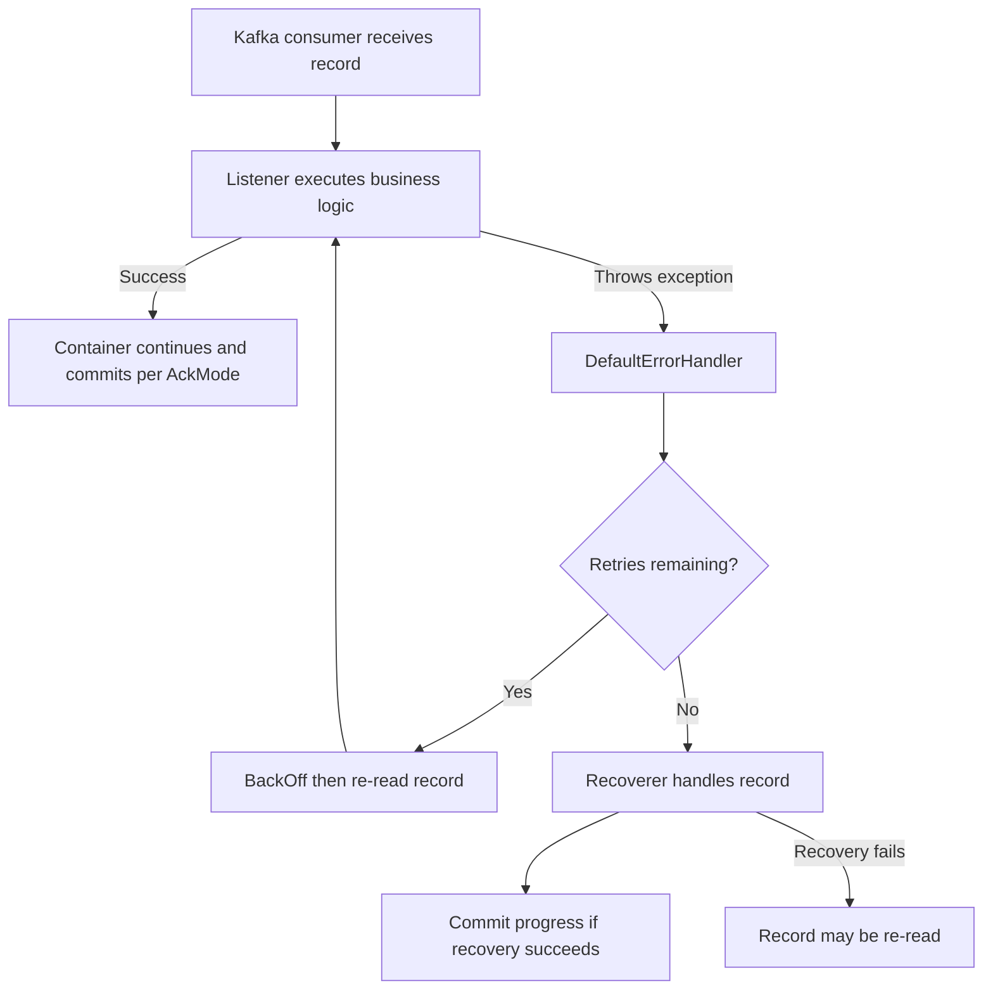

# DefaultErrorHandler

In a Spring Kafka application, a listener may throw an exception while processing a record due to invalid data, a temporarily unavailable dependency, or a programming bug. Without an appropriate error-handling mechanism, the consumer may repeatedly receive the failing record, reducing throughput and forcing other records in the same partition to wait.

`DefaultErrorHandler` is the listener-container-level common error handler used by Spring Kafka to decide how to retry and recover a record after a listener failure. You can configure wait times between attempts, classify exceptions, and forward records that have exhausted retries to a dead-letter topic (DLT).

## 1. Where Does DefaultErrorHandler Sit in the Processing Flow?

The listener focuses on business logic: receiving the payload, validating it, and calling services. When the listener throws an exception, the container delegates the error to `DefaultErrorHandler`. The error handler applies the configured policy and drives re-reading the record via the consumer's seek mechanism.



`DefaultErrorHandler` implements `CommonErrorHandler`, so it is attached to `ConcurrentKafkaListenerContainerFactory`. This is container-level error handling, distinct from catching exceptions inside individual listener methods or using `KafkaListenerErrorHandler` for a single message-receiving listener.

For a record listener, when processing fails, the handler typically seeks back to the offset that needs reprocessing so the consumer delivers that record again. Subsequent records in the partition wait behind the failing record. For a batch listener, the handler can use `BatchListenerFailedException` to pinpoint the failing record's position; if the exception does not identify a record, the framework may have to retry the entire batch.

## 2. Configuring Retries with BackOff

BackOff determines the wait interval and number of retry attempts. The following example allows two retries spaced one second apart after the initial processing attempt:

```java
@Bean
public DefaultErrorHandler kafkaErrorHandler() {
    return new DefaultErrorHandler(
        new FixedBackOff(1_000L, 2L));
}
```

`FixedBackOff(1_000L, 2L)` means a wait interval of 1,000 milliseconds and a maximum of two retries. The total number of times the listener can be invoked for the same record in this processing cycle is three: one initial attempt plus two retries.

If you need increasing wait intervals, you can use another `BackOff` implementation such as exponential backoff. Backoff prevents hammering a troubled service. Set reasonable limits so retry duration does not exceed the system's processing requirements.

`DefaultErrorHandler` retries are consumer-side retries: the failing record is re-read per the container's policy. During waiting and retrying, the partition can be blocked by the failing record. If you need to route failing records to retry topics so subsequent records continue processing, evaluate a non-blocking retry mechanism such as `@RetryableTopic`; this is a different retry architecture that also requires managing retry topics, DLTs, and processing order.

## 3. Exception Classification

Not every error resolves on retry. Timeouts or transient connection errors can be retried; malformed payloads or business-rule violations usually do not change after a few seconds. `DefaultErrorHandler` allows adding retryable and non-retryable exception types.

```java
@Bean
public DefaultErrorHandler kafkaErrorHandler() {
    DefaultErrorHandler handler = new DefaultErrorHandler(
        new FixedBackOff(1_000L, 2L));

    // Permanent data error: do not retry.
    handler.addNotRetryableExceptions(InvalidOrderException.class);

    // Transient dependency error: allow retry.
    handler.addRetryableExceptions(PartnerUnavailableException.class);
    return handler;
}
```

Exceptions classified as non-retryable proceed straight to recovery after the first failure. When no custom classification is declared, Spring Kafka already provides default rules; errors related to deserialization, message conversion, or listener parameter resolution are generally treated as non-retryable because retrying the same data usually does not resolve the root cause.

When classifying, consider exception causes as well. A business error may be wrapped inside another exception; logging both the root exception type and record metadata helps confirm which policy was actually applied.

## 4. Recovering Records and Forwarding to a DLT

Once retries are exhausted, the handler invokes a recoverer. If no custom recoverer is supplied, `DefaultErrorHandler` logs the failed record by default. In systems requiring investigation or data reprocessing, consider `DeadLetterPublishingRecoverer` to publish the record to a DLT.

```java
@Bean
public DefaultErrorHandler kafkaErrorHandler(
        KafkaTemplate<Object, Object> kafkaTemplate) {
    DeadLetterPublishingRecoverer recoverer =
        new DeadLetterPublishingRecoverer(
            kafkaTemplate,
            (record, exception) -> new TopicPartition(
                record.topic() + ".DLT", record.partition()));

    DefaultErrorHandler handler = new DefaultErrorHandler(
        recoverer, new FixedBackOff(1_000L, 2L));
    handler.addNotRetryableExceptions(InvalidOrderException.class);
    return handler;
}
```

The resolver in the example sends records from topic `orders` to `orders.DLT` while preserving the partition number. Therefore, the DLT topic must exist and have enough partitions matching the source partitions. If you want to use a different partition number or funnel failures into a single partition, intentionally change the destination resolver.

The `KafkaTemplate` producer needs serializers compatible with the key and value of forwarded records. `DeadLetterPublishingRecoverer` adds headers for traceability, such as source topic, partition, offset, and exception details. When inspecting the DLT, examine these headers alongside the payload to determine where the record came from and why it failed.

Recovery is considered successful only when the recoverer finishes processing per configuration. If publishing to the DLT fails, the record may re-enter the error flow; therefore, monitor DLT send failures and configure handling for recovery failures. Do not assume merely creating a DLT topic guarantees forwarding will always succeed.

## 5. Offsets and Acknowledgment After Recovery

Kafka tracks offsets per partition. When the listener succeeds, the container commits progress based on the configured `AckMode`. When the handler successfully recovers a record and returns normally, `DefaultErrorHandler` allows the container to acknowledge progress after error handling by default (`ackAfterHandle` defaults to `true`). This lets the consumer advance past the recovered record instead of re-reading it forever.

There is a `commitRecovered` option so the handler itself commits the offset of the recovered record. This option requires `AckMode.MANUAL_IMMEDIATE`; enable it only when the application genuinely needs that commit mechanism and understands how the listener/container acknowledges offsets. Do not change `AckMode` casually because it affects commit timing across the entire flow.

If the recoverer throws an exception, recovery is incomplete. The handler may return the record to the retry flow depending on configuration, so the offset should not be considered safe to skip. With multiple partitions on the same consumer, each partition maintains independent progress.

## 6. Attaching the Handler to the Listener Container

After declaring the error handler, attach it to the container factory used by the listener:

```java
@Bean
public ConcurrentKafkaListenerContainerFactory<String, OrderCreated>
        kafkaListenerContainerFactory(
            ConsumerFactory<String, OrderCreated> consumerFactory,
            DefaultErrorHandler kafkaErrorHandler) {
    ConcurrentKafkaListenerContainerFactory<String, OrderCreated> factory =
        new ConcurrentKafkaListenerContainerFactory<>();
    factory.setConsumerFactory(consumerFactory);
    factory.setCommonErrorHandler(kafkaErrorHandler);
    return factory;
}
```

Listeners using this factory inherit the same retry and recovery policy:

```java
@KafkaListener(
    topics = "orders",
    groupId = "order-processor",
    containerFactory = "kafkaListenerContainerFactory")
public void consume(OrderCreated event) {
    orderService.process(event);
}
```

If an application has multiple listener groups with different retry requirements, you can declare multiple container factories and matching error handlers. Name them clearly to avoid accidentally applying one flow's DLT or retry count policy to another flow.

## 7. Testing the Error Policy

A useful test verifies observable behavior, not just that a bean was created. For a record listener, produce a record that causes the service to fail on the first two attempts and succeed on the next. Verify the listener was called three times and the record did not enter the DLT.

Next, test a record that triggers `InvalidOrderException`. Verify the exception is classified as non-retryable and the record is forwarded to the DLT. Also test the case where the DLT producer fails to send, ensuring the application does not silently mark the record as successfully processed.

You can use Embedded Kafka or Testcontainers to test the consumer, offsets, and DLT in a real Kafka environment. In tests, wait on conditions or use Awaitility rather than long fixed sleeps; also assert the exact topic, partition, key, payload, and source headers on the DLT record.

## 8. Operational Considerations

- Monitor retry counts, recovered records, DLT record counts, and DLT publish failures.
- Log topic, partition, offset, key, and event ID; avoid logging sensitive payload data.
- Set backoff and retry counts according to error type, timeouts, and SLA bounds.
- Design idempotent business logic because records may be redelivered after restarts, rebalances, or errors before offset commits.
- Establish a controlled workflow to inspect, repair data, and replay the DLT; avoid infinitely replaying the same failing record.

For containers with Kafka transactions enabled, processing errors are typically handled via rollback and `DefaultAfterRollbackProcessor`. Design retry/recovery policies around the container's transactional model; do not blindly copy a non-transactional `DefaultErrorHandler` configuration onto a transactional flow.

## Conclusion

`DefaultErrorHandler` centralizes error-handling policy at the listener container: controlling retry counts, wait intervals, which exceptions to retry, and how records are recovered once attempts are exhausted. Combined properly with a DLT, acknowledgment mode, idempotency, and monitoring, the consumer can handle errors predictably while preserving per-partition progress.
