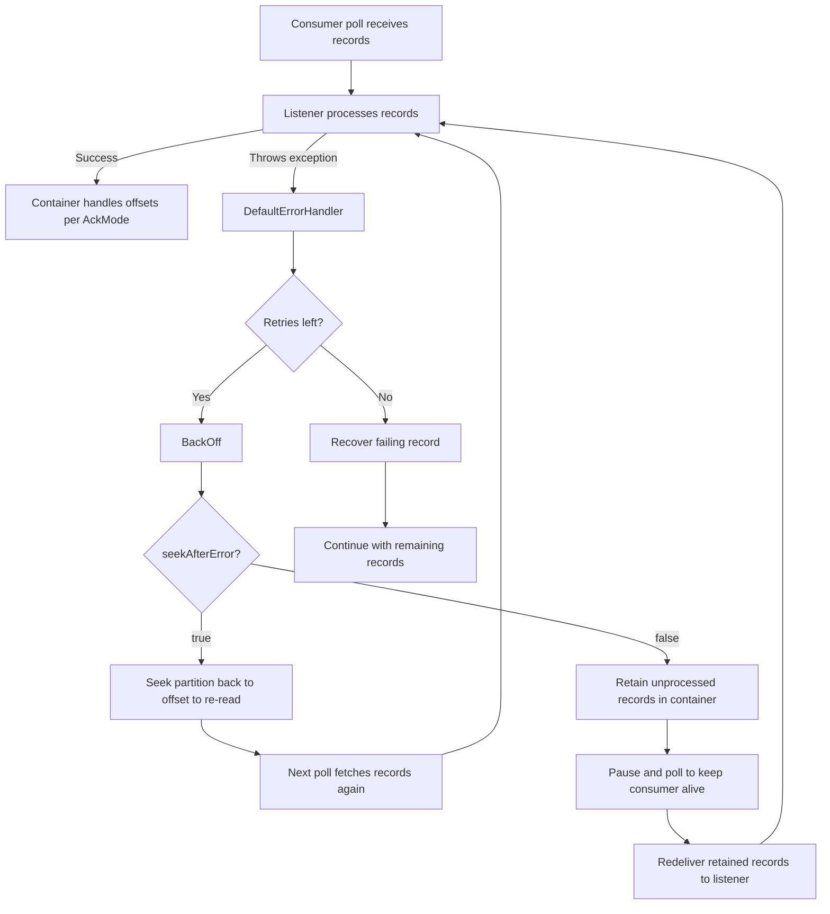

# SeekAfterError and Redelivery Mechanisms

When a listener processes a record and throws an exception, Spring Kafka must decide how to deliver the failing record and any remaining unprocessed records back to the listener. The traditional approach calls `Consumer.seek()` to reset each partition's read position to the offset requiring redelivery. Since Spring Kafka 2.9, `DefaultErrorHandler` also provides `seekAfterError = false`: the container retains the unprocessed records from the previous `poll()` and redelivers them to the listener without seeking the consumer.

Both modes share the same goal: retry the failing record and continue processing remaining data under the retry/recovery policy. The difference lies in how redelivery is produced. Understanding this distinction helps you choose a configuration suited to your load, backoff duration, memory footprint, and consumer group behavior.

## 1. What Is Seek and Why Is Redelivery Needed?

A Kafka consumer reads data per `TopicPartition`. A partition's read position is the next offset the consumer will fetch. Calling `consumer.seek(partition, offset)` resets the read position for that partition. The next `poll()` can then fetch records starting from the specified offset.

For example, suppose a consumer receives four consecutive records from partition `orders-0`:

```text
First poll:    offset 100   101   102   103
Processing:        OK    OK    FAIL  unprocessed
                                  |
                                  +-- exception
```

The listener processed 100 and 101, failed on 102, and therefore has not processed 103 yet. With the default seek mechanism, `DefaultErrorHandler` rewinds the partition's read position to offset 102. After backoff, the next poll fetches from the unfinished portion again:

```text
consumer.seek(orders-0, 102)

Next poll:     offset 102   103   ...
Reprocessing:      retry   continue
```

When a single poll returns records across multiple partitions, the error handler must determine the first offset still needing processing on each partition and seek each partition individually. Consequently, redelivery does not necessarily rewind every partition to the same offset.

Offsets for records already processed before the failing record are committed by the container per the configured `AckMode` and commit rules. The error handler focuses on returning the failing record and remaining unfinished records to the processing pipeline. Seeking does not itself commit offsets; it only changes the current consumer's read position.

## 2. `DefaultErrorHandler` and Default Seek Behavior

In modern Spring Kafka, `DefaultErrorHandler` is the common error handler that replaces older implementations such as `SeekToCurrentErrorHandler`. For a record listener, when the listener fails, the handler applies backoff to retry. While retries remain, failing and unprocessed records are sought for redelivery on the next poll. When retries are exhausted, a recoverer can log, send the record to a dead-letter topic (DLT), or perform another recovery action.

A typical configuration:

```java
@Bean
DefaultErrorHandler orderErrorHandler(
        KafkaTemplate<String, Order> kafkaTemplate) {

    var recoverer = new DeadLetterPublishingRecoverer(kafkaTemplate);
    var backOff = new FixedBackOff(1_000L, 2L);

    return new DefaultErrorHandler(recoverer, backOff);
}
```

`FixedBackOff(1_000L, 2L)` sets a one-second pause between retries and allows two retries after the initial delivery—up to three total listener invocations for the record. Once retries are exhausted, `DeadLetterPublishingRecoverer` sends the failing record to a DLT. The default resolver appends `-dlt` to the original topic name and preserves the source partition; ensure the DLT topic has an appropriate partition configuration.

Attach the handler to the listener container factory:

```java
@Bean
ConcurrentKafkaListenerContainerFactory<String, Order> orderListenerFactory(
        ConsumerFactory<String, Order> consumerFactory,
        DefaultErrorHandler orderErrorHandler) {

    var factory = new ConcurrentKafkaListenerContainerFactory<String, Order>();
    factory.setConsumerFactory(consumerFactory);
    factory.setCommonErrorHandler(orderErrorHandler);
    return factory;
}
```

With the default `seekAfterError = true`, the handler seeks partitions so the failing record and unprocessed records are redelivered on the next poll. If the recoverer successfully handles the failing record, that record is skipped on redelivery; subsequent records proceed normally. If recovery fails, the failing record still needs to be retried.

## 3. Non-Seek Mode with `seekAfterError = false`

Since Spring Kafka 2.9, you can disable seeking with:

```java
DefaultErrorHandler errorHandler =
        new DefaultErrorHandler(recoverer, new FixedBackOff(1_000L, 2L));

errorHandler.setSeekAfterError(false);
```

When this mode is enabled, Spring Kafka retains the failing and unprocessed records from the previous poll's `ConsumerRecords`. After the error handler completes, the container temporarily pauses the consumer, performs a `poll()` to keep the consumer group alive, and then re-dispatches the retained records to the listener. If `ContainerPausingBackOffHandler` or non-blocking retries are in use, the pause window may span multiple polls.

Processing flow:



Non-seek mode does not eliminate retries, nor does it mean skipping the failing record. The failing record is still retried per `BackOff`; once retries are exhausted, the recoverer still decides how to handle it. The difference is that the container reuses the records already held in memory rather than asking Kafka to redeliver them via a rewound read position.

## 4. Full Configuration with Non-Seek Mode

You can combine `seekAfterError = false` with the same recoverer and backoff from the previous example:

```java
@Bean
DefaultErrorHandler orderErrorHandler(
        KafkaTemplate<String, Order> kafkaTemplate) {

    var recoverer = new DeadLetterPublishingRecoverer(kafkaTemplate);
    var backOff = new FixedBackOff(1_000L, 2L);
    var errorHandler = new DefaultErrorHandler(recoverer, backOff);

    errorHandler.setSeekAfterError(false);
    return errorHandler;
}
```

`setSeekAfterError(false)` only changes how unprocessed records are brought back to the listener. Retry policy, backoff, and the recoverer are still managed by `DefaultErrorHandler`. Thus, you can switch from seeking to retaining records without changing retry counts or DLT destinations.

When setting this property to `false`, Spring Kafka also enables resetting retry state when the exception type changes. For instance, if one delivery fails with `TimeoutException` and the next fails with `IllegalStateException`, the backoff schedule resets for the new exception type. Keep this behavior in mind when analyzing attempt counts in logs.

## 5. How Retries and Recovery Unfold

For a record listener, a failing record passes through these steps:

1. The consumer polls a batch of records from one or more partitions.
2. The listener processes records; if one record throws an exception, the container passes the error to `DefaultErrorHandler`.
3. The handler identifies the failing record, applies `BackOff`, and determines whether to retry or whether retries are exhausted.
4. If retries remain, the handler arranges redelivery of the failing record and unprocessed records either via seek or from the container's retained records.
5. If retries are exhausted, the recoverer is called. If the recoverer succeeds, the failing record is treated as recovered; the container continues with the remaining records.
6. If the recoverer fails, the failing record must still be redelivered per error handler policy; never treat DLT routing as successful when the publish operation fails.

For a batch listener, identifying the failing record depends on the exception thrown by the listener. If the listener throws `BatchListenerFailedException` with the failing record or index, `DefaultErrorHandler` can commit records preceding the failing position, retry the failing record along with subsequent records, and recover the failing record individually once retries run out. If the listener throws a regular exception without identifying the failing record, the handler falls back to batch behavior and may retry the entire batch. `seekAfterError = false` only changes how the retryable portion is redelivered; it does not turn an unpositioned batch exception into per-record recovery.

Example pinpointing a failing record in a batch:

```java
@KafkaListener(topics = "orders", containerFactory = "batchFactory")
public void consume(List<ConsumerRecord<String, Order>> records) {
    for (ConsumerRecord<String, Order> record : records) {
        try {
            orderService.apply(record.value());
        }
        catch (Exception ex) {
            throw new BatchListenerFailedException(
                    "Failed to process order", ex, record);
        }
    }
}
```

If using a POJO batch listener such as `List<Order>` without `ConsumerRecord`, pass the failing element's index to `BatchListenerFailedException`. Regardless of whether you seek or retain records, the listener must pinpoint the failure position if you want the error handler to apply per-record handling.

## 6. Choosing Between Seek and Retaining Records

| Criterion | `seekAfterError = true` | `seekAfterError = false` |
|---|---|---|
| Redelivery mechanism | Seeks each partition to the rewind offset; next poll fetches records from Kafka | Container retains failing and unprocessed records from the prior poll and re-dispatches them |
| Default | Yes | No |
| Version support | Default seek mechanism | Since Spring Kafka 2.9 |
| Primary effect | Changes the consumer's read position | Holds records in container memory without seeking |
| Retries and recoverer | Uses configured `BackOff` and recoverer | Still uses the same `BackOff` and recoverer |
| Operational trade-offs | Kafka redelivers data on the next poll | Consumer must pause/poll properly; unprocessed records stay in memory |

Choose the default seek mode when you want the consumer to re-read from the broker at the positioned offset and preserve standard Kafka consumer mechanics. Choose non-seek mode when you want the container to reuse the already-polled records and avoid issuing seek operations on each retry. Neither mode automatically makes business logic idempotent; the listener can still re-execute a record after a failure.

## 7. Long Backoffs and Consumer Group Health

Retries with long wait intervals must be evaluated alongside `max.poll.interval.ms`. If the consumer goes too long without calling `poll()`, the broker may consider it dead and partition assignments in the group can change. Default backoff typically blocks the listener thread during the wait. For waits longer than `max.poll.interval.ms`, consider `ContainerPausingBackOffHandler` to pause the container and keep polling during the wait.

Example creating a handler with pausing backoff:

```java
var backOffHandler = new ContainerPausingBackOffHandler();
var errorHandler = new DefaultErrorHandler(
        recoverer,
        new FixedBackOff(60_000L, 2L),
        backOffHandler);

errorHandler.setSeekAfterError(false);
```

Actual pause duration is affected by `pollTimeout`. When using non-seek mode, the container must also hold pending records in memory throughout the retry period. Therefore, choose `max.poll.records`, batch sizes, and backoffs so retained data and processing times stay within the application's resource limits.

## 8. What to Monitor

- **Delivery attempts:** monitor redelivery counts to detect records stuck in retry loops. `DefaultErrorHandler` supports delivery attempt headers and `RetryListener` to observe retry/recovery flows.
- **Recovery and DLT rates:** measure recovered records, DLT publish failures, and the age of the oldest unprocessed record.
- **Processing and backoff durations:** track listener execution time, wait times, and intervals between deliveries to spot retries degrading throughput.
- **Consumer group health:** track rebalances, lag, intervals between polls, and pause/resume states.
- **Idempotency:** records can be reprocessed after errors, restarts, or rebalances. Use an event ID or business key to avoid applying the same business action multiple times.

If a listener container uses Kafka transactions, distinguish `DefaultErrorHandler` from `DefaultAfterRollbackProcessor`. `seekAfterError` is an option on `DefaultErrorHandler` for common error handling; transactional rollback flows have their own post-rollback processor to manage offsets and record redelivery. Do not substitute `seekAfterError` configuration for `AfterRollbackProcessor` when the goal is handling errors after a Kafka transaction rollback.

## 9. Key Takeaways

- `seek()` changes the next offset the consumer will read; Spring Kafka uses seeks to redeliver failing and unprocessed records.
- `DefaultErrorHandler` defaults to `seekAfterError = true`.
- Since Spring Kafka 2.9, `setSeekAfterError(false)` allows the container to retain unprocessed records and redeliver them after a paused poll without seeking.
- Both modes still share retries, `BackOff`, and recoverers; non-seek mode does not mean ignoring errors.
- For batch listeners, use `BatchListenerFailedException` to identify the failing record or index if per-record retry/recovery is desired.
- Long backoffs must coordinate with `max.poll.interval.ms`, `pollTimeout`, and `ContainerPausingBackOffHandler`; all redeliveries require the listener to be safe for repeated execution.

## References

- [Spring for Apache Kafka — Handling Exceptions, DefaultErrorHandler section](https://docs.spring.io/spring-kafka/reference/kafka/annotation-error-handling.html)
- [Spring for Apache Kafka 3.2 API — FailedRecordProcessor.setSeekAfterError](https://docs.spring.io/spring-kafka/docs/3.2.10/api/org/springframework/kafka/listener/FailedRecordProcessor.html)
- [Spring for Apache Kafka — Listener Container Properties](https://docs.spring.io/spring-kafka/reference/kafka/container-props.html)
