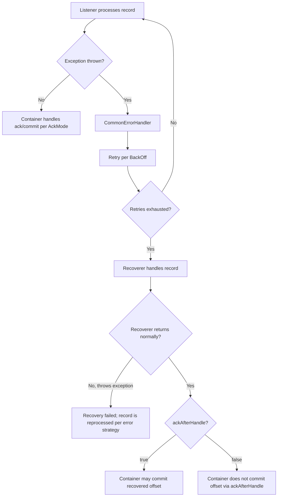

# AckAfterHandle in Spring Kafka

`ackAfterHandle` determines whether the container commits the offset after `CommonErrorHandler` handles an error and returns normally. For `DefaultErrorHandler`, the default value is `true`: when the record is considered handled after retries/recovery and the error handler does not rethrow an exception, the container may commit the offset so the record is not redelivered.

This setting is especially important when using a recoverer to log, skip a failing record, or publish the record to a dead-letter topic (DLT). If recovery succeeds and `ackAfterHandle=true`, the consumer advances past the failing record. If set to `false`, the container does not commit the recovered record's offset through this mechanism; the record may be redelivered when the consumer restarts or partitions are reassigned, depending on offset state and how the handler seeks.

## 1. What Problem Does AckAfterHandle Solve?

A listener may throw an exception while processing a record. The container passes the exception to `CommonErrorHandler`, such as `DefaultErrorHandler`. The error handler can retry, invoke a recoverer, or let the error propagate.

When the error handler finishes handling and returns normally, the container needs to know whether to acknowledge the offset of that handled failing record. `isAckAfterHandle()` supplies that decision. `DefaultErrorHandler` provides `setAckAfterHandle(boolean)` to control it.



Key point: `ackAfterHandle` only governs committing after the error handler returns normally. If the error handler throws an exception, the error path continues according to retry, seek, redelivery, or transaction strategy; no commit succeeds merely because the error handler was invoked.

## 2. Default Behavior of DefaultErrorHandler

`DefaultErrorHandler` defaults to `ackAfterHandle = true`. Once retries are exhausted and the recoverer completes without throwing an exception, the container is permitted to commit the offset of the recovered record.

If no recoverer is supplied, `DefaultErrorHandler` uses a default recoverer that logs the record once the delivery failure threshold is reached. With `ackAfterHandle=true`, the logged record can be treated as recovered and its offset committed. Therefore, the default configuration can cause failing records to be skipped once retries run out.

Example:

```java
DefaultErrorHandler errorHandler = new DefaultErrorHandler(
        new FixedBackOff(1_000L, 2L));

// true is the default; can be called explicitly to clarify intent.
errorHandler.setAckAfterHandle(true);
```

`FixedBackOff(1_000L, 2L)` means two retries after the initial delivery, with a one-second pause between attempts. When retries run out, the default recoverer logs the failure. Because the handler returns normally after recovery and `ackAfterHandle` is enabled, the container can commit the offset to proceed to the next record.

If business rules forbid skipping a record after merely logging, configure an explicit recoverer and handling policy. Do not rely on logs as a substitute for a DLT or a replayable store.

## 3. Configuring AckAfterHandle on DefaultErrorHandler

You can configure the error handler in a bean and attach it to the listener container factory:

```java
@Configuration
public class KafkaErrorHandlingConfiguration {

    @Bean
    public DefaultErrorHandler ordersErrorHandler() {
        DefaultErrorHandler handler = new DefaultErrorHandler(
                new FixedBackOff(1_000L, 2L));

        handler.setAckAfterHandle(true);
        return handler;
    }

    @Bean
    public ConcurrentKafkaListenerContainerFactory<String, OrderCreated>
            kafkaListenerContainerFactory(
                    ConsumerFactory<String, OrderCreated> consumerFactory,
                    DefaultErrorHandler ordersErrorHandler) {

        var factory = new ConcurrentKafkaListenerContainerFactory<String, OrderCreated>();
        factory.setConsumerFactory(consumerFactory);
        factory.setCommonErrorHandler(ordersErrorHandler);
        return factory;
    }
}
```

With Spring Boot, if using the auto-configured factory, you can declare `DefaultErrorHandler` as a bean so Boot wires it into the auto-configured factory under your Boot version's auto-configuration rules. If you declare the factory manually, call `setCommonErrorHandler(...)` on the exact factory used by the listener.

`ackAfterHandle` is set on the `DefaultErrorHandler` instance shared by the factory. If multiple factories share one handler instance, changing the property affects all of those factories. When different commit policies are needed, create separate handler instances.

## 4. When to Set ackAfterHandle=false?

Set `false` when you do not want the container to automatically commit the offset of a record recovered by the error handler after the handler returns normally.

```java
@Bean
public DefaultErrorHandler ordersErrorHandler() {
    DefaultErrorHandler handler = new DefaultErrorHandler(
            new FixedBackOff(1_000L, 2L));

    handler.setAckAfterHandle(false);
    return handler;
}
```

This choice requires careful thought. For example, if the recoverer successfully sends the record to a DLT while `ackAfterHandle=false`, the container does not commit the offset through this mechanism. If the partition's committed offset still sits behind the failing record when the consumer restarts or partitions are reassigned, the record may be re-read and sent to the DLT again. Consequently, the DLT may contain duplicate records. If subsequent records in the same partition are processed and committed, the committed offset may advance past that position anyway; thus, you cannot assume the record will always be redelivered immediately.

`false` does not mean the record is immediately re-invoked in every scenario. Subsequent behavior also depends on whether the error handler seeks, whether the consumer retains records in memory, the current committed offset, whether later records advance the offset past that point, `AckMode`, and the timing of rebalances/restarts.

Choose `false` only when the application has a clear replay plan or idempotency/deduplication around recovery. If the goal is DLT routing and continuing the stream, you usually want to commit the offset once the DLT publish succeeds.

## 5. Distinguishing ackAfterHandle from commitRecovered

Both properties relate to the offset of a recovered record, yet they operate on different paths:

| Property | Meaning | Conditions/Scope |
|---|---|---|
| `ackAfterHandle` | Tells the container whether to commit the offset when the error handler returns normally | Part of `CommonErrorHandler`; `DefaultErrorHandler` defaults to `true` |
| `commitRecovered` | Instructs `DefaultErrorHandler` itself to commit the offset of the recovered record | Used with `AckMode.MANUAL_IMMEDIATE` |
| `Acknowledgment.acknowledge()` | Listener explicitly acknowledges the processed record | Used with `AckMode.MANUAL`/`MANUAL_IMMEDIATE` |

Example with `MANUAL_IMMEDIATE`:

```java
@Bean
public ConcurrentKafkaListenerContainerFactory<String, OrderCreated>
        manualKafkaListenerContainerFactory(
                ConsumerFactory<String, OrderCreated> consumerFactory,
                DefaultErrorHandler manualErrorHandler) {

    var factory = new ConcurrentKafkaListenerContainerFactory<String, OrderCreated>();
    factory.setConsumerFactory(consumerFactory);
    factory.getContainerProperties().setAckMode(ContainerProperties.AckMode.MANUAL_IMMEDIATE);
    factory.setCommonErrorHandler(manualErrorHandler);
    return factory;
}

@Bean
public DefaultErrorHandler manualErrorHandler() {
    DefaultErrorHandler handler = new DefaultErrorHandler(
            new FixedBackOff(1_000L, 2L));
    handler.setCommitRecovered(true);
    return handler;
}
```

`setCommitRecovered(true)` requires `AckMode.MANUAL_IMMEDIATE`; commits can be synchronous or asynchronous depending on the container's `syncCommits` setting. Do not enable this property as if it were an alias for `ackAfterHandle`.

With `MANUAL_IMMEDIATE`, the listener is also responsible for acknowledging successfully processed records. Design the successful-record path and the error-handler-recovered path separately to avoid miscommitting or skipping offsets.

## 6. AckAfterHandle and AckModes

`AckMode` determines how the container commits offsets for normally processed records. `ackAfterHandle` supplements that decision when the error handler handles a failure and returns normally.

| AckMode | Typical Behavior for Successful Records | Relation to Recovered Records |
|---|---|---|
| `RECORD` | Commits after the listener processes each record successfully | Container can commit the record handled by the error handler if `ackAfterHandle=true` |
| `BATCH` | Commits offsets after processing the batch/poll per container rules | Handler may commit records processed before the failure; recovered record is governed by ack-after-handle |
| `TIME` / `COUNT` / `COUNT_TIME` | Commits by elapsed time, record count, or both | Does not necessarily mean the handler commits immediately at recovery time |
| `MANUAL` | Listener acknowledges; container commits per cycle/batch | Distinguish listener acknowledgment from handler recovery |
| `MANUAL_IMMEDIATE` | Acknowledging on the consumer thread can commit immediately | Use `commitRecovered=true` if you want the handler to commit recovered records |

Exact commit mechanics also depend on record vs. batch listeners, sync/async commit settings, transactions, and how the error handler seeks partitions. Do not infer that `ackAfterHandle=true` means every offset in the poll is committed immediately regardless of AckMode.

## 7. Recovery Example with DeadLetterPublishingRecoverer

A common pattern is retrying several times and then publishing the failing record to a DLT. If publishing succeeds and the recoverer returns normally, `ackAfterHandle=true` lets the container commit the offset so the group keeps moving.

```java
@Bean
public DefaultErrorHandler ordersErrorHandler(
        KafkaTemplate<Object, Object> kafkaTemplate) {

    DeadLetterPublishingRecoverer recoverer = new DeadLetterPublishingRecoverer(
            kafkaTemplate,
            (record, exception) -> new TopicPartition(
                    record.topic() + ".DLT",
                    record.partition()));

    DefaultErrorHandler handler = new DefaultErrorHandler(
            recoverer,
            new FixedBackOff(1_000L, 2L));

    handler.setAckAfterHandle(true);
    return handler;
}
```

In this example, the failing record is retried twice after the initial delivery. Once retries run out, the recoverer publishes to the topic suffixed with `.DLT`. After recovery finishes normally, the container is permitted to commit the offset of the recovered record.

When configuring a production DLT, ensure the destination topic exists, serializers match the payload, partition mapping is valid, and the producer has write permissions. Also verify the DLT send outcome; if the recoverer throws an exception on publish failure, recovery is incomplete and the record must not be treated as finished.

## 8. What Happens When the Recoverer Fails?

A recoverer is deemed successful when it completes and returns normally. If the recoverer throws an exception, the error handler cannot treat the record as successfully recovered. With `DefaultErrorHandler`, the record re-enters the retry/seek path per configuration; backoff state may be reset when recovery fails.

Example causes:

- DLT broker is unavailable.
- Producer cannot serialize the payload.
- DLT topic does not exist or ACLs deny writes.
- Timeout when sending to the DLT.
- Application bug inside the recoverer.

Do not set `ackAfterHandle=true` thinking it commits regardless of whether the recoverer succeeds. This flag only applies when the error handler exits normally. If recovery fails and the handler throws an exception, the container follows the error path rather than committing as a processed record.

For DLTs, monitor both listener errors and DLT publish failures. If DLT publishing fails persistently, the consumer may continue retrying the original record and increase lag; that is behavior you want to observe, not hide by committing past it.

## 9. Custom Error Handlers and isAckAfterHandle()

`CommonErrorHandler` (since Spring Kafka 2.8) provides `isAckAfterHandle()` and `setAckAfterHandle(boolean)`. If implementing the interface directly, you can override the commit-decision method:

```java
@Override
public boolean isAckAfterHandle() {
    return false; // Do not ask the container to commit records already handled by the handler.
}
```

Returning `true` tells the container the offset may be committed when the error handler returns normally. Returning `false` tells the container not to commit the offset via the ack-after-handle mechanism.

The method above only expresses the commit policy, not the full error handler. You must implement the appropriate callbacks—such as `handleOne`, `handleRemaining`, `handleBatch`, or `handleOtherException`—matching the `CommonErrorHandler` model and listener type. If the handler wants errors to continue being retried/redelivered, it must perform seeks or return outcomes compliant with the callback contract and `seeksAfterHandling()`.

With `DefaultErrorHandler`, use `setAckAfterHandle(...)` instead of subclassing just to change a boolean.

## 10. Interaction with seekAfterError and Redelivery

`DefaultErrorHandler` can seek the consumer back to the rewind offset or use non-seek mode, retaining unprocessed records in the container and resubmitting them afterward. `ackAfterHandle` does not replace that mechanism.

| Scenario | Primary Outcome |
|---|---|
| Retries not yet exhausted | Record is redelivered per BackOff/seek or resubmit strategy |
| Recoverer succeeds, `ackAfterHandle=true` | Container may commit the recovered record's offset |
| Recoverer succeeds, `ackAfterHandle=false` | Container does not commit offset via ack-after-handle; record may replay when offset remains uncommitted and consumer lifecycle changes |
| Recoverer fails and throws exception | Recovery incomplete; record stays on retry/redelivery path |

With `seekAfterError=false`, the container keeps unprocessed records in memory and resubmits them after the error handler. That controls how remaining records are handled after an error, not a commit toggle. Do not confuse `seekAfterError` with `ackAfterHandle`.

## 11. Batch Listeners and Post-Recovery Commits

For a batch listener, the container and error handler need to know which record in the batch failed. `DefaultErrorHandler` supports `BatchListenerFailedException` to identify the failing record or index. Records before the failing record can be committed; the failing record is retried; once recovered successfully, that record's offset can be committed and remaining records continue processing.

Example:

```java
@KafkaListener(topics = "orders", containerFactory = "batchFactory")
public void onOrders(List<OrderCreated> events) {
    for (int i = 0; i < events.size(); i++) {
        try {
            orderService.process(events.get(i));
        }
        catch (Exception exception) {
            throw new BatchListenerFailedException(
                    "Cannot process order at index " + i,
                    exception,
                    i);
        }
    }
}
```

For batch listeners, avoid throwing only a generic exception if per-record recovery is needed; the container may have to retry the entire batch under its fallback strategy. Verify the exact batch behavior of your Spring Kafka version and AckMode configuration.

If using `MANUAL_IMMEDIATE`, `commitRecovered=true` is the option governing committing recovered records. Do not infer from `ackAfterHandle` that every record in a batch is committed immediately.

## 12. Transactions and AckAfterHandle

When a listener container uses Kafka transactions, the error path differs from non-transactional consumers. By default, Spring Kafka does not configure a standard error handler on a transactional container so that exceptions can trigger transaction rollbacks. `DefaultAfterRollbackProcessor` handles records after rollback.

If you attach a custom error handler to a transactional listener and that handler catches the exception and returns normally, the transaction may fail to roll back as intended. To trigger a rollback, the handler must rethrow the exception so the transaction manager sees the failure.

Therefore, never use `ackAfterHandle=true` as a substitute for transaction rollback or as an exactly-once guarantee. Design post-rollback recovery explicitly with `AfterRollbackProcessor` and verify offset commits inside transactions against your actual configuration.

## 13. Impact on At-Least-Once and Deduplication

Committing the offset after recovery means the consumer group advances past the failing record. If the recoverer published the record to a DLT and the container then committed the offset, the original record will not be redelivered solely due to that listener failure. However, a failure between DLT publish and offset commit can still produce a DLT duplicate: the DLT publish succeeded, the offset commit did not complete, and the restarted consumer processes the original record again.

Hence, DLT consumers and recovery workflows still need idempotency. You can use `eventId`, topic-partition-offset, or a business key to deduplicate, depending on your contract and replay goals.

If `ackAfterHandle=false`, the likelihood of redelivery rises when offsets stay uncommitted. This does not automatically yield exactly-once semantics; it only changes the container's post-recovery commit policy.

## 14. Testing AckAfterHandle

Verify both configuration and actual offset behavior. You can use `@EmbeddedKafka` or Testcontainers to create topics, send records, and inspect consumer group offsets.

Required scenarios:

1. Listener throws an exception; retries remain; verify the record is redelivered per BackOff.
2. Retries exhausted; recoverer returns normally; with `ackAfterHandle=true`, verify the group advances past the recovered record's offset.
3. Retries exhausted; recoverer returns normally; with `ackAfterHandle=false`, verify the container does not commit the offset via this mechanism and observe behavior on restart/rebalance.
4. Recoverer throws an exception; verify the record is not marked successfully recovered and continues retrying/recovering per configuration.
5. DLT publish succeeds while offset commit fails; verify the pipeline can produce duplicates and deduplication handles them.
6. With `MANUAL_IMMEDIATE`, test `commitRecovered=true` separately from `ackAfterHandle`.
7. With a transactional listener, verify exceptions propagate and transactions roll back as intended.

Do not merely assert that the recoverer method was called. Read committed offsets via `KafkaConsumer`/Admin API or observe redelivered records after restart to prove commit behavior. Use finite timeouts and distinct group IDs per test so stale state does not taint results.

## 15. Common Pitfalls

**Thinking ackAfterHandle is an in-listener acknowledgment:** it is the container's decision after the error handler returns normally, not `Acknowledgment.acknowledge()`.

**Thinking false means immediate retry:** `false` prevents the container from committing via ack-after-handle; redelivery timing still depends on seeks, in-memory resubmits, committed offsets, and consumer lifecycle.

**Confusing it with commitRecovered:** `commitRecovered` is for `DefaultErrorHandler` with `AckMode.MANUAL_IMMEDIATE`; it is not another name for `ackAfterHandle`.

**Recoverer only logs yet assuming the record is retained:** if the recoverer returns normally and ack-after-handle is enabled, the record can be skipped once committed.

**Wanting to commit despite DLT publish failure:** the recoverer must signal failure when publishing fails; never treat a record as recovered if the DLT write did not succeed.

**Disabling ackAfterHandle without preparing deduplication:** records can be reprocessed or re-recovered after restarts or rebalances.

**Sharing one handler with conflicting needs across multiple factories:** a single handler instance applies the same policy to every container using it. Create separate handlers when different behavior is needed.

**Swallowing exceptions in a custom CommonErrorHandler:** the container may treat the error as handled and commit if `isAckAfterHandle()` returns true. Return normally only when you genuinely want to mark the error handled.

**Using ackAfterHandle to control transaction rollbacks:** transactional containers need exceptions propagated and an appropriate `AfterRollbackProcessor`.

## 16. Production Checklist

- Identified whether errors should be retried, recovered, sent to a DLT, or stop the container.
- Understood that `DefaultErrorHandler` defaults `ackAfterHandle` to `true`.
- Recoverer returns normally only after recovery completes per contract.
- If using a DLT, verified publish outcomes, topic, serializers, ACLs, and partition mapping.
- Chose `ackAfterHandle=true/false` according to the intended commit policy.
- If using `MANUAL_IMMEDIATE`, evaluated `commitRecovered=true` separately.
- Verified AckMode and batch/record listener interactions with commit behavior.
- Added idempotency/deduplication if recovery can repeat.
- If using transactions, ensured exceptions propagate when rollback is needed and an appropriate `AfterRollbackProcessor` is configured.
- Instrumented metrics/logs for retries, recovery success/failure, DLT publishes, and committed offsets.
- Wrote integration tests proving post-recovery offsets and restart/rebalance behavior.

`ackAfterHandle` governs committing after the error handler finishes handling an error and returns normally. With `DefaultErrorHandler`, the `true` default lets the container commit the recovered record's offset so the stream continues. Set `false` when you have an explicit reason to retain the ability to re-read the record, while accounting for replay and DLT duplicates. Always distinguish this property from `commitRecovered`, acknowledgment modes, and transaction rollbacks.

## References

- [Spring Kafka – Handling Exceptions](https://docs.spring.io/spring-kafka/reference/kafka/annotation-error-handling.html)
- [DefaultErrorHandler API](https://docs.spring.io/spring-kafka/docs/current/api/org/springframework/kafka/listener/DefaultErrorHandler.html)
- [CommonErrorHandler API](https://docs.spring.io/spring-kafka/docs/current/api/org/springframework/kafka/listener/CommonErrorHandler.html)
