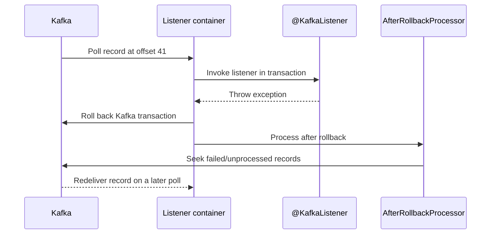
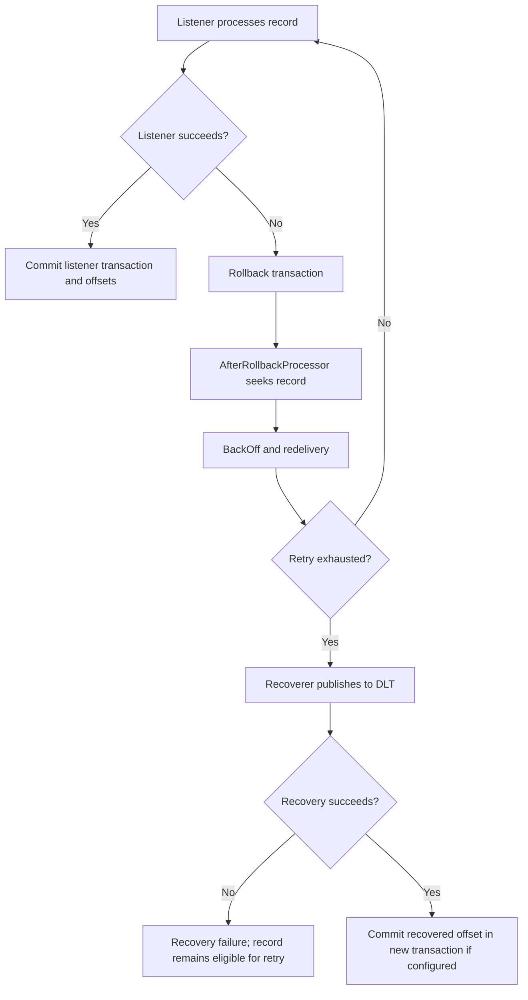

# AfterRollbackProcessor

In Spring Kafka, `AfterRollbackProcessor` handles records after a listener container's transaction is rolled back. When a listener runs inside a Kafka transaction and processing fails causing the transaction to roll back, the container needs to return unprocessed records to an appropriate read position for retry. `DefaultAfterRollbackProcessor` is the default implementation, supporting seeks, retry/backoff, and recovering failing records once retry attempts are exhausted.

Within the `SPRING_KAFKA_MESSAGING` module, producers send events with `KafkaTemplate` and consumers receive events with `@KafkaListener`. `AfterRollbackProcessor` belongs to consumer-side error coordination when using transactional listeners. It defines how records are handled after rollback, including retries, routing failing records to a dead-letter topic, and committing recovered offsets in a new transaction when configured.

The examples in this lesson use the following event and application service:

```java
import java.math.BigDecimal;
import java.util.List;

public record OrderCreatedEvent(
        String eventId,
        String orderId,
        BigDecimal total
) {}

public interface OrderApplicationService {
    void apply(OrderCreatedEvent event);
    void applyBatch(List<OrderCreatedEvent> events);
}
```

## 1. Why Is `AfterRollbackProcessor` Needed?

With a transactional listener, Spring Kafka can run record consumption and listener execution inside a Kafka transaction. If the listener completes, the container commits the transaction; if the listener throws an exception, the container rolls back the transaction.

After rollback, the consumer must reprocess unacknowledged records. `AfterRollbackProcessor` is invoked to coordinate this. By default, the processor seeks the consumer back to the failing record and subsequent unprocessed records so they can be polled again.



`AfterRollbackProcessor` is not a general handler for every exception in every listener. It is tied to the rollback flow of a transactional container. For non-transactional listeners, the standard error-handling mechanism is `CommonErrorHandler`, such as `DefaultErrorHandler`.

## 2. Distinguishing Rollback, Retry, and Recovery

These three concepts play distinct roles:

| Concept | Meaning | Component Typically Responsible |
|---|---|---|
| Rollback | Cancels the active transaction when the listener fails | Kafka transaction manager and listener container |
| Retry | Re-presents unprocessed records so the listener tries again after a pause | `AfterRollbackProcessor` with `BackOff` |
| Recovery | Handles the record after retries are exhausted, e.g., publishing to a DLT or storing in an error repository | Recoverer, typically `DeadLetterPublishingRecoverer` |

Rollback does not automatically mean the record has been sent to a DLT. Normally, the processor retries per backoff; only when recovery criteria are met does it invoke the recoverer. If recovery fails, the application must retain the ability to retry or report the error clearly rather than silently dropping the record.

## 3. Configuring Kafka Transactions for a Listener Container

For a listener to run inside a Kafka transaction, the producer factory must be configured with a transaction ID prefix. Each application instance requires a unique prefix to avoid producer transaction ID conflicts.

Spring Boot configuration example:

```yaml
spring:
  kafka:
    bootstrap-servers: ${KAFKA_BOOTSTRAP_SERVERS:localhost:9092}
    producer:
      transaction-id-prefix: ${INSTANCE_ID:orders-app-}
      acks: all
      properties:
        enable.idempotence: true
    consumer:
      group-id: orders-projection
      enable-auto-commit: false
      auto-offset-reset: earliest
```

When a transaction ID prefix is configured, Spring Boot can auto-create a transaction-capable producer factory. If creating `ProducerFactory` manually, configure the transaction ID prefix on `DefaultKafkaProducerFactory` and supply that factory to `KafkaTransactionManager`.

Example declaring the transaction manager:

```java
import org.springframework.context.annotation.Bean;
import org.springframework.context.annotation.Configuration;
import org.springframework.kafka.core.ProducerFactory;
import org.springframework.kafka.transaction.KafkaTransactionManager;

@Configuration
public class KafkaTransactionConfiguration {

    @Bean
    public KafkaTransactionManager<String, OrderCreatedEvent>
            kafkaTransactionManager(
                    ProducerFactory<String, OrderCreatedEvent> producerFactory) {

        return new KafkaTransactionManager<>(producerFactory);
    }
}
```

`KafkaTransactionManager` must use a producer factory configured for transactions. When multiple templates or producer factories coexist, ensure the listener transaction manager and output-event template use the matching transactional producer factory.

## 4. Attaching the Transaction Manager to the Listener Container

You can configure `ConcurrentKafkaListenerContainerFactory` so the listener container starts a Kafka transaction for each processing cycle:

```java
import org.springframework.context.annotation.Bean;
import org.springframework.context.annotation.Configuration;
import org.springframework.kafka.config.ConcurrentKafkaListenerContainerFactory;
import org.springframework.kafka.core.ConsumerFactory;
import org.springframework.kafka.transaction.KafkaTransactionManager;

@Configuration
public class TransactionalListenerConfiguration {

    @Bean
    public ConcurrentKafkaListenerContainerFactory<String, OrderCreatedEvent>
            transactionalKafkaListenerContainerFactory(
                    ConsumerFactory<String, OrderCreatedEvent> consumerFactory,
                    KafkaTransactionManager<String, OrderCreatedEvent> transactionManager) {

        var factory = new ConcurrentKafkaListenerContainerFactory<
                String, OrderCreatedEvent>();
        factory.setConsumerFactory(consumerFactory);
        factory.getContainerProperties().setKafkaAwareTransactionManager(
                transactionManager
        );
        return factory;
    }
}
```

Listener using this factory:

```java
import org.springframework.kafka.annotation.KafkaListener;
import org.springframework.stereotype.Component;

@Component
public class OrderCreatedListener {

    private final OrderApplicationService orderService;

    public OrderCreatedListener(OrderApplicationService orderService) {
        this.orderService = orderService;
    }

    @KafkaListener(
            topics = "orders.created",
            groupId = "orders-projection",
            containerFactory = "transactionalKafkaListenerContainerFactory"
    )
    public void onMessage(OrderCreatedEvent event) {
        orderService.apply(event);
    }
}
```

When the method returns normally, the container can commit the Kafka transaction along with the processed record's offset. When an exception escapes the listener, the transaction rolls back and `AfterRollbackProcessor` is invoked. If the listener catches the exception and returns normally, the container may treat processing as successful; rethrow the exception or mark the transaction rollback-only when rollback is desired.

## 5. `AfterRollbackProcessor` and `DefaultAfterRollbackProcessor`

`AfterRollbackProcessor<K, V>` is the contract used by the listener container after a transaction rollback. `DefaultAfterRollbackProcessor<K, V>` provides the standard implementation with these capabilities:

- Seeks the failing record and unprocessed records so they are polled again.
- Uses `BackOff` to govern wait intervals and retry counts.
- Invokes a recoverer once retries are exhausted.
- Can commit the recovered record's offset in a new transaction when configured appropriately.
- Supports customizing backoff per record/exception in versions with the corresponding API.

Normally, an application only needs `DefaultAfterRollbackProcessor` with a configured recoverer and backoff. Implement a custom `AfterRollbackProcessor` only when specialized seek, retry, or recovery semantics are required that the default implementation cannot satisfy.

## 6. Configuring Retries and Backoff

`BackOff` controls wait times between retry attempts. Example using `FixedBackOff`:

```java
import org.springframework.kafka.listener.DefaultAfterRollbackProcessor;
import org.springframework.util.backoff.FixedBackOff;
import org.springframework.util.backoff.BackOff;

BackOff retryBackOff = new FixedBackOff(1_000L, 2L);
DefaultAfterRollbackProcessor<String, OrderCreatedEvent> processor =
        new DefaultAfterRollbackProcessor<>(recoverer, retryBackOff);
```

This abbreviated snippet uses the `recoverer` created previously. It illustrates a fixed one-second pause and retry limits per `FixedBackOff` semantics. `FixedBackOff` fits when constant wait intervals are desired; if increasing wait times are needed, use `ExponentialBackOff` or another suitable `BackOff`.

Retries should not be infinite for every exception. Transient failures like an unavailable dependency can be retried; invalid data or schema errors usually require recovery/DLT or manual remediation. Classify errors by business nature and avoid keeping a partition blocked too long by an unprocessable record.

## 7. Recovery with `DeadLetterPublishingRecoverer`

Once retries are exhausted, a recoverer can publish the failing record to a dead-letter topic. Spring Kafka provides `DeadLetterPublishingRecoverer` to create the DLT record and attach metadata about the original record and exception.

```java
import org.apache.kafka.common.TopicPartition;
import org.springframework.context.annotation.Bean;
import org.springframework.context.annotation.Configuration;
import org.springframework.kafka.listener.DeadLetterPublishingRecoverer;
import org.springframework.kafka.core.KafkaTemplate;

@Configuration
public class DeadLetterConfiguration {

    @Bean
    public DeadLetterPublishingRecoverer deadLetterPublishingRecoverer(
            KafkaTemplate<String, OrderCreatedEvent> kafkaTemplate) {

        return new DeadLetterPublishingRecoverer(
                kafkaTemplate,
                (record, exception) -> new TopicPartition(
                        record.topic() + ".DLT",
                        record.partition()
                )
        );
    }
}
```

This example routes records from `orders.created` to `orders.created.DLT` while keeping the partition index. The DLT topic must exist beforehand with enough partitions to accept the corresponding partitions; if the DLT has fewer partitions than the source topic, publishing can fail. Also configure serializers/templates to support the actual payload types of failing records.

`DeadLetterPublishingRecoverer` can add headers such as original topic, partition, offset, consumer group, and exception details. These headers aid investigation and replay. A DLT is not an automated data-repair mechanism; you need workflows to monitor, classify, fix root causes, and replay under control.

## 8. Attaching the Processor to the Listener Container Factory

After creating the recoverer and processor, attach the processor to the factory:

```java
import org.springframework.context.annotation.Bean;
import org.springframework.context.annotation.Configuration;
import org.springframework.kafka.config.ConcurrentKafkaListenerContainerFactory;
import org.springframework.kafka.core.ConsumerFactory;
import org.springframework.kafka.core.KafkaTemplate;
import org.springframework.kafka.listener.DeadLetterPublishingRecoverer;
import org.springframework.kafka.listener.DefaultAfterRollbackProcessor;
import org.springframework.kafka.transaction.KafkaTransactionManager;
import org.springframework.util.backoff.FixedBackOff;

@Configuration
public class AfterRollbackProcessorConfiguration {

    @Bean
    public DefaultAfterRollbackProcessor<String, OrderCreatedEvent>
            orderAfterRollbackProcessor(
                    DeadLetterPublishingRecoverer recoverer,
                    KafkaTemplate<String, OrderCreatedEvent> kafkaTemplate) {

        var processor = new DefaultAfterRollbackProcessor<String, OrderCreatedEvent>(
                recoverer,
                new FixedBackOff(1_000L, 2L)
        );
        processor.setCommitRecovered(true);
        processor.setKafkaTemplate(kafkaTemplate);
        return processor;
    }

    @Bean
    public ConcurrentKafkaListenerContainerFactory<String, OrderCreatedEvent>
            orderTransactionalListenerFactory(
                    ConsumerFactory<String, OrderCreatedEvent> consumerFactory,
                    KafkaTransactionManager<String, OrderCreatedEvent> transactionManager,
                    DefaultAfterRollbackProcessor<String, OrderCreatedEvent>
                            orderAfterRollbackProcessor) {

        var factory = new ConcurrentKafkaListenerContainerFactory<
                String, OrderCreatedEvent>();
        factory.setConsumerFactory(consumerFactory);
        factory.getContainerProperties().setKafkaAwareTransactionManager(
                transactionManager
        );
        factory.setAfterRollbackProcessor(orderAfterRollbackProcessor);
        return factory;
    }
}
```

`setCommitRecovered(true)` instructs the processor to commit the recovered record's offset. With a transactional container, the processor can execute the DLT publish and send the recovered offset inside a new transaction. The `KafkaTemplate` passed into the processor must use a transactional producer factory compatible with the container's transaction manager. Verify the configuration and your Spring Kafka version because constructors/overloads can differ across versions.

Without enabling `commitRecovered` or configuring the corresponding template/transaction, do not assume the recovered record's offset is committed in a new transaction. Define recovery behavior explicitly and test committed offsets after a record is routed to the DLT.

## 9. What Happens After Recovery Succeeds?

Typical recovery flow:



When the recoverer successfully publishes to the DLT and the processor is configured to commit recovered offsets, the failing record's offset is committed in a new transaction. This lets the consumer continue to the next record without infinitely reprocessing records already moved to the DLT.

If DLT publishing fails—for instance, because the broker is unavailable or the serializer does not support the payload—recovery is incomplete. Never commit the source offset in that situation; allow the record to be reprocessed or raise an operational alert.

## 10. Record Listeners and Batch Listeners

For a record listener, the processor can identify the failing record and seek that record along with subsequent unprocessed records. Preceding records in the same poll that completed successfully can retain progress per container transaction/offset semantics.

For a batch listener, by default an exception can cause the entire batch to be reprocessed. If the listener throws `BatchListenerFailedException` specifying the failing record/index, Spring Kafka can commit the portion before the failing record and retry/recover from that position, depending on version and configuration.

Batch listener example identifying the failing record:

```java
import java.util.List;

import org.springframework.kafka.annotation.KafkaListener;
import org.springframework.kafka.listener.BatchListenerFailedException;
import org.springframework.stereotype.Component;

@Component
public class OrderBatchListener {

    private final OrderApplicationService orderService;

    public OrderBatchListener(OrderApplicationService orderService) {
        this.orderService = orderService;
    }

    @KafkaListener(
            topics = "orders.created",
            groupId = "orders-batch",
            containerFactory = "transactionalBatchListenerFactory"
    )
    public void onMessages(List<OrderCreatedEvent> events) {
        for (int index = 0; index < events.size(); index++) {
            try {
                orderService.apply(events.get(index));
            } catch (RuntimeException exception) {
                throw new BatchListenerFailedException(
                        "Failed to process order event",
                        exception,
                        index
                );
            }
        }
    }
}
```

To use a batch listener, the factory needs `setBatchListener(true)`. Check the `BatchListenerFailedException` constructor overloads for your project's Spring Kafka version. Batch processing needs dedicated tests because seek/retry semantics differ from record listeners.

## 11. Distinguishing `AfterRollbackProcessor` from `DefaultErrorHandler`

Both components relate to retries and recovery, yet operate on different coordination paths:

| Criterion | `AfterRollbackProcessor` | `DefaultErrorHandler` |
|---|---|---|
| Primary context | Listener container using transactions after rollback | Listener container handling errors via standard error handler |
| Timing | After transaction rollback | When listener/record processing throws an exception in container flow |
| Role | Seeks and handles records after rollback, retry/recover | Retries/backoff/recovery in error handling outside after-rollback flow |
| Implementation | `DefaultAfterRollbackProcessor` | `DefaultErrorHandler` |
| DLT | Can use `DeadLetterPublishingRecoverer` | Can use `DeadLetterPublishingRecoverer` |

Do not configure both components as if they were a single unified mechanism. For transactional listeners, understand the processor invoked after rollback. For non-transactional listeners, configure an appropriate `CommonErrorHandler`. Combining transactions and error handlers should be driven by processing goals, not merely adding both beans to the application.

## 12. Classifying Errors and Customizing Backoff

Not every exception should retry the same way. Examples:

| Error Type | Suggested Handling |
|---|---|
| Dependency temporarily unavailable | Retry with increasing backoff and attempt cap |
| Short-lived timeout | Bounded retries; monitor latency and dependency health |
| Schema-invalid or malformed payload | Typically route to DLT after few or zero retries |
| Permanent business-rule violation | Recovery/DLT or dedicated business remediation workflow |
| Configuration/authorization error | Alert and stop/fix configuration; infinite retries are rarely useful |

`DefaultAfterRollbackProcessor` supports configuring `BackOff`, and in versions offering the API you can use `setBackOffFunction` to choose backoff by record and exception. Conceptual example:

```java
processor.setBackOffFunction((record, exception) -> {
    if (exception instanceof TemporaryDependencyException) {
        return new FixedBackOff(2_000L, 3L);
    }
    return new FixedBackOff(0L, 0L);
});
```

This snippet illustrates selecting retries by error type; ensure actual exceptions are classified properly and the API exists in your project's Spring Kafka version. Never rely casually on exception class names if exceptions are wrapped across multiple layers; you may need to inspect the cause chain.

## 13. Idempotency and Transaction Boundaries

Suppose a listener updates a database and then the Kafka transaction rolls back. The database does not automatically roll back with the Kafka transaction unless the application configured a specific transaction coordination mechanism. When the record is redelivered, the database may receive the same event a second time.

Therefore:

- Use a unique `eventId` and record processed markers with a unique constraint.
- Update business data and the inbox/idempotency record inside the same database transaction.
- Keep handlers idempotent so retries do not duplicate side effects.
- For Kafka-to-Kafka flows, use Kafka transactions to synchronize output records and input offsets within the same Kafka transaction.
- For database plus Kafka, evaluate outbox/inbox or eventual consistency patterns; never assume Kafka transactions cover databases.

`AfterRollbackProcessor` coordinates post-rollback retries; it does not replace application service transaction design.

## 14. Testing `AfterRollbackProcessor`

Testing should cover success, rollback, retry, and recovery paths:

- **Transactional integration test:** listener succeeds; verify output records and consumer offsets commit within the transaction.
- **Rollback test:** listener throws an exception; verify Kafka outputs in the transaction roll back and the input record is redelivered.
- **Backoff test:** configure a small retry count and verify the listener is invoked the exact configured number of times.
- **Recovery/DLT test:** fail the record repeatedly until the recoverer publishes to the DLT; check topic, partition, and DLT headers.
- **Recovered offset test:** with `commitRecovered` enabled, verify the offset commits in a new transaction after successful recovery.
- **Recovery failure test:** force DLT publishing to fail; verify the source offset is not inadvertently committed.
- **Batch test:** verify `BatchListenerFailedException` pinpoints the failing record with proper seek/retry behavior.
- **Restart test:** stop the application mid-rollback/recovery and verify no records are lost.

Use Embedded Kafka or Testcontainers with a transaction-capable broker. Create DLT topics with partition counts matching the source topic. When verifying transactions, test consumers should use `isolation.level=read_committed` if the goal is observing only committed records.

## 15. Common Pitfalls

- **Using `AfterRollbackProcessor` for non-transactional listeners:** it is not a general replacement for `CommonErrorHandler`.
- **Producer factory lacking a transaction ID prefix:** the transaction manager cannot create properly configured transactional producers.
- **Duplicate transaction ID prefixes across instances:** causes producer transaction ID collisions.
- **Swallowing exceptions inside the listener:** the container may commit the transaction instead of rolling back.
- **Assuming rollback automatically sends to a DLT:** retry and recovery are separate steps; a configured recoverer is required.
- **Enabling `commitRecovered` without a properly configured KafkaTemplate:** recovered offsets are not committed transactionally as expected.
- **DLT missing matching partitions:** publishing with the same partition index can fail.
- **DLT template serializer incompatible with failing payloads:** recovery fails before the record is persisted to the DLT.
- **Infinite retries on permanent data errors:** partitions can stall and consumer lag grows.
- **Non-idempotent database side effects:** records redelivered after rollback can create duplicate data.
- **Not testing batch listeners:** retry/seek semantics differ from record listeners.
- **Confusing `AfterRollbackProcessor` with `DefaultErrorHandler`:** the two mechanisms run in different error-coordination flows.

## 16. Implementation Checklist

- [ ] The listener container genuinely uses a Kafka transaction manager.
- [ ] The producer factory has a unique transaction ID prefix per instance.
- [ ] The listener lets exceptions escape when rollback is needed.
- [ ] `DefaultAfterRollbackProcessor` is attached to the right container factory.
- [ ] Backoff and retry counts fit each exception category.
- [ ] A recoverer is explicitly configured for unprocessable records.
- [ ] The DLT exists, has enough partitions, and uses compatible serializers.
- [ ] `commitRecovered` and `KafkaTemplate` are configured with a transactional producer factory when post-recovery offset commits are needed.
- [ ] Handlers are idempotent or backed by an inbox/deduplication strategy.
- [ ] Batch listeners have dedicated tests if used.
- [ ] Metrics/logs cover rollbacks, retries, recoveries, DLT publish failures, and consumer lag.
- [ ] Integration tests verify transactions, offset commits, and restart behavior.

`AfterRollbackProcessor` is the key coordination point after a transactional listener fails. When Kafka transactions, backoff, recoverers, and recovered-offset commit policies are properly combined, an application can retry safely, route failing records to a DLT, and continue processing with clear consumer progress. Add idempotency for side effects outside Kafka and test both rollback and recovery before going live.
