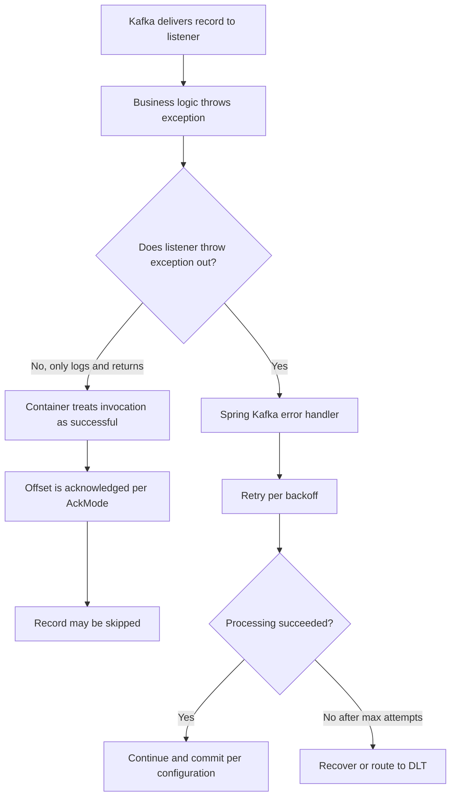

# Never Swallow Errors Blindly

In a Kafka pipeline, a record is considered successfully processed only when business logic completes according to the application's policy and the offset is acknowledged appropriately. If a listener catches an exception, merely logs it, and returns normally, Spring Kafka generally treats that listener invocation as a success. The container keeps moving and commits the offset under the active `AckMode`; the failing record may be skipped without ever going through retries or a dead-letter topic (DLT).

This is a dangerous design flaw because the system stays up, consumer lag may drop, and logs may show an exception—yet the business silently lost an event. This lesson helps distinguish retryable errors from non-retryable errors, explains how to let exceptions reach the error handler, and shows how to acknowledge offsets only after successful processing.

## 1. What Happens When a Listener Swallows an Exception?

Consider the following listener:

```java
@KafkaListener(topics = "orders", groupId = "order-service")
public void consume(OrderEvent event) {
    try {
        orderService.process(event);
    }
    catch (Exception ex) {
        log.error("Cannot process order event", ex);
    }
}
```

If `orderService.process()` fails, the exception is trapped inside `catch`. The `consume()` method completes normally, so the container receives no failure signal from the listener. The error handler has no exception to trigger retries or forward the record to a DLT.

Whether the offset commits immediately depends on `AckMode`, transactions, and container configuration. However, the container already regarded the listener call as successful; under container-managed commit modes, the record can be acknowledged and subsequent consumption will resume from the next offset. Logging alone will never cause Kafka to reprocess the record.



Therefore, separate two distinct concerns: logging exceptions for diagnostics versus propagating failure status to the error-handling mechanism. Logs exist for observability; logging itself does not make Kafka retry a record.

## 2. Let Exceptions Propagate to the Container

If the listener does not need to enrich context, the simplest approach is letting the exception propagate:

```java
@KafkaListener(topics = "orders", groupId = "order-service")
public void consume(OrderEvent event) {
    orderService.process(event);
}
```

Spring Kafka catches the exception from the listener and routes it to the container's error handler. If you need to log or add business context, rethrow the exception or wrap it in an exception that preserves the root cause:

```java
@KafkaListener(topics = "orders", groupId = "order-service")
public void consume(OrderEvent event) {
    try {
        orderService.process(event);
    }
    catch (TransientDataAccessException ex) {
        log.warn("Temporary database failure for order {}", event.orderId(), ex);
        throw new OrderProcessingException(
                "Cannot process order " + event.orderId(), ex);
    }
}
```

`OrderProcessingException` in the example is an application-defined business exception that keeps `ex` as its cause. If you only need to propagate the error, remove `try/catch` altogether. Avoid catching `Exception` or `Throwable` around the entire listener and continuing execution, as that masks programming bugs, infrastructure failures, and business errors alike.

Catch exceptions only when taking a specific, safe action—such as adding context, translating into a classified exception type, or handling an explicitly skippable case per business requirements. If an error is allowed to be skipped, express that decision explicitly with record-identifying logs, metrics, or proper auditing; never accidentally turn every failure into a success.

## 3. Classify Errors Before Choosing Retries

Retries fit errors likely to resolve after a short wait. Examples include temporarily unreachable databases, HTTP service timeouts, rate limits, or intermittent broker/dependency outages. Conversely, relentless retries cannot fix malformed data, missing required fields, or permanent business-rule violations.

| Error Type | Examples | Typically Appropriate Handling |
|---|---|---|
| Transient error | Timeout, brief disconnection, database temporarily unavailable | Bounded retries with backoff; after exhaustion, recover or send to DLT. |
| Data or business error | Invalid order code, missing required info, disallowed state | Do not retry repeatedly; record cause and route to DLT or dedicated business flow. |
| Configuration or programming error | Wrong schema mapping, missing config, bug causing `NullPointerException` | Alert and investigate; avoid infinite retry loops. Optionally mark non-retryable to route to DLT. |
| Deserialization error | Payload cannot be converted to an object | Handle at deserializer/container layer; listener may not be invoked so in-listener `try/catch` cannot catch it. |

A practical strategy is separating errors into two clear sets: retryable and non-retryable. Spring Kafka's `DefaultErrorHandler` lets you register non-retryable exceptions via `addNotRetryableExceptions(...)` or retryable ones via `addRetryableExceptions(...)`. Base classifications on real exceptions and system policy rather than generic exception names.

For example, invalid input errors can be marked non-retryable, while transient data-access errors are retried:

```java
DefaultErrorHandler errorHandler = new DefaultErrorHandler(
        recoverer,
        new FixedBackOff(1_000L, 2L));

errorHandler.addNotRetryableExceptions(InvalidOrderException.class);
errorHandler.addRetryableExceptions(TransientDataAccessException.class);
```

With `FixedBackOff(1_000L, 2L)`, the handler waits one second between retries and allows two retries after the initial attempt. The listener can receive the record up to three times in total unless another policy alters processing. Backoff eases pressure on struggling services; attempt counts must stay bounded to avoid holding onto failing records too long.

## 4. Configuring Retries and Dead-Letter Topics

When a transient error persists past the retry limit, the application needs an explicit recovery decision. For a record listener, `DefaultErrorHandler` can pair with `DeadLetterPublishingRecoverer` to route unrecoverable records to a DLT.

```java
@Configuration
public class KafkaErrorHandlingConfiguration {

    @Bean
    public DefaultErrorHandler kafkaErrorHandler(
            KafkaTemplate<Object, Object> kafkaTemplate) {

        DeadLetterPublishingRecoverer recoverer =
                new DeadLetterPublishingRecoverer(
                        kafkaTemplate,
                        (record, exception) -> new TopicPartition(
                                record.topic() + ".DLT",
                                record.partition()));

        DefaultErrorHandler handler = new DefaultErrorHandler(
                recoverer,
                new FixedBackOff(1_000L, 2L));

        handler.addNotRetryableExceptions(InvalidOrderException.class);
        handler.addRetryableExceptions(TransientDataAccessException.class);
        return handler;
    }

    @Bean
    public ConcurrentKafkaListenerContainerFactory<String, OrderEvent>
            orderListenerFactory(
                    ConsumerFactory<String, OrderEvent> consumerFactory,
                    DefaultErrorHandler kafkaErrorHandler) {

        ConcurrentKafkaListenerContainerFactory<String, OrderEvent> factory =
                new ConcurrentKafkaListenerContainerFactory<>();
        factory.setConsumerFactory(consumerFactory);
        factory.setCommonErrorHandler(kafkaErrorHandler);
        return factory;
    }
}
```

In this example, records from the `orders` topic are forwarded to `orders.DLT` after exhausting retries or matching the non-retryable group. The recoverer preserves the source partition when choosing the target partition. Consequently, the DLT topic needs at least as many partitions as the source topic; otherwise, pick a partition mapping strategy aligned with your DLT layout.

This illustrates configuration for modern Spring Kafka with `DefaultErrorHandler` and `setCommonErrorHandler`. Applications must declare beans, import the right classes, and provision the DLT topic before running. If sending to the DLT also fails, treat it as a recovery failure requiring monitoring and remediation; never treat logging as proof that the record was safely preserved.

A DLT is not a place to forget data. Monitor DLT record counts and retain the original exception alongside source metadata such as topic, partition, offset, key, and timestamp. Build a workflow to investigate causes, fix data or code, and replay under control. Without owners or processes watching the DLT, routing records there merely relocates lost data.

## 5. Offsets and Acknowledgments Must Reflect Processing Outcomes

An offset is the next consumption position confirmed by the consumer group. Commit timing depends on `AckMode`, transactions, and how the container processes records. Common modes include:

| `AckMode` | High-Level Meaning | Error-Handling Caveats |
|---|---|---|
| `RECORD` | Commits after each record is successfully processed by the listener | Letting exceptions escape allows the error handler to intervene before the record is considered finished. |
| `BATCH` | Commits after all records in a poll are processed successfully | Returning normally after swallowing an exception in a batch listener can mark the entire batch successful. |
| `MANUAL` | Application calls `Acknowledgment.acknowledge()`; container commits per manual mode rules | Acknowledge only after required work is guaranteed complete. |
| `MANUAL_IMMEDIATE` | Commit is requested immediately upon acknowledging on the consumer thread | Never acknowledge before confirming success; understand active threads and transactions. |

Never call `acknowledge()` before business work completes just to avoid retries. Doing so can confirm an offset even though data was never persisted. Conversely, if business logic writes to a database and the application crashes before committing the offset, Kafka can redeliver the record. Thus, consumers need idempotent design or appropriate transaction coordination to handle redeliveries safely.

For batch listeners, a failure on one record can affect others in the batch. To pinpoint the failing record position so the error handler can separate completed records from retryable ones, Spring Kafka supports `BatchListenerFailedException` with the failing record's index. Use this mechanism only when the application knows exactly which records succeeded; otherwise, let the exception propagate and apply an appropriate whole-batch policy.

## 6. Deserialization Errors and Pre-Listener Failures

Not all exceptions originate inside `@KafkaListener` methods. The Kafka consumer must deserialize keys and values before Spring invokes the listener. If a payload is malformed, the listener may never be entered, so `try/catch` inside the listener cannot catch that failure.

In Spring Kafka, `ErrorHandlingDeserializer` can wrap the real deserializer to store deserialization error details in the record's headers and let container error handling take over. Example configuration:

```yaml
spring:
  kafka:
    consumer:
      key-deserializer: org.springframework.kafka.support.serializer.ErrorHandlingDeserializer
      value-deserializer: org.springframework.kafka.support.serializer.ErrorHandlingDeserializer
      properties:
        "[spring.deserializer.key.delegate.class]": org.apache.kafka.common.serialization.StringDeserializer
        "[spring.deserializer.value.delegate.class]": com.example.kafka.OrderEventDeserializer
```

Configure delegates matching the topic's actual format. For deserialization errors, decide explicitly whether data can be repaired for replay or must be quarantined in a DLT. Never assume every error is catchable inside a listener or that wrapping business logic in `try/catch` protects the entire message pipeline.

## 7. Avoiding Duplicate Side Effects on Retry or Redelivery

Retries can cause the same record to be processed multiple times. For example, the application might deduct inventory in the database and then fail before committing the offset. Kafka redelivers the record, the listener runs again, and inventory could be deducted twice.

Ways to mitigate the impact:

1. Use a stable event ID or business key and store processed markers inside the same database transaction as the business update.
2. Design operations to be idempotent so re-running the same event causes no unintended extra effects.
3. Use a unique constraint or inbox table to detect already-processed events.
4. When coordinating database writes and event publishing, consider transactional outbox or appropriate transaction mechanisms rather than assuming offset commits and database writes are atomic together.
5. Preserve exception details and record metadata so both failed attempts and replays can be traced.

Do not increase retry counts to compensate for non-idempotent operations. Retries solve transient failures; idempotency solves the consequences of repeated execution. Both mechanisms complement each other.

## 8. Testing to Ensure Errors Are Not Masked

When testing error handling, assert observable behavior rather than just checking that a log appeared:

- When the listener throws a transient error, the record is retried the configured number of times with the configured backoff.
- When the listener throws a non-retryable error, the record routes to the recoverer/DLT per policy.
- When processing succeeds, the offset advances and the record is not unexpectedly reprocessed.
- When the DLT is unavailable or publishing fails, the system surfaces a recovery failure and never silently treats the record as saved.
- When a listener catches an exception, logs only, and returns, tests must demonstrate that the container treats the invocation as successful—highlighting why this pattern must be avoided for unhandled business errors.
- For batch listeners, verify exact offsets before, at, and after the failing position.
- For deserialization errors, verify the listener may not be invoked while the error handler still receives error details via deserializer configuration.

Metrics to track include retry counts, DLT record counts, recovery failures, consumer lag, processing durations, and error rates by exception type. Logs should include topic, partition, offset, and event ID for traceability; avoid emitting generic one-line messages that cannot identify the failing record.

A safe listener faithfully reflects business outcomes: on success, the container is permitted to acknowledge per configuration; on failure, the exception must reach the error-handling mechanism, or the application must execute an explicit, auditable skip decision. Never turn a failed record into a success simply by catching the exception and returning normally.
