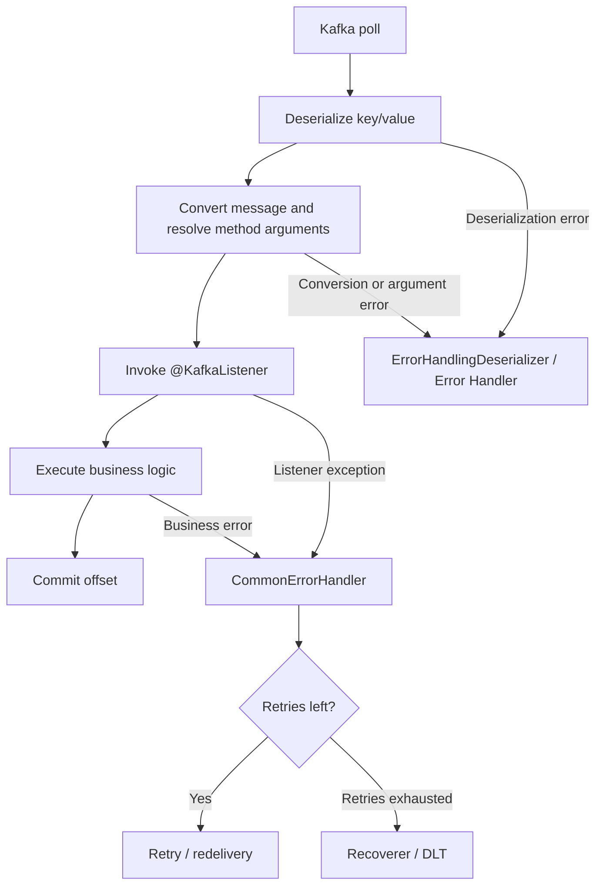

# Logging Errors with Sufficient Context

When a Kafka listener fails, merely logging `"Processing failed"` and a stack trace is rarely enough to tell which record failed, which consumer group was processing it, which delivery attempt failed, and whether the record was retried or sent to a dead-letter topic (DLT).

A useful log connects the **application error**, the **Kafka record**, and the **specific processing attempt**. Spring Kafka provides metadata from `ConsumerRecord`, Spring `MessageHeaders`, error handlers, and retry listeners to build this context.

This lesson focuses on Spring Kafka record listeners. For batch listeners, additionally include the failing record's index and metadata for individual elements in the batch.

## 1. Why Do Error Logs Need Context?

Suppose a log only contains:

```text
ERROR Order processing failed
java.lang.IllegalStateException: Inventory service unavailable
    at ...
```

The stack trace identifies where the code failed, yet leaves critical questions unanswered:

- Which topic, partition, and offset did the record come from?
- Which consumer group and listener were processing it?
- Which key or event ID was involved?
- Was this the first delivery or the third retry?
- Which trace ID links logs across producer, consumer, and downstream services?
- Will the error handler keep retrying, recover, or send the record to a DLT?
- Did the error happen during deserialization, message conversion, business logic, or DLT publishing?

Without these fields, operators must search manually across multiple logs and sometimes cannot pinpoint the exact record.

A context-rich log should quickly answer three questions: **which record failed, where it failed, and what happens next**.

## 2. Context Categories Worth Logging

Not every log line needs every field. Choose fields suited to each logging point.

| Category | Suggested Fields | Purpose |
|---|---|---|
| Record identity | `topic`, `partition`, `offset` | Pinpoint the exact record in Kafka |
| Business identity | `eventId`, `aggregateId`, masked/hashed `recordKey` | Locate the event and related entity |
| Consumer | `consumerGroup`, `listenerId`, `clientId` | Identify the processing consumer |
| Retry | `deliveryAttempt`, `retryCount`, `recovered` | Understand retry/recovery progress |
| Correlation | `traceId`, `correlationId`, `causationId` | Correlate logs across services |
| Classification | `eventType`, `schemaVersion`, `failureStage` | Identify data type and failure stage |
| Exception | `exceptionType`, `message`, `rootCause`, stack trace | Diagnose root cause |
| Runtime | `service`, `environment`, `version`, `host`, `thread` | Identify instance and environment |

### Minimum Context for a Listener Error

In most applications, include at least:

- `topic`
- `partition`
- `offset`
- `consumerGroup`
- `listenerId`
- `eventId` or safely handled key
- `traceId` if available
- `deliveryAttempt` if retrying
- exception and stack trace

`topic + partition + offset` is the essential technical identifier to locate a record. Key does not replace this triplet: many distinct records can share the same key.

## 3. Extracting Context from ConsumerRecord

When a listener accepts `ConsumerRecord<K,V>`, the application accesses Kafka metadata directly:

```java
import java.nio.charset.StandardCharsets;

import org.apache.kafka.clients.consumer.ConsumerRecord;
import org.apache.kafka.common.header.Header;
import org.springframework.kafka.annotation.KafkaListener;

@KafkaListener(
    id = "order-listener",
    topics = "order-events",
    groupId = "billing-service"
)
public void consume(ConsumerRecord<String, OrderCreated> record) {
    OrderCreated event = record.value();

    String topic = record.topic();
    int partition = record.partition();
    long offset = record.offset();
    String key = record.key();
    long timestamp = record.timestamp();

    Header traceHeader = record.headers().lastHeader("trace-id");
    String traceId = traceHeader == null || traceHeader.value() == null
        ? null
        : new String(traceHeader.value(), StandardCharsets.UTF_8);

    // Execute business logic using event and metadata.
}
```

`ConsumerRecord` exposes:

| API | Value |
|---|---|
| `topic()` | Topic name |
| `partition()` | Partition |
| `offset()` | Record offset |
| `key()` | Deserialized key |
| `value()` | Deserialized value |
| `timestamp()` | Record timestamp |
| `timestampType()` | Timestamp type |
| `headers()` | Original Kafka headers |

Consumer group and listener ID are not always available directly on basic `ConsumerRecord` fields. Supply them from listener configuration, `ListenerExecutionFailedException`, listener info, or container context depending on the logging point.

Do not infer group ID from topic names or listener class names.

`client.id` is also absent from `ConsumerRecord`; if needed, retrieve it from consumer configuration or consumer metrics. `memberId` in `consumer.groupMetadata()` is the group member ID, not `client.id`.

## 4. Logging in the Listener and Preserving the Exception

The listener understands the business event and can log `eventId`, event type, and trace ID. When handling an error, log the context and rethrow the exception so the container error handler can perform retries/recovery.

```java
import org.apache.kafka.clients.consumer.ConsumerRecord;
import org.slf4j.Logger;
import org.slf4j.LoggerFactory;
import org.springframework.kafka.annotation.KafkaListener;

public class OrderListener {

    private static final Logger log =
        LoggerFactory.getLogger(OrderListener.class);

    private final OrderService orderService;

    public OrderListener(OrderService orderService) {
        this.orderService = orderService;
    }

    @KafkaListener(
        id = "order-listener",
        topics = "order-events",
        groupId = "billing-service"
    )
    public void consume(ConsumerRecord<String, OrderCreated> record)
            throws Exception {

        OrderCreated event = record.value();

        try {
            orderService.process(event);
        }
        catch (Exception exception) {
            log.error(
                "Kafka listener failed topic={} partition={} offset={} " +
                "recordKey={} eventId={} listenerId={} consumerGroup={}",
                record.topic(),
                record.partition(),
                record.offset(),
                safeKey(record.key()),
                event == null ? null : event.eventId(),
                "order-listener",
                "billing-service",
                exception
            );

            throw exception;
        }
    }

    private String safeKey(String key) {
        if (key == null) {
            return null;
        }
        if (key.length() <= 4) {
            return "****";
        }
        return key.substring(0, 2) + "****" + key.substring(key.length() - 2);
    }
}
```

In this example, the exception is rethrown so Spring Kafka continues applying the error handler. Do not catch the exception, merely log it, and exit the method normally, as the container may treat the listener as successful and commit the offset per ack mode.

Log inside the listener only when adding business context unknown to the container layer, such as `eventId`, `orderType`, or a masked business code. If you merely repeat the stack trace without new information, logs will duplicate container/error handler logs.

When a method can throw checked exceptions, declaring `throws Exception` keeps the original exception intact. Avoid wrapping all errors into one generic exception type if exception classification governs whether retries occur.

## 5. Use Structured Logging Instead of String Concatenation

Structured logs let log systems search by individual fields. Avoid concatenating all context into a free-form string:

```java
// Hard to query by individual fields.
log.error("Failed: " + record.topic() + "-" +
    record.partition() + "-" + record.offset());
```

Use placeholders:

```java
log.error(
    "Kafka record failed topic={} partition={} offset={} eventId={}",
    record.topic(),
    record.partition(),
    record.offset(),
    eventId,
    exception
);
```

If the project uses SLF4J 2.x, you can use the fluent logging API to attach key-values:

```java
log.atError()
    .addKeyValue("topic", record.topic())
    .addKeyValue("partition", record.partition())
    .addKeyValue("offset", record.offset())
    .addKeyValue("consumerGroup", "billing-service")
    .addKeyValue("listenerId", "order-listener")
    .addKeyValue("eventId", eventId)
    .setCause(exception)
    .log("Kafka listener failed");
```

The fluent API requires SLF4J 2.x. With SLF4J 1.7, use parameterized logging or configure a JSON encoder compatible with your logging stack.

Structured logging works effectively only when your appender/encoder emits key-values as separate fields. If the encoder only outputs message text, fields can still be flattened into a string.

Never place offset, key, event ID, or trace ID into high-cardinality metric labels. Those fields belong in logs and traces; metrics should use bounded-cardinality labels such as topic, consumer group, exception type, or outcome.

## 6. Using MDC to Attach Context Across Logs in the Same Flow

A single business flow may log across multiple layers:

- Kafka listener receiving the event.
- Application service checking business rules.
- Repository persisting data.
- HTTP client calling another service.

Passing `topic`, `partition`, `offset`, and `traceId` to every log statement makes code verbose. MDC (Mapped Diagnostic Context) attaches fields to the current thread so the logging pattern or JSON encoder includes them automatically.

Example using `MDC.put` and clearing context in `finally`:

```java
import org.slf4j.MDC;

public void consume(ConsumerRecord<String, OrderCreated> record)
        throws Exception {

    MDC.put("kafka.topic", record.topic());
    MDC.put("kafka.partition", Integer.toString(record.partition()));
    MDC.put("kafka.offset", Long.toString(record.offset()));
    MDC.put("kafka.group", "billing-service");
    MDC.put("kafka.listener", "order-listener");

    try {
        orderService.process(record.value());
    }
    finally {
        MDC.remove("kafka.topic");
        MDC.remove("kafka.partition");
        MDC.remove("kafka.offset");
        MDC.remove("kafka.group");
        MDC.remove("kafka.listener");
    }
}
```

Always clean up MDC whether processing succeeds or fails. The consumer thread is reused for the next record; if left uncleaned, logs for subsequent events can carry context from the previous event.

If context must cross `@Async`, executors, or reactive pipelines, MDC does not propagate across thread boundaries automatically. Use `TaskDecorator`, context propagation, or proper tracing instrumentation. Never pass an entire MDC map into an unmanaged thread without cleaning up on the target thread.

MDC is only a log-context mechanism. It does not replace OpenTelemetry trace context or distributed tracing systems.

## 7. Extracting Trace ID and Correlation ID

Trace IDs are typically created at the start of a request flow and propagated over Kafka via headers. The consumer reads the header back to correlate logs.

Example producer sending a UTF-8 header:

```java
record.headers().add(
    new RecordHeader(
        "trace-id",
        traceId.getBytes(StandardCharsets.UTF_8)
    )
);
```

Consumer reading it:

```java
Header traceHeader = record.headers().lastHeader("trace-id");

String traceId = traceHeader == null || traceHeader.value() == null
    ? null
    : new String(traceHeader.value(), StandardCharsets.UTF_8);
```

You can put the trace ID into logs:

```java
if (traceId != null && !traceId.isBlank()) {
    MDC.put("traceId", traceId);
}
```

Clean up this value in the same `finally` block alongside other MDC fields.

Do not confuse `traceId` with `correlationId`:

- `traceId` typically links the entire distributed trace.
- `correlationId` can link a business workflow or request.
- `eventId` identifies a single specific event.
- `causationId` identifies the event or command that caused the current event.

One workflow can contain multiple events with distinct `eventId` values sharing the same `correlationId`.

If your system uses W3C Trace Context, prefer standard OpenTelemetry instrumentation and propagation over inventing incompatible trace IDs. Custom headers can still be used for business correlation.

## 8. Recording Delivery Attempts and Retries

When `DefaultErrorHandler` retries a record, you need to know how many times the listener has received it. Spring Kafka provides `RetryListener` with callbacks:

- `failedDelivery(record, exception, deliveryAttempt)`
- `recovered(record, exception)`
- `recoveryFailed(record, original, failure)`

Example:

```java
import org.apache.kafka.clients.consumer.ConsumerRecord;
import org.slf4j.Logger;
import org.slf4j.LoggerFactory;
import org.springframework.kafka.listener.RetryListener;

public class KafkaRetryLogListener implements RetryListener {

    private static final Logger log =
        LoggerFactory.getLogger(KafkaRetryLogListener.class);

    @Override
    public void failedDelivery(
            ConsumerRecord<?, ?> record,
            Exception exception,
            int deliveryAttempt) {

        log.warn(
            "Kafka delivery failed topic={} partition={} offset={} attempt={}",
            record.topic(),
            record.partition(),
            record.offset(),
            deliveryAttempt,
            exception
        );
    }

    @Override
    public void recovered(
            ConsumerRecord<?, ?> record,
            Exception exception) {

        log.info(
            "Kafka record recovered topic={} partition={} offset={}",
            record.topic(),
            record.partition(),
            record.offset()
        );
    }

    @Override
    public void recoveryFailed(
            ConsumerRecord<?, ?> record,
            Exception original,
            Exception failure) {

        log.error(
            "Kafka record recovery failed topic={} partition={} offset={} originalType={}",
            record.topic(),
            record.partition(),
            record.offset(),
            original.getClass().getName(),
            failure
        );
    }
}
```

Register the listener on `DefaultErrorHandler`:

```java
import org.springframework.context.annotation.Bean;
import org.springframework.context.annotation.Configuration;
import org.springframework.kafka.listener.DefaultErrorHandler;
import org.springframework.util.backoff.FixedBackOff;

@Configuration
public class KafkaErrorConfiguration {

    @Bean
    DefaultErrorHandler kafkaErrorHandler() {
        DefaultErrorHandler handler =
            new DefaultErrorHandler(new FixedBackOff(1_000L, 2L));

        handler.setRetryListeners(new KafkaRetryLogListener());

        return handler;
    }
}
```

In this example, `FixedBackOff(1_000L, 2L)` provides two retries after the initial delivery—meaning up to three listener invocations before recovery executes.

Attach the handler to the container factory:

```java
factory.setCommonErrorHandler(kafkaErrorHandler);
```

`RetryListener` is well suited for logging retry/recovery status from one central place. It receives the delivery attempt directly, avoiding manually counting listener calls with instance fields or maps shared across consumer threads.

Delivery attempts start at `1` on the initial delivery. Each subsequent retry/redelivery increments this value.

Tier log levels appropriately:

- `WARN` for failed deliveries that still have retries remaining.
- `INFO` for successfully recovered records if auditing is needed.
- `ERROR` for failed recovery or records that remain unprocessable after the retry policy.

You do not necessarily need a full stack trace on every retry. You can log the full stack trace on the final attempt to reduce log volume while retaining exception class and attempt number on earlier attempts.

## 9. Delivery Attempt Header

For record listeners, you can instruct Spring Kafka to add `KafkaHeaders.DELIVERY_ATTEMPT` to the record when the error handler implements `DeliveryAttemptAware`.

Enable in container properties:

```java
factory.getContainerProperties().setDeliveryAttemptHeader(true);
```

When the listener receives headers via Spring message conversion, declare:

```java
import org.springframework.kafka.annotation.KafkaListener;
import org.springframework.kafka.support.KafkaHeaders;
import org.springframework.messaging.handler.annotation.Header;
import org.springframework.messaging.handler.annotation.Payload;

@KafkaListener(topics = "order-events")
public void consume(
        @Payload OrderCreated event,
        @Header(KafkaHeaders.DELIVERY_ATTEMPT) int deliveryAttempt) {

    // Use attempt in logs.
}
```

When reading from a raw `ConsumerRecord`, the delivery attempt value is encoded as 4 bytes:

```java
import java.nio.ByteBuffer;

import org.apache.kafka.common.header.Header;
import org.springframework.kafka.support.KafkaHeaders;

Header attemptHeader =
    record.headers().lastHeader(KafkaHeaders.DELIVERY_ATTEMPT);

Integer deliveryAttempt = null;

if (attemptHeader != null
        && attemptHeader.value() != null
        && attemptHeader.value().length == Integer.BYTES) {

    deliveryAttempt = ByteBuffer
        .wrap(attemptHeader.value())
        .getInt();
}
```

This header is present only when the feature is enabled and supported by the error handler. Do not assume it always exists or use it as a replacement for `RetryListener`.

For batch listeners, attaching delivery attempt headers to each `ConsumerRecord` works differently from record listeners. Since Spring Kafka 3.3, `DeliveryAttemptAwareRetryListener` adds this header for batch records; check your version before relying on it.

## 10. Distinguishing Errors Across Processing Stages

Not every error occurs inside the `@KafkaListener` method. If logging only lives inside the listener, some failures will produce no business logs.



| Stage | Available Context | Appropriate Logging Point |
|---|---|---|
| Poll/consumer client | Consumer group, client, Kafka exception; may have no record | Container error handler or Kafka client logs |
| Deserialization | Topic/partition/offset and deserialization exception; payload may not be an object | `ErrorHandlingDeserializer` and error handler |
| Message conversion | Record, conversion exception, headers | Container error handler or listener error handler if a message was constructed |
| Listener method | Full payload and metadata | Listener, `RecordInterceptor.failure` |
| Retry/recovery | Record, exception, and delivery attempt | `RetryListener`, recoverer |
| Publish DLT | Original record, exception, and DLT destination | `DeadLetterPublishingRecoverer` or recoverer wrapper |

When deserialization fails, the listener may never be called. Do not wait for listener logs to detect these errors. Configure `ErrorHandlingDeserializer` so Spring Kafka can forward deserialization errors to the error handler.

Several exceptions—such as `DeserializationException`, `MessageConversionException`, `ConversionException`, `MethodArgumentResolutionException`, `NoSuchMethodException`, and `ClassCastException`—are classified as non-retryable by default in `DefaultErrorHandler` because retrying usually cannot fix invalid data.


## 11. Using RecordInterceptor to Log Context Centrally

`RecordInterceptor` provides a `failure(record, exception, consumer)` callback after the listener throws an exception. It fits when you want centralized record error logging without modifying every listener.

Example:

```java
import org.apache.kafka.clients.consumer.Consumer;
import org.apache.kafka.clients.consumer.ConsumerRecord;
import org.slf4j.Logger;
import org.slf4j.LoggerFactory;
import org.springframework.kafka.listener.RecordInterceptor;

public class KafkaFailureInterceptor<K, V>
        implements RecordInterceptor<K, V> {

    private static final Logger log =
        LoggerFactory.getLogger(KafkaFailureInterceptor.class);

    @Override
    public ConsumerRecord<K, V> intercept(
            ConsumerRecord<K, V> record,
            Consumer<K, V> consumer) {
        return record;
    }

    @Override
    public void failure(
            ConsumerRecord<K, V> record,
            Exception exception,
            Consumer<K, V> consumer) {

        log.error(
            "Listener invocation failed topic={} partition={} offset={} " +
            "group={} memberId={}",
            record.topic(),
            record.partition(),
            record.offset(),
            consumer.groupMetadata().groupId(),
            consumer.groupMetadata().memberId(),
            exception
        );
    }
}
```

Register the interceptor on the factory:

```java
factory.setRecordInterceptor(
    new KafkaFailureInterceptor<String, OrderCreated>()
);
```

`RecordInterceptor.failure` only observes failures after the listener is invoked and throws an exception. It does not replace the error handler, does not govern retries/DLT routing, and does not cover pre-listener errors such as poll errors or some deserialization failures.

When using both listener logging and interceptor logging, assign clear responsibilities to avoid logging the exact same stack trace twice. You can use listener logs for business context and interceptor logs for technical context, or designate one primary error logging point.

## 12. Listener-Specific Error Handler

`@KafkaListener` supports the `errorHandler` attribute to designate a `KafkaListenerErrorHandler` for that listener. The handler receives Spring `Message<?>` and `ListenerExecutionFailedException`.

Example:

```java
import org.slf4j.Logger;
import org.slf4j.LoggerFactory;
import org.springframework.kafka.listener.KafkaListenerErrorHandler;
import org.springframework.kafka.listener.ListenerExecutionFailedException;
import org.springframework.messaging.Message;

public class OrderListenerErrorHandler
        implements KafkaListenerErrorHandler {

    private static final Logger log =
        LoggerFactory.getLogger(OrderListenerErrorHandler.class);

    @Override
    public Object handleError(
            Message<?> message,
            ListenerExecutionFailedException exception) throws Exception {

        log.error(
            "Order listener failed group={} cause={}",
            exception.getGroupId(),
            exception.getCause() == null
                ? exception.getClass().getName()
                : exception.getCause().getClass().getName(),
            exception
        );

        throw exception;
    }
}
```

Declare on the listener:

```java
@KafkaListener(
    id = "order-listener",
    topics = "order-events",
    groupId = "billing-service",
    errorHandler = "orderListenerErrorHandler"
)
public void consume(OrderCreated event) {
    orderService.process(event);
}
```

A listener-level handler is helpful when you need context from Spring `Message<?>` and want custom logging logic for one listener. `ListenerExecutionFailedException` exposes the listener's group ID in versions supporting that property.

To retrieve the raw `ConsumerRecord` from the message inside a listener error handler, set `rawRecordHeader=true` on `MessagingMessageConverter` or `BatchMessagingMessageConverter`. The converter then attaches the original record under `KafkaHeaders.RAW_DATA`.

Example configuring the converter for a record listener:

```java
@Bean
MessagingMessageConverter kafkaMessageConverter() {
    MessagingMessageConverter converter = new MessagingMessageConverter();
    converter.setRawRecordHeader(true);
    return converter;
}

// When creating the container factory:
factory.setRecordMessageConverter(kafkaMessageConverter);
```

Inside the listener error handler, read the original record to log topic/partition/offset:

```java
import org.apache.kafka.clients.consumer.ConsumerRecord;
import org.springframework.kafka.support.KafkaHeaders;

ConsumerRecord<?, ?> record = message.getHeaders().get(
    KafkaHeaders.RAW_DATA,
    ConsumerRecord.class
);
```

Even with a listener-specific handler, you must still rethrow the exception if you want the container error handler to perform retries or recovery. Never seek the consumer manually inside `KafkaListenerErrorHandler`; the container is unaware of seeks executed inside the handler.

## 13. Recovery and Dead-Letter Topic Logs

Once retries are exhausted, the application typically sends the record to a DLT. Logs at this point should capture:

- Original record's topic, partition, and offset.
- Consumer group that failed.
- Destination DLT topic and partition.
- Exception type, root cause, and final delivery attempt.
- DLT publish outcome: succeeded or failed.

Example configuring `DeadLetterPublishingRecoverer`:

```java
import org.springframework.kafka.core.KafkaTemplate;
import org.springframework.kafka.listener.DeadLetterPublishingRecoverer;
import org.springframework.kafka.listener.DefaultErrorHandler;
import org.springframework.util.backoff.FixedBackOff;

@Bean
DefaultErrorHandler kafkaErrorHandler(
        KafkaTemplate<Object, Object> kafkaTemplate) {

    DeadLetterPublishingRecoverer recoverer =
        new DeadLetterPublishingRecoverer(kafkaTemplate);

    return new DefaultErrorHandler(
        recoverer,
        new FixedBackOff(1_000L, 2L)
    );
}
```

By default, `DeadLetterPublishingRecoverer` sends records to a topic suffixed with `-dlt` and the same partition as the original record. The DLT must have enough matching partitions if using the default routing.

DLT records preserve original headers and add exception/original-record headers, for example:

| Header | Meaning |
|---|---|
| `KafkaHeaders.DLT_EXCEPTION_FQCN` | Exception class name |
| `KafkaHeaders.DLT_EXCEPTION_CAUSE_FQCN` | Root cause class name if present |
| `KafkaHeaders.DLT_EXCEPTION_MESSAGE` | Exception message |
| `KafkaHeaders.DLT_EXCEPTION_STACKTRACE` | Stack trace |
| `KafkaHeaders.DLT_ORIGINAL_TOPIC` | Original topic |
| `KafkaHeaders.DLT_ORIGINAL_PARTITION` | Original partition |
| `KafkaHeaders.DLT_ORIGINAL_OFFSET` | Original offset |
| `KafkaHeaders.DLT_ORIGINAL_TIMESTAMP` | Original timestamp |
| `KafkaHeaders.DLT_ORIGINAL_TIMESTAMP_TYPE` | Original timestamp type |
| `KafkaHeaders.DLT_ORIGINAL_CONSUMER_GROUP` | Original consumer group |

When DLT publishing fails, log the recovery error separately. That is a different operational failure from the original event processing failure: the record has not been safely delivered to the failure store.

Stack trace headers can make records large, especially if republished across multiple retry/DLT tiers. You can exclude the stack trace header if logs already store full exception details:

```java
import org.springframework.kafka.listener.DeadLetterPublishingRecoverer.HeaderNames;

recoverer.excludeHeader(HeaderNames.HeadersToAdd.EX_STACKTRACE);
```

Verify the header-exclusion API for your exact Spring Kafka version. Never exclude original metadata needed for investigation and replay.

## 14. Avoiding Duplicate and Excessive Logging

A single record can emit logs across multiple layers:

1. Listener logs business error.
2. `RecordInterceptor.failure` logs technical error.
3. `RetryListener.failedDelivery` logs each retry.
4. Container/error handler logs exception.
5. Recoverer logs final outcome.

If all layers log full stack traces at ERROR level, a single failure can emit dozens of identical log entries.

Assign roles clearly:

| Log Point | Primary Content | Recommended Level |
|---|---|---|
| Listener | Event ID, business details, and extra context | ERROR when adding new info |
| RetryListener | Attempt, topic/partition/offset, exception type | WARN |
| Recoverer | Recovery success or failure, target DLT | INFO/ERROR |
| Container error handler | Technical errors and container processing state | Per configuration |
| DLT consumer | Failing record details and investigation/replay result | ERROR/WARN |

Guidelines:

- Do not log full payloads on every retry.
- Do not repeat full stack traces if the same exception has already been logged in full.
- Use `setLogLevel(...)` on the error handler when adjusting the log level of exceptions thrown by the handler.
- Use `RetryListener` to log attempts rather than incrementing global variables manually.
- Log terminal failures at ERROR only after retries are exhausted or recovery fails.
- Apply sampling or reduced verbosity for very high-frequency recurring errors.

Example adjusting the log level of exceptions logged by `DefaultErrorHandler`:

```java
import org.springframework.kafka.KafkaException;

handler.setLogLevel(KafkaException.Level.WARN);
```

This setting controls the log level for exceptions logged by the error handler itself. It does not automatically alter logs emitted by the listener or `RetryListener`.

## 15. Information You Should Not Log

Context-rich logs do not mean dumping the entire message. Kafka payloads or headers may contain sensitive data.

Avoid logging:

- Passwords, access tokens, refresh tokens, API keys.
- Personal identifying information, emails, or phone numbers unless necessary.
- Entire JSON payloads when `eventId` suffices.
- Authentication header values or cookies.
- Raw keys if keys contain sensitive data.
- Exception messages that may contain SQL, URLs, or sensitive request data.

Use an allowlist of approved fields. If a key is needed for lookup yet might hold personal data, mask or hash it before logging.

Example:

```java
private String safeKey(String key) {
    if (key == null) {
        return null;
    }

    if (key.length() <= 4) {
        return "****";
    }

    return key.substring(0, 2)
        + "****"
        + key.substring(key.length() - 2);
}
```

Avoid dumping payloads into logs when records can be queried by topic/partition/offset using Kafka tooling or an appropriate storage system.

## 16. Context for Batch Listeners

With a batch listener, a single method invocation can contain records from multiple partitions. Therefore, a single partition/offset cannot represent the entire batch.

If the listener receives `List<ConsumerRecord<K,V>>`, log metadata for each failing record:

```java
import java.util.List;

import org.apache.kafka.clients.consumer.ConsumerRecord;
import org.springframework.kafka.annotation.KafkaListener;
import org.springframework.kafka.listener.BatchListenerFailedException;

@KafkaListener(
    topics = "order-events",
    containerFactory = "batchKafkaListenerContainerFactory"
)
public void consume(List<ConsumerRecord<String, OrderCreated>> records) {
    for (int index = 0; index < records.size(); index++) {
        ConsumerRecord<String, OrderCreated> record = records.get(index);

        try {
            orderService.process(record.value());
        }
        catch (RuntimeException exception) {
            log.error(
                "Batch record failed batchIndex={} topic={} partition={} offset={}",
                index,
                record.topic(),
                record.partition(),
                record.offset(),
                exception
            );

            throw new BatchListenerFailedException(
                "Failed to process batch record",
                exception,
                index
            );
        }
    }
}
```

`BatchListenerFailedException` informs the error handler of the failing record's index in the current batch. This index is zero-based and is not the Kafka offset.

If the listener receives `List<DTO>` rather than raw records, inject the corresponding header lists or switch to a metadata-bearing structure. With only a payload list and no record metadata, you cannot reliably infer a DTO's partition/offset from its list index.

For batches, `RetryListener` has overloads accepting `ConsumerRecords<?,?>`. When logging at the batch level, record the record count and involved topic-partitions; when logging at the record level, record the exact index and metadata of the failing record.

## 17. Logging in Deserialization Failures

When a value fails to deserialize, the listener does not receive the expected DTO. Consequently, logging inside `@KafkaListener` cannot record event IDs or fields from the payload.

Configure `ErrorHandlingDeserializer` so Spring Kafka places deserialization failure info into headers and the error handler can process it:

```yaml
spring:
  kafka:
    consumer:
      key-deserializer: org.springframework.kafka.support.serializer.ErrorHandlingDeserializer
      value-deserializer: org.springframework.kafka.support.serializer.ErrorHandlingDeserializer
      properties:
        spring.deserializer.key.delegate.class: org.apache.kafka.common.serialization.StringDeserializer
        spring.deserializer.value.delegate.class: org.apache.kafka.common.serialization.JsonDeserializer
```

`JsonDeserializer` in the example requires type information from record headers or a configured default target type and trusted packages matching the actual DTO. The example simply illustrates wrapping deserializers with `ErrorHandlingDeserializer`.

At this stage, prioritize logging accessible record metadata, exception type, and failure location. Do not log raw bytes or malformed payloads unless covered by an explicit security policy.

Deserialization errors rarely benefit from retrying the exact same bytes. `DefaultErrorHandler` classifies several deserialization/conversion errors as fatal and routes them to recovery without retrying by default. Explicitly log `failureStage=DESERIALIZATION` so operators do not mistake them for business errors.

## 18. Testing Log Context

Do not only assert that a listener throws an exception. Verify that logs or callbacks carry sufficient fields for traceability.

Useful test cases:

| Test Case | What to Verify |
|---|---|
| Listener throws exception | Log includes topic, partition, offset, key/event ID, and exception |
| Trace ID header present | Log contains the exact trace ID |
| Trace ID header absent | Listener still operates per policy |
| Multiple retries | Attempt increments properly and no sensitive payload is logged |
| Recovery succeeds | Log clearly states the record was recovered |
| DLT publish fails | Separate log emitted for DLT publish failure |
| Batch listener fails | Log includes batch index and failing record metadata |
| Deserialization fails | Error path logs even though listener was never invoked |
| Consumer thread handles next record | MDC no longer holds context from previous record |

With Logback, you can use `ListAppender` in unit tests to capture log events and assert messages, arguments, or MDC properties. With Embedded Kafka, send a record carrying a `trace-id` header, force the listener to fail, and verify retry callbacks receive the expected record metadata.

Do not test by comparing entire stack traces verbatim; stack traces depend on line numbers, runtime, and library versions. Assert operationally meaningful fields instead.

## 19. Combined Configuration Example

The following example combines `DefaultErrorHandler`, `RetryListener`, and a DLT recoverer. This is a record listener setup; serializers, consumer factory, and `KafkaTemplate` must match your application's actual key/value types.

```java
import org.springframework.context.annotation.Bean;
import org.springframework.context.annotation.Configuration;
import org.springframework.kafka.core.KafkaTemplate;
import org.springframework.kafka.listener.DeadLetterPublishingRecoverer;
import org.springframework.kafka.listener.DefaultErrorHandler;
import org.springframework.util.backoff.FixedBackOff;

@Configuration
public class KafkaErrorHandlingConfiguration {

    @Bean
    KafkaRetryLogListener kafkaRetryLogListener() {
        return new KafkaRetryLogListener();
    }

    @Bean
    DefaultErrorHandler kafkaErrorHandler(
            KafkaTemplate<Object, Object> kafkaTemplate,
            KafkaRetryLogListener retryLogListener) {

        DeadLetterPublishingRecoverer recoverer =
            new DeadLetterPublishingRecoverer(kafkaTemplate);

        DefaultErrorHandler handler =
            new DefaultErrorHandler(
                recoverer,
                new FixedBackOff(1_000L, 2L)
            );

        handler.setRetryListeners(retryLogListener);
        return handler;
    }
}
```

Attach the error handler to the listener container factory:

```java
import org.springframework.kafka.config.ConcurrentKafkaListenerContainerFactory;
import org.springframework.kafka.core.ConsumerFactory;

@Bean
ConcurrentKafkaListenerContainerFactory<String, OrderCreated>
orderKafkaListenerContainerFactory(
        ConsumerFactory<String, OrderCreated> consumerFactory,
        DefaultErrorHandler kafkaErrorHandler) {

    var factory =
        new ConcurrentKafkaListenerContainerFactory<String, OrderCreated>();

    factory.setConsumerFactory(consumerFactory);
    factory.setCommonErrorHandler(kafkaErrorHandler);
    factory.getContainerProperties().setDeliveryAttemptHeader(true);

    return factory;
}
```

Listener consuming records and logging business context:

```java
import org.apache.kafka.clients.consumer.ConsumerRecord;
import org.springframework.kafka.annotation.KafkaListener;

@KafkaListener(
    id = "order-listener",
    topics = "order-events",
    groupId = "billing-service",
    containerFactory = "orderKafkaListenerContainerFactory"
)
public void consume(ConsumerRecord<String, OrderCreated> record)
        throws Exception {

    try {
        orderService.process(record.value());
    }
    catch (Exception exception) {
        log.error(
            "Order event failed topic={} partition={} offset={} eventId={}",
            record.topic(),
            record.partition(),
            record.offset(),
            record.value() == null ? null : record.value().eventId(),
            exception
        );

        throw exception;
    }
}
```

In this configuration:

1. The listener logs business context and rethrows the exception.
2. `DefaultErrorHandler` applies backoff and retries.
3. `RetryListener` logs each failed delivery attempt.
4. When retries run out, `DeadLetterPublishingRecoverer` sends the record to the DLT.
5. If recovery fails, `RetryListener.recoveryFailed` logs the failure for investigation.

No step needs to log the full payload. You can add `listenerId`, `consumerGroup`, `traceId`, and `serviceVersion` to the log context following your system's standards.

## 20. Common Pitfalls

| Symptom | Possible Cause | Resolution |
|---|---|---|
| Log only has stack trace | Record metadata not logged | Log topic, partition, offset, and event ID |
| Unknown which consumer group failed | Only logged ConsumerRecord | Include group ID from listener/error exception |
| Cannot locate record in Kafka | Logged key without partition/offset | Log full topic-partition-offset |
| Retries emit hundreds of ERROR logs | Logged full stack trace on every attempt | Use WARN for retries, ERROR for terminal failures |
| Trace IDs leak across events | MDC not cleaned up | Clear MDC in finally |
| Listener logs error but record never retries | Exception caught and not rethrown | Rethrow exception so container handles it |
| No listener logs on malformed JSON | Listener was never invoked | Log in ErrorHandlingDeserializer/error handler |
| DLT publish fails without clear reason | Logged only initial business error | Log recovery exception and DLT destination separately |
| Batch log reports wrong partition | Assigned one partition to entire batch | Log per-record metadata or topic-partition list |
| Logs expose sensitive data | Printed raw payload/key/headers | Mask, hash, or use an allowlist |
| Previous context appears on next record | MDC not cleared | Remove all keys in finally |

## 21. Pre-Production Error Logging Checklist

- Logs include topic, partition, and offset of the failing record.
- Logs include consumer group and listener ID.
- Logs include event ID or safely masked business key.
- Logs include trace ID/correlation ID if supported by the event pipeline.
- Logs include delivery attempt or retry state.
- Logs include exception class, root cause, and stack trace where needed.
- Deserialization, conversion, listener, retry, and recovery errors are distinguished.
- Exceptions are never caught and swallowed.
- MDC is cleaned up after every record.
- Unnecessary payloads, tokens, or sensitive data are never logged.
- Duplicate stack traces are not logged at every layer.
- DLT logs include original topic/partition/offset and recovery destination.
- Batch logs include the index and metadata of the failing record.
- Metrics do not use offset, key, event ID, or trace ID as labels.

## 22. Key Takeaways

- `topic + partition + offset` uniquely locates a record in Kafka.
- `ConsumerRecord` supplies technical metadata; payloads supply business context.
- `@Header`, `MessageHeaders`, and Kafka headers extract trace ID, correlation ID, and delivery attempts.
- `RetryListener` records failed deliveries, successful recoveries, and failed recoveries.
- `RecordInterceptor.failure` observes errors after listener invocation; it does not replace the error handler.
- `KafkaListenerErrorHandler` fits single-listener context; `CommonErrorHandler` drives container-level retries and recovery.
- Use MDC to attach context to logs on the same thread and always clean it up.
- Tier retry log levels appropriately; keep full stack traces for key diagnostic points.
- DLTs must preserve original record metadata and log when recovery publishing fails.
- Log sufficient context, yet log only permitted data.

Logging errors with sufficient context helps operations locate the exact record, identify the failing listener and consumer group, know the current retry attempt, and tell business errors apart from infrastructure failures. Combining Kafka metadata, trace context, retry callbacks, and structured logging policies makes incident investigation and record replay far clearer.


