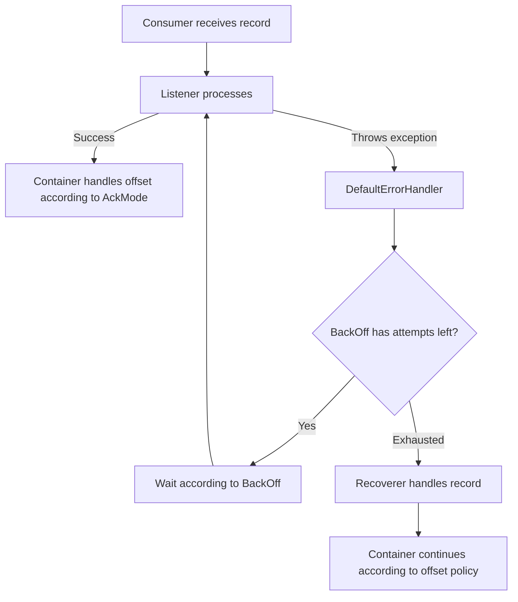

# FixedBackOff and ExponentialBackOff

When a Kafka message encounters a transient error, the consumer often needs to retry processing after a waiting period. For example, a database is restarting, a dependent API returns HTTP 503, or a network connection has just been interrupted. Retrying immediately can overload an already struggling service even further; waiting too long increases message processing latency.

Spring Kafka lets you configure retry wait intervals using Spring Framework `BackOff` implementations. Two common options are `FixedBackOff`, which waits a fixed interval between attempts, and `ExponentialBackOff`, which progressively increases the wait interval after each failure. They are commonly paired with `DefaultErrorHandler` to control record reprocessing in the listener container.

## 1. Where Do Retry and BackOff Sit in the Processing Flow?

For a record listener, the basic flow when a listener throws an exception can be illustrated as follows:



The listener simply throws an exception when processing fails. The container passes the error to the error handler. `DefaultErrorHandler` uses a `BackOff` to determine the wait interval and how many times to keep trying. When the retry policy is exhausted, the recoverer is invoked to handle the unrecoverable record, such as logging it or sending it to a dead-letter topic (DLT).

A few concepts to distinguish:

- **Initial delivery:** the first time the listener receives the record before any retry.
- **Retry:** a reprocessing attempt after the initial attempt fails.
- **Backoff interval:** the waiting period before the next retry attempt.
- **Recoverer:** the component that handles a record once retries are exhausted or when the error handler decides to recover.
- **Offset:** the consumer's processed position in the partition; retrying does not mean the failed record's offset has been committed yet.

BackOff only controls the retry cadence. It does not classify errors on its own, does not automatically create a DLT, and does not guarantee that business operations execute exactly once.

## 2. FixedBackOff: Constant Wait Interval

`FixedBackOff` uses the same wait interval for every retry attempt. Its constructor takes two parameters:

```java
new FixedBackOff(interval, maxAttempts)
```

Where:

- `interval`: the number of milliseconds to wait between two processing attempts.
- `maxAttempts`: the maximum number of retry attempts after the initial processing attempt.

Example:

```java
FixedBackOff backOff = new FixedBackOff(1_000L, 3L);
```

If the listener fails continuously, the maximum processing schedule will be:

| Attempt | Action | Wait before that attempt |
|---|---|---:|
| 1 | Initial processing | None |
| 2 | Retry 1 | 1 second |
| 3 | Retry 2 | 1 second |
| 4 | Retry 3 | 1 second |
| After attempt 4 fails | Retries exhausted, handed to recoverer | No further retries |

Thus, `maxAttempts = 3` means three retry attempts in addition to the initial processing attempt. If the second processing attempt succeeds, the remaining attempts do not occur.

Using `FixedBackOff(0L, 2L)` retries immediately twice with no pause. This can be useful for very brief glitches, but is not suitable if the downstream service is overloaded or disconnected for an extended period.

### When Should You Use FixedBackOff?

Fixed delay works well when the expected recovery time is fairly consistent, for example:

- A transient error is typically resolved within a few seconds.
- You want clear bounds on the number of attempts and total wait time.
- You want predictable retry behavior during operations and testing.
- The task has low latency and a fixed wait does not create significant burst load.

The drawback is that retry attempts always arrive at a steady cadence. If multiple consumers fail at the same time, they may retry simultaneously on the same schedule, creating repeated load spikes on the struggling dependency.

## 3. ExponentialBackOff: Increasing the Wait Interval

`ExponentialBackOff` increases the wait interval exponentially. A typical configuration has three key values:

- `initialInterval`: the first wait interval.
- `multiplier`: the scaling factor after each failure.
- `maxInterval`: the upper bound on the wait interval.

The wait interval on the n-th retry can be expressed as:

```text
d_n = min(d_0 * m^(n-1), d_max)
```

Where `d_0` is the initial interval, `m` is the multiplier, and `d_max` is the maximum limit.

For example, setting an initial interval of 1 second, a multiplier of 2, and a cap of 8 seconds:

| Retry | Wait interval |
|---|---:|
| 1 | 1 second |
| 2 | 2 seconds |
| 3 | 4 seconds |
| 4 | 8 seconds |
| 5 onward | 8 seconds |

Configuring with Spring Framework:

```java
import org.springframework.util.backoff.ExponentialBackOff;

ExponentialBackOff backOff =
        new ExponentialBackOff(1_000L, 2.0);

backOff.setMaxInterval(8_000L);
backOff.setMaxElapsedTime(60_000L);
```

`maxElapsedTime` caps the total elapsed time during which the BackOff allows further wait intervals to be produced. Unlike `FixedBackOff`, this configuration does not set a fixed retry count directly. The actual number of attempts depends on the intervals, elapsed time, and when the BackOff stops.

If business requirements demand an exact cap on the number of exponential retries, you can use `ExponentialBackOffWithMaxRetries` in Spring Kafka versions that provide this class:

```java
import org.springframework.kafka.support.ExponentialBackOffWithMaxRetries;

ExponentialBackOffWithMaxRetries backOff =
        new ExponentialBackOffWithMaxRetries(5);

backOff.setInitialInterval(1_000L);
backOff.setMultiplier(2.0);
backOff.setMaxInterval(10_000L);
```

This class expresses the retry count directly. Check your application's Spring Kafka version before using this API; Spring Framework's `ExponentialBackOff` is the more general option when a time-based limit is needed.

### Why Is Exponential Backoff Useful?

When a dependency goes down, continuous retries can add load right when the system needs reduced pressure to recover. Exponential backoff creates longer pauses after each failure:

- Short glitches can recover quickly because the first retry happens early.
- Prolonged outages do not cause the consumer to hammer the dependency relentlessly.
- Retry requests space out over time, giving the downstream system room to recover.
- Maximum delay can be bounded via `maxInterval`.

Exponential backoff does not make errors disappear on its own. If the dependency stays down longer than the retry limit, the record still has to go through the recovery workflow once retries are exhausted.

## 4. Comparing FixedBackOff and ExponentialBackOff

| Criterion | FixedBackOff | ExponentialBackOff |
|---|---|---|
| Wait interval | Constant | Increases by a multiplier |
| Retry limit | `maxAttempts` | Typically limited by `maxElapsedTime`; a class supporting max retries exists in some versions |
| Predictability | Easy to compute total wait time | Retry count depends on configuration and elapsed time |
| Dependency pressure | Steady call cadence | Reduces call frequency during prolonged failures |
| Best suited for | Short errors with relatively consistent recovery time | Flaky dependencies or outages with uncertain recovery time |
| Primary risk | Synchronized retries at a fixed cadence | Total processing time can drag out if bounds are poorly chosen |

No single policy fits every error type. An internal cache call may only need a couple of short retries. An external API with rate limits or unpredictable recovery times may be better served by a bounded exponential backoff.

## 5. Combining BackOff with DefaultErrorHandler

In Spring Kafka versions using `DefaultErrorHandler` (introduced in Spring Kafka 2.8), you pass a `BackOff` into the error handler. The example below uses `FixedBackOff` and a recoverer that sends exhausted records to a DLT:

```java
import org.springframework.context.annotation.Bean;
import org.springframework.context.annotation.Configuration;
import org.springframework.kafka.core.KafkaTemplate;
import org.springframework.kafka.listener.DefaultErrorHandler;
import org.springframework.kafka.listener.DeadLetterPublishingRecoverer;
import org.springframework.util.backoff.FixedBackOff;

@Configuration
class KafkaErrorHandlingConfiguration {

    @Bean
    DefaultErrorHandler kafkaErrorHandler(
            KafkaTemplate<Object, Object> kafkaTemplate) {

        DeadLetterPublishingRecoverer recoverer =
                new DeadLetterPublishingRecoverer(kafkaTemplate);

        FixedBackOff backOff =
                new FixedBackOff(1_000L, 3L);

        DefaultErrorHandler errorHandler =
                new DefaultErrorHandler(recoverer, backOff);

        errorHandler.addNotRetryableExceptions(
                InvalidOrderException.class
        );

        return errorHandler;
    }
}
```

Attaching the error handler to the listener container factory:

```java
@Bean
ConcurrentKafkaListenerContainerFactory<String, OrderEvent>
orderListenerFactory(
        ConsumerFactory<String, OrderEvent> consumerFactory,
        DefaultErrorHandler kafkaErrorHandler) {

    var factory =
            new ConcurrentKafkaListenerContainerFactory<String, OrderEvent>();

    factory.setConsumerFactory(consumerFactory);
    factory.setCommonErrorHandler(kafkaErrorHandler);

    return factory;
}
```

Listener using this factory:

```java
@KafkaListener(
        topics = "orders",
        groupId = "order-service",
        containerFactory = "orderListenerFactory")
public void consume(OrderEvent event) {
    orderService.process(event);
}
```

When `orderService.process(event)` throws a retryable exception, `DefaultErrorHandler` uses `FixedBackOff` to retry. If retries are exhausted, `DeadLetterPublishingRecoverer` sends the record to the DLT according to the recoverer's routing rules.

The example uses `KafkaTemplate<Object, Object>` to illustrate a general setup. In a real application, ensure the template and serializers can publish both the original record key/value types and records sent to the DLT. Also configure the DLT topic and partition count to match your routing strategy.

To switch to exponential backoff, swap the BackOff instance:

```java
ExponentialBackOff backOff =
        new ExponentialBackOff(1_000L, 2.0);

backOff.setMaxInterval(10_000L);
backOff.setMaxElapsedTime(60_000L);

DefaultErrorHandler errorHandler =
        new DefaultErrorHandler(recoverer, backOff);
```

In the configuration above, `recoverer` remains `DeadLetterPublishingRecoverer`. The waiting policy changes, while the action after exhausting retries is still governed by the recoverer.

## 6. Classifying Exceptions Before Retrying

Not all errors can be resolved by trying again. For example:

| Error type | Example | Handling direction |
|---|---|---|
| Transient | Timeout, brief DB disconnect, HTTP 503 | Can be retried with limits |
| Rate limiting | HTTP 429 | Retry with a policy aligned to the server's requested wait time |
| Invalid data | Missing required field, invalid business format | Do not retry indefinitely; recover or route to DLT |
| Business violation | Order is in a state that disallows transition | Usually do not retry if data cannot change on its own |
| Programming bug | NullPointerException due to a bug | Needs a code fix; retrying usually just repeats the same failure |

You can mark exceptions as non-retryable with `addNotRetryableExceptions`, or declare retryable exception types with `addRetryableExceptions`. Understand the default classification in your Spring Kafka version first, then add application-specific error types.

Example:

```java
DefaultErrorHandler errorHandler =
        new DefaultErrorHandler(recoverer, backOff);

errorHandler.addNotRetryableExceptions(
        InvalidOrderException.class,
        UnsupportedCurrencyException.class
);

errorHandler.addRetryableExceptions(
        TemporaryInventoryException.class
);
```

Do not mark every exception as retryable. A validation error will not fix itself after waiting another second, whereas a network timeout may recover after a brief pause.

If an exception is wrapped inside another exception, check how the error handler classifies causes in your version. Write tests for the actual exceptions your listener can throw.

## 7. Calculating Total Retry Time and Consumer Impact

Backoff does not only affect a single record's latency. It also affects the progress of the consumer group.

With fixed backoff, if there are r retries and each waits d, the maximum total wait time is approximately:

```text
T_wait = r * d
```

With exponential backoff, the total wait time is the sum of all intervals produced before the policy stops:

```text
T_wait = sum(d_i), for i from 1 to r
```

That is only the wait time. Actual time also includes listener execution time on the initial attempt and each retry, recoverer execution, data conversion, and other overhead.

For example, if processing a record takes 300 ms per attempt, with three retries and a 2-second wait each, the processing time for one failing record can approach:

```text
4 * 300ms + 3 * 2s = 7.2s
```

This figure must be factored into the consumer's poll limits and processing budget. If retries block the consumer for too long, the consumer may fail to call `poll()` within `max.poll.interval.ms`, causing it to leave the group and trigger a rebalance.

For long wait times, consider a backoff mechanism capable of pausing the container or using an appropriate retry-topic/non-blocking retry design. Retry topics move subsequent attempts to another topic, fitting long retry schedules, though they impact processing order and topic architecture. That is an architectural decision on its own and cannot be solved merely by raising `max.poll.interval.ms`.

## 8. Retries, Offsets, and Duplicate Processing

When a listener throws an exception, the record is not considered successfully processed. Depending on configuration and version, the error handler may seek so the record is redelivered or hold and replay the record. As a result, a record that has already executed part of its logic may be received again.

For example, the listener may have written data to the database, yet an error occurs before completion. The next retry may write the same data again. Therefore:

- Use an `eventId` or unique business key to identify the event.
- Design write operations to be idempotent, such as upserts or checking whether the event was already applied.
- Do not manually commit offsets before business work is complete.
- Ensure errors propagate back to the listener container; catching and swallowing an exception prevents the error handler from knowing a retry is needed.
- Distinguish Kafka offset commits from database transactions. Retrying does not automatically create a distributed transaction across both systems.

When the recoverer successfully sends a record to the DLT, the container handles offsets according to the error handler and listener ack configuration. Check commit configuration and test the DLT path to avoid both losing records and unintended duplicate processing.

## 9. Choosing a Retry Policy by Scenario

You can use the following table as a starting point:

| Scenario | Recommendation |
|---|---|
| Short timeout, usually recovers quickly | FixedBackOff with a few retries and a short interval |
| Flaky dependency, unpredictable recovery time | ExponentialBackOff with a max interval and total time cap |
| Rate-limited API | Respect the wait time returned by the API if supported; avoid aggressive retries |
| Bad data or business error that cannot self-heal | Mark non-retryable and route to recoverer/DLT |
| Retry window spanning several minutes | Consider retry topics or a dedicated delay mechanism |
| Need an exact limit on attempt count | FixedBackOff or an exponential class supporting max retries in your version |

A good retry policy must answer three questions: which error types are retried, how many times or for how long they are retried, and what happens once retries are exhausted.

## 10. Testing BackOff Policies

Do not just verify that the listener is called multiple times. Verify attempt counts, wait intervals, and the action taken once retries are exhausted.

Scenarios to include:

1. Listener fails once then succeeds: the record is reprocessed and eventually completes.
2. Listener always fails: retries stop at the exact limit and the recoverer is invoked.
3. Non-retryable exception: does not consume configured retry attempts.
4. FixedBackOff: wait intervals remain constant.
5. ExponentialBackOff: wait intervals grow without exceeding max interval.
6. Record sent to DLT: verify payload, key, headers, and target topic.
7. Retry after partial writes: confirm business operations do not cause duplicate side effects.

When unit-testing processing logic, you can use mocks to count service invocations. When testing Kafka integration, use a test broker to verify record redelivery, DLT publishing by the recoverer, and proper offset handling. Avoid overly long real-time waits in tests if you can unit-test the BackOff separately or use short intervals in test configurations.

## 11. Common Configuration Mistakes

| Issue | Cause | Fix |
|---|---|---|
| Too many retries | `maxAttempts` or `maxElapsedTime` is too large | Set bounds aligned with SLA and recovery capability |
| Retries do not happen | Listener swallows exception or error is classified non-retryable | Let errors propagate to the container and verify classification |
| Consumer lag increases | Long backoffs reduce throughput | Measure processing time and consider retry topics |
| DLT does not receive records | Recoverer is not wired or topic/serializer is wrong | Check recoverer, target topic, and serializers |
| Duplicate DB writes | Processing logic is not idempotent | Use event IDs and unique constraints |
| Consumers retry in lockstep | Synchronized fixed delays after the same incident | Consider exponential backoff and jitter at the policy level |
| Retries do not stop as expected | Confusing `maxAttempts` with total deliveries | Account for both the initial delivery and retry attempts |

`FixedBackOff` and `ExponentialBackOff` are waiting policies; they do not replace error classification, recoverers, idempotency, or offset management. Choose intervals according to dependency characteristics, bound total duration per operational requirements, and define a clear path for records once retries are exhausted.

## 12. Implementation Checklist

- [ ] Classified transient exceptions and non-retryable exceptions.
- [ ] Selected FixedBackOff or ExponentialBackOff based on dependency recovery behavior.
- [ ] Distinguished retry count from the initial processing attempt.
- [ ] Configured max interval and a cap on total duration or attempt count.
- [ ] Configured a recoverer for exhausted retries.
- [ ] Verified DLT topic, serializers, keys, and headers.
- [ ] Factored total retry time into the consumer's poll limits.
- [ ] Listener does not swallow exceptions when container retry is desired.
- [ ] Business operations are safe under duplicate processing.
- [ ] Tested success, exhausted retries, non-retryable errors, and DLT delivery.

In Spring Kafka, combining `DefaultErrorHandler` with `BackOff` controls the cadence of record reprocessing. Fixed delay is predictable; exponential delay eases pressure during prolonged failures. Choosing the right policy and pairing it with a recoverer, exception classification, offset management, and idempotency helps consumers recover cleanly when dependencies fail.

