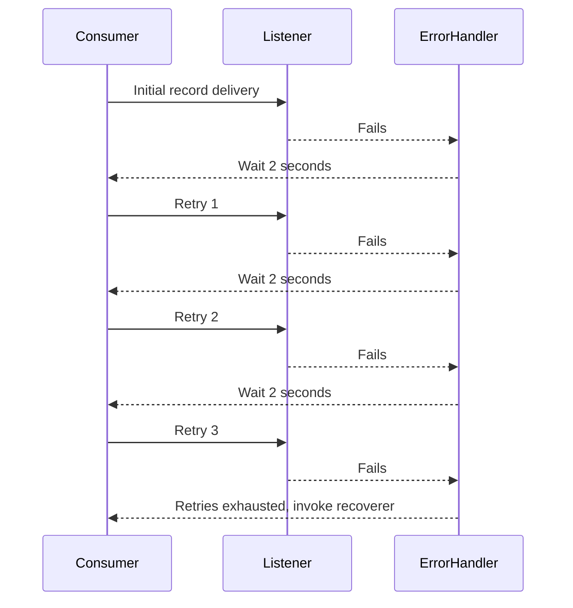

# Retry Count and Backoff Interval

When a Kafka record fails, Spring Kafka can re-invoke the listener according to a retry policy before routing the record to a recovery step, such as sending it to a dead-letter topic (DLT). The two parameters that govern how retries occur are the retry count and the backoff interval between attempts. Choosing both values properly helps the system tolerate transient errors without stalling the consumer for too long or overwhelming a struggling service.

In Spring Kafka, `DefaultErrorHandler` accepts a `BackOff` to control retry timing and count. Be sure to distinguish the retry count from the total number of times the listener receives the record: the initial processing attempt does not count as a retry.

## 1. Distinguishing the Initial Attempt from Retry Attempts

Suppose a listener receives a record and fails on the first attempt. If the configuration allows three retries, the listener can be invoked up to three more times. In total, there are at most four processing attempts: one initial attempt and three retries.

| Configuration | Maximum processing attempts |
| --- | ---: |
| `new FixedBackOff(1_000L, 0L)` | 1 attempt, no retries |
| `new FixedBackOff(1_000L, 1L)` | 2 attempts |
| `new FixedBackOff(1_000L, 3L)` | 4 attempts |
| `new FixedBackOff(1_000L, 5L)` | 6 attempts |

The first parameter of `FixedBackOff` is the wait interval in milliseconds. The second parameter is the maximum number of retries after the first attempt. Thus, `FixedBackOff(2_000L, 3L)` can produce three wait intervals of two seconds each; the maximum total wait time is six seconds, excluding listener execution time and container overhead.



When `BackOff` runs out of attempts, `DefaultErrorHandler` invokes the recoverer. If the recoverer successfully sends the record to the DLT, the container can proceed according to the configured acknowledgement and offset commit policy. If recovery fails, the record may re-enter the error flow; therefore, monitor DLT publish errors as well.

## 2. Configuring a Fixed Backoff Interval

`FixedBackOff` is suitable when you want each retry spaced by the same duration and an exact cap on retries. For instance, a partner service typically recovers quickly after a brief network glitch:

```java
@Bean
public DefaultErrorHandler kafkaErrorHandler(
        ConsumerRecordRecoverer recoverer) {
    FixedBackOff backOff = new FixedBackOff(2_000L, 3L);
    return new DefaultErrorHandler(recoverer, backOff);
}
```

With the configuration above, after the initial attempt fails, the container waits two seconds and retries. If the next three retry attempts also fail, the recoverer is invoked. The maximum total listener invocations is four.

You can use a wait interval of `0` to retry immediately, but continuous retries can create a hot loop, consuming CPU and increasing load on the dependent service. Even when an error appears transient, consider a brief wait interval to avoid adding pressure.

## 3. Using Exponential Backoff for Prolonged Errors

A fixed wait interval is not always appropriate. If a dependent service is overloaded or disconnected for an extended time, retrying every second can make matters worse. Exponential backoff progressively increases the wait interval after each failure.

Example using Spring Framework's `ExponentialBackOff`:

```java
@Bean
public DefaultErrorHandler kafkaErrorHandler(
        ConsumerRecordRecoverer recoverer) {
    ExponentialBackOff backOff = new ExponentialBackOff();
    backOff.setInitialInterval(1_000L);
    backOff.setMultiplier(2.0);
    backOff.setMaxInterval(8_000L);
    backOff.setMaxElapsedTime(30_000L);

    return new DefaultErrorHandler(recoverer, backOff);
}
```

With an initial interval of one second, a multiplier of `2.0`, and an eight-second cap, the wait intervals grow along a sequence of roughly `1s, 2s, 4s, 8s, 8s...`. `maxInterval` caps each wait at the maximum interval; `maxElapsedTime` caps total backoff execution time. Because the number of retries depends on elapsed time and the interval sequence, this approach fits better when you want to bound retry duration rather than enforce an exact retry count.

If the business requirement is "retry exactly three times after the first attempt", `FixedBackOff` is clearer and easier to test. If the requirement is "retry for up to about thirty seconds with increasing intervals", `ExponentialBackOff` is a better fit.

## 4. Choosing Attempt Counts by Error Type

The number of retries should reflect the root cause's ability to self-heal and the time budget allowed by the business:

- **Timeouts or brief network glitches:** retry a few times with short intervals. The goal is to ride out transient blips without adding excessive load.
- **Overloaded dependent service:** use exponential backoff and cap total duration. If the error persists, route the record to a DLT for investigation or later replay.
- **Invalid data or business rule violations:** retrying usually will not make the data valid. Classify the exception as non-retryable to route straight to the recoverer.
- **Programming bugs:** retrying multiple times usually just repeats the same error. Log, alert, and fix the underlying issue in the application.

The attempt count in `BackOff` only applies to exceptions classified as retryable. Non-retryable exceptions go straight to recovery even if attempts remain in the configuration. Pair your backoff policy with exception classification in `DefaultErrorHandler`, instead of raising retry counts for all errors.

## 5. How Backoff Intervals Affect Partitions and Consumers

With consumer-side retries in `DefaultErrorHandler`, the failed record is typically re-read within the same partition. Records behind it in the partition must wait until the failed record succeeds or is recovered. Consequently, increasing the wait interval or retry count can lengthen wait times for subsequent records.

For example, partition `orders-0` contains records A, B, and C. If B fails and is retried with three two-second waits, C may have to wait while B is retried. Partitions handled by other consumers in the same group can still make progress; other partitions assigned to the same consumer waiting on the retry may also be delayed.

A long wait interval must also be evaluated alongside `max.poll.interval.ms`. If the consumer thread is blocked too long without calling `poll()`, Kafka may consider the consumer dead and trigger a rebalance. With Spring Kafka 2.9 or later, you can use `ContainerPausingBackOffHandler` to pause the container during long waits:

```java
DefaultErrorHandler handler = new DefaultErrorHandler(
    recoverer,
    new FixedBackOff(60_000L, 3L),
    new ContainerPausingBackOffHandler());
```

A container pausing backoff handler lets the container pause receiving records during the wait while maintaining an appropriate poll loop. Check your Spring Kafka version and consumer settings before opting for long waits.

If business requirements demand long delays while letting subsequent records proceed, consider non-blocking retry with `@RetryableTopic`. This routes the record through retry topics rather than holding it on the source partition; in exchange, processing order between the failed record and later arrivals can change.

## 6. Do Not Confuse Retry Count with System-Wide Delivery Count

The retry count controlled by `DefaultErrorHandler` is the number of attempts within the current error-handling cycle. Application restarts, rebalances, or redelivery before an offset commit can cause the listener to receive the record again. Therefore, do not rely on the configured retry count as the sole counter for how many times an event has appeared across the entire lifecycle of the system.

Business logic still needs idempotency, such as storing `eventId` with a unique constraint or recording processed state within the same database transaction. Retry is a messaging recovery mechanism; it does not guarantee that external side effects happen only once.

## 7. Testing Retry Counts and Backoff Intervals

A test for `FixedBackOff(2_000L, 3L)` should simulate continuous listener failures and verify the listener is invoked at most four times before recovery. Also verify the record moves to the DLT after retries are exhausted and offsets advance only per the configured commit policy.

Do not force tests to wait through long real-time intervals when the goal is only to verify invocation counts. You can use short backoffs in tests or test the `BackOff` configuration separately; for Kafka integration tests, use Awaitility to wait for conditions such as listener invocation counts or the record appearing on the DLT.

For exponential backoff, verify the increasing interval sequence, the `maxInterval` cap, and termination based on `maxElapsedTime`. Also test a non-retryable exception to verify the recoverer is called immediately without consuming retry attempts.

## 8. Production Configuration Checklist

- Determine maximum processing attempts as `1 + retry count` and document this number clearly in configuration.
- Estimate total wait time as the sum of backoff intervals, plus listener processing time and overhead.
- Set wait intervals and total retry duration according to dependent service timeouts, SLAs, and `max.poll.interval.ms`.
- Use exponential backoff when errors may persist; use fixed backoff when predictable counts and spacing are needed.
- Classify unrecoverable exceptions so they route to the DLT early.
- Monitor retries, recoveries, DLT volume, consumer lag, and rebalance errors to spot overly long retry policies.

Choosing retry counts and wait intervals is a trade-off between resilience and partition-wide latency. A clear, bounded, and tested configuration helps consumers handle transient errors while preserving progress and operability across the Kafka stream.
