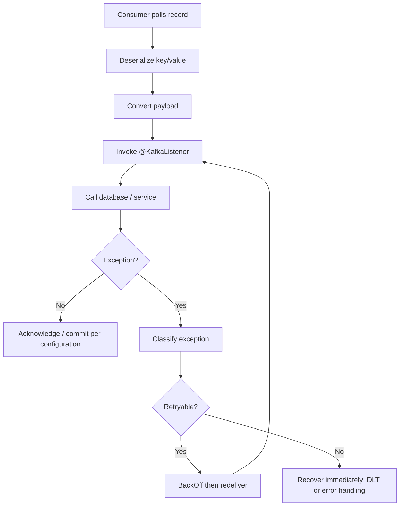

# Classifying Retryable Exceptions

Not every error encountered while processing a Kafka record should be retried. An error caused by a temporary database disconnect may recover after a few seconds; a malformed event or one violating a business rule will keep failing even after hundreds of attempts. Without exception classification, a consumer can loop endlessly on a failing record, increasing consumer lag and stalling the entire partition.

Spring Kafka lets you classify exceptions into **retryable** and **non-retryable** groups. For blocking retry, you configure `DefaultErrorHandler`; for non-blocking retry, you declare `include` and `exclude` in `@RetryableTopic`. Classification answers *whether to retry*; `BackOff` and attempt count answer *when and how many times to retry*.

## 1. Retryable and Non-Retryable Exceptions

An exception should be retried when the root cause is likely to clear over time and a subsequent attempt has a chance to succeed without changing the payload or logic. Conversely, an exception should not be retried if the record will always fail under the same data or conditions.

| Error group | Examples | Typical classification | Reason |
|---|---|---|---|
| Transient infrastructure errors | Database timeout, connection reset, temporary broker/network blip. | Retryable | The dependency may recover after a waiting period. |
| Rate limits or overloaded service | HTTP 429, certain HTTP 5xx errors, open circuit breaker. | Bounded retryable | May succeed once load drops; requires backoff and an attempt cap. |
| Payload-induced business errors | Missing required field, negative amount, invalid state transition. | Non-retryable | The payload does not change, so retrying will not fix the error. |
| Fixed schema/serialization errors | Invalid JSON syntax, incompatible schema, corrupted payload bytes. | Usually non-retryable | The producer or data must be fixed before reprocessing. |
| Configuration or permission errors | Invalid credentials, missing access rights, misconfigured endpoint. | Usually non-retryable for short retries | Configuration/permissions must be fixed; continuous retries only add load and noisy logs. |
| Reference data not yet ready | An entity not yet synced that may appear after another event. | Depends on business rules | Can retry if the dependent event is guaranteed to arrive; otherwise a reconciliation workflow is needed. |

Do not classify solely by exception name or HTTP status code. For instance, HTTP 404 may be a permanent error if the resource does not exist, or a transient state if the system uses eventual consistency and the resource is about to be created. Base decisions on the business contract and the recoverability of the root cause.

## 2. Classification Rules in the Processing Flow

A listener can fail at multiple stages:



Examples:

- Database temporarily unresponsive: retry with backoff, then send to DLT after a bounded number of attempts.
- `OrderValidationException`: do not retry; route straight to DLT or a business error workflow.
- Undeserializable JSON: the failure occurs before the listener receives the payload; typically treated as fatal/non-retryable and requires `ErrorHandlingDeserializer` with an appropriate error handler.

The classification point must reflect the true root cause. If a service wraps the original exception inside a generic exception, inspect the cause chain so that all errors are not classified identically.

## 3. Exceptions Treated as Fatal by Default in DefaultErrorHandler

`DefaultErrorHandler` includes a built-in set of exceptions considered fatal (not retried by default), because calling the listener again with the same record generally cannot fix them. Typical types include:

| Exception | Common cause |
|---|---|
| `DeserializationException` | Cannot convert key/value bytes into a Java type. |
| `MessageConversionException` | Cannot convert the message into the type expected by the listener. |
| `ConversionException` | Data conversion failure during dispatch. |
| `MethodArgumentResolutionException` | Cannot resolve listener method parameters. |
| `NoSuchMethodException` | Cannot find a matching handler method. |
| `ClassCastException` | Actual data type is incompatible with the type handled by the listener. |

This is the error handler's default list, not an exhaustive taxonomy for every application. You can extend or alter classifications per business needs. When using `ErrorHandlingDeserializer`, deserialization failures are routed through the container's error handling mechanism instead of causing the consumer to fail repeatedly inside `poll()`.

## 4. Creating Business-Specific Exceptions

Define exceptions around recoverability semantics rather than lumping every error into `RuntimeException` or `KafkaException`. For example:

```java
public class RetryableInventoryException extends RuntimeException {
    public RetryableInventoryException(String message, Throwable cause) {
        super(message, cause);
    }
}

public class InvalidOrderEventException extends RuntimeException {
    public InvalidOrderEventException(String message) {
        super(message);
    }
}

public class OrderStateConflictException extends RuntimeException {
    public OrderStateConflictException(String message) {
        super(message);
    }
}
```

Conventions:

- `RetryableInventoryException`: inventory service is temporarily unreachable; can be retried.
- `InvalidOrderEventException`: event data violates the contract; do not retry.
- `OrderStateConflictException`: state conflict; determine whether it can be retried after reloading state or must go to business error handling.

Do not create exception classes purely for classification if the original exception name already conveys clear semantics and is used consistently. However, application-service boundary exceptions prevent the listener from depending directly on specific database or HTTP libraries.

## 5. Classifying Exceptions with DefaultErrorHandler

`DefaultErrorHandler` is used for blocking retry: the record is reprocessed on the listener container thread after a backoff interval. You can add retryable or non-retryable exceptions using `addRetryableExceptions(...)` and `addNotRetryableExceptions(...)`.

Configuration example:

```java
import org.springframework.context.annotation.Bean;
import org.springframework.context.annotation.Configuration;
import org.springframework.dao.TransientDataAccessException;
import org.springframework.kafka.core.KafkaTemplate;
import org.springframework.kafka.listener.DeadLetterPublishingRecoverer;
import org.springframework.kafka.listener.DefaultErrorHandler;
import org.springframework.util.backoff.FixedBackOff;

@Configuration
public class KafkaErrorHandlerConfiguration {

    @Bean
    DefaultErrorHandler kafkaErrorHandler(
            KafkaTemplate<Object, Object> dltKafkaTemplate) {

        var recoverer = new DeadLetterPublishingRecoverer(dltKafkaTemplate);

        // 2 retries after the initial delivery, up to 3 total deliveries.
        var handler = new DefaultErrorHandler(
                recoverer,
                new FixedBackOff(1_000L, 2L)
        );

        handler.addRetryableExceptions(
                RetryableInventoryException.class,
                TransientDataAccessException.class
        );

        handler.addNotRetryableExceptions(
                InvalidOrderEventException.class,
                IllegalArgumentException.class
        );

        return handler;
    }
}
```

In this example:

- `FixedBackOff(1_000L, 2L)` waits 1 second between retries and allows 2 retries after the initial delivery.
- `RetryableInventoryException` and `TransientDataAccessException` are marked retryable.
- `InvalidOrderEventException` and `IllegalArgumentException` are marked non-retryable.
- When retries are exhausted or an exception is classified as non-retryable, the recoverer publishes the record to the DLT per its destination configuration.

If no custom recoverer is configured, the error handler can use a default recoverer that logs records exceeding the attempt limit. In production, define an explicit policy for finally failed records: a DLT, error store, or another recovery workflow.

Attach the handler to the listener container factory if you create the factory yourself:

```java
factory.setCommonErrorHandler(kafkaErrorHandler);
```

With Spring Boot auto-configuration, an appropriate `CommonErrorHandler` bean can be applied to the default factory. If the application has multiple factories, inspect each factory to ensure the handler is attached to the intended listeners.

## 6. Overriding Default Classifications

`DefaultErrorHandler` allows adding exceptions to the retryable or non-retryable groups. Avoid placing the same exception in both groups, as overlapping configuration obscures operational intent.

For example, if an application has a specific data conversion error it wants to retry because reference data is synced asynchronously, that specific exception can be explicitly classified as retryable. However, do not enable blanket retries for all `MessageConversionException` instances if most conversion errors stem from permanently malformed payloads.

When a fully explicit classification table is needed, you can configure classifications on the error handler using the API of your Spring Kafka version. Boolean `true` denotes the retryable group and `false` denotes the non-retryable group; the default value for exceptions absent from the map must also be chosen intentionally. For most applications, `addRetryableExceptions` and `addNotRetryableExceptions` are easier to read and maintain.

Exceptions may be wrapped in `ListenerExecutionFailedException` or another wrapper. Check how the handler inspects the cause chain in your framework version, and write tests for both direct and wrapped exceptions. Never assume a custom exception is automatically recognized if it only appears deep in the cause chain without verifying.

## 7. Classifying Exceptions with @RetryableTopic

`@RetryableTopic` configures non-blocking retry by forwarding records to retry topics rather than holding the consumer thread during backoff. The `include` attribute specifies exceptions to retry; `exclude` specifies exceptions not to retry. If an exception is excluded from retries, the record can go straight to the DLT per configuration.

Example:

```java
import org.springframework.dao.TransientDataAccessException;
import org.springframework.kafka.annotation.KafkaListener;
import org.springframework.kafka.annotation.RetryableTopic;
import org.springframework.retry.annotation.Backoff;
import org.springframework.stereotype.Component;

@Component
public class OrderEventListener {

    @RetryableTopic(
            attempts = "4",
            backoff = @Backoff(
                    delay = 1_000,
                    multiplier = 2.0,
                    maxDelay = 10_000
            ),
            include = {
                    TransientDataAccessException.class,
                    RetryableInventoryException.class
            },
            exclude = {
                    InvalidOrderEventException.class
            }
    )
    @KafkaListener(
            topics = "orders.events",
            groupId = "order-projection"
    )
    public void onOrderEvent(OrderEvent event) {
        orderService.apply(event);
    }
}
```

In this example, `attempts = "4"` is the total number of processing attempts, including the initial attempt; that means up to three retries after the first try. Backoff grows by a multiplier of 2 and is capped at 10 seconds. Only exceptions matching the configured retry group pass through the retry topics; excluded business exceptions do not consume retry attempts.

`@RetryableTopic` creates retry endpoints/topics and a DLT according to naming/configuration rules. Ensure topics have appropriate partition counts and replication factors, DLT consumers have a handling workflow, and using retry topics does not violate ordering required by the business.

## 8. Differences Between Blocking Retry and Non-Blocking Retry

The two mechanisms have different operational impacts:

| Criterion | `DefaultErrorHandler` | `@RetryableTopic` |
|---|---|---|
| Retry mechanism | Redelivers the record on the listener container thread after backoff. | Publishes the record to a retry topic for later processing. |
| Consumer thread | Can be held during retry/backoff waits. | Can continue processing other records once the record is forwarded. |
| Ordering | Preserves partition processing flow more tightly, though a failing record can block partition progress during retries. | Can alter relative ordering between failed records and later arrivals because retries are handled on separate topics. |
| Classification config | `addRetryableExceptions`, `addNotRetryableExceptions`, or classifications. | `include`, `exclude`, and retry topic configuration. |
| Best suited for | Short retries where in-partition processing order must be preserved. | Slow retries or when consumer threads must not be blocked waiting. |

Do not use non-blocking retry if business rules require every record in a partition to be processed strictly in order. A subsequent record may be processed before a record waiting in a retry topic.

## 9. Classifying Exceptions by Cause Chain

In multi-layered applications, actual exceptions are frequently wrapped:

```text
ListenerExecutionFailedException
  └── OrderProcessingException
        └── TransientDataAccessResourceException
```

If the classifier only inspects the outermost wrapper, it may fail to recognize the transient database error inside. Conversely, a generic wrapper can mask a business error that should not be retried.

Principles to apply:

1. Preserve the cause when wrapping exceptions: `throw new OrderProcessingException("...", cause)`.
2. Never catch `Exception` and throw a generic exception that drops the cause.
3. Use application-specific exceptions when stable classification across multiple adapters is required.
4. Test the cause chain in unit and integration tests.
5. Verify the cause-traversal option of `@RetryableTopic` or the classifier used in your specific Spring Kafka version.

Example wrapping an error while preserving the cause:

```java
try {
    inventoryClient.reserve(orderId);
}
catch (SocketTimeoutException exception) {
    throw new RetryableInventoryException(
            "Inventory service timeout for order " + orderId,
            exception
    );
}
```

This allows the application service to express retryable semantics while keeping the original exception for logging and investigation.

## 10. Handling Deserialization and Conversion Errors Separately

Deserialization errors happen before the listener receives a payload. For example, a consumer receives invalid JSON bytes while using `JsonDeserializer`. In this scenario, the listener method has no opportunity to catch the error or throw a business exception.

With Spring Kafka, `ErrorHandlingDeserializer` wraps the real deserializer and passes error details to the container's error handler:

```yaml
spring:
  kafka:
    consumer:
      key-deserializer: org.springframework.kafka.support.serializer.ErrorHandlingDeserializer
      value-deserializer: org.springframework.kafka.support.serializer.ErrorHandlingDeserializer
      properties:
        spring.deserializer.key.delegate.class: org.apache.kafka.common.serialization.StringDeserializer
        spring.deserializer.value.delegate.class: org.springframework.kafka.support.serializer.JsonDeserializer
        spring.json.value.default.type: com.example.orders.OrderEvent
        spring.json.trusted.packages: com.example.orders
```

Because malformed payloads do not fix themselves after a second, deserialization errors should generally be handled as non-retryable, routing raw bytes and metadata to a DLT for investigation. Conversion errors arising after obtaining a record—before or during method invocation—must likewise be classified according to their root cause.

Never retry poison pills indefinitely. If the data needs fixing, preserve the raw bytes and source metadata so it can be replayed after the producer or migration process resolves the issue.

## 11. Designing an Application Exception Taxonomy

A small, clear taxonomy helps services align on retry rules:

| Application exception group | Example class | Retry? | Action when retries exhausted |
|---|---|---|---|
| Transient dependency | `RetryableInventoryException` | Bounded | DLT and dependency alert. |
| Transient database | `TransientDataAccessException` | Bounded | DLT or operational retry workflow. |
| Invalid payload | `InvalidOrderEventException` | No | DLT, producer feedback, or data-fix workflow. |
| State violation | `OrderStateConflictException` | Depends on semantics | Short retry if state will converge; otherwise DLT/manual resolution. |
| Insufficient permission/config | `AuthorizationException`, credential error | Usually no short retry | Alert and fix configuration/permissions. |

Avoid creating a single generic `RetryableException` and reusing it for every failure. Class names should describe the cause or recoverability so operators understand why a record is being retried.

## 12. Retry Count and BackOff Do Not Replace Classification

Classification decides whether a record is retried. BackOff determines how long to wait between retries. These two aspects should be designed separately:

- **Fixed backoff:** constant wait interval, suitable for dependencies with short, predictable recovery times.
- **Exponential backoff:** increases wait duration after each failure, reducing pressure on an overloaded dependency.
- **Max attempts:** caps attempts so failing records do not consume resources indefinitely.
- **Jitter:** adds randomness when multiple consumers might retry simultaneously, avoiding synchronized request bursts.

For example, retrying a database timeout after 1 second, 2 seconds, 4 seconds, up to 10 seconds makes more sense than retrying continuously with no delay. However, if the exception is `InvalidOrderEventException`, no amount of backoff will make an invalid payload valid.

With Spring's `FixedBackOff(interval, maxAttempts)`, `maxAttempts` is the number of retries after the initial delivery. With `@RetryableTopic(attempts = "N")`, `attempts` is the total number of processing attempts including the initial one. Always document these semantics clearly in configuration and tests to avoid off-by-one confusion on delivery counts.

## 13. Idempotency During Retries

Retrying means an event can be delivered to the listener multiple times. Moreover, producers or consumers can encounter ambiguous outcomes during timeouts or restarts. Business handlers must therefore tolerate reprocessing the same event.

Common techniques:

- Use a unique `eventId` and store it in an inbox/processed-events table with a unique constraint.
- Update state via conditional statements, such as transitioning from `PENDING` to `PAID` only once.
- Use optimistic locking or versions to detect duplicate or conflicting updates.
- Persist side effects and the processed marker inside the same database transaction.
- Avoid sending duplicate emails, payments, or transfers just because the consumer retried; pass an idempotency key to downstream services.

Kafka producer idempotence does not replace consumer idempotency. Producer idempotence primarily prevents duplicates from internal producer retries within a session; it does not prevent the application from reprocessing the same record or re-sending an event in another producer session.

## 14. Testing Exception Classification

Test against a decision matrix rather than only verifying a single successful retry:

| Scenario | Expected outcome |
|---|---|
| Listener throws `RetryableInventoryException` first, succeeds next | Retried per backoff; side effects applied strictly according to the idempotency contract. |
| Listener throws `InvalidOrderEventException` | Does not wait for retries; record is recovered/routed to DLT per configuration. |
| Listener throws `IllegalArgumentException` | Behavior matches configured classification, including when marked non-retryable. |
| Retryable exception inside a wrapper's cause chain | Classified accurately per cause-traversal configuration. |
| Invalid JSON payload | Listener is not invoked; error handler processes deserialization failure and DLT preserves raw bytes if supported. |
| Retries exhausted | Recoverer is invoked; record does not loop endlessly on the partition. |

For integration tests, use a test broker / Embedded Kafka or Testcontainers, latches to wait for deliveries and DLT records, and finite timeouts. Verify listener invocation counts, source topic/partition/offset in DLT headers, and side-effect state. Never use fixed `Thread.sleep` calls to guess retry timing.

## 15. Common Pitfalls

| Symptom | Cause | Fix |
|---|---|---|
| Record retried repeatedly despite bad payload | Validation exception not classified as non-retryable. | Add to `addNotRetryableExceptions` or retry topic `exclude`. |
| Transient database error routed straight to DLT | Exception classified fatal or wrapped in an unrecognized class. | Inspect cause chain and register specific retryable exceptions. |
| Every exception is retried | Relying on default classification without adding business taxonomy. | Classify validation, schema, and permission exceptions. |
| Consumer lag spikes | Backoff/retry holds consumer thread too long or poison record blocks partition. | Cap attempts, classify non-retryables, and consider retry topics. |
| Record reaches DLT missing payload | Deserialization error not wired via `ErrorHandlingDeserializer` or DLT serializer lacks raw-byte support. | Configure delegate deserializers and an appropriate DLT template. |
| Retry topic breaks ordering | Failing record moves to retry topic while later records keep processing. | Use non-blocking retry only when business rules accept ordering shifts. |
| Retries produce duplicate side effects | Listener is not idempotent or commit/ack setup is inappropriate. | Use event IDs, inbox/unique constraints, and transactions. |
| Retries hit too aggressively | Fixed backoff too short or multiple consumers retrying together. | Use exponential backoff, load limits, and jitter if needed. |

## 16. Key Takeaways

- Retry exceptions when the root cause can recover; do not retry payload or business errors that cannot self-heal.
- `DefaultErrorHandler` treats certain deserialization/conversion and dispatch errors as fatal by default; you can add retryable or non-retryable exceptions.
- `addRetryableExceptions(...)` and `addNotRetryableExceptions(...)` establish clear classification for blocking retries.
- `@RetryableTopic` uses `include` and `exclude` to select which exceptions flow through retry topics.
- `FixedBackOff` counts retries after the initial delivery; `@RetryableTopic.attempts` includes the initial attempt.
- Cause chains and exception wrappers must be tested so classification does not misfire.
- Deserialization errors happen before the listener; use `ErrorHandlingDeserializer` and a suitable DLT setup to retain raw bytes.
- Blocking retry keeps records in the main stream; non-blocking retry can allow later records to be processed first.
- Retries require idempotent consumers to protect side effects on redelivery.

When designing retry handling, start by asking whether the root cause can heal on its own or requires fixing data/configuration. Build a clear exception taxonomy, configure classification on the right retry mechanism, set backoff and attempt caps, and test both successful retry paths and DLT routing. This keeps failed records from stalling the consumer group while still giving transient errors a chance to recover.

## References

- [Spring for Apache Kafka — Handling Exceptions](https://docs.spring.io/spring-kafka/reference/kafka/annotation-error-handling.html)
- [Spring for Apache Kafka — Non-Blocking Retries](https://docs.spring.io/spring-kafka/reference/retrytopic.html)
- [Spring Kafka — DefaultErrorHandler API](https://docs.spring.io/spring-kafka/api/org/springframework/kafka/listener/DefaultErrorHandler.html)
- [Spring Kafka — RetryableTopic API](https://docs.spring.io/spring-kafka/api/org/springframework/kafka/annotation/RetryableTopic.html)
