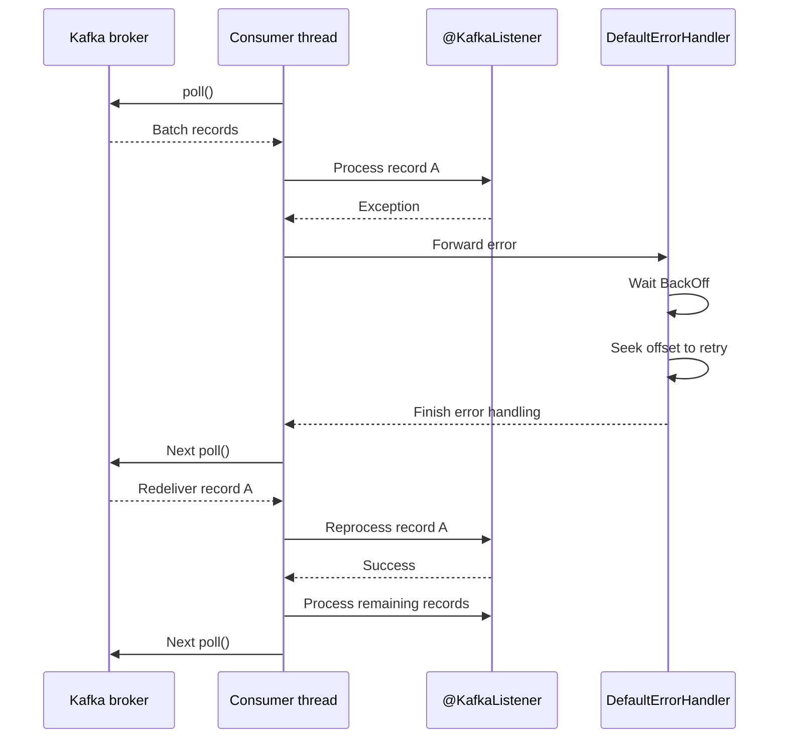

# Blocking Retry Increases Poll Duration

Blocking retry re-attempts processing a record directly on the current consumer thread. When the listener throws an exception, the error handler waits per `BackOff`, and the failed record is then redelivered on the next `poll()`. This approach is simple and typically preserves in-partition processing order, but the wait durations and reprocessing time increase the elapsed time from one `poll()` call to the next.

The key metric to watch is the **interval between two `poll()` calls**, bounded by `max.poll.interval.ms`. Blocking retry does not necessarily make a single `poll()` API call take longer; rather, it keeps the consumer thread busy processing and waiting on retries before returning to poll. If this interval exceeds the configured threshold, the consumer may be considered stalled and the consumer group may rebalance.

## 1. How Does Blocking Retry Occur on the Consumer Thread?

For a record listener, the typical flow includes these steps:

1. The consumer calls `poll()` and receives a batch of records from assigned partitions.
2. The listener processes each record.
3. If the listener throws an exception, `DefaultErrorHandler` applies `BackOff`.
4. Once the wait finishes, error handling completes; the next `poll()` can redeliver the failed record to the listener.
5. Once the record succeeds or is recovered, the container finishes processing remaining records and returns to `poll()`.



With `DefaultErrorHandler`, `BackOff` determines the wait duration and redelivery count. `BackOffHandler` determines how the container waits. By default, the handler pauses the thread until the backoff expires or the container stops. Therefore, during the wait, the consumer thread neither processes the next record nor calls `poll()` as in a normal cycle.

If a consumer thread is assigned multiple partitions, a failure on one record can delay processing progress for other records served by that same thread. Other consumer threads in the same application can still proceed if they belong to independent consumers/containers.

## 2. Why Does Time Between Polls Increase?

Kafka uses `max.poll.interval.ms` to cap the maximum elapsed time between consumer `poll()` calls. The consumer must process the fetched batch and return to poll before this interval expires. If exceeded, the group coordinator can consider the consumer dead and initiate partition reassignment.

With blocking retry, the time between two polls can include:

- Time spent processing records preceding the failed record in the current poll.
- Wait time for each backoff.
- Time spent reprocessing the failed record on each attempt.
- Time spent processing remaining records after the failed record succeeds or is recovered.
- Overhead for offset commits, callbacks, and container coordination.

This can be estimated as:

```text
T_between_polls
  ≈ T_processing_before_error
  + Σ(T_backoff + T_retry_processing)
  + T_processing_remaining_records
  + T_container_overhead
```

For example, the configuration:

```java
new FixedBackOff(2_000L, 2L)
```

means waiting 2 seconds between retries and allowing 2 retries after the initial delivery, for a maximum of 3 total deliveries to the listener. Backoff alone adds roughly 4 seconds. If each listener invocation takes 300 ms, the failing record can consume roughly 4.9 seconds across three processing attempts and two waits, excluding time for other records and overhead.

If `max.poll.interval.ms` is configured lower than the total required duration, the consumer risks exceeding the limit before returning to poll. When partitions are reassigned to another consumer, uncommitted records may be redelivered. Thus, retry affects not only latency but can also increase duplicate processing after rebalances.

## 3. Configuring Blocking Retry with `DefaultErrorHandler`

The example below configures two retries spaced one second apart. Once retries are exhausted, `DeadLetterPublishingRecoverer` sends the failed record to a dead-letter topic (DLT):

```java
@Bean
DefaultErrorHandler orderErrorHandler(
        KafkaTemplate<Object, Object> kafkaTemplate) {

    var recoverer = new DeadLetterPublishingRecoverer(kafkaTemplate);
    var backOff = new FixedBackOff(1_000L, 2L);

    return new DefaultErrorHandler(recoverer, backOff);
}
```

Attaching the handler to the listener container factory:

```java
@Bean
ConcurrentKafkaListenerContainerFactory<String, Order> orderListenerFactory(
        ConsumerFactory<String, Order> consumerFactory,
        DefaultErrorHandler orderErrorHandler) {

    var factory = new ConcurrentKafkaListenerContainerFactory<String, Order>();
    factory.setConsumerFactory(consumerFactory);
    factory.setCommonErrorHandler(orderErrorHandler);
    return factory;
}
```

With this setup, `DefaultErrorHandler` uses the default backoff handler, meaning the thread sleeps during the backoff period. `FixedBackOff(1_000L, 2L)` specifies two retries, not two total deliveries. If the DLT uses the default resolver, the target topic name is the source topic plus the `-dlt` suffix and the source partition is preserved; ensure the DLT is created with an adequate partition count and compatible serializers.

Only retry errors likely to resolve on their own, such as timeouts or temporary connection errors. Invalid data errors usually do not change after waiting; add them to the non-retryable group to recover immediately:

```java
orderErrorHandler.addNotRetryableExceptions(ValidationException.class);
```

`DefaultErrorHandler` also treats certain deserialization and message conversion errors as non-retryable by default. Proper exception classification avoids wasting poll budget on attempts that cannot succeed.

Never configure infinite retries for persistent errors without alerting and a recovery plan. A single failing record can keep the consumer thread retrying indefinitely, increasing lag and blocking progress on other records assigned to that consumer.

## 4. Reducing the Risk of Exceeding `max.poll.interval.ms` with ContainerPausingBackOffHandler

Since Spring Kafka 2.9, you can opt for `ContainerPausingBackOffHandler`. Instead of blocking the thread in one continuous sleep, the handler pauses the listener container during the backoff period and resumes it when it is time to retry. This helps when wait intervals exceed `max.poll.interval.ms` because the container can keep issuing polls while paused to maintain consumer liveness.

```java
@Bean
DefaultErrorHandler orderErrorHandler(
        KafkaTemplate<Object, Object> kafkaTemplate) {

    var recoverer = new DeadLetterPublishingRecoverer(kafkaTemplate);
    var backOff = new FixedBackOff(360_000L, 2L);
    var backOffHandler = new ContainerPausingBackOffHandler();

    return new DefaultErrorHandler(recoverer, backOff, backOffHandler);
}
```

Actual pause granularity depends on the container's `pollTimeout`. For example, if `pollTimeout` is one second, the exact retry timing can drift along that polling cadence. Pick a `pollTimeout` suited to your backoff precision requirements and polling overhead.

Pausing the container lets the consumer keep polling and avoid group eviction solely due to long retry waits. However, a paused container does not process new records during that time. This protects consumer group health and keeps retries on the current consumer, without turning blocking retry into parallel processing.

## 5. Choosing `max.poll.interval.ms`, `max.poll.records`, and Concurrency

These four settings all influence how long a poll cycle takes to finish:

| Setting | Impact | Considerations |
|---|---|---|
| `max.poll.interval.ms` | Maximum time allowed between `poll()` calls | Set high enough for expected processing and retry durations when using thread-sleep backoff |
| `max.poll.records` | Maximum records returned per poll | Lower when a single poll contains too many records and processing exceeds the time budget |
| `concurrency` | Number of consumer/container threads created by the listener container | Increase to spread partitions when sufficient partitions and resources exist |
| `pollTimeout` | Maximum wait during a single container poll | Affects the timing resolution of `ContainerPausingBackOffHandler` |

Do not simply raise `max.poll.interval.ms` to mask an overly long retry chain. Higher values delay detection of genuinely hung consumers and push rebalances out later. Measure actual processing times, retry counts, and backoff durations first; then pick limits aligned with your SLA.

Lowering `max.poll.records` reduces how many records must be processed per cycle, though it can reduce efficiency when per-poll overhead is high. Increasing concurrency helps when the topic has enough partitions to distribute across consumers. If there is only one partition, increasing concurrency will not allow multiple consumers in the same consumer group to process that partition.

## 6. When Should You Use Non-Blocking Retry?

Blocking retry works best when errors resolve quickly, such as a brief dependent service timeout, and preserving in-partition order matters. If recovery time is uncertain or long waits would stall the main stream, consider non-blocking retry via `@RetryableTopic`.

With non-blocking retry, a failed record is forwarded to a retry topic along with metadata indicating when it may be retried. The retry topic consumer inspects the timestamp; if it is not due yet, the retry partition is paused. Once due, the record is reprocessed. Meanwhile, the main topic consumer can keep reading other records instead of waiting on the failed one.

```java
@RetryableTopic(attempts = "4")
@KafkaListener(topics = "orders")
public void consume(Order order) {
    orderService.process(order);
}
```

Non-blocking retry trades off ordering. Later records can be processed ahead of a failed record sitting in a retry topic. This mechanism also does not support batch listeners and cannot be combined with container transactions. If business logic demands strict in-partition order or requires listener container transactions, evaluate carefully before switching to retry topics.

Starting in Spring Kafka 2.8.4, blocking retry and non-blocking retry can be combined. Selected exceptions can be retried a few times immediately before moving to a retry topic. Example configuring blocking retries for a transient exception:

```java
@EnableKafka
@Configuration
class OrderRetryConfiguration extends RetryTopicConfigurationSupport {

    @Override
    protected void configureBlockingRetries(BlockingRetriesConfigurer blockingRetries) {
        blockingRetries
                .retryOn(TemporaryDatabaseException.class)
                .backOff(new FixedBackOff(500L, 2L));
    }
}
```

Place `@RetryableTopic` on the listener to declare the retry-topic flow. `configureBlockingRetries()` uses an allowlist: only exceptions declared via `retryOn()` go through the configured blocking retries. Whether the record then proceeds through retry topics or to the DLT depends on exception classification and retry topic settings. This combination is useful when you want fast retries for glitches that clear immediately, falling back to a longer retry schedule if the error persists.

## 7. Blocking Retry in Transactional Listeners

When a listener container uses Kafka transactions, Spring Kafka does not install `DefaultErrorHandler` by default; exceptions are thrown out so the transaction rolls back. Retrying after rollback is handled by `AfterRollbackProcessor`. Therefore, distinguish `DefaultErrorHandler` blocking retry configuration in non-transactional flows from after-rollback retry in transactional flows.

Non-blocking retry topics cannot be combined with container transactions. If you need both Kafka transactions and retries, design an appropriate `AfterRollbackProcessor`, backoff, recovery, and DLT; do not assume `@RetryableTopic` can directly replace that mechanism.

## 8. Measuring the Impact of Blocking Retry

To tell whether blocking retry is pushing poll cycles past limits, track these signals:

- **Time between polls:** measure elapsed time between container `poll()` invocations and compare against `max.poll.interval.ms`.
- **Listener duration:** measure processing time per record and per batch, including external service calls.
- **Retry counts and backoff duration:** record exception type, delivery attempt, wait duration, and recovery outcome.
- **Consumer lag:** watch per-partition lag; steadily rising lag can indicate retries are stalling progress.
- **Rebalances and duplicate processing:** track rebalance frequency, redelivered records, and offset commit failures.
- **DLT rate:** monitor records entering the DLT and elapsed time from initial failure to recovery.

`DefaultErrorHandler` supports `RetryListener` for callbacks when deliveries fail, recovery succeeds, or recovery fails. For blocking delivery attempt headers, enable `deliveryAttemptHeader` on `ContainerProperties` if you want the attempt count added to message headers. These metrics help determine whether transient errors are recovering smoothly or a record is keeping the consumer waiting too long.

## 9. Strategy Selection Example

An order-processing consumer must call a pricing service. The service occasionally times out for 200–500 ms, yet sometimes loses connectivity for several minutes.

1. For short timeouts, run a couple of blocking retries with short backoffs to avoid creating retry topics for brief blips.
2. If it still fails, route the record to a retry topic with a longer delay so the main consumer continues processing other orders, provided the business accepts ordering shifts.
3. If in-partition ordering is mandatory, keep retries in the blocking flow or design partitions/streams specifically so trailing records cannot overtake earlier ones.
4. Set retry limits and a DLT so failing records never stall the consumer indefinitely.
5. Keep order-processing operations idempotent because records can be redelivered after retries, rebalances, or restarts.

## 10. Key Takeaways

- Blocking retry waits and reprocesses on the current consumer thread; backoff duration lengthens the gap between `poll()` calls.
- `max.poll.interval.ms` caps the interval between polls; exceeding it can evict the consumer from the group and trigger partition reassignment.
- `DefaultErrorHandler` defaults to a backoff handler that pauses the thread during backoff.
- Since Spring Kafka 2.9, `ContainerPausingBackOffHandler` allows pausing the container during waits; backoff timing precision depends on `pollTimeout`.
- `max.poll.records`, listener processing time, retry count, and backoff together determine how long a poll cycle takes to complete.
- Non-blocking retry uses retry topics to defer failed records without blocking the main topic consumer, sacrificing topic ordering and lacking support for batch listeners or container transactions.
- Since Spring Kafka 2.8.4, short blocking retries can be combined with non-blocking retries per exception classification.

## References

- [Spring for Apache Kafka — Handling Exceptions, Back Off Handlers and DefaultErrorHandler sections](https://docs.spring.io/spring-kafka/reference/kafka/annotation-error-handling.html)
- [Spring for Apache Kafka — Non-Blocking Retries](https://docs.spring.io/spring-kafka/reference/retrytopic.html)
- [Spring for Apache Kafka — How the Retry Topic Pattern Works](https://docs.spring.io/spring-kafka/reference/retrytopic/how-the-pattern-works.html)
- [Spring for Apache Kafka — Combining Blocking and Non-Blocking Retries](https://docs.spring.io/spring-kafka/reference/retrytopic/retry-topic-combine-blocking.html)
