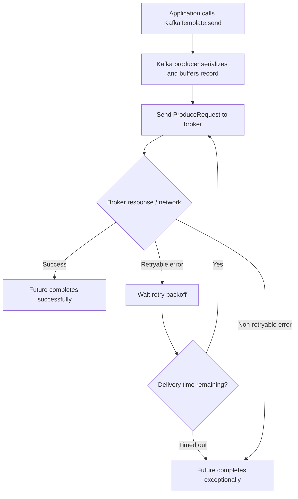

# Producer Retries via Client Configuration

The Kafka producer has an internal retry mechanism to resend requests when encountering transient broker or network errors. With Spring Kafka, `KafkaTemplate` uses the underlying Kafka producer, so properties like `retries`, `retry.backoff.ms`, `request.timeout.ms`, and `delivery.timeout.ms` are configured on the Kafka producer client.

Internal retries help the producer handle transient errors without requiring business code to call `send()` again. However, retries are time-bounded, apply only to errors the Kafka client considers retriable, and do not replace application-level error handling. To minimize duplicates caused by retries, enable the idempotent producer along with `acks=all` and a compatible `max.in.flight.requests.per.connection` setting.

## 1. Where Do Producer Retries Operate?

When the application calls `KafkaTemplate.send(...)`, Spring Kafka forwards the request to the Kafka producer. The producer serializes key/value, fetches topic-partition metadata, buffers the record, and sends the request to the broker. If the request encounters a transient error, the Kafka client can retry per producer configuration.



Retries are performed by the Kafka producer at the client layer, asynchronously in the background. While retries are taking place, the `send()` call has usually already returned a future to the application. The application can continue other work and inspect the result via callbacks or futures.

If a retry succeeds, the future completes normally with a `SendResult`. If retries time out or encounter a non-retryable error, the future completes exceptionally. Therefore, never assume a successful `send()` call means the broker has persisted the record.

## 2. Producer Properties Related to Retries

| Property | Role | Operational meaning |
|---|---|---|
| `retries` | Maximum retry attempts | Caps how many times the Kafka producer retries a request |
| `retry.backoff.ms` | Initial retry wait interval | Pause between retry attempts |
| `retry.backoff.max.ms` | Maximum retry wait interval | Caps backoff when the client increases wait duration between retries; available in supported Kafka versions |
| `request.timeout.ms` | Single-request timeout | Time the producer waits for a broker response to one request |
| `delivery.timeout.ms` | Total record send deadline | Upper bound from `send()` until success or failure, covering batching, requests, and retries |
| `max.in.flight.requests.per.connection` | Unacknowledged requests per connection | Affects throughput and ordering during retries |
| `enable.idempotence` | Enables idempotent producer | Mitigates duplicates caused by producer request retries |
| `acks` | Broker acknowledgment level | Defines when the producer considers a request successful |

`retries` and `delivery.timeout.ms` must be understood together. Setting a very large retry count does not make the producer retry indefinitely; `delivery.timeout.ms` still bounds the total send duration for a record. Conversely, a long delivery timeout does not guarantee retrying every error type.

## 3. Configuring Retries in application.yml

In Spring Boot, producer properties can be set under `spring.kafka.producer`:

```yaml
spring:
  kafka:
    bootstrap-servers: ${KAFKA_BOOTSTRAP_SERVERS:localhost:9092}
    producer:
      key-serializer: org.apache.kafka.common.serialization.StringSerializer
      value-serializer: org.springframework.kafka.support.serializer.JsonSerializer
      acks: all
      retries: 2147483647
      properties:
        "[enable.idempotence]": true
        "[max.in.flight.requests.per.connection]": 5
        "[request.timeout.ms]": 30000
        "[delivery.timeout.ms]": 120000
        "[retry.backoff.ms]": 200
        "[retry.backoff.max.ms]": 1000
```

Configuration breakdown:

- `acks: all`: the broker acknowledges only after replicas in the ISR satisfy replication write requirements.
- `retries: 2147483647`: permits a very high retry count; total actual duration remains bounded by the delivery timeout.
- `enable.idempotence: true`: uses a producer ID and sequence numbers so the broker recognizes retries of the same batch and avoids duplicate writes from internal retries.
- `max.in.flight.requests.per.connection: 5`: caps unacknowledged requests; compatible with idempotence in current Kafka versions.
- `request.timeout.ms: 30000`: waits up to 30 seconds for a single request.
- `delivery.timeout.ms: 120000`: caps the overall record send lifecycle at roughly two minutes.
- `retry.backoff.ms` and `retry.backoff.max.ms`: tune wait durations between retry attempts.

Keys inside `producer.properties` are wrapped in brackets to preserve dotted Kafka property names when Spring Boot binds the map. Check your Spring Boot and Kafka client versions, as defaults and supported properties can vary across versions.

Kafka requires `delivery.timeout.ms` to be at least the sum of `request.timeout.ms` and `linger.ms`. In the example, `delivery.timeout.ms=120000` exceeds `request.timeout.ms=30000` plus the default `linger.ms`. If you increase batching via `linger.ms`, re-evaluate your timeouts.

## 4. Configuring via Java ProducerFactory

If you construct `ProducerFactory` manually, pass the Kafka producer properties directly:

```java
@Configuration
public class KafkaProducerConfiguration {

    @Bean
    public ProducerFactory<String, OrderCreated> orderProducerFactory() {
        Map<String, Object> properties = new HashMap<>();
        properties.put(ProducerConfig.BOOTSTRAP_SERVERS_CONFIG, "localhost:9092");
        properties.put(ProducerConfig.KEY_SERIALIZER_CLASS_CONFIG, StringSerializer.class);
        properties.put(ProducerConfig.VALUE_SERIALIZER_CLASS_CONFIG, JsonSerializer.class);
        properties.put(ProducerConfig.ACKS_CONFIG, "all");
        properties.put(ProducerConfig.ENABLE_IDEMPOTENCE_CONFIG, true);
        properties.put(ProducerConfig.RETRIES_CONFIG, Integer.MAX_VALUE);
        properties.put(ProducerConfig.MAX_IN_FLIGHT_REQUESTS_PER_CONNECTION, 5);
        properties.put(ProducerConfig.REQUEST_TIMEOUT_MS_CONFIG, 30_000);
        properties.put(ProducerConfig.DELIVERY_TIMEOUT_MS_CONFIG, 120_000);
        properties.put(ProducerConfig.RETRY_BACKOFF_MS_CONFIG, 200L);
        properties.put("retry.backoff.max.ms", 1_000L);

        return new DefaultKafkaProducerFactory<>(properties);
    }

    @Bean
    public KafkaTemplate<String, OrderCreated> orderKafkaTemplate(
            ProducerFactory<String, OrderCreated> orderProducerFactory) {
        return new KafkaTemplate<>(orderProducerFactory);
    }
}
```

When defining a custom factory, the application is responsible for supplying all required bootstrap servers, serializers, security settings, and producer properties. Do not assume a manually created factory automatically inherits all of Spring Boot's `spring.kafka.producer` settings.

`retry.backoff.max.ms` is a Kafka client property in versions that support it. If your project's client version lacks this property, omit it and use `retry.backoff.ms`.

## 5. `retries` Does Not Mean Infinite Retries

`retries` caps how many times the producer retries a retriable request. Yet a record must also satisfy `delivery.timeout.ms`. Once the delivery timeout expires, the producer reports failure even if `retries` still has remaining attempts.

Example:

```text
send() is called
  |
  +-- serialize and wait for buffer
  |
  +-- attempt 1 request -> timeout
  |
  +-- backoff -> attempt 2 request -> temporary broker error
  |
  +-- backoff -> attempt 3 request -> timeout
  |
  +-- ...
  |
  +-- delivery.timeout.ms expires -> future fails
```

The producer also spends time on `linger.ms` and waiting on metadata/buffers. Consequently, you cannot compute actual retry counts simply by dividing `retries` by `retry.backoff.ms`.

In production, pick a delivery timeout aligned with your publish SLA and acceptable broker disruption window. Too short a timeout causes failures during brief broker blips; too long a timeout makes the application wait longer for outcomes and grows backlogs in the producer buffer.

## 6. Distinguishing `request.timeout.ms` and `delivery.timeout.ms`

The two timeouts cover different scopes:

| Timeout | Scope | Example failure |
|---|---|---|
| `request.timeout.ms` | A single request sent to the broker | Broker responds slowly or response does not arrive on time |
| `delivery.timeout.ms` | Entire lifecycle of sending a record after calling `send()` | Record has not been confirmed by the broker within the allowed deadline |

`request.timeout.ms` can expire multiple times while sending a single record if the producer still has delivery time and retry budget left. `delivery.timeout.ms` is the overall deadline for sending the record, covering batching wait time, requests, and retries.

Example:

```yaml
spring:
  kafka:
    producer:
      properties:
        "[request.timeout.ms]": 20000
        "[delivery.timeout.ms]": 90000
        "[linger.ms]": 5
```

Delivery timeout must be large enough to cover request timeout plus linger. Use milliseconds and verify timeout relationships whenever changing any of these values.

## 7. `retry.backoff.ms` and `retry.backoff.max.ms`

`retry.backoff.ms` sets the base pause between retry attempts. `retry.backoff.max.ms`, when supported by your Kafka client version, sets the ceiling for backoff as wait times increase.

Example:

```yaml
spring:
  kafka:
    producer:
      properties:
        "[retry.backoff.ms]": 200
        "[retry.backoff.max.ms]": 2000
```

Backoff keeps the producer from flooding a troubled broker with requests. Some client versions apply exponential backoff with jitter to reduce synchronized retries across producers.

Do not set backoff too high if your publish SLA requires low latency. Conversely, too small a backoff can exert relentless request pressure on an overloaded broker.

## 8. Idempotent Producer and Duplicates from Retries

When a producer sends a request and receives no response, it may not know whether the broker already wrote the record. If it resends and the broker had already appended the earlier request, the same record risks appearing twice unless retries can be deduplicated.

An idempotent producer uses a producer ID and sequence numbers so the broker identifies resent batches. When retrying the same batch, the broker can discard duplicates resulting from that resend.

```yaml
spring:
  kafka:
    producer:
      acks: all
      retries: 2147483647
      properties:
        "[enable.idempotence]": true
        "[max.in.flight.requests.per.connection]": 5
```

Key configuration conditions for idempotence include:

- `enable.idempotence=true`.
- `acks=all`.
- `retries` greater than 0.
- `max.in.flight.requests.per.connection` no greater than 5.

Modern Kafka clients typically enable idempotence by default when no conflicting settings exist. Declaring it explicitly makes operational intent easy to review and avoids relying on version defaults.

Idempotence protects retries within the same producer session via Kafka sequence numbers. It does not automatically deduplicate if the application calls `send()` twice as two separate logical sends, does not deduplicate across two distinct producers, and does not provide exactly-once guarantees for database or HTTP side effects.

## 9. `max.in.flight.requests.per.connection` and Ordering

`max.in.flight.requests.per.connection` limits how many unacknowledged requests a producer can have in flight on a single connection. Higher values can improve throughput, yet with idempotence disabled, if an earlier request fails and retries while a later request succeeds, the write order can differ from the original send order.

With idempotence enabled, Kafka supports preserving order for up to five in-flight requests per connection under current configuration constraints. If idempotence is disabled and ordering across retries is required, you can cap in-flight requests to `1`, though this usually lowers throughput.

Example favoring idempotence:

```yaml
spring:
  kafka:
    producer:
      properties:
        "[enable.idempotence]": true
        "[max.in.flight.requests.per.connection]": 5
```

Global ordering across multiple partitions is still not guaranteed by Kafka. If ordering is needed for an aggregate, use the same key so that aggregate's events land in the same partition.

## 10. `acks` and `min.insync.replicas`

Retries resend failed requests, while data durability also depends on acknowledgments and replication.

| `acks` | Meaning |
|---|---|
| `0` | Producer does not wait for broker acknowledgment; unsuitable when reliable write confirmation is required |
| `1` | Leader acknowledges after appending to its local log |
| `all` or `-1` | Leader waits for replicas in the ISR to satisfy acknowledgment requirements |

With `acks=all`, the topic/broker `min.insync.replicas` setting dictates the minimum ISR count required for writes to succeed. For instance, with a replication factor of `3` and `min.insync.replicas=2`, if the ISR drops below `2`, the producer may receive `NotEnoughReplicasException` and retry within the delivery timeout.

Retries cannot create extra replicas or bring back lost brokers. If the cluster fails to satisfy ISR requirements within the delivery timeout, the future still fails in the end. Design replication factor, min ISR, and recovery SLAs together.

## 11. Calling `KafkaTemplate.send` and Observing Retry Results

Since Spring Kafka 3.0, `KafkaTemplate.send(...)` returns `CompletableFuture<SendResult<K,V>>`; older versions used `ListenableFuture`. The producer client performs internal retries before completing the future. Note that `send()` can still throw synchronous exceptions before returning a future, such as serialization errors, a closed producer, or waiting for metadata/buffers beyond `max.block.ms`. Delivery failures occurring after the record is accepted into the producer are typically reported through the future.

```java
@Service
public class OrderEventPublisher {

    private final KafkaTemplate<String, OrderCreated> kafkaTemplate;

    public OrderEventPublisher(
            KafkaTemplate<String, OrderCreated> kafkaTemplate) {
        this.kafkaTemplate = kafkaTemplate;
    }

    public CompletableFuture<SendResult<String, OrderCreated>> publish(
            OrderCreated event) {

        return kafkaTemplate.send(
                "orders.created.v1",
                event.orderId(),
                event);
    }
}
```

You do not need to call `send()` again manually for broker/network retries already managed by the Kafka producer. Observe the future for the final outcome:

```java
publish(event).whenComplete((result, exception) -> {
    if (exception != null) {
        log.error("Publish order event failed: eventId={}", event.eventId(), exception);
        return;
    }

    RecordMetadata metadata = result.getRecordMetadata();
    log.info("Published eventId={} topic={} partition={} offset={}",
            event.eventId(),
            metadata.topic(),
            metadata.partition(),
            metadata.offset());
});
```

The callback runs only after the producer completes successfully or fails permanently. Do not block request threads with `get()` or `join()` without a clear reason; use callbacks/futures and design timeouts at the appropriate caller boundary.

## 12. Distinguishing Retriable and Non-Retriable Errors

The Kafka producer decides whether to retry based on error types returned by the client or broker. Transient errors are retriable, such as network glitches, request timeouts, leader not available, or replicas temporarily unresponsive.

Errors that retries usually cannot fix include:

- Serialization errors because an object cannot be converted to bytes.
- Invalid topic or partition.
- Record exceeding broker/topic size limits.
- Producer configuration errors.
- Authentication/authorization errors requiring credential or ACL fixes.

The exact list depends on the exception and Kafka client version. Do not classify every exception by name alone; inspect the cause chain and Kafka exception retriable flags when needed.

For non-retriable errors, the producer can fail the future immediately without waiting out `delivery.timeout.ms`. Increasing `retries` will not fix invalid serialization schemas, missing write permissions, or misconfigured topics.

## 13. Producer Retries vs. Application Retries

These two mechanisms differ:

| Mechanism | Executed by | Scope |
|---|---|---|
| Kafka producer retry | Kafka client | Resends transient requests within retry and delivery timeout bounds |
| Application retry | Business code / retry framework | Re-invokes publish operations after a future fails or a business decision |

Example of what not to do blindly:

```java
kafkaTemplate.send("orders", event)
        .whenComplete((result, exception) -> {
            if (exception != null) {
                // Calling send() again immediately can create an independent send.
                kafkaTemplate.send("orders", event);
            }
        });
```

When a future reports failure, the producer may have exhausted its delivery timeout with ambiguity over whether anything outside Kafka recorded side effects. If the application resends, the first attempt might have been appended by the broker while the response was lost; the new send is an independent logical send and can create a duplicate.

If application-level retries are needed, use stable event IDs, idempotent consumers, an outbox, or deduplication mechanisms. Apply backoff and attempt limits at the business layer; never retry tightly inside a callback and create a hot loop.

## 14. `max.block.ms` and `buffer.memory` Are Not Delivery Timeouts

The producer maintains a buffer to batch records before sending. If metadata is unavailable or the buffer is full, `send()` can block before returning a future.

| Property | Meaning |
|---|---|
| `buffer.memory` | Total memory the producer uses for records waiting to be sent |
| `max.block.ms` | Maximum time `send()` can block waiting for metadata or buffer allocation |
| `delivery.timeout.ms` | Maximum time for a record to be acknowledged by the broker after calling send |

If the producer faces backpressure due to a slow broker, the buffer can fill up and `send()` calls block up to `max.block.ms`. This is not a broker request retry and should not be confused with `delivery.timeout.ms`.

Example:

```yaml
spring:
  kafka:
    producer:
      properties:
        "[buffer.memory]": 33554432
        "[max.block.ms]": 60000
        "[delivery.timeout.ms]": 120000
```

Increasing buffer memory can absorb short bursts but does not solve prolonged broker outages. Monitor producer buffer availability, send latency, and timeout errors.

## 15. Monitoring Retries and Publish Failures

Producer retries happen internally, so the application does not necessarily receive callbacks for each attempt. Normally the application only sees the future's final result. For observability, combine producer metrics, client logs, and Spring Kafka metrics.

Useful signals:

- `record-retry-rate`: rate of record batches retried.
- `record-error-rate`: rate of record batches failing.
- `record-send-rate`: rate of records sent.
- `request-latency-avg` and `request-latency-max`: request latency.
- `record-queue-time-avg`: time records spend in the producer accumulator.
- `buffer-available-bytes`: remaining free buffer capacity.
- `requests-in-flight`: number of requests awaiting responses.
- Application-level rate of futures completing exceptionally.

Exact metric names may vary by Kafka client version and metrics reporter. When logging errors, include event ID, topic, business key, and exception; avoid logging full sensitive payloads.

## 16. Testing Producer Retries

Do not just check YAML values. Test both bound configuration and behavior when the broker fails temporarily.

Scenarios to verify:

1. Healthy broker: future completes successfully and returns `RecordMetadata`.
2. Temporary broker interruption: producer retries within delivery timeout and succeeds once the broker recovers.
3. Broker fails to recover before delivery timeout: future completes exceptionally.
4. Serialization error: future or `send()` call reports failure without futile broker retries.
5. Idempotence enabled: request retries do not create duplicates from internal retries.
6. Application calls `send()` a second time: verify it is a distinct logical send and business deduplication handles it if required.
7. `acks=all` paired with replication/min ISR: verify producer behavior when ISR falls short.

You can use Testcontainers Kafka and control the broker/container to simulate interruptions. In integration tests, use dedicated groups/topics/event IDs and finite timeouts. Tests should not rely on fixed sleeps; await futures, broker health, or metric conditions via polling with timeouts.

## 17. Common Pitfalls

**Setting `retries` very high yet records still fail:** `delivery.timeout.ms` expired or the error is non-retriable. Inspect the exception and overall timeout.

**Raising request timeout while forgetting delivery timeout:** delivery timeout may become smaller than request timeout plus linger, yielding an invalid configuration or missing your goal.

**Disabling idempotence while raising max in-flight:** retries can reorder records in some cases. Keep idempotence enabled and in-flight requests within supported bounds if ordering matters.

**Assuming idempotence eliminates all duplicates:** it guards internal producer retries; independent application resends can still produce duplicates.

**Using `acks=1` while expecting `acks=all` durability:** the leader can acknowledge before other replicas persist. Choose `acks` and min ISR based on acceptable data-loss risk.

**Retrying serialization or ACL errors:** these require fixing payloads, serializers, credentials, or permissions; raising `retries` will not solve them.

**Calling `send()` immediately inside callbacks:** can create unbounded application retry loops and duplicates. Use backoff, attempt caps, and idempotency.

**Ignoring the future:** the application assumes the record was sent simply because `send()` returned, even though the future may ultimately fail.

**Confusing `max.block.ms` with `delivery.timeout.ms`:** one governs blocking before the future is returned; the other bounds the record send lifecycle.

## 18. Production Checklist

- Selected `acks` per durability and replication requirements.
- Enabled idempotent producer if internal retry duplicates must be avoided.
- Configured `retries` and `delivery.timeout.ms` per publish SLA.
- `request.timeout.ms`, `delivery.timeout.ms`, and `linger.ms` satisfy valid constraints.
- `retry.backoff.ms` and `retry.backoff.max.ms` fit broker recovery characteristics.
- `max.in.flight.requests.per.connection` is compatible with idempotence and ordering.
- Serializers and key/value types are tested; serialization errors are not retried pointlessly.
- Application observes futures and handles final failures.
- If application retries exist, backoff, attempt limits, event IDs, and deduplication/outbox are in place.
- Distinguished `max.block.ms`, `buffer.memory`, and `delivery.timeout.ms`.
- Metrics cover retries, request latency, buffer pressure, and publish failures.
- Tested broker outages, timeouts, insufficient ISR, and duplicates from application resends.

Producer retries via client configuration allow the Kafka producer to recover automatically from transient errors within the delivery timeout. Configure `retries`, backoff, and timeouts together, enable idempotence when guarding against internal retry duplicates, and observe futures to handle final failures. When the application must resend at the business layer, add idempotency or an outbox because a new `send()` call is not a retry of the same Kafka client request.
