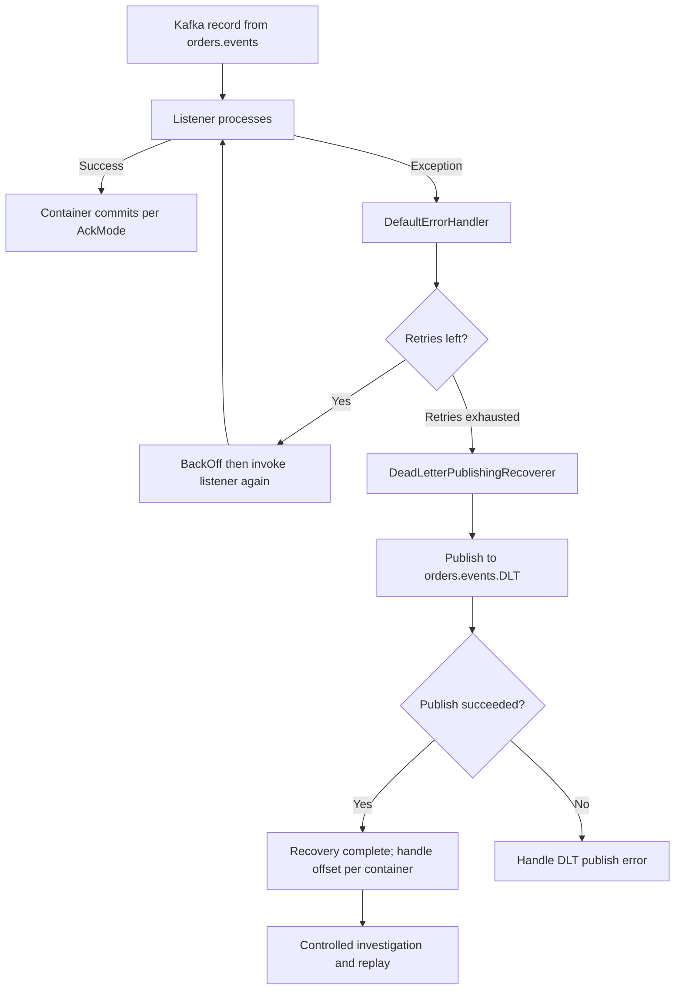

# DeadLetterPublishingRecoverer

`DeadLetterPublishingRecoverer` is a Spring Kafka component used to send an unprocessable record to a dead-letter topic (DLT). It is typically invoked by an error handler after the listener has retried according to policy and still failed. The recoverer creates a new Kafka record, preserves the key/payload along with necessary original metadata, adds headers describing the origin and exception, and sends the record to the target topic.

In a typical processing flow, `DefaultErrorHandler` is responsible for retries and deciding when to hand off to recovery; `DeadLetterPublishingRecoverer` performs the publishing of the failed record. The two components have distinct responsibilities and are usually configured together.

A DLT separates failed records from the main flow so the consumer can continue processing other records, while retaining data for investigation and replay. However, publishing to a DLT is itself a Kafka operation that can fail. Target topics, partitions, serializers, access permissions, offset commits, and replay procedures must all be designed explicitly.

## 1. What Problem Does DeadLetterPublishingRecoverer Solve?

Suppose the Billing service consumes events from the `orders.events` topic. A record with a malformed payload or invalid business data causes the listener to repeatedly throw an exception. If the consumer stays stuck on that record, the partition can become blocked and subsequent records must wait.

A common workflow:

1. The listener receives the record and attempts to process it.
2. On failure, `DefaultErrorHandler` retries according to `BackOff`.
3. Once retries are exhausted, the error handler invokes the recoverer.
4. `DeadLetterPublishingRecoverer` sends the record to `orders.events.DLT` or an application-specified topic.
5. If recovery succeeds, the error handler/container advances offset progress per configuration.
6. A separate operational process investigates, fixes data, or replays records from the DLT.



A DLT is not a place that automatically fixes errors. It is a place to store records that cannot be processed on the main flow, allowing the system to keep making progress and enabling later error handling.

## 2. Roles of DeadLetterPublishingRecoverer and DefaultErrorHandler

The two components are commonly configured together:

| Component | Responsibility |
| --- | --- |
| Listener method | Executes business logic and throws an exception when processing fails |
| `DefaultErrorHandler` | Classifies errors, applies retry/backoff, decides to recover when retries are exhausted |
| `DeadLetterPublishingRecoverer` | Creates and publishes the record to the DLT, adding metadata about the original record and exception |
| DLT consumer/tool | Investigates, fixes, replays, or routes records into a manual handling workflow |

`DeadLetterPublishingRecoverer` does not decide the retry count itself. Retry count and backoff live in the error handler. Nor does the recoverer guarantee exactly-once business execution on its own; the consumer must still be idempotent because a record can be redelivered if DLT publishing or offset commit fails.

## 3. Creating the DLT Topic

A common convention is appending the `.DLT` suffix to the original topic name:

| Main topic | Dead-letter topic |
| --- | --- |
| `orders.events` | `orders.events.DLT` |
| `payments.events` | `payments.events.DLT` |
| `inventory.events` | `inventory.events.DLT` |

You can create a DLT using the Kafka CLI:

```bash
kafka-topics.sh \
  --bootstrap-server localhost:9092 \
  --create \
  --topic orders.events.DLT \
  --partitions 6 \
  --replication-factor 3
```

The DLT partition count must align with the routing strategy. If the recoverer sends records to the same partition number as the original topic, the DLT must have at least as many partitions. For example, if the original topic has six partitions, the DLT needs at least six partitions to accept every partition number from 0 to 5.

Do not rely on auto topic creation in production. If the DLT does not exist yet and the broker auto-creates a topic with a smaller default partition count than the source topic, sending to a non-existent partition can fail. Provision the DLT upfront, and verify replication factor, retention, ACLs, and partition assignment.

## 4. Basic DeadLetterPublishingRecoverer Configuration

Example using `KafkaTemplate` and an explicit resolver to send records to a `.DLT`-suffixed topic, preserving the original record's partition number:

```java
package com.example.messaging.config;

import org.apache.kafka.common.TopicPartition;
import org.springframework.context.annotation.Bean;
import org.springframework.context.annotation.Configuration;
import org.springframework.kafka.core.KafkaTemplate;
import org.springframework.kafka.listener.DeadLetterPublishingRecoverer;

@Configuration
public class DeadLetterConfiguration {

    @Bean
    public DeadLetterPublishingRecoverer deadLetterPublishingRecoverer(
            KafkaTemplate<Object, Object> kafkaTemplate
    ) {
        return new DeadLetterPublishingRecoverer(
                kafkaTemplate,
                (record, exception) -> new TopicPartition(
                        record.topic() + ".DLT",
                        record.partition()
                )
        );
    }
}
```

The resolver receives the original record and the exception. It returns a `TopicPartition` specifying where the record is published. In the example above:

- `record.topic()` is the original topic.
- `record.partition()` is the original partition.
- `record.topic() + ".DLT"` is the target topic.
- Target partition equals the original partition for easier log correlation and keeping matching partitioning.

The default constructor of `DeadLetterPublishingRecoverer` also provides the common destination convention of original topic plus `.DLT` suffix and original partition. Declaring an explicit resolver makes the routing contract clear to readers and makes it easier to extend when multiple different DLTs are needed.

`KafkaTemplate<Object,Object>` in the example is a general-purpose choice. In a real application, the template's generic types and serializers must support all key/value types actually sent to the DLT, including `byte[]` when handling deserialization errors.

## 5. Combining with DefaultErrorHandler

`DefaultErrorHandler` accepts a recoverer and a `BackOff`. The following example performs two retries, each spaced one second apart; if the initial attempt and two retries all fail, the record is moved to the DLT:

```java
package com.example.messaging.config;

import org.springframework.context.annotation.Bean;
import org.springframework.context.annotation.Configuration;
import org.springframework.kafka.listener.DefaultErrorHandler;
import org.springframework.kafka.listener.DeadLetterPublishingRecoverer;
import org.springframework.util.backoff.FixedBackOff;

@Configuration
public class KafkaErrorHandlerConfiguration {

    @Bean
    public DefaultErrorHandler kafkaErrorHandler(
            DeadLetterPublishingRecoverer recoverer
    ) {
        FixedBackOff backOff = new FixedBackOff(1_000L, 2L);
        return new DefaultErrorHandler(recoverer, backOff);
    }
}
```

`FixedBackOff(interval, maxAttempts)` takes the pause interval in milliseconds and the number of retries after the first listener invocation. Therefore, `new FixedBackOff(1_000L, 2L)` means one initial attempt plus two retries, for a maximum of three listener invocations if every attempt fails.

Spring Boot/Spring Kafka can use a `CommonErrorHandler` or `DefaultErrorHandler` bean to configure the listener container factory. If creating a factory manually, attach the handler:

```java
factory.setCommonErrorHandler(kafkaErrorHandler);
```

Ensure the factory is actually used by the listener. If the application has multiple factories, configure the error handler on the exact factory referenced by `@KafkaListener`'s `containerFactory`.

## 6. Classifying Exceptions to Decide Retries

Not every error should be retried. Transient errors such as database timeouts or network glitches can self-recover; invalid data errors usually do not change on retry.

You can declare non-retryable exceptions:

```java
@Bean
public DefaultErrorHandler kafkaErrorHandler(
        DeadLetterPublishingRecoverer recoverer
) {
    DefaultErrorHandler handler = new DefaultErrorHandler(
            recoverer,
            new FixedBackOff(1_000L, 3L)
    );

    handler.addNotRetryableExceptions(
            InvalidOrderEventException.class,
            UnsupportedEventVersionException.class
    );

    return handler;
}
```

In this example, the two business exceptions (declared in the application package) are recovered immediately instead of waiting through retries. Other exceptions continue using the configured backoff unless classified separately.

Choose the policy based on how recoverable the error is:

| Error type | Examples | Common handling approach |
| --- | --- | --- |
| Transient | Database timeout, network reset | Bounded retries with backoff |
| Invalid data | Missing required field, negative amount | No retry or very limited retries, then DLT |
| Unsupported version | Event schema version not yet understood by consumer | DLT/quarantine and upgrade consumer |
| Prolonged infrastructure outage | Database disconnected for several minutes | Appropriate backoff, alert; consider pausing container if continuing would cause overload |

Do not retry a poison or unprocessable record infinitely. It can pin the partition and cause consumer lag to grow continuously.

## 7. Choosing Destinations with DestinationResolver

`DeadLetterPublishingRecoverer` lets you decide the DLT based on the record and exception. You can route validation errors and technical errors to different topics:

```java
@Bean
public DeadLetterPublishingRecoverer deadLetterPublishingRecoverer(
        KafkaTemplate<Object, Object> kafkaTemplate
) {
    return new DeadLetterPublishingRecoverer(kafkaTemplate, (record, exception) -> {
        String suffix = exception instanceof InvalidOrderEventException
                ? ".DLT.validation"
                : ".DLT.processing";

        return new TopicPartition(
                record.topic() + suffix,
                record.partition()
        );
    });
}
```

Example:

| Exception | Original topic | Target DLT |
| --- | --- | --- |
| `InvalidOrderEventException` | `orders.events` | `orders.events.DLT.validation` |
| Remaining processing errors | `orders.events` | `orders.events.DLT.processing` |

Each target DLT must be created in advance and have partitions compatible with the partition number returned by the resolver. If both DLTs use the same partition count as the source topic, you can preserve the partition to investigate per source stream.

A resolver can also inspect the topic, tenant, or exception cause. However, routing must be deterministic and operationally manageable. Avoid creating unbounded topics dynamically from exception messages or untrusted payload data.

## 8. Preserving Original Partition or Using a Partitioner for the DLT?

There are two common strategies:

| Strategy | Approach | Pros | Considerations |
| --- | --- | --- | --- |
| Preserve original partition | Send to the partition with the same number as the original record | Easy correlation, keeps matching partitioning | DLT must have enough partitions; does not automatically guarantee global ordering between original topic and DLT |
| Let broker/partitioner choose | Resolver returns a partition per a chosen strategy or omits partition per supported API | Can use a DLT with fewer partitions or distribute by key | Check version API/overloads and note there is no longer a 1:1 mapping with the original partition |

If preserving the original partition, the DLT must have a partition count greater than or equal to the source topic. If you want a different partition count for the DLT, pick an explicit routing rule and retain original metadata to know which partition the record came from.

Kafka does not guarantee ordering between the main topic and the DLT. When one event for an aggregate is routed to the DLT, subsequent events for the same aggregate can still proceed on the main topic depending on error handling and retry strategy. If business logic requires halting processing for that aggregate until the error is fixed, add a pause, sequencing, or business state mechanism; merely moving a record to the DLT does not block later events on its own.

## 9. Headers Added by the Recoverer

`DeadLetterPublishingRecoverer` adds headers to help investigate the original record and the exception that occurred. Commonly used headers include:

| Header constant | Information |
| --- | --- |
| `KafkaHeaders.DLT_ORIGINAL_TOPIC` | Original topic |
| `KafkaHeaders.DLT_ORIGINAL_PARTITION` | Original partition |
| `KafkaHeaders.DLT_ORIGINAL_OFFSET` | Original offset |
| `KafkaHeaders.DLT_ORIGINAL_TIMESTAMP` | Original timestamp |
| `KafkaHeaders.DLT_EXCEPTION_FQCN` | Fully qualified exception class name |
| `KafkaHeaders.DLT_EXCEPTION_MESSAGE` | Exception message |
| `KafkaHeaders.DLT_EXCEPTION_STACKTRACE` | Stack trace attached to header |

These headers let a DLT consumer know which topic/partition/offset the record came from and why it was recovered. Specific constants may be added across Spring Kafka versions; use `KafkaHeaders` from your application's version instead of hardcoding string names whenever possible.

Beyond DLT headers, the recoverer typically preserves the original key, value, and headers. If a record has already passed through retry topics or already carries DLT metadata from an earlier attempt, understand how duplicate headers are appended or stripped according to your configuration and version.

Stack traces can be very long and contain internal details. Consider limiting their size or stripping sensitive exception headers according to security policies and record size limits.

## 10. Reading Metadata from the DLT

A DLT consumer can accept `ConsumerRecord` to read the payload and source headers:

```java
package com.example.messaging.dlt;

import java.nio.ByteBuffer;
import java.nio.charset.StandardCharsets;
import org.apache.kafka.clients.consumer.ConsumerRecord;
import org.apache.kafka.common.header.Header;
import org.slf4j.Logger;
import org.slf4j.LoggerFactory;
import org.springframework.kafka.annotation.KafkaListener;
import org.springframework.kafka.support.KafkaHeaders;
import org.springframework.stereotype.Component;

@Component
public class OrderDltListener {

    private static final Logger log =
            LoggerFactory.getLogger(OrderDltListener.class);

    @KafkaListener(topics = "orders.events.DLT", groupId = "orders-dlt-inspector")
    public void inspect(ConsumerRecord<String, Object> record) {
        Integer originalPartition = headerAsInt(
                record, KafkaHeaders.DLT_ORIGINAL_PARTITION);
        Long originalOffset = headerAsLong(
                record, KafkaHeaders.DLT_ORIGINAL_OFFSET);

        Header exceptionHeader = record.headers().lastHeader(
                KafkaHeaders.DLT_EXCEPTION_MESSAGE);
        String exceptionMessage = exceptionHeader == null
                ? null
                : new String(exceptionHeader.value(), StandardCharsets.UTF_8);

        log.error(
                "DLT record: originalTopic={}, originalPartition={}, "
                        + "originalOffset={}, exception={}, key={}",
                headerAsString(record, KafkaHeaders.DLT_ORIGINAL_TOPIC),
                originalPartition,
                originalOffset,
                exceptionMessage,
                record.key()
        );
    }

    private static String headerAsString(
            ConsumerRecord<?, ?> record, String name) {
        Header header = record.headers().lastHeader(name);
        return header == null ? null
                : new String(header.value(), StandardCharsets.UTF_8);
    }

    private static Integer headerAsInt(
            ConsumerRecord<?, ?> record, String name) {
        Header header = record.headers().lastHeader(name);
        return header == null || header.value().length != Integer.BYTES
                ? null
                : ByteBuffer.wrap(header.value()).getInt();
    }

    private static Long headerAsLong(
            ConsumerRecord<?, ?> record, String name) {
        Header header = record.headers().lastHeader(name);
        return header == null || header.value().length != Long.BYTES
                ? null
                : ByteBuffer.wrap(header.value()).getLong();
    }
}
```

The original topic is a UTF-8 string; original partition and offset are encoded as 4-byte/8-byte integers in standard headers. In production code, check byte array length before reading and wrap parsing with error handling because a DLT record might have been produced by another producer or lack expected headers.

## 11. DLT Serializers Must Support Real-World Data Types

A common pitfall is when the listener fails to deserialize the value. With `ErrorHandlingDeserializer`, Spring Kafka can pass raw bytes and error information to the error handler for recovery. In that case, the DLT publisher may receive a value of type `byte[]`, not a POJO like `OrderCreated`.

If the DLT `KafkaTemplate` only uses `JsonSerializer` for every value, publishing `byte[]` may not produce the expected record or may cause type/serialization errors. The DLT serializer must support all data types that can be recovered.

Examples of value types that may appear:

| Scenario | Value the recoverer may receive |
| --- | --- |
| Listener throws an exception after successful deserialization | Java object such as `OrderCreated` |
| Value deserialization fails with `ErrorHandlingDeserializer` | Original raw `byte[]` plus headers describing the deserialization exception |
| Key deserialization fails | Key may be raw `byte[]` instead of the normal key type |

You can use `DelegatingByTypeSerializer` to choose a serializer by runtime type. The following example illustrates a value serializer for POJOs and raw bytes; the key serializer is assumed to be `StringSerializer` because the key always deserializes to a String in this flow:

```java
import java.util.LinkedHashMap;
import java.util.Map;
import org.apache.kafka.common.serialization.ByteArraySerializer;
import org.apache.kafka.common.serialization.Serializer;
import org.apache.kafka.common.serialization.StringSerializer;
import org.springframework.kafka.support.serializer.DelegatingByTypeSerializer;
import org.springframework.kafka.support.serializer.JsonSerializer;

Map<Class<?>, Serializer<?>> valueDelegates = new LinkedHashMap<>();
valueDelegates.put(byte[].class, new ByteArraySerializer());
valueDelegates.put(Object.class, new JsonSerializer<>());

DelegatingByTypeSerializer valueSerializer =
        new DelegatingByTypeSerializer(valueDelegates);

// Use StringSerializer for the key if the key always deserializes to a String.
// If the key can be byte[] due to a deserialization error, configure the key serializer
// using the same DelegatingByTypeSerializer approach.
```

This is the core serializer setup; wire `valueSerializer` and the corresponding key serializer into the `DefaultKafkaProducerFactory` used by the DLT `KafkaTemplate`. Check generic types and constructors against your project's Spring Kafka version. If the consumer handles multiple POJO types, the `Object.class` delegate can use `JsonSerializer` for the remaining objects; special types like `byte[]` must be explicitly mapped.

### 11.1. Configuring ErrorHandlingDeserializer

Example consumer delegate deserializer configuration for key/value:

```yaml
spring:
  kafka:
    consumer:
      key-deserializer: org.springframework.kafka.support.serializer.ErrorHandlingDeserializer
      value-deserializer: org.springframework.kafka.support.serializer.ErrorHandlingDeserializer
      properties:
        "[spring.deserializer.key.delegate.class]": org.apache.kafka.common.serialization.StringDeserializer
        "[spring.deserializer.value.delegate.class]": org.springframework.kafka.support.serializer.JsonDeserializer
        "[spring.json.trusted.packages]": com.example.messaging.event
        "[spring.json.value.default.type]": com.example.messaging.event.OrderCreated
```

`ErrorHandlingDeserializer` wraps the delegate and allows container error handling to process deserialization failures. Without this mechanism, errors occurring before listener invocation may not go through the same handling flow as exceptions thrown by the listener.

## 12. Handling Failures When Publishing to the DLT

Publishing to a DLT is also a Kafka send. It can fail because:

- The DLT topic does not exist or the target partition is invalid.
- The producer lacks permission to write to the DLT.
- The broker disconnects or times out.
- The serializer does not support the recovered key/value type.
- The record is too large or exceeds broker/topic limits.
- Quotas or broker capacity are exceeded.

If DLT publishing fails, do not treat the record as successfully recovered. Ensure the publish error is observed and handled per the container/version policy in use; if the error handler treats a recoverer failure as an error, the record can continue to be retried rather than committing progress as recovered.

Spring Kafka provides an option for the recoverer to throw an exception when the send result indicates an error (`failIfSendResultIsError`) on supported versions. When using this option, choose an appropriate send timeout and verify the API of your project's Spring Kafka version. Do not assume a single `KafkaTemplate.send()` call means the broker has durably stored the DLT record.

Have dedicated metrics/logs for:

- Number of recoverer invocations.
- Successful/failed DLT publishes.
- DLT producer serialization errors.
- Invalid target topic/partition errors.
- Number of records awaiting processing or replay in the DLT.

## 13. Offset Commit After Recovery

After the recoverer publishes the record to the DLT, the listener container/error handler still has to decide how the original record's offset is committed. This depends on `AckMode`, listener type, error handler, and transaction configuration.

For a non-transactional record listener using `DefaultErrorHandler`, when recovery succeeds, the error handler/container can treat the record as handled under the recovery policy and advance the offset. If DLT publishing fails, do not advance the offset as though the record was safely persisted in the DLT.

Some manual configurations require special care:

- With `AckMode.MANUAL_IMMEDIATE`, the option to commit recovered records and container semantics must be configured consistently if the application expects immediate commits.
- With `AckMode.MANUAL` or other modes, do not infer that the offset was committed merely because the recoverer was called; check the behavior of `DefaultErrorHandler` and the container version.
- With batch listeners, commit/recovery carries additional semantics per batch and failed record position.
- With transactional listeners, the rollback/recovery path may use `DefaultAfterRollbackProcessor` and a separate transaction boundary.

Test the group offset after both a successful DLT publish and a failed publish. The DLT is a copy of the failed record in another topic; a successful send and committing the source offset are two separate operations with a failure window between them.

## 14. Dead-Letter with Kafka Transactions

In applications using Kafka transactions, you must decide which transaction the DLT publish belongs to. With a transactional listener, errors normally trigger transaction rollback; Spring Kafka can use `DefaultAfterRollbackProcessor` to retry and recover after rollback. `DeadLetterPublishingRecoverer` can serve as the recoverer for that flow, provided the transaction manager, producer factory, and offset handling are configured properly.

Do not attach a non-transactional `DefaultErrorHandler` to a transactional listener without reviewing the transaction flow. Follow the documentation for your Spring Kafka version to configure `DefaultAfterRollbackProcessor`, `KafkaTransactionManager`, and the recoverer.

A Kafka transaction can coordinate DLT output and consumer offsets within Kafka if configured properly. It does not automatically cover database or HTTP side effects. If the listener updated a database before the Kafka rollback, the database transaction must be coordinated separately or handled via inbox/outbox.

## 15. Replaying Records from a DLT

Once the bug is fixed, records in the DLT can be replayed. Replaying should be a controlled operation, not an infinite automatic loop.

A safe replay workflow:

1. Read the DLT record and original metadata: topic, partition, offset, event ID, exception.
2. Verify whether the root cause has been fixed.
3. Check the current schema/payload and business conditions.
4. Choose the target topic: original topic, retry topic, or a dedicated replay topic.
5. Preserve the key and necessary business metadata; add a replay marker/correlation ID if appropriate.
6. Verify idempotency to avoid re-applying side effects that succeeded before the crash.
7. Record who/which process performed the replay, timestamp, and outcome.
8. Monitor consumer lag, retries, and any new DLT entries.

When replaying back to the original topic, do not assume the original offset can be reused. The replayed record is a new record and receives a new offset. Original topic/partition/offset headers help with tracing, while the consumer group advances using the new offset on the target topic.

Avoid replaying records into the exact DLT used by the recoverer if the DLT listener could route them right back to the DLT under the same rules; that creates a loop. Use a separate replay topic or a specialized group/handler.

## 16. Testing DeadLetterPublishingRecoverer

Integration tests should verify both that the record is sent to the DLT and that original metadata is preserved accurately.

A scenario with `@EmbeddedKafka` or Testcontainers:

1. Create `orders.events` and `orders.events.DLT` topics with the same partition count.
2. Configure a producer to send a valid event to the source topic.
3. Configure a listener to intentionally throw an exception for a specific event.
4. Configure `DefaultErrorHandler` with a short backoff and finite retry count.
5. Wait for the recoverer to publish the record to the DLT.
6. Use a test consumer to read the DLT and verify key, value, topic, partition, and DLT headers.
7. Verify the listener invocation count matches the initial attempt plus retries.
8. Check the committed offset of the source group after successful recovery.
9. Simulate a DLT publish failure (topic/partition/serializer/ACL) and verify the error is observed and the source record is not marked as successfully recovered.
10. Test the deserialization failure path if the application uses `ErrorHandlingDeserializer` and the DLT serializer must accept `byte[]`.

Example metadata assertions after the test consumer receives the DLT record:

```java
assertThat(dltRecord.topic()).isEqualTo("orders.events.DLT");
assertThat(dltRecord.partition()).isEqualTo(sourcePartition);
assertThat(dltRecord.headers().lastHeader(KafkaHeaders.DLT_ORIGINAL_TOPIC))
        .isNotNull();
assertThat(dltRecord.headers().lastHeader(KafkaHeaders.DLT_ORIGINAL_OFFSET))
        .isNotNull();
```

Tests should use a dedicated group ID and synchronize with `BlockingQueue`, `CountDownLatch`, or polling assertions with timeouts. Avoid fixed `Thread.sleep()` calls as proof that the DLT was published.

## 17. Common Issues

| Symptom | Common cause | Resolution |
| --- | --- | --- |
| Record does not appear in DLT | Recoverer not attached to error handler or retries not yet exhausted | Check container factory and BackOff |
| DLT publish reports invalid partition | DLT has fewer partitions than source topic while resolver preserves original partition | Create enough partitions or change resolver intentionally |
| DLT topic does not exist | Topic not provisioned or auto creation disabled | Create the DLT before deploying the listener |
| DLT publish serialization error | Template does not support original value type or `byte[]` | Use an appropriate serializer, such as `DelegatingByTypeSerializer` |
| Cannot read exception header | Header missing, stripped, or code uses wrong name | Use `KafkaHeaders` for your version and inspect raw record |
| Failed deserialization record does not enter DLT | Not using `ErrorHandlingDeserializer` or delegate config is wrong | Wrap key/value deserializers and test the deserialization failure path |
| Source record re-read after being sent to DLT | Failure window between DLT publish and source offset commit; unsuitable commit/recovery config | Check send result, error handler, AckMode, and idempotency |
| DLT grows rapidly and continuously | Unresolved business/infrastructure bug or retry policy too short | Classify exceptions, tune backoff, and alert |
| Replay creates duplicate side effects | Consumer is not idempotent or replay is uncontrolled | Use event ID/inbox and replay markers |
| Events for same aggregate arrive out of order | Retry/DLT separates the record from the original partition flow | Design sequencing/pause or process by aggregate version |

## 18. Deployment Checklist

Before enabling a DLT in production, confirm:

1. `DefaultErrorHandler` is attached to the right listener container factory.
2. Backoff and retry counts match the error types.
3. Non-retryable exceptions are clearly classified.
4. The DLT topic is pre-created with appropriate partition count and replication.
5. The destination resolver follows clear rules and does not create unbounded dynamic topics.
6. The DLT producer has serializers for normal key/value types and raw bytes when needed.
7. ACLs allow the producer to write to the DLT and consumers/tools to read from the DLT.
8. DLT headers are preserved sufficiently to trace the source record and exception.
9. Publish failures are logged/metered and not treated as successful recovery.
10. Offset commit after recovery is tested with the actual AckMode.
11. Transactional listeners use a recovery flow compatible with the transaction manager.
12. There is a controlled process for DLT investigation, fixing, and replay.
13. Consumers are idempotent to tolerate redelivery and replay.
14. Alerts exist for DLT rate, publish failures, retry rate, and consumer lag.

`DeadLetterPublishingRecoverer` provides a mechanism to move failed records to a separate topic and attach metadata for investigation. When properly combined with `DefaultErrorHandler`, DLT topics, serializers, and offset handling, a service can keep processing the main stream while preserving failed data for recovery workflows. End-to-end reliability still depends on confirming DLT publishes, committing source offsets at the right time, and ensuring business logic can tolerate duplicate processing.

## 19. Self-Check

1. How do `DeadLetterPublishingRecoverer` and `DefaultErrorHandler` differ in responsibility?
2. With `new FixedBackOff(1000L, 2L)`, at most how many times is the listener invoked if every attempt fails?
3. Why does a DLT that preserves the original partition need at least as many partitions as the source topic?
4. What does `DestinationResolver` use the record and exception to decide?
5. Which DLT headers help identify the original topic, partition, and offset?
6. Why must a DLT serializer support `byte[]` when handling deserialization errors?
7. What should happen if publishing to the DLT fails?
8. Why must a successful DLT send and committing the source offset be verified separately?
9. When does a transactional listener need `DefaultAfterRollbackProcessor` instead of a standard `DefaultErrorHandler` flow?
10. What steps help replay a DLT without creating duplicate side effects or infinite loops?
