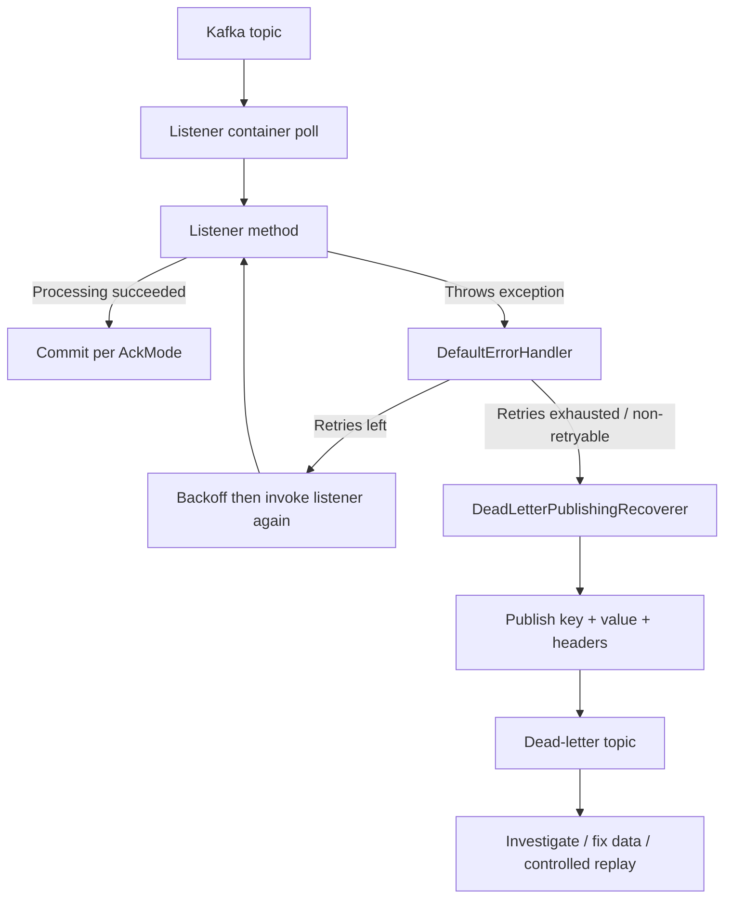

# Preserving Failed Keys and Payloads

When a record cannot be processed after the configured number of retries, Spring Kafka can move that record to a dead-letter topic (DLT). Moving a record is only useful when operations teams still have enough data to investigate and recover. The DLT must retain the key, payload, and source metadata so you know which entity the record belongs to, what the original content was, which topic/partition/offset it came from, and where the failure occurred.

`DeadLetterPublishingRecoverer` supports publishing failed records to a DLT. In the normal case, the recoverer preserves the input record's key and value while adding headers that describe its origin and exception. However, "preserving the payload" can mean two different things: preserving the deserialized object or preserving the exact bytes sent by the producer. You must choose serializers/deserializers and raw-byte storage that match your recovery requirements.

## 1. What Should a Failed Record Preserve?

A Kafka record has a key, value, headers, topic, partition, offset, and timestamp. When moving a failed record to a DLT, these parts serve different purposes:

| Component | Meaning when stored in DLT |
|---|---|
| Key | Identifies the entity, supports partitioning and replaying to the right stream |
| Value/payload | Event content to investigate or reprocess |
| Original headers | Correlation ID, trace ID, event type, schema version, and producer-supplied metadata |
| Original topic | Initial topic of the record |
| Original partition | Partition that held the record |
| Original offset | Position of the record in the source partition |
| Original timestamp | Timestamp attached to the original record |
| Exception headers | Error type, error message, and stack trace for investigation |
| Consumer group | Consumer group that processed the failed record |

Example input record:

```text
topic      = orders
partition  = 2
offset     = 184
key        = order-1024
value      = {"orderId":"order-1024","total":250000}
headers    = trace-id=abc-123, event-type=OrderCreated
```

After the recoverer sends it to the DLT, the record may look like:

```text
topic      = orders.DLT
partition  = 2
key        = order-1024
value      = {"orderId":"order-1024","total":250000}

headers:
  trace-id
  event-type
  kafka_dlt-original-topic       = orders
  kafka_dlt-original-partition  = 2
  kafka_dlt-original-offset     = 184
  kafka_dlt-exception-fqcn
  kafka_dlt-exception-message
  kafka_dlt-exception-stacktrace
```

Actual header names are provided by Spring Kafka through constants in `KafkaHeaders`, such as `DLT_ORIGINAL_TOPIC`, `DLT_ORIGINAL_PARTITION`, `DLT_ORIGINAL_OFFSET`, `DLT_ORIGINAL_TIMESTAMP`, `DLT_ORIGINAL_CONSUMER_GROUP`, `DLT_EXCEPTION_FQCN`, `DLT_EXCEPTION_MESSAGE`, and `DLT_EXCEPTION_STACKTRACE`. Use the constants matching your Spring Kafka version instead of scattering raw header strings.

The key and payload allow data recovery; original metadata locates the source record; exception headers explain why the record was routed to the DLT. Do not store only stack traces while discarding the key or payload, because without them it is hard to identify the entity and impossible to replay the original content.

## 2. Processing Flow from Listener to DLT

A common configuration combines `DefaultErrorHandler` with `DeadLetterPublishingRecoverer`:



`DefaultErrorHandler` decides retries and backoff timing. Once a record is deemed recovered by moving it to the DLT, `DeadLetterPublishingRecoverer` builds a new `ProducerRecord` and sends it via a Kafka producer.

The components have distinct responsibilities:

- The error handler determines how many times a record is retried, which exceptions are non-retryable, and when to invoke the recoverer.
- The recoverer chooses the destination topic/partition, creates the DLT record, preserves key/value, and attaches failure metadata.
- The DLT producer serializes key/value so the broker can store the new record.
- The DLT consumer reads failed records for investigation or replay workflows.

Moving a record to the DLT does not mean business processing succeeded. It is a technical recovery outcome: the record has been placed into failure storage and requires a separate process to handle next steps.

## 3. Configuring ErrorHandlingDeserializer to Avoid Losing Raw Payloads on Deserialization Errors

If the key or value fails to deserialize, the listener may never be invoked. For example, a producer sends malformed JSON, an incompatible schema, or corrupted byte payloads. Using `JsonDeserializer` directly causes the failure before the listener runs, making it difficult for the application to retrieve the original bytes from a deserialized object.

`ErrorHandlingDeserializer` wraps the actual deserializer. When the delegate fails to deserialize, it writes the exception details and raw bytes into the record's headers and returns null for the failed part. Spring Kafka error handling can use this metadata when routing the record to the DLT.

Configuration example:

```yaml
spring:
  kafka:
    bootstrap-servers: localhost:9092
    consumer:
      group-id: orders-service
      enable-auto-commit: false
      key-deserializer: org.springframework.kafka.support.serializer.ErrorHandlingDeserializer
      value-deserializer: org.springframework.kafka.support.serializer.ErrorHandlingDeserializer
      properties:
        "[spring.deserializer.key.delegate.class]": org.apache.kafka.common.serialization.StringDeserializer
        "[spring.deserializer.value.delegate.class]": org.springframework.kafka.support.serializer.JsonDeserializer
        "[spring.json.value.default.type]": com.example.orders.OrderEvent
        "[spring.json.trusted.packages]": com.example.orders
```

In this configuration:

- `ErrorHandlingDeserializer` is the outer wrapper for both key and value.
- The key delegate is `StringDeserializer`.
- The value delegate is `JsonDeserializer`.
- When deserialization succeeds, the listener receives normal key/value types.
- When the delegate fails, raw bytes and the exception are placed in headers for the error handler/recoverer to handle.

For a record whose key deserializes successfully while the value fails, the key can remain a `String` while raw value bytes are sent to the DLT. If key deserialization fails, the key observed by the listener/error handler may be null; raw key bytes are kept in the exception header so the recoverer can republish the original data.

This is why configuring `ErrorHandlingDeserializer` is essential when the DLT must preserve failed payloads even when they cannot be converted into Java objects.

## 4. Using DeadLetterPublishingRecoverer with DefaultErrorHandler

`DeadLetterPublishingRecoverer` is commonly used as the recoverer after `DefaultErrorHandler` exhausts retries. The following example sends failed records to a `.DLT`-suffixed topic while preserving the source partition number:

```java
import org.apache.kafka.common.TopicPartition;
import org.springframework.kafka.core.KafkaTemplate;
import org.springframework.kafka.listener.DeadLetterPublishingRecoverer;
import org.springframework.kafka.listener.DefaultErrorHandler;
import org.springframework.util.backoff.FixedBackOff;
import org.springframework.context.annotation.Bean;
import org.springframework.context.annotation.Configuration;

@Configuration
class DeadLetterConfiguration {

    @Bean
    DeadLetterPublishingRecoverer deadLetterPublishingRecoverer(
            KafkaTemplate<Object, Object> dltKafkaTemplate) {

        DeadLetterPublishingRecoverer recoverer =
                new DeadLetterPublishingRecoverer(
                        dltKafkaTemplate,
                        (record, exception) -> new TopicPartition(
                                record.topic() + ".DLT",
                                record.partition()
                        )
                );

        recoverer.setFailIfSendResultIsError(true);
        return recoverer;
    }

    @Bean
    DefaultErrorHandler kafkaErrorHandler(
            DeadLetterPublishingRecoverer recoverer) {

        return new DefaultErrorHandler(
                recoverer,
                new FixedBackOff(1_000L, 2L)
        );
    }
}
```

In this example, the record is retried twice with a one-second backoff after the initial processing attempt. If it still fails, the recoverer sends the record to a topic such as `orders.DLT`. Calling `setFailIfSendResultIsError(true)` instructs the recoverer to treat a DLT send failure as a recovery error; if the broker did not receive the DLT record, the application should not treat the source record as handled. This API is available in Spring Kafka versions supporting send-result checks; check your project dependencies.

Attach the error handler to the listener container factory:

```java
import org.springframework.boot.autoconfigure.kafka.ConcurrentKafkaListenerContainerFactoryConfigurer;
import org.springframework.context.annotation.Bean;
import org.springframework.kafka.config.ConcurrentKafkaListenerContainerFactory;
import org.springframework.kafka.core.ConsumerFactory;

@Bean
ConcurrentKafkaListenerContainerFactory<String, OrderEvent> ordersListenerFactory(
        ConcurrentKafkaListenerContainerFactoryConfigurer configurer,
        ConsumerFactory<String, OrderEvent> consumerFactory,
        DefaultErrorHandler kafkaErrorHandler) {

    var factory =
            new ConcurrentKafkaListenerContainerFactory<String, OrderEvent>();

    configurer.configure(factory, consumerFactory);
    factory.setCommonErrorHandler(kafkaErrorHandler);
    return factory;
}
```

Listener using this factory:

```java
import org.springframework.kafka.annotation.KafkaListener;

@KafkaListener(
        topics = "orders",
        groupId = "orders-service",
        containerFactory = "ordersListenerFactory"
)
public void onOrder(OrderEvent event) {
    orderService.process(event);
}
```

When processing succeeds, the container commits according to its acknowledgement mode. When the listener throws an exception, the error handler applies retry/backoff; when the recoverer publishes to the DLT successfully, the error handler can mark the record as recovered per container settings. Verify acknowledgement modes, transactions, and error handler semantics for your Spring Kafka version.

If DLT publishing fails, the recoverer should throw an error so the source record is not treated as recovered. Monitor DLT publish errors, as an unavailable DLT broker or topic can keep partitions blocked or retrying depending on configuration.

## 5. The DLT Producer Must Serialize Both Objects and Raw byte[]

This is the most critical point for preserving payloads. After successful listener deserialization, the value can be `OrderEvent`. When deserialization fails, the recoverer may need to send raw `byte[]` extracted from the exception header. Therefore, the DLT producer must handle both types.

If the DLT producer factory only configures `JsonSerializer`, sending a raw `byte[]` can fail. If it only uses `ByteArraySerializer`, a deserialized `OrderEvent` object cannot be sent either. Configure serializers to cover the actual data types the recoverer can publish.

One option is `DelegatingByTypeSerializer`, which maps each Java type to an appropriate serializer. The example below illustrates keys that can be `String` or raw bytes, and values that can be `OrderEvent`, `String`, or raw bytes:

```java
import java.util.HashMap;
import java.util.LinkedHashMap;
import java.util.Map;

import org.apache.kafka.clients.producer.ProducerConfig;
import org.apache.kafka.common.serialization.ByteArraySerializer;
import org.apache.kafka.common.serialization.Serializer;
import org.apache.kafka.common.serialization.StringSerializer;
import org.springframework.kafka.core.DefaultKafkaProducerFactory;
import org.springframework.kafka.core.ProducerFactory;
import org.springframework.kafka.support.serializer.DelegatingByTypeSerializer;
import org.springframework.kafka.support.serializer.JsonSerializer;

Map<String, Object> producerProperties = new HashMap<>();
producerProperties.put(
        ProducerConfig.BOOTSTRAP_SERVERS_CONFIG,
        "localhost:9092"
);

Map<Class<?>, Serializer<?>> keyDelegates = new LinkedHashMap<>();
keyDelegates.put(byte[].class, new ByteArraySerializer());
keyDelegates.put(String.class, new StringSerializer());

Map<Class<?>, Serializer<?>> valueDelegates = new LinkedHashMap<>();
valueDelegates.put(byte[].class, new ByteArraySerializer());
valueDelegates.put(String.class, new StringSerializer());
valueDelegates.put(OrderEvent.class, new JsonSerializer<>());

Serializer<Object> keySerializer =
        new DelegatingByTypeSerializer(keyDelegates, true);

Serializer<Object> valueSerializer =
        new DelegatingByTypeSerializer(valueDelegates, true);

ProducerFactory<Object, Object> dltProducerFactory =
        new DefaultKafkaProducerFactory<>(
                producerProperties,
                keySerializer,
                valueSerializer
        );
```

In a real application, `producerProperties` needs security settings and serializers for all valid key/value types such as `UUID`, `Long`, or other event types. Place more specific delegates before general delegates so a supertype does not match ahead of a subtype.

`DelegatingByTypeSerializer` constructors and delegate selection behavior vary by Spring Kafka version; check the API of your dependency. The configuration goal is: byte arrays go through `ByteArraySerializer`, Strings go through `StringSerializer`, and business objects go through a schema-compatible serializer. Do not force raw bytes into a JSON String, as that alters the original payload. Also test null keys/values, since tombstones have null values and some serializer dispatchers must be configured to handle nulls properly.

Create the dedicated template for the DLT:

```java
@Bean
KafkaTemplate<Object, Object> dltKafkaTemplate(
        ProducerFactory<Object, Object> dltProducerFactory) {
    return new KafkaTemplate<>(dltProducerFactory);
}
```

In applications with multiple event types, you can use multiple templates or a single producer factory with type-based serializer dispatch. What matters is that every type the recoverer might send is supported, including raw bytes on deserialization errors and null values on tombstones.

## 6. How Are Failed Keys and Payloads Preserved?

There are two main cases:

| Scenario | Value seen by listener/error handler | Data the recoverer needs to send |
|---|---|---|
| Deserialization succeeds, listener fails | Deserialized key/value | Key/value objects, re-serialized by the DLT producer |
| Value deserialization fails | Value may be null; exception header holds raw value bytes | Raw value bytes, plus key if key deserialized successfully |
| Key deserialization fails | Key may be null; exception header holds raw key bytes | Raw key bytes, plus value if value deserialized successfully |
| Both key and value fail deserialization | Both fields may be null | Raw key bytes and raw value bytes from their respective exception headers |
| Listener fails processing a tombstone | Key may be valid, value is null | Key and null value |

With `ErrorHandlingDeserializer`, Spring Kafka attaches exception headers containing deserialization details and raw bytes. `DeadLetterPublishingRecoverer` can recognize these headers and reuse the raw bytes for the corresponding key/value when publishing to the DLT.

For this reason, do not write a custom recoverer that simply grabs `record.key()` and `record.value()` while ignoring exception headers. Doing so can turn failed deserialization payloads into null and lose the original bytes. If a custom recoverer is needed, it must handle `DeserializationException` metadata stored in headers or reuse `DeadLetterPublishingRecoverer`.

### Keeping objects or keeping original bytes?

When deserialization succeeds, the recoverer typically republishes the deserialized key/value objects and the DLT producer serializes them again. Logical content is preserved, though the byte representation may differ due to JSON field ordering, whitespace, serializer version, type headers, or schema encoding.

If compliance or reconciliation requires byte-for-byte retention, do not assume a deserialized-and-reserialized object will match the original payload identically. Consider one of these approaches:

- Use `ByteArrayDeserializer` and deserialize in the application layer after saving the raw payload.
- Retain raw bytes in a separate envelope before converting to a domain object.
- Use a custom deserializer/recoverer that intentionally retains raw bytes alongside the object.
- Store raw payloads in an immutable object store and put a reference in the DLT if payloads are too large.

`ErrorHandlingDeserializer` preserves raw bytes when deserialization itself fails. It does not mean the listener always receives raw bytes for business errors that happen after successful deserialization.
## 7. Preserving Original Headers and Source Metadata

`DeadLetterPublishingRecoverer` creates a new record for the DLT. The new record receives its own broker-assigned topic/partition/offset; the source location is stored in DLT headers for traceability. Producer-sent headers such as trace ID or event type should also be kept if they aid investigation and replay.

Commonly useful source headers:

| Header | What is it used for? |
|---|---|
| `trace-id` / `correlation-id` | Finding logs and traces across services |
| `event-type` | Identifying the event kind |
| `schema-version` | Picking the right parser or schema |
| `tenant-id` | Identifying the tenant if allowed to store |
| `content-type` | Understanding payload format |
| `idempotency-key` | Identifying the business processing attempt |

DLT headers added by Spring Kafka typically include:

- Original topic, partition, offset, and timestamp.
- Consumer group that processed the record.
- Exception class name and message.
- Exception stack trace.

Do not assume every header is always preserved under every configuration. Headers can be altered by header mappers, custom recoverers, or header-stripping policies. If an application retries multiple times, watch out for accumulating duplicate stack traces or duplicate exception headers. Check the original/exception header management options in your exact Spring Kafka version.

If you need to attach custom metadata when moving to the DLT, you can use the recoverer's headers function:

```java
import java.nio.charset.StandardCharsets;

import org.apache.kafka.common.header.internals.RecordHeaders;

recoverer.setHeadersFunction((record, exception) -> {
    RecordHeaders headers = new RecordHeaders();

    headers.add(
            "recovery-source",
            "orders-service".getBytes(StandardCharsets.UTF_8)
    );

    headers.add(
            "failure-category",
            exception.getClass().getSimpleName()
                    .getBytes(StandardCharsets.UTF_8)
    );

    return headers;
});
```

This example demonstrates adding diagnostic headers. Verify the method signature and header-merging behavior for your version; do not overwrite important original headers with a brand-new header set if the goal is preserving record provenance.

## 8. Choosing the Partition for the DLT

A common strategy is preserving the source record's partition number:

```java
(record, exception) -> new TopicPartition(
        record.topic() + ".DLT",
        record.partition()
)
```

This keeps DLT partitions aligned with source partitions, making per-stream investigation convenient. However, the DLT topic must have enough partitions. If the source topic has 12 partitions and the DLT only has 3, sending a source record from partition 8 to partition 8 of the DLT will fail.

There are two approaches:

1. Create the DLT with as many or more partitions than the source topic if you need to preserve partition mapping.
2. Return partition `-1` in `TopicPartition` so the producer picks the target partition if preserving the partition number is unnecessary. The original partition is still recorded in the DLT header.

Example letting the producer choose the partition:

```java
(record, exception) -> new TopicPartition(
        record.topic() + ".DLT",
        -1
)
```

Whichever approach you choose, the record's key should still be kept for lookup and replay. Note that the DLT partition/offset is a new position; do not confuse it with the original partition/offset stored in headers.

## 9. Tombstones and Null Payloads

Kafka allows records that have a key but a null value. On compacted topics, such a record is typically a tombstone indicating deletion of the key's state. When a tombstone triggers a processing error, the DLT must preserve both the key and the null value.

Do not turn a null value into the string `"null"` or an empty JSON object. Those values carry a different meaning from a tombstone and can alter business logic during replay.

Checks to perform:

- The DLT producer/serializer must accept null values without substituting a dummy payload.
- The DLT consumer must distinguish a null value from a deserialization failure.
- If tombstones must be retained for long-term investigation, avoid using a compacted cleanup policy on the DLT because compaction can purge records sharing the key.
- For DLTs that need failure history, prefer time-based retention (`cleanup.policy=delete`) with a retention period suited to your handling workflow.

Example DLT consumer checking for null:

```java
@KafkaListener(
        topics = "orders.DLT",
        groupId = "orders-dlt-audit",
        containerFactory = "dltListenerFactory"
)
public void inspect(ConsumerRecord<byte[], byte[]> record) {
    if (record.value() == null) {
        log.warn(
                "DLT tombstone: keyBytes={}",
                record.key() == null ? 0 : record.key().length
        );
        return;
    }

    inspectPayload(record.key(), record.value());
}
```

This listener uses a container factory configured with `ByteArrayDeserializer` for key/value. Reading original topic, partition, and offset is illustrated completely in the next section.

## 10. Reading DLT Headers for Investigation

A DLT can contain both payloads serialized from business objects and raw bytes captured from deserialization errors. Using `JsonDeserializer` across the entire DLT can cause the DLT consumer itself to fail deserialization on invalid raw JSON bytes. For an investigation consumer, a reliable choice is using `ByteArrayDeserializer` for both key and value, then parsing payloads according to `event-type`, `content-type`, or `schema-version`.

Example DLT consumer factory configuration:

```java
import java.util.HashMap;
import java.util.Map;

import org.apache.kafka.clients.consumer.ConsumerConfig;
import org.apache.kafka.common.serialization.ByteArrayDeserializer;
import org.springframework.kafka.core.ConsumerFactory;
import org.springframework.kafka.core.DefaultKafkaConsumerFactory;

Map<String, Object> dltConsumerProperties = new HashMap<>();
dltConsumerProperties.put(
        ConsumerConfig.BOOTSTRAP_SERVERS_CONFIG,
        "localhost:9092"
);
dltConsumerProperties.put(
        ConsumerConfig.GROUP_ID_CONFIG,
        "orders-dlt-audit"
);
dltConsumerProperties.put(
        ConsumerConfig.KEY_DESERIALIZER_CLASS_CONFIG,
        ByteArrayDeserializer.class
);
dltConsumerProperties.put(
        ConsumerConfig.VALUE_DESERIALIZER_CLASS_CONFIG,
        ByteArrayDeserializer.class
);

ConsumerFactory<byte[], byte[]> dltConsumerFactory =
        new DefaultKafkaConsumerFactory<>(dltConsumerProperties);
```

Attach `dltConsumerFactory` to a listener container factory dedicated to the DLT. Reading bytes preserves the wire data for the DLT consumer; the application can decode String keys or JSON payloads after inspecting metadata. For tombstones, `record.value()` remains null.

Example reading key, value, and original location:

```java
import java.nio.ByteBuffer;
import java.nio.charset.StandardCharsets;

import org.apache.kafka.clients.consumer.ConsumerRecord;
import org.apache.kafka.common.header.Header;
import org.springframework.kafka.annotation.KafkaListener;
import org.springframework.kafka.support.KafkaHeaders;
import org.springframework.stereotype.Component;

@Component
class DeadLetterAuditListener {

    @KafkaListener(
            topics = "orders.DLT",
            groupId = "orders-dlt-audit",
            containerFactory = "dltListenerFactory"
    )
    public void onDeadLetter(ConsumerRecord<byte[], byte[]> record) {
        String originalTopic = readStringHeader(
                record, KafkaHeaders.DLT_ORIGINAL_TOPIC
        );
        Integer originalPartition = readIntegerHeader(
                record, KafkaHeaders.DLT_ORIGINAL_PARTITION
        );
        Long originalOffset = readLongHeader(
                record, KafkaHeaders.DLT_ORIGINAL_OFFSET
        );
        String exceptionMessage = readStringHeader(
                record, KafkaHeaders.DLT_EXCEPTION_MESSAGE
        );

        log.error(
                "Dead letter: keyBytes={}, valueBytes={}, source={}-{}@{}, error={}",
                record.key() == null ? 0 : record.key().length,
                record.value() == null
                        ? -1
                        : record.value().length,
                originalTopic,
                originalPartition,
                originalOffset,
                exceptionMessage
        );
    }

    private String readStringHeader(
            ConsumerRecord<?, ?> record,
            String headerName) {
        Header header = record.headers().lastHeader(headerName);
        return header == null
                ? null
                : new String(header.value(), StandardCharsets.UTF_8);
    }

    private Integer readIntegerHeader(
            ConsumerRecord<?, ?> record,
            String headerName) {
        Header header = record.headers().lastHeader(headerName);
        return header == null || header.value().length != Integer.BYTES
                ? null
                : ByteBuffer.wrap(header.value()).getInt();
    }

    private Long readLongHeader(
            ConsumerRecord<?, ?> record,
            String headerName) {
        Header header = record.headers().lastHeader(headerName);
        return header == null || header.value().length != Long.BYTES
                ? null
                : ByteBuffer.wrap(header.value()).getLong();
    }
}
```

The helpers above read topic and exception messages as UTF-8, and partition/offset as 4-byte/8-byte integers. Verify the header encoding used by your running Spring Kafka version before deploying to production; do not force every header to UTF-8 if a header may hold binary data.

For `byte[]` payloads, logging size and hash is usually safer than logging the entire content. You can store raw bytes in controlled storage and log only the storage reference.

## 11. Replaying Records from the DLT Back to the Original Topic

After fixing the root cause, operations teams can replay DLT records. Replaying must preserve the key and payload, while explicitly defining the target topic, partition strategy, headers to forward, and duplicate prevention.

A safe replay workflow:

1. Read the DLT record and inspect the original topic, key, payload, exception, and failure timestamp.
2. Confirm the root cause is fixed and the schema/payload can now be processed.
3. Check whether the event may have already been partially processed before failing.
4. Republish the key and payload to the target topic using the active partitioning strategy.
5. Preserve event ID, correlation ID, and required schema version; remove or clearly distinguish old DLT exception headers.
6. Audit the replay action: who requested it, timestamp, source record, and outcome.
7. Monitor consumer lag, processing results, and remaining records in the DLT.

Do not automatically replay the entire DLT on every service startup. Some records may contain poison payloads, invalid data, or unfixed bugs; unbounded replay creates an error loop.

Example manual replay service triggered after verification:

```java
import org.springframework.kafka.core.KafkaTemplate;
import org.springframework.stereotype.Service;

@Service
class DeadLetterReplayService {

    private final KafkaTemplate<Object, Object> kafkaTemplate;

    DeadLetterReplayService(
            KafkaTemplate<Object, Object> kafkaTemplate) {
        this.kafkaTemplate = kafkaTemplate;
    }

    void replay(
            String targetTopic,
            Object key,
            Object payload) {

        kafkaTemplate.send(targetTopic, key, payload);
    }
}
```

This example only illustrates the send call. A production replay tool needs authorization checks, auditing, duplicate detection, partition selection, header handling, and observation of the send future result. If the payload is raw bytes, the template must use a serializer supporting `byte[]`; if it is an object, the serializer must match the target topic's schema.

You do not necessarily replay to the exact old partition number. If the topic's partition count has changed, let the current partitioner pick the partition by key or use a designed resolver. Original partition/offset remain useful for tracing, but are not always a valid target partition.

## 12. Idempotency and Duplicate Processing Risks During Recovery

A DLT does not guarantee that side effects before the failure never happened. A listener might have written to a database or called an external service, then failed before committing the offset. When the record is redelivered or replayed, side effects can repeat.

For safe recovery:

- Use a stable event ID in the payload or header.
- Place unique constraints/idempotency keys where business state is persisted.
- Check aggregate version/sequence before applying older events.
- If a listener writes to a database and emits follow-up events, consider transactional outbox.
- Record replay status to prevent operators from sending the same record multiple times.
- Do not rely solely on the DLT offset as a system-wide idempotency key; it only locates the record within a DLT partition.

A resent record gets a new offset and a new timestamp on the target topic. Event IDs and aggregate versions provide business identity across the initial publish, DLT, and replay.

## 13. Protecting Data in the DLT

Payloads and exception headers can contain sensitive information. Stack traces sometimes expose class names, SQL statements, endpoints, input data, or configuration details. DLTs are also often retained longer than business topics for investigation.

Design for protection:

- ACLs restricting who can read, write, and replay the DLT.
- Replication factor and `min.insync.replicas` aligned with the criticality of failed data.
- Retention aligned with investigation windows and data policies.
- Encryption in transit and at rest per system requirements.
- Never put tokens, passwords, or secrets into Kafka headers.
- Limit logging of full payloads; prefer event IDs, log-safe keys, payload sizes, and hashes.
- Consider deleting or masking sensitive data upon retention expiration.
- Cap stack trace/header sizes to avoid oversized DLT records.

If payloads contain personal data, the DLT must still comply with storage and access policies at least as strict as the original topic. Never treat a DLT as indefinite storage.

## 14. Testing Key and Payload Preservation

Tests should verify both business-processing failure paths and deserialization failure paths. Do not only assert that a record appeared in the DLT; verify the key, value, raw bytes, and original metadata.

Scenarios to include:

| Scenario | Outcome to verify |
|---|---|
| Listener throws exception after deserialization | DLT contains matching key and logical payload |
| Invalid JSON value | DLT preserves raw value bytes |
| Key fails to deserialize | DLT preserves raw key bytes when `ErrorHandlingDeserializer` is configured |
| Both key and value fail | Both raw byte payloads are recoverable |
| Tombstone with key, null value | DLT retains key and null value |
| DLT producer cannot connect | Recoverer raises error; source record is not marked recovered |
| Target DLT partition does not exist | Test catches invalid partition routing |
| Record replay | Key, payload, event ID, and needed headers are preserved |
| Re-sending same event | Consumer is idempotent with no duplicate side effects |

An example test using Embedded Kafka or Testcontainers should:

1. Create source and DLT topics with proper partitions/retention.
2. Send a record with a key, JSON payload, and trace header.
3. Configure a listener to intentionally throw an exception after configured retries.
4. Read the record from the DLT with a test consumer.
5. Compare key, payload, original topic/partition/offset, and trace header.
6. Send an invalid JSON payload to verify raw bytes are preserved via `ErrorHandlingDeserializer`.
7. Test tombstones separately and confirm null is not turned into the string `"null"`.

If checking byte-for-byte fidelity, compare byte arrays directly. Do not deserialize both payloads and compare objects, as that only verifies logical meaning, not the original bytes.

## 15. Common Pitfalls

| Symptom | Cause | Resolution |
|---|---|---|
| DLT record has key but null value | Deserialization failed and raw bytes were not recovered, or serializer does not support `byte[]` | Use `ErrorHandlingDeserializer`, check exception headers and DLT serializer |
| DLT publish fails with `SerializationException` | DLT producer only supports one value type | Use type-dispatching serializer supporting objects and `byte[]` |
| Key is null even though source record had a key | Key deserialization failed or DLT serializer does not support raw key bytes | Configure key `ErrorHandlingDeserializer` and `byte[]` serializer |
| DLT payload differs from original bytes | Payload was deserialized and re-serialized | Use a raw-byte strategy if byte-for-byte retention is required |
| Cannot locate original topic/offset | DLT metadata headers were stripped or custom recoverer did not add them | Check original headers and header mapper |
| DLT publish fails yet offset advances | Recoverer does not fail on send error or error handling is misconfigured | Enable fail-on-send-error appropriately and test failure paths |
| DLT sent to non-existent partition | DLT has fewer partitions than source while resolver preserves partition number | Increase DLT partitions or let producer pick partition |
| Tombstones disappear after a while | DLT uses compaction and null value is treated as a delete marker | Use `delete` retention if failed tombstone history must be kept |
| Replay causes business duplicates | Side effects happened before failure or replay lacks idempotency | Use event IDs, unique constraints, and replay auditing |

## 16. Checklist for Preserving Failed Keys and Payloads

1. Use `DefaultErrorHandler` to define retry/backoff and `DeadLetterPublishingRecoverer` to publish to the DLT.
2. Enable `ErrorHandlingDeserializer` for key/value when raw bytes must be preserved on deserialization failure.
3. Use a DLT producer with serializers supporting all actual key/value types, including String, objects, and `byte[]`.
4. Verify the recoverer preserves key, value, and original headers; avoid writing custom recoverers that only copy deserialized values.
5. Retain original topic, partition, offset, timestamp, consumer group, and exception metadata.
6. Choose partition routing compatible with the DLT's partition count.
7. Preserve null values accurately as tombstones; avoid DLT compaction if keeping failure history.
8. Distinguish between preserving logical objects and preserving byte-for-byte payloads.
9. Design replay with auditing, idempotency, and access controls.
10. Test listener exceptions, deserialization failures, key failures, tombstones, and DLT publish failures.

A useful DLT must retain enough information for humans and systems to investigate, fix the root cause, and replay safely. `DeadLetterPublishingRecoverer` provides the foundation for preserving keys/values and source metadata; `ErrorHandlingDeserializer` protects raw bytes on deserialization failures; and the DLT producer must be able to serialize both deserialized data and original raw bytes.
