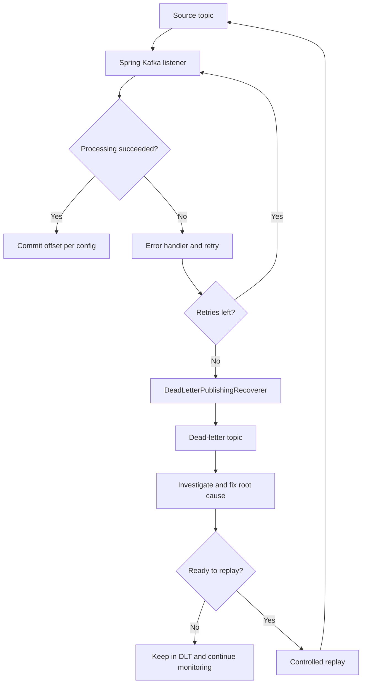

# Failed Record Replay Process

A dead-letter topic (DLT) stores records that a consumer could not process under the active retry policy. Moving a record to the DLT keeps the main stream moving, but it does not mean the incident is resolved. The record still needs to be investigated, the root cause fixed, and the record replayed through a controlled procedure to complete the business operation.

Replay means reintroducing a failed record into a consumption stream for reprocessing. Without proper controls, replaying can cause duplicate business effects, break event ordering, or create infinite loops between the source topic and the DLT. This lesson covers managing the lifecycle of DLT records, choosing a replay target, confirming successful sends, and controlling replay risks.

## 1. Lifecycle of a Record Entering the DLT

With a Spring Kafka consumer, the listener throws an exception when processing a record. The error handler executes retries according to backoff. Once retries are exhausted or the record hits a non-retryable error, the recoverer can publish the record to a DLT. After a successful publish, the source offset advances per error handler and container policy so the partition keeps progressing.



A DLT normally stores the payload, key, and original headers, while adding metadata about the source record and exception. This metadata identifies which topic, partition, and offset the record came from and why processing failed. Exact header names depend on the Spring Kafka version; common headers contain original topic, partition, offset, consumer group, exception class, message, and stack trace.

For example, if the `orders` topic has a failing record at partition 2, offset 145, the recoverer can send it to `orders.DLT` on the corresponding partition. During investigation, record both the record's location in the DLT and its original location in `orders`. These two locations differ: the DLT offset locates the record in failure storage, while the original offset traces the event in the source stream.

## 2. Investigating Before Replaying

Never replay as soon as a record appears in the DLT. First understand the root cause and confirm the bug is resolved. If nothing changed, the record will fail again and return to the DLT, adding load and operational noise.

An investigation checklist should answer:

1. **Which record failed?** Record event ID, key, source topic, partition, offset, timestamp, and consumer group.
2. **Where did it fail?** Inspect exception class, message, stack trace, and correlated logs from the listener, database, or downstream dependencies.
3. **Does the error still persist?** Check data, schema, permissions, configuration, and dependency health.
4. **Where must the fix happen?** You may need to repair data, deploy an application patch, restore a service, or update configuration.
5. **Can the record be safely re-executed?** Verify the event did not produce partial business side effects or that idempotency prevents duplicate processing.
6. **Where and how fast should it replay?** Choose target topic, partition, batch size, rate limit, and maintenance window.

| Signal in DLT | Investigation focus | Precondition before replay |
|---|---|---|
| Timeout or connection error | Inspect dependency health, connection pools, and response latency | Dependency has recovered and can handle replay load. |
| Invalid data | Inspect payload, schema, event version, and business rules | Data is corrected or the application now supports that format. |
| Deserialization error | Inspect raw payload bytes, serializer/deserializer, and schema registry if used | Target consumer can deserialize the payload; if needed, preserve raw bytes to republish after fixing config. |
| Code bug | Compare application version and stack trace | Fix is deployed and verified. |
| Downstream overload | Check lag, rate limits, connection pools, and serving capacity | Replay rate limit matches current capacity. |

Do not modify payloads inside the DLT arbitrarily. If data needs repair, record the original value, repaired value, operator, reason, and timestamp. This creates an audit trail explaining why an event was replayed with modified content.

## 3. Choosing a Replay Strategy

There are three common ways to reintroduce failed records into processing. Each suits a different goal.

| Strategy | Implementation | When appropriate | Controls needed |
|---|---|---|---|
| Replay to source topic | Publish the record back into the original topic | Want the record to traverse the exact original listener and business pipeline | New record gets a new offset; may land after newer events and affect ordering. |
| Replay to dedicated recovery topic | Publish to a topic specifically for recovered events | Want a separate controlled flow, validation, or compensating actions before updating state | Needs dedicated listener, schema, and operational workflow for the recovery topic. |
| Controlled manual handling | Tool or operator picks records, verifies content, and triggers replay | Small record volume, sensitive failures, or business approval required | Must record audit logs, prevent duplicate sends, and restrict operator permissions. |

Replaying to the source topic is often straightforward because records flow through the same consumer group and current logic. However, Kafka appends new records at the end of a partition. If earlier offsets moved on and newer events already updated business state, an older replayed record may be processed after them. For order-sensitive logic, check version, sequence, or current state before applying old events.

A recovery topic is useful when separating replays from live event production. It also limits write permissions on the source topic. Adding a topic does not automatically solve ordering or duplicates, though; the recovery consumer still needs event ID and business rule checks.

## 4. Preserving Metadata and Event Identity

When replaying, preserve stable business identifiers such as `eventId`, `orderId`, or `aggregateId`. Never generate a brand-new event ID for the same event simply because it is being resent. Consumers rely on the event ID to detect already-processed events and avoid repeating writes, deductions, or payments.

In addition to business metadata, retain provenance in dedicated headers, such as:

- `replay-source-topic`: the DLT topic containing the selected record.
- `replay-source-partition` and `replay-source-offset`: location of the record in the DLT.
- `replay-original-topic`, `replay-original-partition`, `replay-original-offset`: initial position in the source topic.
- `replay-request-id`, `replay-by`, and `replay-at`: request ID, operator or process executing the replay, and timestamp.
- `replay-reason`: resolved cause or linked investigation ticket.

Do not blindly copy every technical DLT header back to the source topic. Old exception headers can cause new processing attempts to look like they still carry old errors; some headers may have accumulated multiple values across repeated dead-lettering. Forward only needed business headers and attach namespaced replay metadata. Keep complete provenance in the source record or audit store for investigation.

## 5. Example Republishing Records with KafkaTemplate

The following example illustrates a replay service accepting an event already read and verified from the DLT and sending it back to the source topic. It assumes the payload has deserialized into `OrderEvent`; DLT reading and replay authorization happen in the caller layer.

```java
@Service
public class OrderReplayService {

    private final KafkaTemplate<String, OrderEvent> kafkaTemplate;

    public OrderReplayService(
            KafkaTemplate<String, OrderEvent> kafkaTemplate) {
        this.kafkaTemplate = kafkaTemplate;
    }

    public void replay(
            OrderEvent event,
            String originalTopic,
            Integer originalPartition,
            String sourceDlt,
            long sourceDltOffset,
            String replayRequestId) throws Exception {

        ProducerRecord<String, OrderEvent> record = new ProducerRecord<>(
                originalTopic,
                originalPartition,
                event.eventId(),
                event);

        record.headers().add(new RecordHeader(
                "replay-source-topic",
                sourceDlt.getBytes(StandardCharsets.UTF_8)));
        record.headers().add(new RecordHeader(
                "replay-source-offset",
                Long.toString(sourceDltOffset).getBytes(StandardCharsets.UTF_8)));
        record.headers().add(new RecordHeader(
                "replay-request-id",
                replayRequestId.getBytes(StandardCharsets.UTF_8)));

        kafkaTemplate.send(record).get(10, TimeUnit.SECONDS);
    }
}
```

In this example:

- `event.eventId()` is used as the key to preserve key-based routing if the producer and topic share the same partitioning strategy.
- `originalPartition` is passed when resending to the exact source partition and that partition still exists. If partition topology changed, pick a valid target partition or let the producer choose by key.
- `replay-*` headers capture source provenance and the replay request for tracing.
- `send(...).get(...)` waits for the send result within a timeout. Record a publish as successful only once the broker acknowledges per producer settings; handle timeouts or exceptions as indeterminate outcomes and verify before retrying.

Required imports include `ProducerRecord`, `RecordHeader`, `StandardCharsets`, `TimeUnit`, and corresponding Spring Kafka classes. Choose the `KafkaTemplate` types and serializers matching the target topic.

If publishing fails or times out, do not immediately mark the DLT record as replayed. A timeout can happen after the broker persisted the record but before the client received the ack. Retrying can create a duplicate. Rely on a stable event ID and consumer-side deduplication to handle this ambiguity.

## 6. Handling Replay for Deserialization Errors

Deserialization-failed records are a special case: the listener may never have been invoked because the consumer could not convert byte payloads into objects. The DLT may retain original data alongside headers describing the deserialization error, depending on `ErrorHandlingDeserializer` and recoverer configuration.

When replaying this kind of record, do not read the DLT with a consumer that forces deserialization into `OrderEvent` while the deserializer is still broken. Use `ByteArrayDeserializer` to read raw bytes, investigate the original format, and then resend intact bytes once the source consumer is fixed to read them.

```yaml
spring:
  kafka:
    consumer:
      key-deserializer: org.apache.kafka.common.serialization.ByteArrayDeserializer
      value-deserializer: org.apache.kafka.common.serialization.ByteArrayDeserializer
```

This configures a consumer reading raw DLT data; it does not have to match the business consumer configuration on the source topic. When republishing raw bytes, the producer must use `ByteArraySerializer` and carry over needed business headers. Avoid re-serializing a deserialized JSON string if the goal is preserving exact original bytes, since formatting, encoding, or type headers may change.

## 7. Preventing Duplicate Replays and Ordering Violations

Replay is a fresh publish, not rewinding offsets on the source topic. Consequently, a replayed record can be delivered again, and you cannot assume the consumer will see it only once.

Key safeguards:

1. **Idempotency by event ID.** Persist a processed-event marker in the same transaction as the business update. If the event ID already exists, skip re-applying business effects.
2. **Replay ledger.** Track DLT topic/partition/offset, event ID, request ID, status (`PENDING`, `SENT`, `FAILED`), and timestamps. Enforce a unique key to prevent two concurrent replay requests for the same record.
3. **Rate and batch limits.** Replay in small, pausable, resumable batches. Never dump the entire DLT onto the source topic right as a downstream recovers.
4. **Business version checks.** For aggregates with sequences or versions, apply an event only if valid against current state. This catches stale, late-arriving records.
5. **Partition checks.** Send back to the old partition only if it still exists and key/ordering policies allow it. Partition count changes alter key mappings for new records.
6. **Segregated replay permissions.** Only authorized tools or services may publish to source or recovery topics.

If a replay service reads the DLT with a consumer and publishes to the source topic, the typical sequence is publish first, then commit the DLT offset. If the app crashes after publishing but before committing the DLT offset, the record will be re-read and potentially republished. If you commit the DLT offset before publishing, a crash in between loses the chance to replay. Thus, publish-then-commit avoids losing records while requiring idempotency or a ledger to handle duplicates.

Within the same Kafka cluster, you can use a Kafka transaction to coordinate publishing the replayed record and committing the DLT consumer offset inside one Kafka transaction. This ensures both Kafka operations commit or abort together. It does not cover database transactions or external HTTP side effects; the target consumer still needs idempotency for non-Kafka effects.

## 8. Operational Replay Workflow

A production-ready workflow:

1. **Detect and classify.** Alert when DLT record count or oldest record age crosses thresholds. Operations groups failures by exception, source topic, and event type.
2. **Investigate.** Correlate DLT metadata with logs, traces, and dependencies. Identify root cause and affected record scope.
3. **Remediate.** Fix code, configuration, or data. Test with a representative record and confirm the source consumer operates normally.
4. **Plan the replay.** Pick the record set, target topic, partition, rate, batch size, execution window, and owner. Require business sign-off for sensitive events.
5. **Pilot a small batch.** Replay a few records, verify producer acks, consumer outcomes, event IDs, and final business state.
6. **Scale under monitoring.** Gradually raise batch size or rate if downstream has headroom. Watch consumer lag, new errors, duplicates, and records bouncing back to the DLT.
7. **Reconcile and close.** Compare selected, sent, succeeded, pending, and failed counts. Archive audit logs and document the root cause.

A simple reconciliation table can include these columns:

| Field | Purpose |
|---|---|
| `replayRequestId` | Groups records belonging to one replay execution. |
| `eventId` | Stable business identifier for duplicate detection. |
| `dltTopic`, `dltPartition`, `dltOffset` | Identifies the source record inside the DLT. |
| `originalTopic`, `originalPartition`, `originalOffset` | Traces back to the original position. |
| `status` | Tracks `PENDING`, `SENT`, `PROCESSED`, or `FAILED`. |
| `attemptedAt`, `completedAt` | Captures execution start and completion times. |
| `reason`, `operator` | Records justification and who requested the replay. |

## 9. Testing the Replay Process

Do not merely test that the producer can send a message. Verify the entire path from DLT to final business state:

- Replayed records retain event ID, key, and payload per policy.
- Replay headers carry provenance and request ID without accidentally retaining old exception headers.
- Producer send failures or timeouts do not cause the system to mark records as completed.
- Replaying the same DLT record repeatedly produces no duplicate business effects.
- Crashing after publish but before committing the DLT offset recovers safely on the next run.
- Replays target the right partition when it exists; behavior is well-defined if partition counts changed.
- Deserialization-failed records can be read as raw bytes and resent once the serializer/deserializer is fixed.
- Replay rate does not overload downstreams or spike consumer lag past thresholds.
- Audit logs trace who replayed which record, why, and the outcome.

Replay is complete when the record has been sent, the target consumer processes it successfully, and business state is reconciled. An ack from `KafkaTemplate` only proves the broker received the record per producer config; it does not prove the listener completed business logic. Track both phases and persist status accordingly.

A DLT is an isolation zone for investigation and recovery, not the end of an event's lifecycle. By preserving source metadata, fixing the root cause, bounding replays, and preventing duplicates, a Spring Kafka system can recover failed records while maintaining traceability and business consistency.
