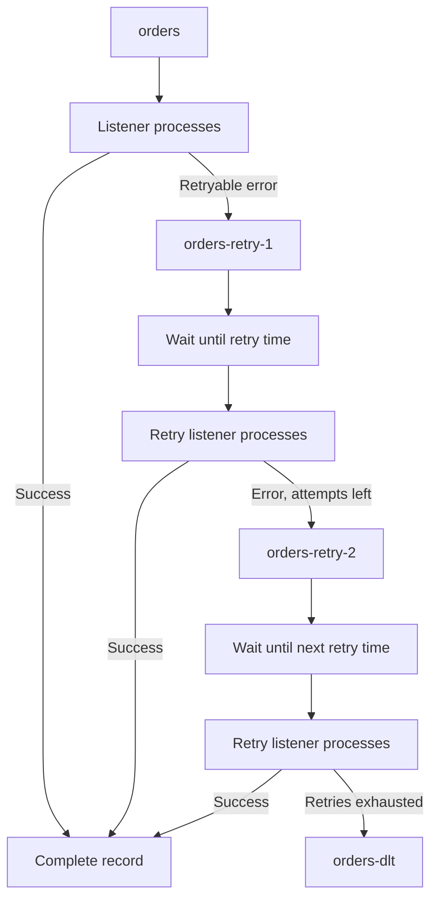

# @RetryableTopic and How to Declare It

When a Kafka record encounters a transient error, an application often wants to retry after a delay. With synchronous retry (*blocking retry*), the consumer holds processing of the current record and waits for the retry attempts to finish before moving on. This works well for flows that require ordering, but a persistently failing record can slow down the entire partition.

Spring Kafka provides a *non-blocking retry* mechanism based on retry topics. Instead of holding the record at the original consumer, the framework forwards the failed record to a retry topic, attaches metadata indicating when it is eligible to be retried, and lets the main topic consumption flow continue. When the due time arrives, a retry listener receives and processes the record; if it fails again, the record moves to the next retry topic or to the dead-letter topic (DLT).

The `@RetryableTopic` annotation lets you declare this topology and policy directly alongside `@KafkaListener`. This lesson focuses on how to declare it, how the framework routes records, and the trade-offs to understand when introducing non-blocking retry into a Spring Kafka application.

## 1. How Does Non-Blocking Retry Work?

Suppose a service consumes the `orders` topic. An order cannot be processed because the inventory service is temporarily unresponsive. With retry topics, the record can follow this flow:



Topic names in the diagram are illustrative only; actual names are generated according to the configured suffixes and naming strategy.

The flow has the following characteristics:

1. The consumer receives a record from the main topic and invokes the listener.
2. If the listener succeeds, the record is handled through the normal offset mechanism.
3. If the listener throws a retryable exception, the framework publishes the record to the corresponding retry topic.
4. Once forwarding is handled, the main topic consumer can continue receiving subsequent records.
5. The retry listener only processes the record once the backoff time has elapsed.
6. If the retry succeeds, the flow ends. If it fails, the record moves to the next retry level or to the DLT when attempts are exhausted.

Retry topics are real Kafka topics. Delay scheduling is coordinated by Spring Kafka's retry mechanism and timestamp metadata in the record; the broker does not natively turn a topic into a general-purpose timer queue.

## 2. Blocking Retry vs. Non-Blocking Retry

The two retry approaches address different needs:

| Criterion | Blocking retry | Non-blocking retry |
|---|---|---|
| Retry approach | Error handler retries within the container's processing flow | Forwards record to a retry topic |
| Main topic consumer | Can be blocked by the failing record | Can continue processing subsequent records after forwarding the failed record |
| Long delays | Can keep the consumer/partition waiting for a long time | Better suited for long wait durations |
| Ordering | Can preserve partition order when processed sequentially | Later records may be processed before the retrying record |
| Infrastructure | Primarily needs an error handler | Requires corresponding retry topics and a DLT |
| Key limitation | Total retry time affects poll intervals | Does not support batch listeners or container transactions |

For example, suppose a partition contains three records in order: A, B, C. If A fails and is forwarded to a retry topic, the main topic consumer can process B and then C while A is waiting. When A returns, the actual processing order may be B, C, A.

Therefore, non-blocking retry is appropriate when the ability to keep processing other records outweighs strict ordering. If events for the same aggregate must be applied sequentially, consider blocking retry, redesigning keys/partitions, or implementing a business workflow capable of enforcing order.

## 3. Basic @RetryableTopic Declaration

`@RetryableTopic` is placed alongside `@KafkaListener` on the handler method. The following example declares four total attempts with an exponentially increasing delay:

```java
import org.springframework.kafka.annotation.Backoff;
import org.springframework.kafka.annotation.KafkaListener;
import org.springframework.kafka.annotation.RetryableTopic;
import org.springframework.kafka.annotation.DltHandler;
import org.springframework.kafka.annotation.Header;
import org.springframework.kafka.support.KafkaHeaders;

@Component
public class OrderListener {

    private final OrderService orderService;

    public OrderListener(OrderService orderService) {
        this.orderService = orderService;
    }

    @RetryableTopic(
            attempts = "4",
            backoff = @Backoff(
                    delay = 1_000,
                    multiplier = 2.0,
                    maxDelay = 10_000
            ),
            retryTopicSuffix = "-retry",
            dltTopicSuffix = "-dlt"
    )
    @KafkaListener(
            topics = "orders",
            groupId = "order-service"
    )
    public void consume(OrderEvent event) {
        orderService.process(event);
    }

    @DltHandler
    public void handleDlt(OrderEvent event) {
        // Record for investigation or route to a manual processing workflow.
    }
}
```

In this example:

- `attempts = "4"` is the total number of processing attempts, including the first attempt on the main topic. That means at most three retries after the initial attempt.
- `delay = 1_000` sets the initial wait interval to one second.
- `multiplier = 2.0` doubles the wait interval on each step.
- `maxDelay = 10_000` caps each wait interval at ten seconds.
- `retryTopicSuffix` and `dltTopicSuffix` customize the topic name suffixes.
- `@DltHandler` marks the method that handles records reaching the DLT within the same listener class.

With this example, the wait intervals can be 1, 2, and 4 seconds before the three retries. If the listener continues to fail on the final attempt, the record is sent to the DLT. Actual wait intervals also depend on the backoff configuration and how Spring Kafka creates and reuses retry topics.

Some annotation attributes use string types, such as `attempts`. Be sure to use the exact value types required by the API when configuring via annotations.

## 4. Choosing Attempt Counts and Backoff

The number of attempts and backoff delays determine the maximum time a record can remain in the retry flow. Choose them based on dependency recovery times and business requirements.

For example, with:

```java
@RetryableTopic(
        attempts = "4",
        backoff = @Backoff(
                delay = 1_000,
                multiplier = 2.0,
                maxDelay = 10_000
        )
)
```

You can visualize the retry schedule as follows:

| Attempt | Processing location | Wait time before attempt |
|---|---|---:|
| 1 | Main topic | None |
| 2 | Retry topic level 1 | 1 second |
| 3 | Retry topic level 2 | 2 seconds |
| 4 | Retry topic level 3 | 4 seconds |
| After attempt 4 fails | DLT | No more retries |

`attempts` includes the first attempt. If `attempts = "1"` is set, the record is only processed on the main topic; there are no subsequent retries, and a failed record is handled according to the DLT policy.

Some considerations when choosing a policy:

- A delay that is too short may cause retry topics to repeatedly hammer a dependency that is still unhealthy.
- A delay that is too long keeps records in the retry flow longer and increases completion latency.
- Too many attempts may cause records to reach the DLT very late.
- With exponential backoff, set an upper bound so wait times do not grow unexpectedly.
- If multiple delay tiers are needed, clearly define each tier and inspect the topic topology generated by the framework.

Do not pick an attempt count based solely on a default number. Measure actual dependency recovery times and set thresholds aligned with the event's SLA.

## 5. Classifying Retryable Exceptions

Not every exception should pass through retry topics. Network glitches or transient dependency failures can resolve themselves; malformed data or business rule violations usually cannot be fixed simply by waiting.

You can use `include` to explicitly declare which exception types should be retried:

```java
@RetryableTopic(
        attempts = "4",
        backoff = @Backoff(delay = 1_000, multiplier = 2.0),
        include = {
                TemporaryInventoryException.class,
                RemoteServiceUnavailableException.class
        }
)
@KafkaListener(topics = "orders", groupId = "order-service")
public void consume(OrderEvent event) {
    orderService.process(event);
}
```

You can use `exclude` to exclude errors that should not be retried:

```java
@RetryableTopic(
        attempts = "4",
        backoff = @Backoff(delay = 1_000),
        exclude = {
                InvalidOrderException.class,
                UnsupportedCurrencyException.class
        }
)
@KafkaListener(topics = "orders", groupId = "order-service")
public void consume(OrderEvent event) {
    orderService.process(event);
}
```

Choose a classification policy that is easy to understand. `include` declares exception types admitted into the retryable group; `exclude` filters out exception types that should not be retried. Verify how combined rules and defaults behave in the Spring Kafka version you are running, especially when the application only wants to retry a narrow set of errors.

Some errors appear as wrapped exceptions (causes). When classifying, check the cause-traversal configuration and ensure the actual exception thrown by the listener is recognized accurately. Also examine errors occurring before the listener executes, such as deserialization errors; they may follow a separate error-handling path depending on the container configuration and version.

## 6. Handling Records at the Dead-Letter Topic

The DLT receives records that have exhausted retries or been routed directly to dead-letter per the exception policy. The DLT allows the system to isolate failing events from the main flow for investigation, data correction, or later replay.

A `@DltHandler` method can persist the record and relevant details:

```java
@DltHandler
public void handleDlt(
        OrderEvent event,
        @Header(KafkaHeaders.RECEIVED_TOPIC) String topic) {

    log.error("Order event moved to DLT topic {}", topic);
    dltService.saveForInvestigation(event);
}
```

In practice, store additional metadata such as the original topic, partition, offset, key, timestamp received, and exception details. Spring Kafka adds headers describing the origin and error when forwarding a record to the DLT; exact header names and details can be verified against the version in use.

Do not merely log and ignore records if the business requires recovery. Define who or which process will review the DLT, how data is corrected, how replays are performed, and how to prevent applying the same event twice.

The DLT is also a Kafka stream that can encounter errors. If the DLT handler method fails, a dedicated monitoring and recovery policy is needed. Do not assume a record in the DLT is always processed successfully just because it left the retry flow.

## 7. Topic Naming and Retry Topology

Spring Kafka generates retry topics based on the backoff configuration and suffix strategy. You can customize suffixes for retry topics and the DLT:

```java
@RetryableTopic(
        attempts = "4",
        retryTopicSuffix = "-retry",
        dltTopicSuffix = "-dlt"
)
@KafkaListener(topics = "orders")
public void consume(OrderEvent event) {
    orderService.process(event);
}
```

Conceptually, the topology may include:

| Role | Example name |
|---|---|
| Main topic | `orders` |
| Retry topic for first wait | `orders-retry-...` |
| Retry topic for subsequent wait | `orders-retry-...` |
| Dead-letter topic | `orders-dlt` |

The exact suffix depends on `TopicSuffixingStrategy` and whether topics with the same delay are reused. Avoid hardcoding retry topic names in business producers or consumers; let the framework manage routing or configure topic names consistently.

In production, you can let the framework create topics if the environment allows, or proactively provision them through infrastructure workflows. When provisioning manually, account for partition count, replication factor, retention, and publish/consume permissions for the involved services. Disabling auto-creation without creating all required topics will prevent the retry flow from working as expected.

## 8. Partitions, Keys, and Processing Order

Retry topics are separate topics from the main topic, so partition mapping must be considered. If the original record is on partition 3, the framework typically needs to forward it to the corresponding partition on the retry topic to preserve partition distribution. Therefore, retry topics should have a compatible partition count, usually equal to or greater than the main topic according to the routing strategy in use.

If the main topic has six partitions, design retry topics with at least six partitions when original partition mapping must be preserved. Partition count configuration must align with the actual topology; do not assume auto-creation defaults match the main topic.

Record keys are also crucial. The same key usually hashes to the same partition within a topic, yet passing through a retry topic still does not restore global ordering between a retrying record and records that continued on the main topic.

For example:

1. Event A for order 101 fails and is sent to the retry topic.
2. Event B for order 101 arrives later and is immediately processed on the main topic.
3. Event A is subsequently retried and succeeds.

If business logic requires A to complete before B, non-blocking retry can break that requirement. You can use blocking retry, partition/isolate flows by aggregate, track version numbers, or design consumers to check ordering before applying events.

## 9. Limitations to Know

Non-blocking retry comes with several important architectural limitations:

- Batch listeners are not supported in the non-blocking retry mechanism.
- Cannot be combined with container transactions.
- Does not guarantee processing order between records forwarded to retry topics and subsequent records on the main topic.
- Increases the number of topics, consumer flows, ACL configurations, and observability demands.
- Event completion latency increases according to the retry schedule.
- The DLT requires its own handling and replay procedures.

If the application needs Kafka transactions on the listener container, or needs to process an entire batch as a transactional unit, use an appropriate blocking retry strategy. Do not enable `@RetryableTopic` assuming that the listener transaction protects the entire forwarding chain across retry topics.

Non-blocking retry also does not make business side effects exactly-once. An event can be reprocessed due to publishing failures, consumer restarts, or replays. Database writes, API calls, or downstream event emissions still require idempotency and appropriate coordination mechanisms.

## 10. Configuring Topics and Listeners in the Application

In a Spring Boot application, ensure listeners use the proper Kafka configuration and retry topics have the required access permissions. When declared via annotations, the framework handles most of the topology; when configured programmatically, Spring Kafka provides `RetryTopicConfigurationBuilder` to construct retry policies for selected topics.

Examples of settings to align across environments:

| Component | What to configure |
|---|---|
| Main topic | Partition count, replication, retention |
| Retry topic | Compatible partition count, retention long enough for backoff |
| DLT | Write permissions, retention, owner/processing workflow |
| Producer | Serializers compatible with original and retry/DLT records |
| Consumer | Group ID, concurrency, and read permissions across topics |
| ACLs | Read/write permissions for main, retry, and DLT topics |
| Monitoring | Consumer lag, retry record count, DLT rate, and publish errors |

In particular, retry topic retention must be long enough so records are not purged before their retry time arrives. Also check message size limits and serializers for both payloads and headers.

## 11. When Should You Use @RetryableTopic?

Consider `@RetryableTopic` when:

- An event may need to wait several seconds or longer for a dependency to recover.
- The consumer needs to continue processing other records on the main topic.
- Business rules allow later records to be processed before retrying records.
- Operating additional retry topics and a DLT is feasible.
- The flow does not rely on batch listeners or container transactions.

Prefer blocking retry when:

- Preserving in-partition ordering is mandatory.
- Retries need to happen immediately and last only a short duration.
- The listener flow requires container transactions.
- The application consumes in batches and wants error handling at the batch/record level via an error handler.

## 12. Testing Non-Blocking Retry

A test that only verifies a listener receives an event once is insufficient. Verify the full path across topics:

1. The listener receives a record from the main topic and throws a retryable exception.
2. The record appears on the retry topic according to the policy.
3. Backoff headers and origin metadata are preserved appropriately.
4. The retry listener receives the record again after the wait period.
5. If processing succeeds, the record does not advance to another retry topic.
6. If all attempts fail, the record is sent to the DLT.
7. Non-retryable exceptions go straight to the DLT per policy.
8. The DLT handler captures payload and metadata for investigation.
9. The consumer group continues processing new records on the main topic while old records await retry.
10. Partition mapping, keys, and access permissions work across all retry topics.

You can use Embedded Kafka or Testcontainers to run integration tests against a broker. Use short backoff delays in tests to avoid long waits, while still asserting topic transitions and attempt counts. To test ordering behavior, produce multiple records with the same key and observe the actual order when one record is retried.

## 13. Common Implementation Mistakes

| Symptom | Possible cause | Resolution |
|---|---|---|
| Retry topics not visible | Topics not created or auto-create disallowed | Provision topics and check topic creation configuration |
| Records go straight to DLT | Exception not in the retryable group | Check `include`/`exclude` and exception causes |
| Retry topic receives no records | Producer/ACL/serializer error during forwarding | Check publish logs and write permissions |
| Records do not return on time | Backoff timestamp or retry topic consumer issue | Inspect headers, lag, and listener container state |
| Consumer lag grows on retry topic | Dependency still failing or retry schedule too long | Adjust backoff and monitor dependency health |
| Events processed out of order | Failed record diverted from the main topic | Choose blocking retry or enforce business versioning |
| DLT grows continuously | Data issue or prolonged dependency outage | Classify exceptions, alert, and investigate DLT |
| Records deleted early from retry topic | Retention shorter than wait duration | Increase retention to match retry policy |

## 14. Production Readiness Checklist

- [ ] Confirmed the flow can tolerate later records being processed before retrying records.
- [ ] Listener uses a record listener, not a batch listener, for non-blocking retry.
- [ ] Flow does not depend on container transactions.
- [ ] `attempts` accounts for the initial processing attempt.
- [ ] Backoff has appropriate delay, multiplier, and upper limit.
- [ ] Exceptions are clearly classified via `include`/`exclude` or equivalent policy.
- [ ] Retry topics and DLT are provisioned with compatible partitions and sufficient retention.
- [ ] Producers, consumers, and ACLs have necessary permissions across all topics.
- [ ] DLT handler and investigation/replay procedures are defined.
- [ ] Business side effects can tolerate duplicate processing.
- [ ] Metrics and alerts exist for retry rate, DLT rate, lag, and publish failures.
- [ ] Tested success, retry, exhausted retries, non-retryable exceptions, and ordering behavior.

`@RetryableTopic` helps Spring Kafka implement non-blocking retry by routing failed records through retry topics before sending them to a DLT. This frees the main topic flow to process subsequent records, at the cost of managing topic topology and accepting potential reordering. Choose it when business logic suits asynchronous handling, explicitly define attempts and backoff, and design DLT handling, partitioning, idempotency, and monitoring from the start.

