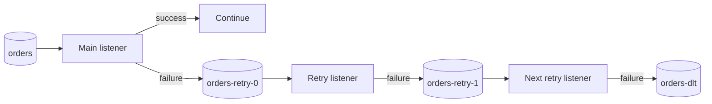

# Retry Topic Naming and Count

Spring Kafka non-blocking retry forwards failed records to retry topics so the consumer can continue processing other records in the main topic. Retry topics are created based on the backoff schedule and naming rules; after exhausting all attempts, the record can be forwarded to a dead-letter topic (DLT). When designing this flow, distinguish between **attempt count**, **retry count**, and **retry topic count**, because these three numbers are not necessarily equal.

In the `SPRING_KAFKA_MESSAGING` module, producers send events with `KafkaTemplate`, and consumers handle them with `@KafkaListener`. `@RetryableTopic` lets Spring Kafka construct a topology consisting of the main topic, retry topics, and a DLT. Topic names and counts directly impact partition counts, replication, broker resources, ACLs, monitoring, and operations when deploying multiple application versions.

Listener examples in this lesson use the following event and service contract:

```java
public record OrderCreatedEvent(
        String eventId,
        String orderId
) {}

public interface OrderApplicationService {
    void handle(OrderCreatedEvent event);
    void recordFailedEvent(OrderCreatedEvent event);
}
```

## 1. Retry Topics in Non-Blocking Retry

With blocking retry, the consumer pauses processing at the failed record and retries before advancing to the next record. With non-blocking retry, the failed record is forwarded to a retry topic; the main topic consumer can continue processing other records.



A retry topic is a real Kafka topic. It has partitions, a replication factor, retention, ACLs, and a listener/consumer handling it in the retry topology. Topic names are not mere display labels; they are part of the operational structure of the retry flow.

## 2. Distinguishing attempts, retries, and retry topics

`attempts` in `@RetryableTopic` specifies the maximum total number of processing attempts, including the initial attempt on the main topic.

| Configuration | Max processing attempts | Retries after initial attempt |
|---|---:|---:|
| `attempts = "1"` | 1 | 0 |
| `attempts = "2"` | 2 | 1 |
| `attempts = "3"` | 3 | 2 |
| `attempts = "4"` | 4 | 3 |
| `attempts = "5"` | 5 | 4 |

For example, `attempts = "4"` means the listener has at most four processing attempts: one on the main topic and three in the retry flow. If all attempts fail, the record is forwarded to the DLT as configured.

**Retry count is not retry topic count.** Multiple retries can share the same retry topic if their delays match and the naming/reuse strategy allows it. Conversely, a backoff schedule with multiple distinct delays usually produces multiple retry destinations.

## 3. Components That Form Retry Topic Names

Topic names are typically composed of:

- The main topic name, for example `orders`.
- `retryTopicSuffix`, the common retry topic suffix, for example `-retry`.
- The index or delay suffix segment, depending on `TopicSuffixingStrategy`.
- `dltTopicSuffix`, the dead-letter topic suffix, for example `-dlt`.

Explicitly configure suffixes rather than relying on library version defaults. For example:

```java
@RetryableTopic(
        attempts = "4",
        retryTopicSuffix = "-retry",
        dltTopicSuffix = "-dlt"
)
```

With main topic `orders`, the base names become `orders-retry...` for retry topics and `orders-dlt` for the DLT. The portion after `-retry` depends on the suffixing strategy.

## 4. Index-Based Naming: `SUFFIX_WITH_INDEX`

`TopicSuffixingStrategy.SUFFIX_WITH_INDEX` appends the retry index to the topic name. For example, with `attempts = "4"`, there are three retries:

```text
Original topic: orders

orders
orders-retry-0
orders-retry-1
orders-retry-2
orders-dlt
```

Advantages of index-based suffixes:

- Looking at the name reveals which retry stage in the topology holds the record.
- Each retry stage has its own topic, making it convenient to monitor per-stage lag and throughput.
- You do not need to infer topic names from delay values.

On the other hand, the number of retry topics can scale with the configured retry count. With fixed backoff and many retries, the topology may create multiple topics even when attempts share the same wait interval.

## 5. Delay-Based Naming: `SUFFIX_WITH_DELAY`

`TopicSuffixingStrategy.SUFFIX_WITH_DELAY` uses the delay duration as the suffix segment. For example, an exponential backoff schedule with delays of 1 second, 2 seconds, and 4 seconds:

```text
Original topic: orders

orders
orders-retry-1000
orders-retry-2000
orders-retry-4000
orders-dlt
```

The topic name reflects the delay in milliseconds. This makes it easy to cross-reference with the backoff schedule and allows sharing a destination for retries with the same delay.

Configuration example:

```java
import org.springframework.kafka.retrytopic.TopicSuffixingStrategy;
import org.springframework.retry.annotation.Backoff;
import org.springframework.kafka.retrytopic.RetryableTopic;

@RetryableTopic(
        attempts = "4",
        backoff = @Backoff(delay = 1_000, multiplier = 2.0),
        topicSuffixingStrategy = TopicSuffixingStrategy.SUFFIX_WITH_DELAY,
        retryTopicSuffix = "-retry",
        dltTopicSuffix = "-dlt"
)
```

With this schedule, the three retries have delays of 1,000 ms, 2,000 ms, and 4,000 ms respectively. The corresponding topic names are `orders-retry-1000`, `orders-retry-2000`, and `orders-retry-4000`.

## 6. Calculating Retry Topic Count from the Backoff Schedule

Calculate the retry attempts first, then derive the destinations. Given:

```java
@RetryableTopic(
        attempts = "5",
        backoff = @Backoff(
                delay = 1_000,
                multiplier = 2.0,
                maxDelay = 5_000
        ),
        topicSuffixingStrategy = TopicSuffixingStrategy.SUFFIX_WITH_DELAY
)
```

The maximum processing attempts is five, consisting of one initial attempt and four retries. Delay schedule:

| Attempt | Processing location | Delay before attempt |
|---|---|---:|
| 1 | Main topic `orders` | 0 ms |
| 2 | Retry topic | 1,000 ms |
| 3 | Retry topic | 2,000 ms |
| 4 | Retry topic | 4,000 ms |
| 5 | Retry topic | 5,000 ms (capped at `maxDelay`) |

With delay-based suffixes, the corresponding retry topic names are `orders-retry-1000`, `orders-retry-2000`, `orders-retry-4000`, and `orders-retry-5000`. If the fifth attempt still fails, the record goes to `orders-dlt`.

`maxDelay` caps the backoff delay; it does not limit the number of retries. `attempts` is what determines the maximum total number of processing attempts.

## 7. Fixed Backoff and Reusing Topics with the Same Delay

With fixed backoff, every retry has the same wait interval. For example, `attempts = "4"` and `delay = 1_000` creates three retries all having a 1-second delay.

If using delay-based suffixes, retries with the same delay can point to the same name `orders-retry-1000`. If using index-based suffixes, the topology can create separate topics such as `orders-retry-0`, `orders-retry-1`, `orders-retry-2`.

Some Spring Kafka versions support `SameIntervalTopicReuseStrategy` to control retry topic reuse when multiple attempts share the same delay. For example:

```java
import org.springframework.kafka.retrytopic.SameIntervalTopicReuseStrategy;
import org.springframework.kafka.retrytopic.TopicSuffixingStrategy;

@RetryableTopic(
        attempts = "4",
        backoff = @Backoff(delay = 1_000),
        topicSuffixingStrategy = TopicSuffixingStrategy.SUFFIX_WITH_INDEX,
        sameIntervalTopicReuseStrategy = SameIntervalTopicReuseStrategy.SINGLE_TOPIC
)
```

`SINGLE_TOPIC` requests reusing a single topic for retries sharing the same delay; `MULTIPLE_TOPICS` keeps separate destinations per retry attempt. This attribute depends on the Spring Kafka version, so verify your API version before applying it. If you want a predictable topology across versions, explicitly declare the suffixing strategy and inspect the generated topic list in integration tests.

## 8. Complete `@RetryableTopic` Example

Example listener handling order events with four total attempts, exponential backoff, and index-based suffixes:

```java
import org.springframework.kafka.annotation.DltHandler;
import org.springframework.kafka.annotation.KafkaListener;
import org.springframework.kafka.retrytopic.TopicSuffixingStrategy;
import org.springframework.retry.annotation.Backoff;
import org.springframework.kafka.annotation.RetryableTopic;
import org.springframework.stereotype.Component;

@Component
public class OrderEventListener {

    private final OrderApplicationService orderService;

    public OrderEventListener(OrderApplicationService orderService) {
        this.orderService = orderService;
    }

    @RetryableTopic(
            attempts = "4",
            backoff = @Backoff(delay = 1_000, multiplier = 2.0),
            topicSuffixingStrategy = TopicSuffixingStrategy.SUFFIX_WITH_INDEX,
            retryTopicSuffix = "-retry",
            dltTopicSuffix = "-dlt"
    )
    @KafkaListener(topics = "orders", groupId = "orders-service")
    public void listen(OrderCreatedEvent event) {
        orderService.handle(event);
    }

    @DltHandler
    public void handleDlt(OrderCreatedEvent event) {
        orderService.recordFailedEvent(event);
    }
}
```

With `attempts = "4"`, the listener has at most one attempt on the main topic and three attempts in the retry flow. The DLT handler receives the record after retries are exhausted and recovery routes the record to the DLT. The DLT handler needs logging/alerting and an appropriate processing workflow; do not simply discard records.

Annotation import packages may vary by Spring Kafka version; use the exact packages from your project's dependencies. `@RetryableTopic` applies to non-blocking retry for record listeners; do not treat it as a replacement for blocking retry on batch listeners or transactional listeners.

## 9. Estimating Total Topic Count

For a topology serving one main topic, a simple estimate is:

```text
Total topics = 1 original topic + number of distinct retry topics + 1 DLT
```

Examples:

| Backoff and suffix | Retry topics | Total topics including main + retry + DLT |
|---|---:|---:|
| 3 retries, distinct exponential delays, delay suffix | 3 | 5 |
| 3 retries, distinct exponential delays, index suffix | 3 | 5 |
| 3 retries same delay, delay suffix | 1 destination per delay | 3 |
| 3 retries same delay, index suffix, reuse `SINGLE_TOPIC` | 1 | 3 |
| 3 retries same delay, index suffix, reuse `MULTIPLE_TOPICS` | 3 | 5 |

This is an estimate for a single listener/topic retry topology. Actual topic counts also depend on DLT configuration, reuse strategy, listener endpoints, whether retry destinations are shared, and the Spring Kafka version. Verify actual topics after the application starts.

## 10. Partition Count and Replication of Retry Topics

Topic count is only part of the cost. Each retry topic and DLT also has partitions and replicas. If the main topic has `P` partitions, each retry topic needs a partition count compatible with your routing strategy and application ordering requirements. If the recoverer or retry topology preserves the record's partition index, retry/DLT topics must have matching partitions.

For example, a topology with a 12-partition main topic, three retry topics, and one DLT, all with 12 partitions:

```text
Topic count       = 1 + 3 + 1 = 5
Partition count   = 5 * 12 = 60
Replica count     = 60 * replication factor
```

With a replication factor of three, the cluster must store roughly 180 partition replicas. This figure excludes other internal topics and may vary depending on actual configuration.

When provisioning retry topics manually, align partition counts, replication factors, retention, cleanup policies, and ACLs. If using Spring Kafka auto-create topics, configure partition/replica counts appropriately for the cluster; do not leave retry topics defaulting to a single partition when the source topic has multiple partitions and routing preserves partition indices.

## 11. Choosing Stable Topic Names and Avoiding Conflicts

Retry topic names are part of the operational contract. Changing suffixes, naming strategies, or backoff schedules can introduce new topics while old topics still hold records or active consumers.

Some guidelines:

- Choose `retryTopicSuffix` and `dltTopicSuffix` consistently according to system conventions.
- Prevent two independent listeners from accidentally generating the same retry topic name with different backoff or DLT policies.
- If multiple listeners consume the same main topic, decide explicitly whether they can share a retry topology or require separate suffixes.
- Do not arbitrarily rename suffixes during rolling deployments; plan how to drain records still sitting in old retry topics.
- Name topics so they are easily traceable to the source topic and retry stage.
- Document actual topic names in dashboards, ACLs, and runbooks.

For example, two independent processing flows can use distinct suffixes:

```java
@RetryableTopic(
        attempts = "4",
        retryTopicSuffix = ".billing-retry",
        dltTopicSuffix = ".billing-dlt"
)
```

Use separate suffixes only when topology isolation is needed. If two consumer groups share the same policy and operational ownership, a shared topology may be used after thorough testing.

## 12. Delay Time Does Not Guarantee Exact Execution Time

Backoff delay is a minimum/target interval before a record advances through the next retry stage; actual listener execution time also depends on consumer polls, lag, partition count, broker load, and the retry mechanism's internal scheduler.

For example, a 5-second delay does not mean the listener will necessarily re-run at exactly the fifth second. If the retry topic has lag, the record may be processed later. Therefore:

- Do not use retry delays as an exact business timer/scheduler.
- Monitor consumer lag on every retry topic.
- Set retention long enough so records do not expire before reprocessing.
- Account for total retry duration alongside business timeouts.
- Use a dedicated scheduler or workflow engine when exact timing or multi-hour/multi-day retries are required.

## 13. Ordering and the Impact of Multiple Retry Topics

Non-blocking retry lets the main topic partition continue processing subsequent records while a failed record waits in a retry topic. This improves throughput but alters the observed processing order.

Example:

```text
orders partition 0:
  offset 10: OrderCreated(order-1) -> sent to retry
  offset 11: OrderUpdated(order-1) -> processed successfully

orders-retry-0:
  OrderCreated(order-1) -> reprocessed after delay
```

`OrderUpdated` may be processed before `OrderCreated` finishes retrying. If business rules require per-aggregate ordering, design idempotent event handlers, sequence/version checks, or an appropriate coordination mechanism. Do not assume using the same key automatically restores order once a record traverses retry topics.

## 14. Testing Retry Topic Names and Counts

Integration tests should verify the actual topology rather than only inspecting annotations:

- Start the application with a fixed test main topic name.
- Configure simple `attempts` and backoff to make stage counts easy to calculate.
- Use `AdminClient` to list topics after the retry infrastructure initializes.
- Verify topic names under `SUFFIX_WITH_INDEX` or `SUFFIX_WITH_DELAY`.
- Verify retry topic count when delays differ.
- Verify reuse strategy when multiple retries share the same delay.
- Verify DLT suffix and partition count.
- Send failing records to confirm they traverse the expected retry stages and eventually land on the DLT.
- Verify rolling configuration changes do not leave records stranded in old-suffix topics.

In tests, use small retry counts and short delays. Avoid fixed sleeps when Awaitility or conditional waits can be used; tests must wait for topics/records to actually appear.

## 15. Common Pitfalls

- **Counting `attempts` as retry count:** `attempts` includes the initial processing attempt on the main topic.
- **Assuming one retry always equals one retry topic:** topic count also depends on delays, suffix strategy, and reuse strategy.
- **Confusing index-based and delay-based suffixes:** the two strategies produce different names and group retries differently.
- **Changing suffixes across versions without migration:** records may remain stranded in old topics.
- **Ignoring partition and replica counts:** a few retry topics can multiply into more partition replicas than anticipated.
- **Under-partitioned DLT/retry topics:** routing by partition index can fail.
- **Sharing the same suffix across listeners with different policies:** can cause topology or consumer configuration conflicts.
- **Assuming exact delay timing:** consumer lag and load can delay retries further.
- **Assuming non-blocking retry preserves ordering:** subsequent records can be processed ahead of waiting retry records.
- **Skipping verification of created topics:** annotation config alone does not prove the broker topology matches expectations.

## 16. Retry Topic Design Checklist

- [ ] `attempts` includes the initial processing attempt.
- [ ] Actual retry count is calculated as `attempts - 1`.
- [ ] Backoff schedule is explicitly itemized into concrete delays.
- [ ] Intentionally chose `SUFFIX_WITH_INDEX` or `SUFFIX_WITH_DELAY`.
- [ ] Decided how topics are reused when multiple retries share the same delay.
- [ ] `retryTopicSuffix` and `dltTopicSuffix` are stable and conflict-free.
- [ ] Estimated total topics, partitions, and replicas.
- [ ] Retry/DLT partition counts are compatible with source topic routing.
- [ ] Retention, ACLs, monitoring, and ownership are configured.
- [ ] Migration plan exists if changing suffixes or backoff topology.
- [ ] Assessed the impact of non-blocking retry on per-key/per-aggregate ordering.
- [ ] Integration tests verify actual topic names, counts, and record flow.

Designing retry topics starts with the attempt count and backoff schedule, followed by naming and destination reuse choices. By understanding that `attempts` includes the first attempt, distinguishing index-based vs. delay-based suffixes, and accounting for partitions and replicas, you can predict topology scale, avoid unnecessary topic proliferation, and operate non-blocking retries reliably.
