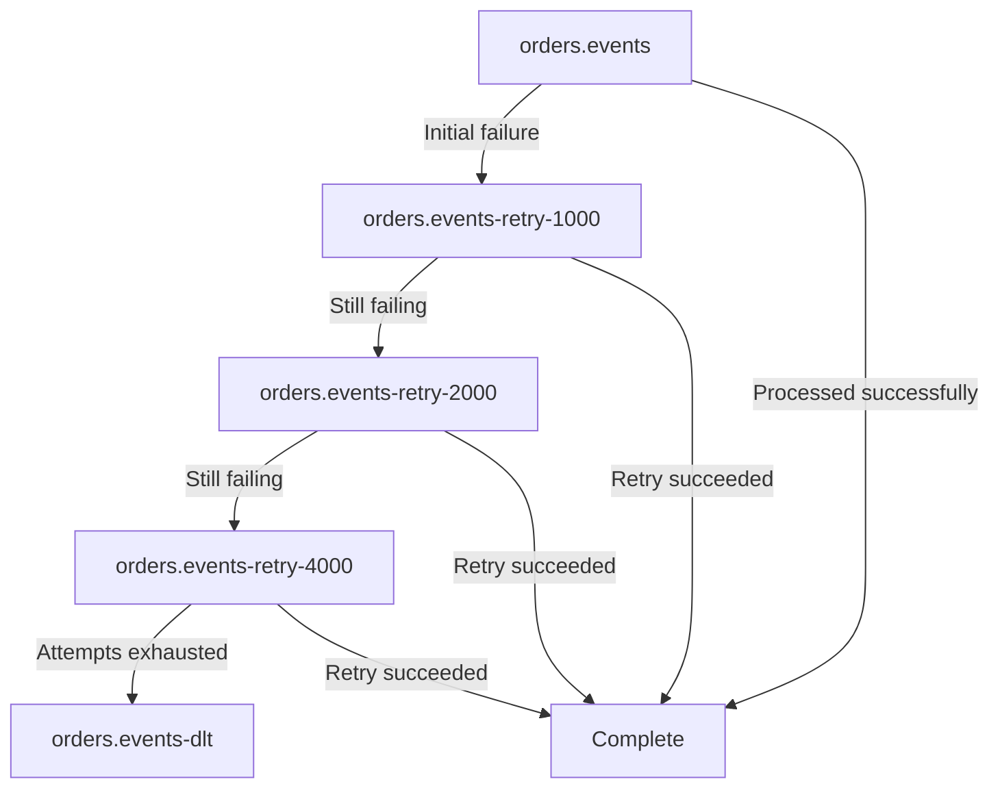

# Dead-Letter Topic in Non-Blocking Retry

In Spring Kafka, non-blocking retry routes failed records to one or more retry topics instead of holding the consumer on the main topic to wait out the backoff period. If a record still fails after the configured total number of attempts, it is forwarded to a **dead-letter topic (DLT)**. The DLT is the end of the automated retry flow, where the application can investigate, fix the root cause, and perform controlled replays.

`@RetryableTopic` is the standard declarative way for Spring Kafka to create the retry infrastructure, retry topic listeners, and the DLT. You can customize topic names, attempt counts, backoff, retryable exceptions, partitions, and replication. A DLT does not fix records automatically; it stores records that have exhausted retries so the main flow can keep moving forward.

## 1. Where Does Non-Blocking Retry Send Records?

With blocking retry, the listener container retries the record in the current processing thread and waits according to backoff. During that time, the partition cannot proceed to subsequent records in normal order.

With non-blocking retry, when a listener fails, the record is published to a retry topic. The main topic consumer can keep processing the next record; a retry listener consumes the record from the retry topic when the retry time arrives. If all retries are exhausted and it still fails, the record is published to the DLT.

For example, a main topic `orders.events` can generate this topology:



Retry topic names in the diagram are illustrative. Actual names depend on the suffix strategy and Spring Kafka configuration. The DLT commonly uses the `-dlt` suffix by default; applications can configure a custom suffix.

Non-blocking retry fits scenarios where errors can self-heal after a delay and the system wants to keep processing other records on the main topic. In return, failed records may be processed later than records arriving after them.

## 2. How Does a DLT Differ from a Retry Topic?

A retry topic is an intermediate stage for retrying after a backoff interval. A DLT is the final destination once the retry policy is exhausted or a record is classified as non-retryable by configuration.

| Component | Role | Typical consumer |
| --- | --- | --- |
| Main topic | Receives new events from producers | Primary business listener |
| Retry topic | Holds records awaiting the next attempt | Retry listener created by Spring Kafka |
| DLT | Stores records that failed after retries | DLT handler, investigation tools, or replay workflow |

A record may pass through multiple retry topics according to the backoff schedule. When the final attempt still fails, the recoverer publishes the record to the DLT. Records in the DLT do not automatically return to the main topic; a separate replay workflow is needed after fixing the root cause.

Do not use a DLT as an infinite retry queue. If a DLT consumer keeps throwing exceptions and routing records back to the same DLT, the system can enter a loop and generate uncontrolled load.

## 3. Declaring Non-Blocking Retry with @RetryableTopic

Spring Kafka supports declaring retry topics directly on a listener via `@RetryableTopic`. The example below allows four total processing attempts, consisting of the initial attempt on the main topic and three subsequent attempts on retry topics:

```java
package com.example.orders.consumer;

import com.example.orders.event.OrderCreated;
import com.example.orders.service.BillingService;
import org.slf4j.Logger;
import org.slf4j.LoggerFactory;
import org.springframework.kafka.annotation.KafkaListener;
import org.springframework.kafka.annotation.RetryableTopic;
import org.springframework.kafka.annotation.DltHandler;
import org.springframework.retry.annotation.Backoff;
import org.springframework.stereotype.Component;

@Component
public class OrderCreatedListener {

    private static final Logger log =
            LoggerFactory.getLogger(OrderCreatedListener.class);

    private final BillingService billingService;

    public OrderCreatedListener(BillingService billingService) {
        this.billingService = billingService;
    }

    @RetryableTopic(
            attempts = "4",
            backoff = @Backoff(
                    delay = 1_000,
                    multiplier = 2.0,
                    maxDelay = 10_000
            ),
            retryTopicSuffix = "-retry",
            dltTopicSuffix = "-dlt"
    )
    @KafkaListener(
            topics = "orders.events",
            groupId = "billing-service"
    )
    public void onOrderCreated(OrderCreated event) {
        billingService.createInvoice(event);
    }

    @DltHandler
    public void onDlt(OrderCreated event) {
        billingService.recordFailedEvent(event);
    }
}
```

In this example:

- `attempts = "4"` is the maximum total processing attempts, including the initial attempt on the main topic.
- `delay = 1_000` sets the initial backoff to one second.
- `multiplier = 2.0` increases the wait interval exponentially.
- `maxDelay = 10_000` caps the maximum wait interval at ten seconds.
- `retryTopicSuffix` and `dltTopicSuffix` define topic name suffixes.
- `@DltHandler` marks the method that processes records sent to the DLT.

With this backoff configuration, expected wait times are 1 second, 2 seconds, and 4 seconds (not yet reaching maxDelay). The first attempt runs on the main topic; if all four attempts fail, the record is forwarded to the DLT.

`@RetryableTopic` must be used alongside `@KafkaListener`. Check the API of your project's Spring Kafka version because some annotation attributes and topic configuration options can vary across releases.

## 4. attempts Is the Total Number of Attempts

A common mistake is treating `attempts` as the number of retries after the first attempt. With `@RetryableTopic`, `attempts` represents the total number of processing attempts, including the initial attempt on the main topic.

| `attempts` | Initial attempt | Maximum retries | Maximum total processing attempts |
| ---: | ---: | ---: | ---: |
| 1 | 1 | 0 | 1 |
| 2 | 1 | 1 | 2 |
| 3 | 1 | 2 | 3 |
| 4 | 1 | 3 | 4 |
| 5 | 1 | 4 | 5 |

For example, `attempts="4"` does not mean the listener is invoked for four retries plus the initial attempt. It means at most four listener invocations including the initial one. After the last attempt fails, the record enters the DLT.

This differs from `DefaultErrorHandler`'s `FixedBackOff`, where `maxAttempts` specifies the number of retries after the initial invocation. When migrating from blocking retry to non-blocking retry, review attempt counts so you do not accidentally increase or shrink your retry budget.

## 5. Backoff and Retry Schedule

Backoff defines the wait period before a record is retried. With exponential backoff:

\[
delay_n = \min(initialDelay \times multiplier^{n-1}, maxDelay)
\]

For example, `initialDelay=1s`, `multiplier=2`, `maxDelay=10s`:

| Retry attempt | Wait interval before attempt |
| ---: | ---: |
| 1 | 1 second |
| 2 | 2 seconds |
| 3 | 4 seconds |
| 4 | 8 seconds |
| 5 onward | Up to 10 seconds |

Spring Kafka uses retry topics corresponding to the configured wait intervals. How delay intervals map to topics and suffixes depends on the topic suffixing strategy and the same-interval topic reuse strategy. When multiple attempts share the same delay, topics can be reused per configuration rather than creating a separate topic per attempt.

Choose backoff according to error characteristics:

- Brief timeouts or transient network errors: short backoff may suffice.
- Overloaded downstream systems: gradually increasing backoff avoids adding extra pressure.
- Prolonged dependency outages: longer wait intervals, alerts, and possibly pausing consumers per operational policy.
- Invalid data errors: retrying rarely helps; classify them to route to the DLT early.

## 6. Retry Only Appropriate Exceptions

Do not treat all exceptions equally when retrying. Transient failures may resolve on retry; validation errors or unsupported event versions usually belong in the DLT for investigation.

Example specifying retryable exceptions:

```java
@RetryableTopic(
        attempts = "4",
        backoff = @Backoff(delay = 1_000, multiplier = 2.0),
        include = {TransientBillingException.class},
        exclude = {InvalidOrderEventException.class}
)
@KafkaListener(topics = "orders.events", groupId = "billing-service")
public void onOrderCreated(OrderCreated event) {
    billingService.createInvoice(event);
}
```

This example shows `TransientBillingException` being retried and `InvalidOrderEventException` not being retried. Exceptions outside the specified lists follow the retry configuration's default rules; explicitly declare `include`/`exclude` to prevent ambiguity when multiple error types exist.

When an exception is determined to be non-retryable, the record can be forwarded directly to the DLT without traversing the entire retry chain. Test this case explicitly to verify listener invocation counts and destination topics.

## 7. DLT Handler with @DltHandler

`@DltHandler` lets you declare a method to process records in the DLT. The method is typically placed in the same class as the `@RetryableTopic` listener, keeping event and error-handling logic together in one component.

```java
@DltHandler
public void onDlt(OrderCreated event) {
    log.error("Order event exhausted retry: eventId={}, orderId={}",
            event.eventId(), event.orderId());

    failedEventRepository.save(
            FailedEvent.from(event, "Retry attempts exhausted")
    );
}
```

A DLT handler should perform tasks that can complete reliably:

- Record the event ID, aggregate ID, and error details.
- Persist traces for investigation or raise a ticket/alert through a separate flow.
- Do not re-execute the failed business action if the root cause has not been fixed.
- Do not silently swallow errors, causing DLT records to be acknowledged without a trace.

If the handler writes to a database, design it to be idempotent because DLT records can also be redelivered after a restart. You can use the event ID as a unique key on the failed-event record.

When full metadata access is needed, a DLT handler can accept `ConsumerRecord` or headers supported by Spring Kafka. Verify that the method signature is compatible with the DLT listener's payload and deserializer.

If another monitoring tool also needs to read the entire DLT, use a separate consumer group. If it shares the same group ID as the DLT listener, the two consumers will split partitions/records instead of each receiving a full copy.

## 8. Proactively Provisioning the DLT and Retry Topics

Spring Kafka can auto-create retry topics when `@RetryableTopic` is configured to permit it. In production, many operations teams prefer managing topics via infrastructure tooling (Terraform, Helm, or AdminClient workflows) to control partitions, replication, retention, and ACLs.

Example disabling topic auto-creation in the annotation (check attribute types for your version):

```java
@RetryableTopic(
        attempts = "4",
        backoff = @Backoff(delay = 1_000, multiplier = 2.0),
        autoCreateTopics = "false",
        numPartitions = "6",
        replicationFactor = "3"
)
@KafkaListener(topics = "orders.events", groupId = "billing-service")
public void onOrderCreated(OrderCreated event) {
    billingService.createInvoice(event);
}
```

When auto-creation is disabled, provision all retry topics and the DLT using the exact names Spring Kafka generates from the suffix strategy. Cross-check actual names against your backoff, suffix, and strategy configuration; do not create only the main topic and assume the rest will appear automatically.

You can declare the DLT using Spring Kafka's `KafkaAdmin`/`NewTopic`:

```java
import org.apache.kafka.clients.admin.NewTopic;
import org.springframework.context.annotation.Bean;
import org.springframework.context.annotation.Configuration;
import org.springframework.kafka.config.TopicBuilder;

@Configuration
public class DeadLetterTopicProvisioning {

    @Bean
    NewTopic ordersDltTopic() {
        return TopicBuilder.name("orders.events-dlt")
                .partitions(6)
                .replicas(3)
                .build();
    }
}
```

This example creates a DLT with six partitions and a replication factor of three. Retry topics must also be provisioned with the exact names generated by the suffix strategy and compatible partition counts. `numPartitions` on `@RetryableTopic` configures partition counts for topics created by the retry infrastructure; if the source topic has multiple partitions and routing preserves the original partition number, do not give retry/DLT topics fewer partitions than the source.

A common suffix strategy appends the delay to the retry topic name, such as `orders.events-retry-1000`, `orders.events-retry-2000`; the DLT uses a distinct suffix like `orders.events-dlt`. `TopicSuffixingStrategy` and `SameIntervalTopicReuseStrategy` govern naming and topic reuse for attempts sharing the same delay. Confirm the generated topic names in your exact Spring Kafka version before provisioning manually.

### 8.1. DLT Partition Count

Retry topics and the DLT need partition counts compatible with how the framework routes records. Some configurations preserve the source record's partition number; in that case, retry/DLT topics must have enough corresponding partitions. If a topic is created with fewer partitions, publishing can fail with `InvalidPartitionException` or a similar error.

Using a uniform partition count, such as six partitions across the main topic, retry topics, and DLT, simplifies partition alignment. However, partition count also affects concurrency, metadata, and broker cost.

### 8.2. Replication Factor and Retention

Do not assume retry topics/DLT should share the same retention as the main topic. Retry topics must retain records long enough for backoff delays and lag processing; the DLT may need even longer retention for investigation and replay.

Configure:

- A replication factor suitable for cluster availability.
- `min.insync.replicas` aligned with producer `acks` when durability is required.
- Retention long enough to cover retry wait times and incident resolution windows.
- ACLs for retry/DLT producers and retry/DLT consumers.
- Alerts for abnormal disk usage, under-replicated partitions, or DLT growth.

## 9. Configuration with RetryTopicConfigurationBuilder

If you prefer not to place annotations on every listener, you can create a `RetryTopicConfiguration` using the builder:

```java
import com.example.orders.event.OrderCreated;
import org.springframework.context.annotation.Bean;
import org.springframework.context.annotation.Configuration;
import org.springframework.kafka.core.KafkaTemplate;
import org.springframework.kafka.retrytopic.RetryTopicConfiguration;
import org.springframework.kafka.retrytopic.RetryTopicConfigurationBuilder;
import com.example.orders.exception.InvalidOrderEventException;
import com.example.orders.exception.TransientBillingException;

@Configuration
public class OrdersRetryTopicConfig {

    @Bean
    public RetryTopicConfiguration ordersRetryConfiguration(
            KafkaTemplate<String, OrderCreated> kafkaTemplate
    ) {
        return RetryTopicConfigurationBuilder
                .newInstance()
                .exponentialBackoff(1_000, 2.0, 10_000)
                .maxAttempts(4)
                .retryOn(TransientBillingException.class)
                .notRetryOn(InvalidOrderEventException.class)
                .dltSuffix("-dlt")
                .includeTopic("orders.events")
                .create(kafkaTemplate);
    }
}
```

The builder is useful when multiple listeners share a retry policy or when centralizing configuration. The `RetryTopicConfiguration` return type resides in `org.springframework.kafka.retrytopic`; application-specific imports and exception classes are shown as examples. Check method names and overloads on `RetryTopicConfigurationBuilder` in your project's Spring Kafka version; annotations and builders are two ways to declare the same retry infrastructure and should not be configured overlappingly for the same endpoint.

## 10. Headers in Retry Topics and the DLT

Spring Kafka attaches metadata to records forwarded through the retry chain. Metadata helps identify the original topic, original partition/offset, initial send timestamp, and number of attempts already made.

Commonly inspected metadata includes:

| Metadata | Purpose |
| --- | --- |
| Original topic | Identifies the source topic of the event |
| Original partition/offset | Traces the record's initial position |
| Original timestamp | Shows when the record was originally created/sent |
| Attempt count | Tracks how many attempts the record has undergone |
| Backoff timestamp | Indicates when the record becomes eligible for retry |
| Exception type/message | Investigates the cause of failure |

Header names are managed by Spring Kafka via retry topic classes/constants in the corresponding version. When reading them manually, prefer the API/constants of your active version rather than hardcoding header strings from an outdated article.

Do not write long stack traces or sensitive data into application logs without controls. Exception headers can also increase record size; monitor message size limits and sensitive-data policies.

## 11. How Does Non-Blocking Retry Affect Ordering?

Non-blocking retry involves a critical trade-off: when a failed record is forwarded to a retry topic, the main topic consumer can keep processing the next record. Consequently, events with the same key may be processed out of their original order.

For example, a partition contains these events:

```text
Offset 10: OrderCreated(ORD-100)  -> failed, sent to retry topic
Offset 11: OrderPaid(ORD-100)     -> processed successfully on main topic
Retry:     OrderCreated(ORD-100)  -> processed successfully later
```

As a result, `OrderPaid` may be applied before `OrderCreated`. Using the same Kafka key only guarantees records enter the same partition according to the partitioner; it does not preserve processing order across multiple retry topics.

Non-blocking retry fits independent events or business logic that tolerates out-of-order processing. If strict per-aggregate ordering is mandatory, consider blocking retry, pausing partitions, version/sequence checks, or a workflow with dedicated serialization.

Spring Kafka non-blocking retry does not support batch listeners and does not combine with container transactions in the same way blocking retry does. Check framework version compatibility limits and avoid enabling this mechanism for flows needing unsupported batch/transaction semantics.

## 12. Non-Blocking Retry and Transactions

Non-blocking retry moves records across topics via separate publish operations. It is not an atomic transaction spanning main topic consumption, retry record publishing, and source offset commits in all configurations.

Therefore, a failure window can exist between publishing to the retry topic and committing the main topic offset. If a record is published to the retry topic before the source offset commits, the original record may be redelivered after a restart. That can introduce duplicates into the retry chain.

Consumers and business side effects must be idempotent. Use a stable `eventId`, inbox table, or unique constraint to prevent applying the same event multiple times.

If Kafka transactions / exactly-once consume-transform-produce semantics are mandatory, evaluate blocking retry and an appropriate transactional flow rather than assuming non-blocking retry provides that transaction automatically. Kafka transactions also do not automatically cover databases or HTTP calls.

## 13. Choosing Non-Blocking Retry vs. Blocking Retry

| Criterion | Non-blocking retry | Blocking retry |
| --- | --- | --- |
| Wait mechanism | Forwards record to a retry topic | Consumer waits through backoff in the processing thread |
| Extra topics | Has retry topics and a DLT | Usually only main topic and optionally a DLT |
| Main flow | Can continue processing subsequent records | May be held back during retries |
| Ordering | Order may shift between failed and later records | Easier to preserve partition order when retrying in place |
| Best suited for | Independent events needing throughput without blocking partitions | Events requiring ordering or transactional containers |
| Limitations | Does not support batch listeners/container transactions in standard mode | Long backoffs can block partitions and increase lag |

No single choice fits every topic. Determine ordering requirements, expected error durations, throughput, retry counts, and transaction semantics before choosing.

## 14. The DLT as the Endpoint of Automated Retries

Once a record enters the DLT, the system should have a clear handling workflow. An unmonitored DLT quickly becomes a forgotten graveyard of errors.

A DLT handler or operational consumer can:

- Store the event ID, key, payload reference, and source metadata.
- Record the exception class/message and recovery timestamp.
- Trigger alerts by error category and DLT rate.
- Route records into a quarantine store if payloads contain sensitive data or require access controls.
- Await replay decisions after the bug is fixed.

If the DLT handler only logs and acknowledges the record, ensure logs/metrics are sufficient for recovery and records are retained per required retention. For critical business flows, persist a durable failed-event record rather than relying solely on logs.

## 15. Replaying Records from the DLT

Replay is the operation of publishing a DLT record back to the main topic or a dedicated replay topic once the error has been resolved. Replaying creates a new Kafka record with a new offset; the original offset is kept only in headers for traceability.

A replay procedure should include:

1. Reading the DLT record and identifying the event ID, original topic/partition/offset, key, and exception.
2. Fixing the root cause: data, schema, consumer code, or dependency.
3. Confirming the payload is still valid and will not cause invalid side effects against current state.
4. Selecting the destination topic and preserving the key for business routing.
5. Adding a replay marker/correlation ID if auditing is required.
6. Sending the record and confirming publish success.
7. Monitoring the consumer, retry chain, and new DLT activity.
8. Marking the source record as successfully replayed in any tracking store.

Do not automatically replay a persistently failing record indefinitely. Limit replay attempts and record a trace of each attempt to avoid creating loops.

## 16. Testing the Non-Blocking Retry DLT

Integration tests should verify topology, attempt counts, metadata, and DLT handler behavior.

A scenario using `@EmbeddedKafka` or Testcontainers:

1. Create the main topic `orders.events`, required retry topics, and `orders.events-dlt`.
2. Configure `@RetryableTopic` with a small attempt count and short backoff so tests run quickly.
3. Build a test listener that intentionally throws `TransientBillingException` for a specific event.
4. Wait for the record to appear on the retry topic after the initial attempt.
5. Verify attempt count/backoff metadata and key/value preservation.
6. Let all attempts fail and verify the record eventually reaches the DLT.
7. Verify `@DltHandler` is invoked once as expected by the test and persists the failed-event record.
8. Send an event that succeeds on a later retry and verify it does not land on the DLT.
9. Verify non-retryable exceptions route straight to the DLT when configured that way.
10. Restart the consumer mid-retry to verify records in retry topics are still processed according to metadata and retention.

Tests should use dedicated group IDs, latches/queues, and timeout-bounded assertions. Avoid relying on fixed `Thread.sleep()` calls to assume retries are due.

## 17. Monitoring Retry Topics and the DLT in Production

Track the following metrics:

| Metric | Question to answer |
| --- | --- |
| Retry topic record rate | How many records are being diverted into retries? |
| DLT publish rate | How many records have exhausted retries? |
| DLT consumer lag | Are failed records waiting for investigation/handling? |
| Attempts distribution | On which attempt do records typically succeed? |
| Backoff delay | How long do records wait before retrying? |
| Retry publish failure | Are failures occurring when forwarding to retry topics? |
| Consumer processing latency | How long does the listener take to process a record? |
| Topic disk usage/retention | Are retry and DLT topics consuming abnormal storage? |

Alerts should fire when DLT rates exceed thresholds, retry topic lag grows continuously, retry/DLT publishing fails, or the DLT lacks an active operational consumer when needed. DLT growth signals data quality issues, schema incompatibilities, or dependency health problems—not merely Kafka issues.

## 18. Common Pitfalls

| Symptom | Common cause | Resolution |
| --- | --- | --- |
| Records never reach DLT | Attempts not yet exhausted or exception retried under a different policy | Check `attempts`, `include`/`exclude`, and listener logs |
| Records enter DLT earlier than expected | Exception classified as non-retryable | Check exception hierarchy and `include`/`exclude` |
| Retry topic does not exist | Auto-create disabled without provisioning all topics | Provision topics matching suffix strategy and backoff |
| Retry/DLT publish fails with invalid partition | Target topic has fewer partitions than selected partition | Align partition counts or adjust routing |
| DLT handler does not execute | DLT endpoint not created or listener config mismatch | Check `@RetryableTopic`, `@DltHandler`, group, and topic |
| Events for same aggregate processed out of order | Non-blocking retry lets main topic advance | Use blocking retry or version/sequence checks if ordering is mandatory |
| DLT grows rapidly | Data errors or prolonged downstream outage, retry budget too low | Classify errors, tune backoff, and alert |
| Replay creates duplicates | Side effects are not idempotent | Use event ID/inbox and replay markers |
| Retry topic uses excessive disk | Long retention, backlog, or overly large backoff | Monitor lag, retention, and capacity |
| Listener incompatible | Using batch listener or container transactions | Switch to record listener without transactions, or use blocking retry |

## 19. DLT Design Checklist for Non-Blocking Retry

Before deploying, verify:

1. Main topic and group ID are stably defined.
2. `attempts` is understood as total attempts, including the first.
3. Backoff, multiplier, and max delay suit expected failures.
4. Retryable/non-retryable exceptions are clearly classified.
5. Retry topic suffix and DLT suffix do not conflict with other topics.
6. Retry topics and DLT are provisioned with proper partitions/replication if not auto-created.
7. Retention is long enough for retry wait durations and incident response.
8. DLT handler stores sufficient metadata for investigation and is idempotent.
9. Consumers tolerate potential reordering, or an alternative mechanism is chosen if strict order is required.
10. Listeners do not use unsupported batch/container transaction modes with non-blocking retry.
11. Replay is bounded, audited, and loop-free.
12. Metrics/alerts cover retry rate, DLT rate, publish failures, lag, and disk usage.
13. Integration tests cover retry success, exhausted retries, non-retryable exceptions, and restarts.

The non-blocking retry DLT is the endpoint of the retry chain, preserving events that fail after all retry attempts. Good design requires accurately defining attempts/backoff, topic naming, partitions and retention, the DLT handler, replay procedures, and ordering boundaries. Combined with idempotency and monitoring, the system can keep the main flow running while preserving failed data for recovery.

## 20. Self-Check

1. How does non-blocking retry differ from blocking retry in handling failed records?
2. How do the roles of a retry topic and a DLT differ?
3. How many maximum listener invocations correspond to `attempts="4"`?
4. What retry schedule does exponential backoff with a 1-second delay and multiplier of 2 produce?
5. What is `@DltHandler` used for?
6. Why do DLT/retry topics need partition counts compatible with the routing strategy?
7. How can non-blocking retry break per-aggregate ordering?
8. Why should non-blocking retry not be treated as an atomic transaction with the source offset?
9. When should blocking retry be used instead of non-blocking retry?
10. What information must be stored to replay DLT records safely?
