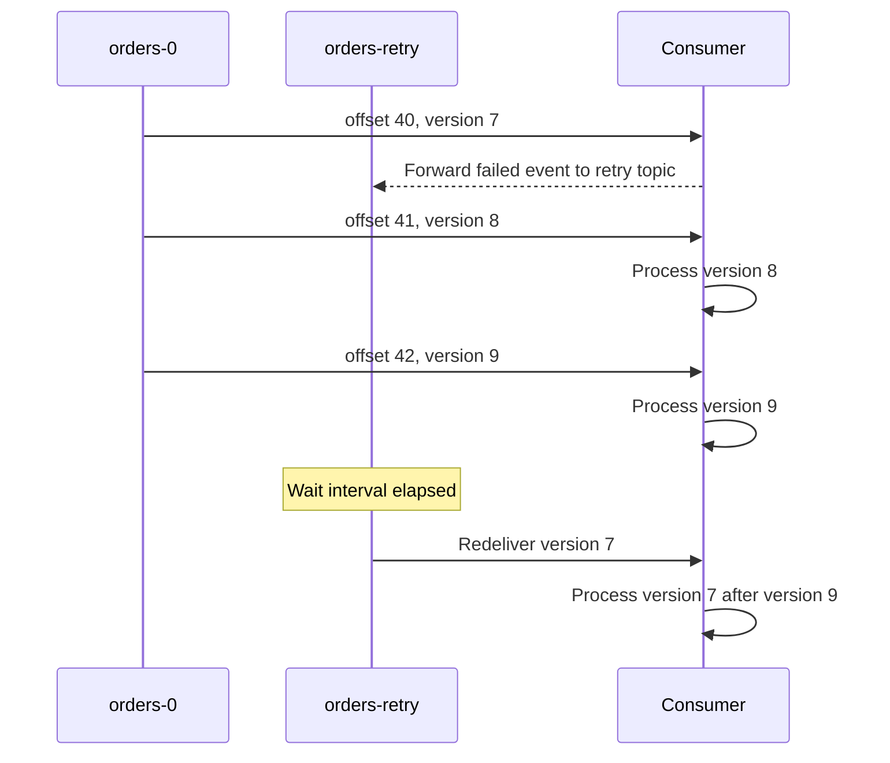

# How Ordering Is Affected

Non-blocking retry lets a consumer continue reading subsequent records when a record fails. Spring Kafka forwards the failed record to a retry topic, waits until the configured timestamp, and delivers it to a retry topic consumer. This approach increases concurrency and prevents a transient error from stalling the entire source partition.

In return, the original processing order can change. An older record waiting for retry may be processed after newer records in the same partition. This is essential to understand whenever events update the same order, account, or aggregate whose outcome depends on sequence.

## 1. At What Scope Does Kafka Guarantee Ordering?

Kafka preserves record order within a single partition. If a producer writes A and then B to the same partition, a consumer reading that partition receives A before B by offset. Kafka does not provide a global order across multiple partitions, nor does it enforce a shared order between the main topic and retry topics.

With non-blocking retry, a failed record is published to a retry topic. Once forwarding and source offset handling finish, the main topic consumer can move on to the next record. The retry topic is consumed by a retry listener flow on its own delivery schedule, so the source flow and retry flow progress independently.

## 2. An Example of a Newer Record Overtaking an Older One

Suppose partition `orders-0` receives three events for the same order in sequence:

| Offset | Event | Version | First-attempt outcome |
| ---: | --- | ---: | --- |
| 40 | `OrderAddressChanged` | 7 | Address service call failed |
| 41 | `OrderPaid` | 8 | Processed successfully |
| 42 | `OrderPacked` | 9 | Processed successfully |

When the event at offset 40 is forwarded to a retry topic, the main consumer can proceed to process offsets 41 and 42. Only after the wait interval does version 7 get retried. The effective business completion order can become version 8, version 9, and then version 7.



If version 7 changes the shipping address while versions 8 and 9 perform payment and packing based on the prior state, the system may persist stale state or trigger invalid side effects. Therefore, non-blocking retry must be evaluated against business ordering rules, not throughput alone.

## 3. Are Keeping the Same Key and Partition Enough?

Using the same key, such as `orderId`, routes events for a given order consistently to one partition in the source topic. When retry topic configuration preserves matching partition mapping, retried records can also land in the corresponding partition of the retry topic.

However, keys and partitions only preserve affinity within each individual topic. Partition `orders-0` and partition `orders-retry-0` are two independent logs consumed at separate paces and schedules. Sharing the same key or partition number does not force event version 7 to finish before version 8 on the main topic.

Furthermore, different retry levels may use different topics depending on wait intervals. An older event in a long-delay retry topic can be overtaken by a newer event in a short-delay retry topic. Concurrency, differing processing durations, and DLT replays can also alter completion order.

## 4. Configuring Non-Blocking Retry

Spring Kafka provides `@RetryableTopic` to declare delivery attempts, backoff, and retryable exception groups. The example below permits up to four total deliveries including the initial attempt, with exponential backoff:

```java
@RetryableTopic(
    attempts = "4",
    backoff = @Backoff(
        delay = 1_000,
        multiplier = 2.0,
        maxDelay = 10_000),
    include = {PartnerUnavailableException.class})
@KafkaListener(topics = "orders", groupId = "order-projection")
public void consume(OrderEvent event) {
    orderService.apply(event);
}
```

`attempts = "4"` consists of one initial processing attempt and up to three redeliveries. `@RetryableTopic` sets up the retry topic flow and DLT as configured; the source consumer can continue once the failed record is successfully forwarded. Only exceptions included in the retry policy traverse retry topics; non-retryable errors can be routed directly to the DLT.

Topic and partition configurations must match how records are routed. If the resolver preserves source partitions, retry topics must have matching partition counts. Verify partition counts, replication factors, retention, and consumer groups for retry/DLT topics in the deployment environment.

Non-blocking retry via `@RetryableTopic` is intended for record listeners; it does not support batch listeners and cannot be combined with container transactions. If a listener must process batches or requires container-managed transactions, choose an error-handling strategy compatible with that model.

## 5. When Is Affected Ordering Acceptable?

Non-blocking retry works well when events can be processed independently or business logic is designed to tolerate out-of-order arrivals. Examples:

- Sending emails or notifications: each event can be handled independently; prevent duplicate sends with an event ID.
- Snapshot-based data synchronization: snapshots carry a version, and consumers only apply snapshots newer than the current state.
- Commutative metric aggregations: additive or commutative updates with deduplication keys so late events do not corrupt totals.
- Processing many independent aggregates: order between two distinct orders does not matter, provided each order enforces its own versioning rules.

Even when reordering is acceptable, handlers still need to be idempotent. Retries, restarts, rebalances, and DLT replays can all cause the same event to arrive multiple times. Events should carry a stable `eventId`; writes should deduplicate and optionally verify versions.

## 6. Using Versions or Sequences to Protect State

If events for the same aggregate must respect ordering, attach a monotonically increasing version number to each event. The consumer compares the incoming version against the applied version:

- Version less than or equal to current version: stale or duplicate event; ignore after verifying idempotency.
- Version equal to the next expected version: apply the event and increment the stored version.
- Version greater than the next expected version: a preceding event is missing; store the event in a pending area or durable buffer for later processing.

Illustrative example of version checking:

```java
@Transactional
public void apply(OrderEvent event) {
    long current = orderRepository.currentVersion(event.orderId());

    if (event.version() <= current) {
        return; // Stale or already applied event.
    }

    if (event.version() > current + 1) {
        pendingEventRepository.saveIfAbsent(event.eventId(), event);
        return; // Wait for missing version.
    }

    orderRepository.apply(event);
    orderRepository.updateVersion(event.orderId(), event.version());
    pendingEventService.applyNextConsecutive(event.orderId());
}
```

This is a business logic outline; updates to the aggregate, version, and pending events must execute within an appropriate data transaction. When the missing event arrives later, the system applies it and sequentially processes consecutive pending versions. Include a retry or alerting mechanism for pending events stuck for too long.

Do not simply throw an exception for every out-of-version event expecting retry topics to restore order automatically. Delayed retries can let later events keep overtaking earlier ones and create a reordering loop. A durable buffer with sequence rules lets the consumer coordinate ordering explicitly.

## 7. When Should Blocking Retry Be Used?

If the requirement is that subsequent records in the same partition must never be processed ahead of a failing record, blocking retry is usually more suitable. `DefaultErrorHandler` retries at the consumer using seek/backoff; the failing record continues holding the head of the partition, so later records in that partition must wait.

```java
@Bean
public DefaultErrorHandler kafkaErrorHandler(
        ConsumerRecordRecoverer recoverer) {
    return new DefaultErrorHandler(
        recoverer, new FixedBackOff(2_000L, 3L));
}
```

This preserves partition read order during retries, but reduces that partition's throughput and can grow consumer lag. Once retries are exhausted and the record is recovered to a DLT, subsequent records can still proceed, leaving a gap in the business stream. For strict ordering, decide explicitly whether to stop/pause the partition to resolve the incident or enforce a fix-and-replay procedure before allowing progress to resume.

For long blocking delays, consider `ContainerPausingBackOffHandler` and check `max.poll.interval.ms`. Do not increase concurrency expecting parallel in-order processing of records in the same partition; Kafka assigns a given partition to only one consumer in a group at a time.

## 8. Choosing a Strategy by Business Requirement

| Requirement | Suitable strategy | Main trade-off |
| --- | --- | --- |
| Independent events, throughput prioritized | Non-blocking retry with `@RetryableTopic` | May complete out of order; requires idempotency |
| In-partition ordering needed during retries | Blocking retry with `DefaultErrorHandler` | Partition waits on failing record, lowering throughput |
| Multiple aggregates, ordering needed only per aggregate | Partition by aggregate key and verify versions | Requires sequence design and deduplication |
| Strict ordering, failing events cannot be skipped | Pause/stop progress or durable buffer/resequencer | Increases operational complexity and wait times |

One consumer can use non-blocking retry for order-independent events while another flow uses blocking retry for order-sensitive events. Policies should be tailored per event type and listener rather than forcing the same retry strategy onto every topic.

## 9. DLT Replay Can Also Invert Order

When an event is moved to a DLT, newer events in the source topic may already have been processed. Replaying an old event back to the source topic does not rewrite history; it normally creates a new processing attempt at replay time.

Before replaying, check the aggregate's current version, verify whether the event is still valid, and choose how to handle it: conditional application, rebuilding projections from a controlled offset, or routing the event into a data-correction workflow. Record the event ID and replay source to prevent infinite loops between the DLT and retry topics.

## 10. Testing Ordering and Monitoring

An integration test should send three events with the same key to the same partition. Intentionally fail the first event on its initial attempt, allow subsequent events to succeed, and wait for the retry to finish. Verify that observed execution order can differ from offset order and test that version guards or resequencers keep the final state accurate.

Additional scenarios to test:

- Two events for the same aggregate sitting in different retry levels with different delays.
- Retry topics with multiple partitions and listener concurrency greater than one.
- Duplicate events, late-arriving events, and events with missing versions.
- DLT replay after the aggregate has already received a newer version.
- Application restart while an event is waiting in a retry topic.

Track separate consumer lag for main and retry topics, number of records awaiting retry, age of the oldest pending event, DLT counts, rejection rates for stale or missing versions, and completion latency per aggregate. These metrics reveal where the system reorders events and whether business state is compromised.

Non-blocking retry changes error handling by allowing the main stream to keep running, so completion order is no longer guaranteed between the main topic and retry topics. Use it when business rules tolerate reordering or when versions, buffers, and idempotency safeguard outcomes. When ordering is mandatory, choose blocking retry or a stateful ordering coordination mechanism.
