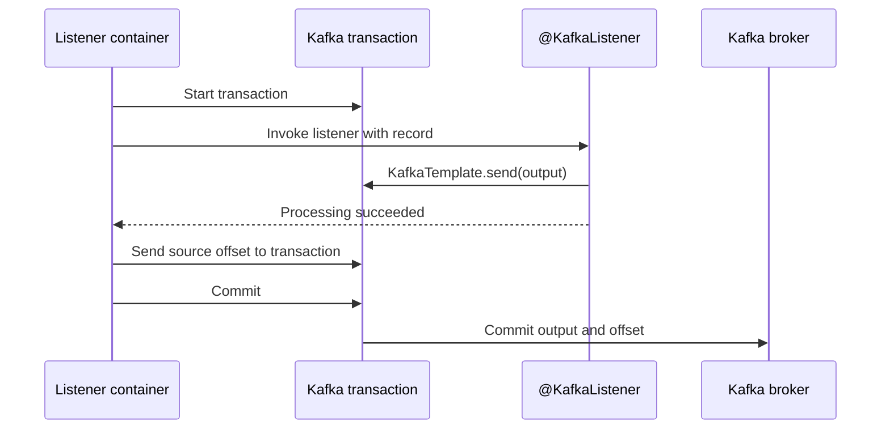
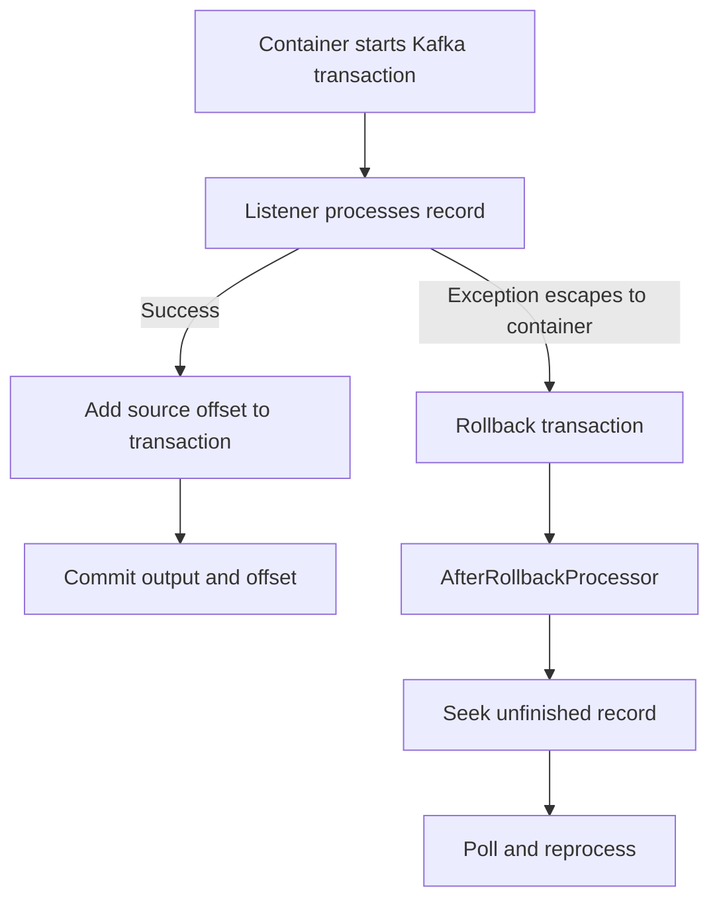
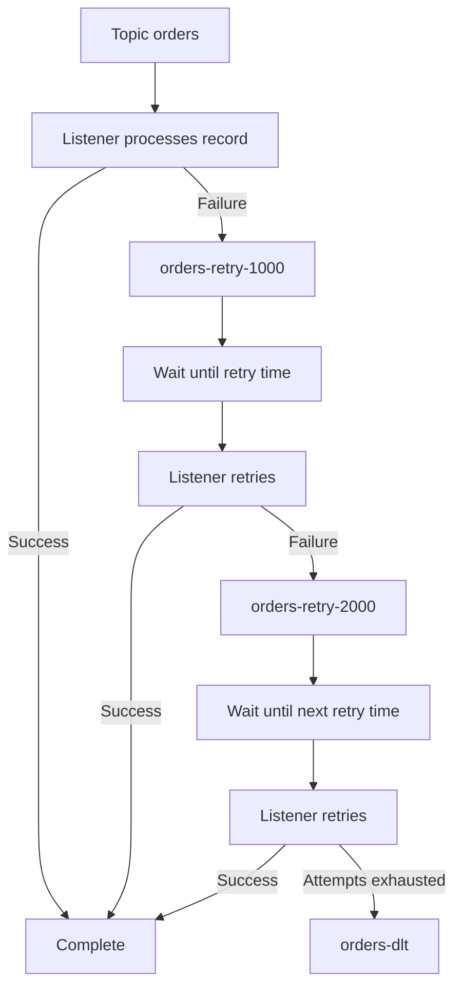

# Do Not Combine Non-Blocking Retry with Container Transactions

Spring Kafka supports two error-handling mechanisms with distinct goals: container transactions use Kafka transactions to commit or roll back processing alongside source offsets; non-blocking retry forwards failed records to retry topics to be tried again after a delay without blocking the main topic consumer flow. These two mechanisms cannot be combined directly using `@RetryableTopic` together with Kafka transactions managed by the listener container.

The crux lies in how the framework handles exceptions. With container transactions, exceptions must escape the listener so the transaction rolls back and `AfterRollbackProcessor` handles redelivery. With non-blocking retry, exceptions are handled by forwarding the record to a retry topic. Spring Kafka documentation explicitly states that when a listener throws an exception in this setup, the container transaction still commits successfully and the record is sent to the retryable topic. Consequently, you cannot rely on that exception to make the container roll back the transaction as in a normal transactional retry flow.

## 1. What Does a Container Transaction Protect?

When a listener container is configured with a `KafkaAwareTransactionManager` (commonly `KafkaTransactionManager`), the container starts a Kafka transaction before invoking the listener. Kafka sends via a `KafkaTemplate` sharing the same `ProducerFactory` participate in that active transaction. When the listener succeeds, the container sends the processed record's offset to the transaction and commits.

If the listener throws an exception and it propagates out, the transaction rolls back. Produced Kafka outputs in the transaction are not committed, and the source offset is not committed. The consumer is positioned to re-read the incomplete record. This forms the foundation for read-process-write flows with exactly-once semantics in Kafka.



If the listener fails, the path is rollback:



For this mechanism to work, the `KafkaTemplate` used inside the listener must be configured with the same transaction-capable `ProducerFactory` as `KafkaTransactionManager`. In Spring Boot, you can configure `spring.kafka.producer.transaction-id-prefix`; each application instance needs a distinct prefix to avoid `transactional.id` collisions.

## 2. How Does Non-Blocking Retry Forward Records to Retry Topics?

Spring Kafka has supported non-blocking retry since version 2.7 via `@RetryableTopic` and `RetryTopicConfiguration`. When a listener fails, the framework forwards the record to a retry topic along with metadata specifying when it is eligible to be retried. The retry topic consumer inspects that timestamp. If the due time has not arrived, the retry partition is paused; once due, the partition is resumed and the record is invoked for reprocessing.

If the next attempt still fails, the record moves to the next retry topic. This repeats until the listener succeeds or attempts are exhausted; once exhausted, the record is sent to the Dead Letter Topic (DLT) if configured.



This lets the main topic consumer keep processing the next record while a failed record waits in a retry topic. In return, Kafka no longer guarantees processing order between the retrying record and subsequent records in the same business stream. This is an important trade-off when adopting non-blocking retry.

## 3. Why Cannot the Two Mechanisms Be Combined?

`@RetryableTopic` installs an exception-handling flow that forwards records to retry topics. It needs to complete that forwarding and allow the main consumer to move forward. Meanwhile, a container transaction expects an exception from the listener to escape so the container rolls back the transaction.

When combining non-blocking retry with container transactions, Spring Kafka documents that the container transaction commits successfully and the record is sent to the retryable topic after the listener throws an exception. The exception has already been handled by the retry infrastructure via topic forwarding; it no longer triggers a container rollback like a standard transactional listener.

This alters the meaning of transaction boundaries:

- The application cannot expect a thrown listener exception to roll back the container transaction.
- Kafka sends that joined the container transaction cannot be assumed to be aborted just because the listener threw an exception in this non-blocking retry flow.
- Forwarding records to retry topics does not replace `AfterRollbackProcessor`.
- If atomicity between Kafka outputs and input offsets is required, let the exception trigger rollback and handle retries post-rollback.

For example, a listener sends an `OrderPriced` event and then calls another service. If that downstream call throws an exception, the application might expect the transaction to roll back so `OrderPriced` never becomes visible. When `@RetryableTopic` is combined with container transactions, you must not rely on that rollback assumption: Spring Kafka documentation explicitly notes that the container transaction commits on the non-blocking retry path. Therefore, choose an error-handling model consistent with your commit/rollback requirements.

This limitation refers to **container transactions** managed by the listener container. It does not mean applications using database transactions cannot use retry topics. However, if a listener also updates a database or external system, forwarding a record to a retry topic does not automatically create a distributed transaction across those systems. Design idempotency, outbox/inbox patterns, or appropriate coordination mechanisms instead.

## 4. Using `@RetryableTopic` Without Container Transactions

If business logic allows forwarding failed records to retry topics and does not require the container to roll back Kafka outputs together with offsets, you can use non-blocking retry on a listener container without Kafka transactions configured:

```java
@RetryableTopic(
        attempts = "4",
        backoff = @BackOff(delay = 1_000, multiplier = 2.0, maxDelay = 5_000)
)
@KafkaListener(topics = "orders", groupId = "order-service")
public void consume(Order order) {
    orderService.process(order);
}

@DltHandler
public void handleDlt(Order order) {
    orderFailureService.storeForInvestigation(order);
}
```

In this example, `attempts = "4"` is the maximum total deliveries, including the initial processing attempt. The framework provisions the retry infrastructure, retry topics, and DLT per configuration. A `KafkaTemplate` must be available to forward records; if no template name is specified in the annotation, Spring Kafka looks up a bean named `defaultRetryTopicKafkaTemplate`.

In operations, verify:

- Retry topics and the DLT have sufficient partitions. By default, records are routed to the partition matching the original partition.
- The `KafkaTemplate` serializer can publish the actual payloads, including `byte[]` if handling deserialization failures.
- Retry topic consumer groups are cleanly separated from the main group so rebalances on retry topics do not trigger unnecessary rebalances on the main topic.
- `@DltHandler` or the DLT workflow can persist, alert on, and replay records once the root cause is resolved.
- The listener is idempotent because records may be redelivered after publish failures, restarts, or offset commit failures.

Non-blocking retry is not supported for batch listeners. If using a batch listener or needing container-level transactions, choose a transaction-compatible error-handling mechanism rather than attaching `@RetryableTopic` to that listener.

## 5. When Container Transactions Are Needed, Use AfterRollbackProcessor

With container transactions, Spring Kafka by default lets exceptions escape the listener so the transaction rolls back. After rollback, `DefaultAfterRollbackProcessor` seeks partitions back to the positions needing re-reading; the failed record and unfinished records are redelivered on the next poll.

If a record fails repeatedly, `DefaultAfterRollbackProcessor` can be configured with a finite `BackOff` and a recoverer. Once retries are exhausted, the recoverer can send the record to a DLT. Since Spring Kafka 2.2.5, the processor can execute recovery inside a new transaction after the initial processing transaction rolls back. When `commitRecovered = true` is set and a transactional `KafkaTemplate` is provided, publishing the recovered record and committing the source offset can happen within the same recovery transaction.

Example processor configuration:

```java
@Bean
DefaultAfterRollbackProcessor<String, Order> orderAfterRollbackProcessor(
        KafkaTemplate<Object, Object> transactionalKafkaTemplate) {

    var recoverer = new DeadLetterPublishingRecoverer(transactionalKafkaTemplate);

    return new DefaultAfterRollbackProcessor<>(
            (record, exception) -> recoverer.accept(record, exception),
            new FixedBackOff(1_000L, 2L),
            transactionalKafkaTemplate,
            true
    );
}
```

Attach the transaction manager and processor to the listener container factory:

```java
@Bean
ConcurrentKafkaListenerContainerFactory<String, Order> transactionalOrderFactory(
        ConsumerFactory<String, Order> consumerFactory,
        KafkaTransactionManager<String, Order> kafkaTransactionManager,
        DefaultAfterRollbackProcessor<String, Order> orderAfterRollbackProcessor) {

    var factory = new ConcurrentKafkaListenerContainerFactory<String, Order>();
    factory.setConsumerFactory(consumerFactory);
    factory.getContainerProperties()
            .setKafkaAwareTransactionManager(kafkaTransactionManager);
    factory.setAfterRollbackProcessor(orderAfterRollbackProcessor);
    return factory;
}
```

In this example:

- `KafkaTransactionManager` begins a transaction before invoking the listener.
- `transactionalKafkaTemplate` must share the same transaction-capable `ProducerFactory` as the transaction manager.
- `FixedBackOff(1_000L, 2L)` waits one second between retries and allows two retries after the initial delivery.
- The final argument `true` enables `commitRecovered`; the processor uses the template to send the recovered record's offset into the recovery transaction.
- If the recoverer fails and throws an exception, the record remains queued for re-reading; the offset is not treated as successfully recovered.

`setKafkaAwareTransactionManager()` is the preferred API since Spring Kafka 3.2; `ContainerProperties.setTransactionManager()` was deprecated in that release. For older versions, use the transaction manager API appropriate to your running version.

## 6. Comparing Choices by Business Requirement

| Requirement | Non-blocking retry (`@RetryableTopic`) | Container transaction + `AfterRollbackProcessor` |
|---|---|---|
| Goal | Forward failed records to retry topics for later processing | Roll back Kafka operations and offsets when listener fails |
| Retry mechanism | Topic forwarding with backoff timestamp | Seek and re-read record after rollback |
| Kafka output in listener | No rollback guarantee on listener exception in container transaction mode | Shares transaction with offset; rolls back on listener failure |
| Ordering | Later records may be processed before retrying records | Preserves partition re-read order via blocking retry flow |
| Batch listener | Not supported | Supported; by default rollback may replay the whole batch |
| DLT | Via retry-topic infrastructure | Via `AfterRollbackProcessor` recoverer, optionally in recovery transaction |
| When suitable | Tolerates reordering, needs to avoid blocking main consumer | Needs atomic read-process-write in Kafka and explicit rollback |

## 7. Design Mistakes to Avoid

**Attaching `@RetryableTopic` to a transactional listener and expecting exceptions to roll back.** This directly conflicts with how retry topics handle exceptions. Decide upfront whether a listener uses container transactions or non-blocking retry.

**Assuming retry topics make database and Kafka operations atomic.** Retry topics only forward records between Kafka topics. A standalone database transaction does not automatically commit or roll back alongside retry record publishing. If coordination is needed, consider outbox/inbox patterns or appropriate transaction synchronization.

**Ignoring record ordering.** Once record A is forwarded to a retry topic, subsequent record B can be processed by the main topic consumer before A. For events representing state transitions of the same order or account, keep blocking/transactional retry or redesign partitioning and business flows.

**Using a batch listener with `@RetryableTopic`.** Spring Kafka does not support non-blocking retry for batch listeners. For batch transactions, use `AfterRollbackProcessor`, or consider `BatchToRecordAdapter` if processing records individually within a batch.

**Failing to handle duplicates.** Failures occurring between publishing to retry/DLT and committing offsets can lead to redelivery. Listeners and DLT handlers should use event IDs or business keys to guard side-effecting operations.

## 8. Illustrative Scenario

A listener reads `orders`, updates order status, and sends an `OrderConfirmed` event using `KafkaTemplate`. The system requires the order status update and output event to commit together in a Kafka transaction.

1. The container starts a transaction before calling the listener.
2. The listener processes the record and sends `OrderConfirmed` using a transactional `KafkaTemplate`.
3. If processing succeeds, the container adds the source offset to the transaction and commits. The consumer reads the next record.
4. If the listener throws an exception, the transaction rolls back; neither `OrderConfirmed` nor the source offset is committed.
5. `AfterRollbackProcessor` retries the record. If retries are exhausted, the processor sends the failed record to the DLT within a recovery transaction and commits the source offset in that same transaction.

In this scenario, `@RetryableTopic` is unsuitable because it handles exceptions by forwarding the record to a retry topic and the container transaction commits successfully as documented by Spring Kafka. Use `AfterRollbackProcessor` to uphold the rollback requirements of the read-process-write flow.

## 9. Key Takeaways

- Container transactions start before the listener; Kafka outputs from `KafkaTemplate` and source offsets can commit within the same transaction.
- When a listener throws an exception to the container, the transaction rolls back and `AfterRollbackProcessor` handles redelivery.
- Non-blocking retry forwards failed records to timestamped retry topics; retry consumers wait until due and reprocess, eventually routing to a DLT.
- `@RetryableTopic` does not combine with container transactions. In this path, Spring Kafka states that the container transaction commits successfully and the record is sent to the retryable topic.
- If transaction rollback and retry are required, use `DefaultAfterRollbackProcessor`; recovery can run in a new transaction with `commitRecovered = true` and a transactional `KafkaTemplate`.
- Non-blocking retry does not support batch listeners and does not preserve main topic processing order.
- Choose the retry mechanism according to transaction boundaries and business ordering requirements; do not treat retry topics as distributed transactions.

## References

- [Spring for Apache Kafka — Non-Blocking Retries](https://docs.spring.io/spring-kafka/reference/retrytopic.html)
- [Spring for Apache Kafka — How the Retry Topic Pattern Works](https://docs.spring.io/spring-kafka/reference/retrytopic/how-the-pattern-works.html)
- [Spring for Apache Kafka — Transactions](https://docs.spring.io/spring-kafka/reference/kafka/transactions.html)
- [Spring for Apache Kafka — Handling Exceptions, After Rollback Processor section](https://docs.spring.io/spring-kafka/reference/kafka/annotation-error-handling.html)
- [Spring for Apache Kafka 3.2 API — DefaultAfterRollbackProcessor](https://docs.spring.io/spring-kafka/docs/3.2.10/api/org/springframework/kafka/listener/DefaultAfterRollbackProcessor.html)
