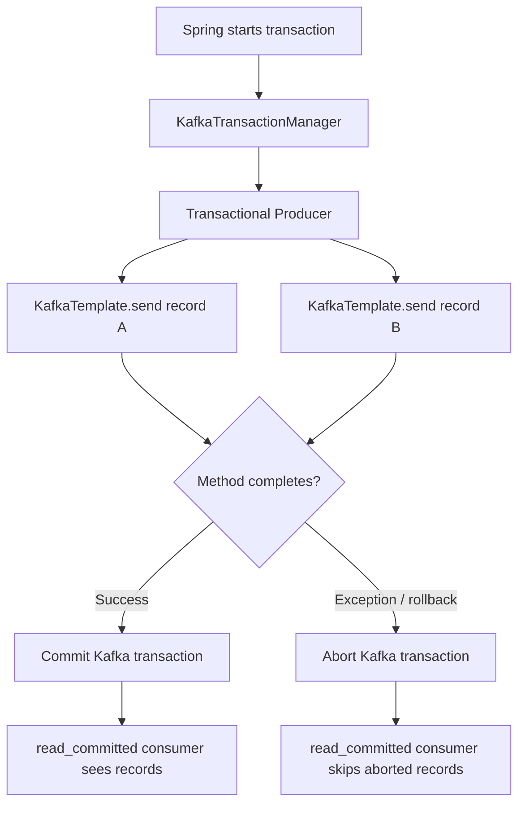
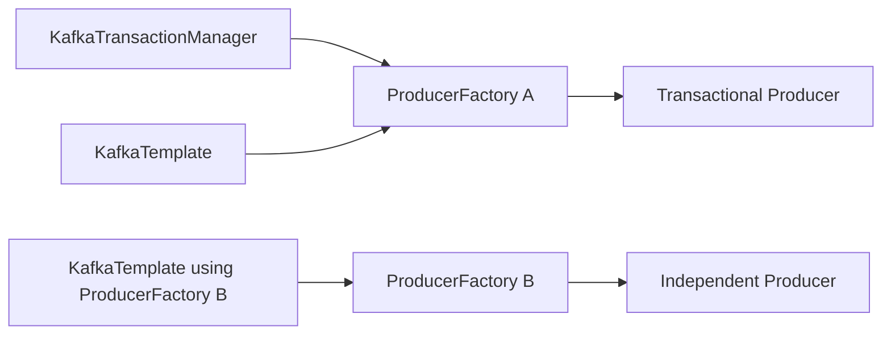
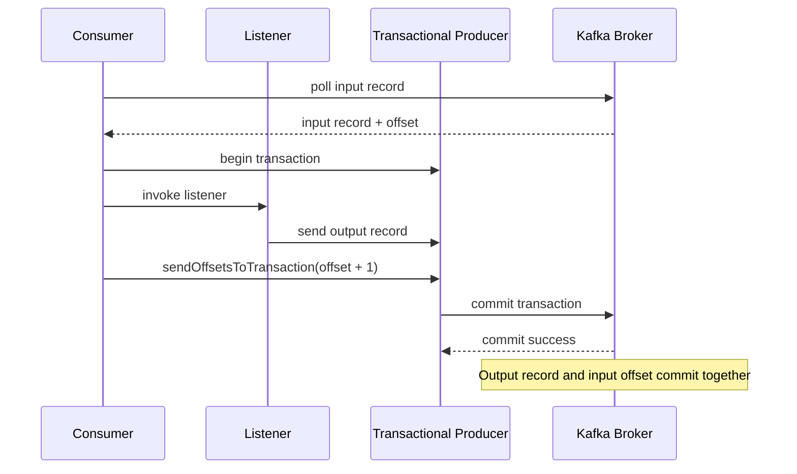

# KafkaTransactionManager

`KafkaTransactionManager` is Spring's `PlatformTransactionManager` implementation for Kafka. It connects the Spring transaction abstraction to Kafka's transactional producer so that applications can use `@Transactional`, `TransactionTemplate`, or listener containers to commit or roll back Kafka sends as a single transaction.

The core requirement is that the producer factory must be transaction-capable and `KafkaTemplate` must use the same `ProducerFactory` as the transaction manager. When a transaction is active, `KafkaTemplate.send(...)` calls on the same thread use the producer bound to that transaction. If processing succeeds, the transaction is committed; if an exception triggers a rollback, records sent in that transaction are aborted and `read_committed` consumers will not see them.

## 1. What problem does `KafkaTransactionManager` solve?

If multiple records are sent independently, some records may be written successfully while another fails. This can leave an inconsistent state in an event flow that must be published as a single unit.

Kafka transactions allow grouping multiple write operations into a single commit/abort unit. `KafkaTransactionManager` brings that mechanism into Spring transactions:

- Starts a Kafka transaction when Spring starts a transaction.
- Binds a transactional producer to the current thread.
- Allows `KafkaTemplate` to participate in the active transaction.
- Commits when the transaction completes successfully.
- Aborts when the transaction is rolled back.



Kafka transactions can also combine writing output records with committing consumer offsets in the same transaction. This is the foundation for consume-process-produce with exactly-once semantics within Kafka.

## 2. Prerequisites for enabling Kafka transactions

Spring Kafka enables transactions by configuring `transactionIdPrefix` on `DefaultKafkaProducerFactory`. When a prefix is set, the factory manages a cache of transactional producers rather than using a single shared producer. Each producer receives a distinct `transactional.id` formed from the prefix and a suffix.

With Spring Boot, the concise way is to declare `spring.kafka.producer.transaction-id-prefix`:

```yaml
spring:
  kafka:
    bootstrap-servers: localhost:9092
    producer:
      transaction-id-prefix: ${INSTANCE_ID:local}-orders-
      key-serializer: org.apache.kafka.common.serialization.StringSerializer
      value-serializer: org.springframework.kafka.support.serializer.JsonSerializer
```

When this property is configured, Spring Boot auto-configures a transactional producer factory, creates a `KafkaTransactionManager` bean, and attaches the manager to the default listener container. If running multiple application instances, `INSTANCE_ID` must differ on each instance. Do not use the same static prefix across all pods/replicas because producers can fence one another.

`transactionIdPrefix` is a transaction identity prefix, not a consumer group ID. The prefix must be stable across an instance's lifecycle while remaining unique across concurrently running instances.

### Configuring `ProducerFactory` manually

If not using Spring Boot auto-configuration or when a dedicated producer factory is needed, set the prefix on `DefaultKafkaProducerFactory`:

```java
import java.util.HashMap;
import java.util.Map;

import org.apache.kafka.clients.producer.ProducerConfig;
import org.apache.kafka.common.serialization.StringSerializer;
import org.springframework.kafka.core.DefaultKafkaProducerFactory;
import org.springframework.kafka.core.ProducerFactory;
import org.springframework.kafka.support.serializer.JsonSerializer;

Map<String, Object> props = new HashMap<>();
props.put(ProducerConfig.BOOTSTRAP_SERVERS_CONFIG, "localhost:9092");
props.put(ProducerConfig.KEY_SERIALIZER_CLASS_CONFIG, StringSerializer.class);
props.put(ProducerConfig.VALUE_SERIALIZER_CLASS_CONFIG, JsonSerializer.class);

DefaultKafkaProducerFactory<String, OrderEvent> producerFactory =
        new DefaultKafkaProducerFactory<>(props);
producerFactory.setTransactionIdPrefix("orders-instance-01-");
```

A custom producer factory passed into `KafkaTransactionManager` must return `true` from `transactionCapable()`. If the factory does not support transactions, the `KafkaTransactionManager` constructor will reject that configuration.

## 3. Declaring the `KafkaTransactionManager` bean

When Spring Boot has `spring.kafka.producer.transaction-id-prefix` configured, Boot creates the manager automatically. There is no need to declare a duplicate manager if the auto-configured bean meets your requirements.

If managing the producer factory manually, create the manager from that exact factory:

```java
import org.springframework.context.annotation.Bean;
import org.springframework.context.annotation.Configuration;
import org.springframework.kafka.core.ProducerFactory;
import org.springframework.kafka.transaction.KafkaTransactionManager;

@Configuration
public class KafkaTransactionConfiguration {

    @Bean
    KafkaTransactionManager<String, OrderEvent> kafkaTransactionManager(
            ProducerFactory<String, OrderEvent> producerFactory) {
        return new KafkaTransactionManager<>(producerFactory);
    }
}
```

`KafkaTransactionManager` takes a `ProducerFactory` in its constructor. This factory must be the transactional factory configured with the prefix. The `KafkaTemplate` used inside the transaction must also use that exact factory; if the template uses a different factory, it will not participate in the same transaction.

In the following examples, `OrderCreatedEvent`, `OrderPaidEvent`, and `OrderSummaryEvent` all implement an `OrderEvent` contract with an `orderId()` method:

```java
public interface OrderEvent {
    String orderId();
}
```

## 4. Using `@Transactional` for the producer

When you want multiple Kafka sends to commit or abort together, annotate the service method with `@Transactional` and select `KafkaTransactionManager`:

```java
import org.springframework.kafka.core.KafkaTemplate;
import org.springframework.stereotype.Service;
import org.springframework.transaction.annotation.Transactional;

@Service
public class OrderEventPublisher {

    private final KafkaTemplate<String, OrderEvent> kafkaTemplate;

    public OrderEventPublisher(KafkaTemplate<String, OrderEvent> kafkaTemplate) {
        this.kafkaTemplate = kafkaTemplate;
    }

    @Transactional(transactionManager = "kafkaTransactionManager")
    public void publishOrder(OrderEvent created, OrderEvent paid) {
        kafkaTemplate.send("orders.events", created.orderId(), created);
        kafkaTemplate.send("orders.events", paid.orderId(), paid);

        // If a RuntimeException occurs here, the entire Kafka transaction is rolled back.
    }
}
```

Inside the transaction:

1. Spring invokes `KafkaTransactionManager` to begin the transaction.
2. A producer is bound to the current thread.
3. Both `send()` calls use the same transactional producer.
4. If the method completes, the manager commits the transaction.
5. If the method throws an exception that triggers rollback, the manager aborts the transaction.

By default, Spring rolls back on `RuntimeException` and `Error`. To roll back on checked exceptions as well, declare `rollbackFor`, for example `@Transactional(transactionManager = "kafkaTransactionManager", rollbackFor = Exception.class)`.

The method must be called through the Spring transaction proxy. Calling a `@Transactional` method from another method in the same instance (self-invocation) normally bypasses the proxy, so the transaction annotation may not be applied as expected.

Do not call `beginTransaction()`, `commitTransaction()`, or `abortTransaction()` directly on the Kafka producer when using `KafkaTransactionManager`. The manager is responsible for the transaction lifecycle.

## 5. `KafkaTemplate` must use the same `ProducerFactory`

This is a critical configuration requirement. The transaction manager binds producers by `ProducerFactory`; only `KafkaTemplate` operations using the exact same factory participate in the active transaction.



If `KafkaTemplate` uses `ProducerFactory B` while the manager uses `ProducerFactory A`, sends may execute outside the intended transaction or fail because the template requires a transaction and cannot find a matching one.

When an application has multiple templates, inspect each template injected into services. Templates that need to participate in the same Kafka transaction must share the corresponding producer factory.

## 6. Using `TransactionTemplate`

If you prefer not to place annotations on methods, you can use `TransactionTemplate` with `KafkaTransactionManager`:

```java
import org.springframework.kafka.core.KafkaTemplate;
import org.springframework.kafka.transaction.KafkaTransactionManager;
import org.springframework.transaction.support.TransactionTemplate;

public class OrderPublisher {

    private final KafkaTemplate<String, OrderEvent> kafkaTemplate;
    private final TransactionTemplate transactionTemplate;

    public OrderPublisher(
            KafkaTemplate<String, OrderEvent> kafkaTemplate,
            KafkaTransactionManager<String, OrderEvent> transactionManager) {
        this.kafkaTemplate = kafkaTemplate;
        this.transactionTemplate = new TransactionTemplate(transactionManager);
    }

    public void publish(OrderEvent first, OrderEvent second) {
        transactionTemplate.executeWithoutResult(status -> {
            kafkaTemplate.send("orders.events", first.orderId(), first);
            kafkaTemplate.send("orders.events", second.orderId(), second);
        });
    }
}
```

`TransactionTemplate` begins and ends the transaction around the callback. If the callback throws a runtime exception, the transaction is rolled back; if the callback completes normally, the transaction commits.

## 7. Local transactions with `KafkaTemplate.executeInTransaction`

If you only need a local transaction around a group of Kafka send calls, you can use `KafkaTemplate.executeInTransaction(...)`:

```java
boolean result = kafkaTemplate.executeInTransaction(template -> {
    template.send("orders.events", "O100", createdEvent);
    template.send("orders.audit", "O100", auditEvent);
    return true;
});
```

If the callback completes normally, the transaction is committed and the callback's return value is returned to the caller. If the callback throws an exception, the transaction is aborted and the exception is propagated out.

Note: `executeInTransaction()` creates a separate local transaction. If a transaction managed by `KafkaTransactionManager` or synchronized transaction is already active, this method does not join the existing transaction; it starts an independent nested transaction. Therefore, do not call it inside `@Transactional` assuming all operations will commit or roll back as a single transaction.

## 8. Transactional listener container

For a consumer that needs to read a record, process it, and then send new events, you can configure the listener container with `KafkaTransactionManager`. The container starts a Kafka transaction before invoking the listener.

In Spring Kafka 3.2 and later, configure it via `setKafkaAwareTransactionManager(...)`:

```java
import org.springframework.context.annotation.Bean;
import org.springframework.context.annotation.Configuration;
import org.springframework.kafka.config.ConcurrentKafkaListenerContainerFactory;
import org.springframework.kafka.core.ConsumerFactory;
import org.springframework.kafka.transaction.KafkaTransactionManager;

@Configuration
public class KafkaListenerConfiguration {

    @Bean
    ConcurrentKafkaListenerContainerFactory<String, OrderEvent>
    transactionalKafkaListenerContainerFactory(
            ConsumerFactory<String, OrderEvent> consumerFactory,
            KafkaTransactionManager<String, OrderEvent> kafkaTransactionManager) {

        var factory =
                new ConcurrentKafkaListenerContainerFactory<String, OrderEvent>();
        factory.setConsumerFactory(consumerFactory);
        factory.getContainerProperties()
                .setKafkaAwareTransactionManager(kafkaTransactionManager);
        return factory;
    }
}
```

Prior to Spring Kafka 3.2, the older API was `setTransactionManager(...)`; that method was deprecated in 3.2 in favor of `setKafkaAwareTransactionManager(...)`.

The factory in the example receives the manager created from `ProducerFactory<String, OrderEvent>` from the earlier section. The listener's `KafkaTemplate` must also use the same producer factory; with Spring Boot auto-configuration, the default template already uses the Boot-created producer factory. If configuring the template manually, create it with `new KafkaTemplate<>(producerFactory)` using the exact factory passed to the manager.

The listener can read one event and send another:

```java
import org.springframework.kafka.annotation.KafkaListener;
import org.springframework.kafka.core.KafkaTemplate;
import org.springframework.stereotype.Component;

@Component
public class OrderProjectionListener {

    private final KafkaTemplate<String, OrderEvent> kafkaTemplate;

    public OrderProjectionListener(
            KafkaTemplate<String, OrderEvent> kafkaTemplate) {
        this.kafkaTemplate = kafkaTemplate;
    }

    @KafkaListener(
            topics = "orders.events",
            groupId = "order-projection",
            containerFactory = "transactionalKafkaListenerContainerFactory"
    )
    public void onOrderEvent(OrderEvent event) {
        OrderSummaryEvent summary = OrderSummaryEvent.from(event);
        kafkaTemplate.send("orders.summary", event.orderId(), summary);
    }
}
```

When the listener completes successfully, the container sends the processed offsets into the Kafka transaction via `sendOffsetsToTransaction()` and then commits the transaction. Output records and input offsets are therefore committed together. If the listener throws an exception, the transaction rolls back and the input record is re-read according to the container's rollback/recovery mechanism.

In this example, `KafkaTransactionManager<String, OrderEvent>` and `KafkaTemplate<String, OrderEvent>` share the same producer factory. `ConsumerFactory<String, OrderEvent>` is the consumer-side factory used by the listener container to read input records; the producer factory and consumer factory are two separate resources.

## 9. Consume-process-produce and exactly-once semantics

A transactional listener container supports the consume-process-produce flow:



If the process crashes before commit, the Kafka transaction is aborted or times out and the input offset has not been committed with that transaction; the record can be processed again. If the commit succeeds, both the output record and the input offset are recorded together.

For consumers to read only committed data, configure:

```yaml
spring:
  kafka:
    consumer:
      properties:
        isolation.level: read_committed
```

`read_committed` ensures the consumer returns only records belonging to committed transactions and skips records from aborted transactions. If using `read_uncommitted`, the consumer may observe records from uncommitted or aborted transactions.

Exactly-once semantics here apply to the Kafka consume-process-produce chain and consumer group offsets. It does not automatically include databases, HTTP APIs, email, or side effects outside Kafka. If a listener updates a database, idempotency, DB transactions, and a coordination strategy across the two systems are still required.

## 10. Combining Kafka transactions with database transactions

`KafkaTransactionManager` manages the Kafka resource; it does not turn Kafka and a database into an XA distributed transaction. There are two common patterns.

`KafkaTransactionManager` disables its own transaction synchronization by default because it can be used alongside another transaction manager; only one manager controls synchronization at a time. In the producer-only model below, the database transaction is the primary transaction and `KafkaTemplate` registers a Kafka transaction to synchronize commits.

### Producer-only: database transaction is the primary transaction

If a method uses `DataSourceTransactionManager` and calls `KafkaTemplate.send(...)`, Spring Kafka can synchronize the Kafka transaction with the database transaction. By default, the database commits first, and then the Kafka transaction commits:

```java
@Transactional(transactionManager = "transactionManager")
public void updateOrderAndPublish(Order order) {
    orderRepository.save(order);
    kafkaTemplate.send("orders.events", order.id(), OrderEvent.from(order));
}
```

If the database commits successfully but the Kafka commit fails, the database data has changed while the event has not been published. Spring can propagate the Kafka commit error to the caller, but it cannot automatically roll back the already-committed database. The application needs compensation logic or a transactional outbox if this gap is unacceptable.

### Consumer-initiated: container opens Kafka transaction, listener opens DB transaction

Another pattern is having the container start the Kafka transaction and using `@Transactional` on the listener method to manage the database:

```java
@KafkaListener(
        topics = "orders.events",
        groupId = "order-projection",
        containerFactory = "transactionalKafkaListenerContainerFactory"
)
@Transactional(transactionManager = "transactionManager")
public void onOrderEvent(OrderEvent event) {
    orderRepository.apply(event);
    kafkaTemplate.send("orders.audit", event.orderId(), OrderAuditEvent.from(event));
}
```

The database transaction completes when the listener method returns; then the container adds the offset to the Kafka transaction and commits Kafka. If the database transaction fails, the exception rolls back the Kafka transaction. If the database commits successfully yet the Kafka commit fails, the input record can be redelivered and the database side effect may repeat. Thus, the DB handler must still be idempotent, for example using `eventId` with a unique constraint or an inbox table.

`ChainedKafkaTransactionManager` has been deprecated since Spring Kafka 2.7. For consumer-initiated transactions, the current approach is configuring `KafkaTransactionManager` on the listener container and using `@Transactional` for the database transaction inside the listener when needed.

## 11. Limitations to understand

| Limitation | Operational implication |
|---|---|
| One manager is tied to one `ProducerFactory` | Only templates using that exact factory join the transaction. |
| Transactions are thread-bound | Sends on another thread or executor do not automatically join the current transaction. |
| Kafka has no database-style isolation levels | `KafkaTransactionManager` does not support isolation levels other than `ISOLATION_DEFAULT`. |
| The transaction manager does not set a database-style transaction timeout | `KafkaTransactionManager` does not apply timeouts from `TransactionDefinition`; Kafka transaction time limits are governed by `transaction.timeout.ms` and broker policy. |
| Transactions do not automatically cover DB/HTTP | External side effects require their own transaction manager, idempotency, or outbox. |
| Transactional IDs must be unique per instance | Duplicate prefixes can cause `ProducerFencedException` when multiple instances run. |
| Transactions hold broker resources | Overly long transactions can time out, keep open transactions alive, and impact `read_committed` consumers. |
| Non-blocking retry does not combine with container transactions | `@RetryableTopic` and container transactions have incompatible semantics; listener errors can cause the container transaction to commit before the record is routed to a retry topic. |

### Transaction timeout and idle producers

`transaction.timeout.ms` defines the maximum time the Kafka broker waits for a transaction to finish; this value must fall within the broker's `transaction.max.timeout.ms` limit. Listeners should not perform slow I/O or wait on user interaction inside an open transaction.

When cached transactional producers stay idle longer than the broker's `transactional.id.expiration.ms`, the producer may be fenced upon reuse. Spring Kafka supports `maxAge` on the producer factory to refresh producers before reaching the expiration limit; choose a `maxAge` lower than the broker expiration if your workload has long-idle producers.

## 12. Common errors

| Symptom | Cause | Resolution |
|---|---|---|
| `KafkaTransactionManager` fails to initialize | `ProducerFactory` is not transaction-capable or lacks a transaction ID prefix. | Configure `transactionIdPrefix` on `DefaultKafkaProducerFactory`. |
| `KafkaTemplate` reports no transaction | Template uses a different producer factory or is called outside a transaction when a transaction is required. | Use the same factory and invoke within `@Transactional`, `TransactionTemplate`, or a container transaction. |
| Multiple instances continuously fence each other | Instances share the same transaction ID prefix. | Generate a unique prefix per pod/instance. |
| Consumer reads aborted records | Consumer is using `read_uncommitted`. | Configure `isolation.level=read_committed` for consumers that must read only committed records. |
| DB commits but Kafka event is missing | The two resources commit sequentially; Kafka commit happens after DB commit and fails. | Use outbox, idempotency, and appropriate compensation processes. |
| Record is reprocessed after Kafka commit failure | Input offset and Kafka output were not committed together, or an external side effect committed first. | Use container transactions for Kafka flows and idempotency for non-Kafka systems. |
| Transaction timeout | Listener takes too long or broker timeout is low. | Shorten transactions, adjust timeout per broker policy, and remove slow I/O inside transactions. |
| `NoProducerAvailableException` under high concurrency | Transactional producer suffix pool has `maxCache` smaller than required concurrent transactions. | Tune `maxCache` for concurrency and nested transactions when using bounded suffix strategies. |
| Calling `executeInTransaction()` does not roll back outer transaction | The API creates an independent local transaction rather than joining the active transaction. | Use `KafkaTemplate` directly inside the current transaction if you want to join that transaction. |

## 13. Testing `KafkaTransactionManager`

Test both commit and rollback paths against a real broker, Embedded Kafka, or Testcontainers with transaction support:

1. Send multiple records inside a `@Transactional` method and verify all appear upon commit.
2. Send records and throw an exception; a `read_committed` consumer must not see records from the aborted transaction.
3. Use a `read_uncommitted` consumer in a comparison test if you want to observe the isolation level difference.
4. With a transactional listener container, verify output records and input offsets commit together.
5. Throw an exception inside the listener to verify the Kafka transaction rolls back and the record is redelivered as configured.
6. If a database is involved, test the scenario where DB commits successfully while Kafka commit fails and verify idempotency/outbox.
7. Verify distinct prefixes across test instances if running multiple application contexts concurrently.

Conceptual assertion example for the rollback path:

```java
assertThatThrownBy(() -> orderPublisher.publishAndFail(event))
        .isInstanceOf(IllegalStateException.class);

// Test consumer configured with isolation.level=read_committed.
// Poll within a finite timeout and verify no aborted records are present.
```

This illustrates only the assertion part; a complete test needs dedicated topics, dedicated group IDs, waiting for consumer assignment, and polling with finite timeouts. Do not use fixed `Thread.sleep` calls to guess whether a transaction has committed or aborted.

## 14. Key takeaways

- `KafkaTransactionManager` implements Spring's `PlatformTransactionManager` for Kafka.
- Enable transactions using `transactionIdPrefix` on `DefaultKafkaProducerFactory`; Spring Boot uses `spring.kafka.producer.transaction-id-prefix`.
- Every application instance requires its own transaction ID prefix.
- `KafkaTemplate` must use the same `ProducerFactory` as the transaction manager to join the transaction.
- Use `@Transactional`, `TransactionTemplate`, or `KafkaTemplate.executeInTransaction()` to manage producer transactions.
- `executeInTransaction()` creates a separate local transaction and does not join an active transaction.
- Transactional listener containers commit output records and input offsets in the same Kafka transaction.
- Consumers need `isolation.level=read_committed` to read only committed transactions.
- Exactly-once in Kafka does not automatically include databases or external systems; use outbox/idempotency when needed.
- From Spring Kafka 3.2 onward, use `setKafkaAwareTransactionManager()` on the listener container; the older `setTransactionManager()` is deprecated.
- Keep transactions short, and monitor timeouts, producer fencing, and transactional producer pool demand.

`KafkaTransactionManager` bridges Spring transactions and Kafka's transactional producer. When using the right producer factory, a unique transaction ID prefix, and a single execution thread, applications can group multiple sends or combine output records with input offsets into one Kafka transaction. For databases or services outside Kafka, separate synchronization and idempotency designs are still needed because Kafka transactions are not distributed transactions spanning every system.

## References

- [Spring for Apache Kafka — Transactions](https://docs.spring.io/spring-kafka/reference/kafka/transactions.html)
- [Spring Kafka — KafkaTransactionManager API](https://docs.spring.io/spring-kafka/api/org/springframework/kafka/transaction/KafkaTransactionManager.html)
- [Spring Kafka — ContainerProperties API](https://docs.spring.io/spring-kafka/api/org/springframework/kafka/listener/ContainerProperties.html)
- [Apache Kafka — Producer Configurations](https://kafka.apache.org/documentation/#producerconfigs)
