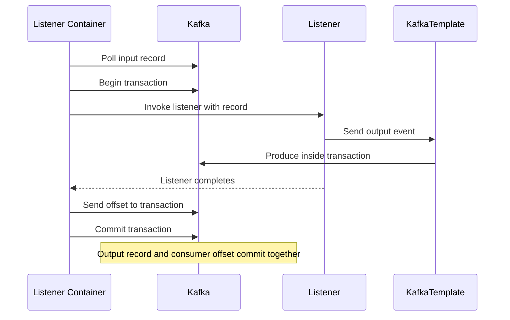

# Consumer-initiated transactions

In an event-processing Kafka flow, a consumer typically reads a record, executes business logic, and may emit a new event. If the consumer commits the offset while emitting the output event has not succeeded, the system can lose the result it needed to publish. If it emits the event first and the consumer stops before committing the offset, the input record can be reprocessed and produce duplicate events.

Consumer-initiated transactions close this gap by having the listener container begin a Kafka transaction for each processing attempt. Records sent via `KafkaTemplate` participate in that transaction, and the processed record's offset is sent into the same transaction. When the transaction commits, both output events and the input offset commit together; if it rolls back, neither is considered completed.

This mechanism is the foundation for consume-transform-produce flows with exactly-once semantics in Kafka. It covers only Kafka operations participating in the transaction; databases, HTTP APIs, or external systems outside Kafka require a separate coordination strategy.

## 1. What is a consumer-initiated transaction?

In Spring Kafka, the listener container can manage the transaction instead of having each listener open a transaction itself. When configured with `KafkaTransactionManager`, the container starts a transaction before invoking the listener.

While the listener runs:

- The listener reads a record from Kafka.
- `KafkaTemplate` using the same `ProducerFactory` sends output events into the active transaction.
- When the listener completes successfully, the container enlists the processed record's offset into the transaction.
- The container commits the transaction. Kafka commits both the output records and the consumer offset simultaneously.
- If the listener throws an exception, the transaction rolls back; output records in the transaction are aborted and the input offset is not committed by that transaction.

The flow can be visualized as follows:



This is called consumer-initiated because the transaction starts from the consumption process driven by the listener container. The listener focuses solely on business processing and sending output events.

## 2. Distinguishing from producer-initiated transactions

Spring Kafka also allows the application to proactively start a transaction on the producer side, for example with `KafkaTemplate.executeInTransaction(...)`. This fits when a block of code needs to send multiple Kafka records as an atomic unit, yet it does not automatically include the offset of a consuming listener.

| Criterion | Consumer-initiated | Producer-initiated |
|---|---|---|
| Who starts the transaction? | Listener container | Application calling producer transaction API |
| Consumer offset | Container enlists offset in the transaction | Does not automatically include the listener's offset |
| Sending output events | `KafkaTemplate` joins container transaction | Code sends inside the producer-opened transaction |
| Common purpose | Consume-transform-produce | Atomically sending multiple Kafka records |
| Rollback | Listener error triggers container transaction rollback | Code inside producer transaction throws or rolls back |

Producer-initiated example:

```java
kafkaTemplate.executeInTransaction(operations -> {
    operations.send("order-created", orderId, createdEvent);
    operations.send("audit-events", orderId, auditEvent);
    return true;
});
```

Both records are sent in the same producer transaction. However, if this snippet runs inside a listener, the input record's offset does not automatically become part of the newly opened transaction. To bind consumer offsets with outputs, configure transactions on the listener container.

Inside a listener that already has a container transaction, you normally just call `kafkaTemplate.send(...)` on the same producer factory. Do not open an independent transaction via `executeInTransaction` if the goal is for output records to join the container's transaction.

## 3. Configuring the transactional producer

The Kafka producer must be configured with a transaction ID prefix. With Spring Boot, you can declare:

```yaml
spring:
  application:
    name: order-service
  kafka:
    producer:
      transaction-id-prefix: ${spring.application.name}-${INSTANCE_ID}-
    consumer:
      properties:
        isolation.level: read_committed
```

`transaction-id-prefix` causes the producer factory to create transactional producers. The `INSTANCE_ID` part must be unique across concurrently running instances. If multiple pods or processes share the same prefix, they can collide on transactional IDs and fence one another.

In a local environment running only a single instance, you can set a fixed value. In production, use a stable, unique instance identifier suited to your deployment method, such as pod identity.

Configuring `isolation.level: read_committed` ensures the consumer reads only records belonging to committed transactions. If a consumer uses `read_uncommitted`, it may observe records from a transaction that is later aborted. For pipelines that need to observe exactly-once outcomes, consumers reading transactional outputs should use `read_committed`.

## 4. Declaring `KafkaTransactionManager`

`KafkaTransactionManager` connects Spring's transaction infrastructure with a transaction-capable producer factory. It must use the same `ProducerFactory` as the `KafkaTemplate` sending output events.

```java
import org.springframework.context.annotation.Bean;
import org.springframework.context.annotation.Configuration;
import org.springframework.kafka.core.ProducerFactory;
import org.springframework.kafka.transaction.KafkaTransactionManager;

@Configuration
class KafkaTransactionConfiguration {

    @Bean
    KafkaTransactionManager<String, Object> kafkaTransactionManager(
            ProducerFactory<String, Object> producerFactory) {

        return new KafkaTransactionManager<>(producerFactory);
    }
}
```

The example assumes the application already has a transactional `ProducerFactory<String, Object>` configured from `transaction-id-prefix`. If creating the producer factory manually instead of using Spring Boot auto-configuration, call `setTransactionIdPrefix(...)` on `DefaultKafkaProducerFactory`.

Ensure `KafkaTemplate` is also created from that exact producer factory. If the template uses a different producer factory, sends may not participate in the transaction managed by the listener container.

## 5. Attaching the transaction manager to the listener container

The listener container needs to know which transaction manager governs each processing invocation. With Spring Boot, you can use the configurer to preserve already-bound consumer configurations:

```java
import org.springframework.boot.autoconfigure.kafka.ConcurrentKafkaListenerContainerFactoryConfigurer;
import org.springframework.context.annotation.Bean;
import org.springframework.kafka.config.ConcurrentKafkaListenerContainerFactory;
import org.springframework.kafka.core.ConsumerFactory;
import org.springframework.kafka.transaction.KafkaTransactionManager;

@Bean
ConcurrentKafkaListenerContainerFactory<String, OrderEvent>
orderListenerFactory(
        ConcurrentKafkaListenerContainerFactoryConfigurer configurer,
        ConsumerFactory<String, OrderEvent> consumerFactory,
        KafkaTransactionManager<String, Object> kafkaTransactionManager) {

    var factory =
            new ConcurrentKafkaListenerContainerFactory<String, OrderEvent>();

    configurer.configure(factory, consumerFactory);

    factory.getContainerProperties()
            .setKafkaAwareTransactionManager(kafkaTransactionManager);

    return factory;
}
```

The `setKafkaAwareTransactionManager(...)` method is the API used in Spring Kafka versions prior to 3.2. In Spring Kafka 3.2 and later, use `setTransactionManager(...)` on `ContainerProperties` according to the API of your running version.

Then specify this factory on the listener:

```java
@KafkaListener(
        topics = "orders",
        groupId = "order-processor",
        containerFactory = "orderListenerFactory")
public void process(OrderEvent event) {
    // Process inside the container-started transaction.
}
```

When a listener factory is configured with a transaction manager, the container starts a transaction for each listener invocation. When using a batch listener, the transaction boundary typically covers the batch-processing invocation; the batch offsets are added to the transaction upon successful processing.

## 6. Sending output events in the same transaction

A consume-transform-produce example:

```java
@Component
public class OrderProjectionListener {

    private final OrderService orderService;
    private final KafkaTemplate<String, Object> kafkaTemplate;

    public OrderProjectionListener(
            OrderService orderService,
            KafkaTemplate<String, Object> kafkaTemplate) {
        this.orderService = orderService;
        this.kafkaTemplate = kafkaTemplate;
    }

    @KafkaListener(
            topics = "orders",
            groupId = "order-projection",
            containerFactory = "orderListenerFactory")
    public void process(OrderEvent event) {
        OrderProjection projection =
                orderService.createProjection(event);

        kafkaTemplate.send(
                "order-projections",
                event.orderId(),
                projection
        );

        kafkaTemplate.send(
                "order-audit",
                event.orderId(),
                new OrderProcessed(event.orderId())
        );
    }
}
```

Both send calls use a `KafkaTemplate` configured with the producer factory participating in the container transaction. When the listener method finishes normally, the container enlists the input record's offset in the transaction and commits.

There are two possible outcomes:

| Listener outcome | Output records | Input offset |
|---|---|---|
| Completes and transaction commits | Committed together | Committed in the same transaction |
| Throws exception and transaction rolls back | Aborted | Not committed by that transaction |

Send operations must happen on the active transaction's thread. If sending work is dispatched to an executor or another thread, the transaction context does not automatically propagate to that thread; those sends can run outside the intended transaction.

## 7. What happens when the listener fails?

Suppose the listener has already sent an output event, then detects invalid data and throws an exception. The container rolls back the Kafka transaction.

This means:

- Output records sent in the transaction are aborted and are not visible to `read_committed` consumers.
- The input offset is not committed in the rolled-back transaction.
- The input record can be redelivered after the container handles rollback.
- The retry attempt can start a new transaction.

The post-rollback path is controlled by `AfterRollbackProcessor`. Spring Kafka provides `DefaultAfterRollbackProcessor` to seek and redeliver records, combined with backoff and recovery after a configured number of attempts. With transactional listeners, design retry/recovery around the appropriate rollback processor mechanism; do not assume `DefaultErrorHandler` behaves identically to a non-transactional listener flow.

An error during transaction commit must also be treated as an uncertain outcome by the application until the producer/container finishes handling it. The Kafka transaction protocol and producer fencing protect commit state, yet business operations outside Kafka still require safe handling of redeliveries.

## 8. Consumer isolation and aborted records

A transactional producer can write records and then roll back. Those records can still physically exist in the Kafka log with an aborted transaction status.

Consumers decide how to view these records via `isolation.level`:

| Value | Behavior |
|---|---|
| `read_uncommitted` | May read records belonging to uncommitted or aborted transactions |
| `read_committed` | Returns only records belonging to committed transactions |

For consumers reading data produced by a transactional listener, configure `read_committed`. Otherwise, downstream consumers could process output records that are later rolled back, defeating the atomicity created by the producer transaction.

When using `read_committed`, consumers can be constrained by the Last Stable Offset (LSO). An open transaction on a partition can prevent later records from being returned until the transaction finishes. Therefore, transactions should be short and avoid long-waiting operations such as external API calls or waiting on user input.

## 9. Consumer-initiated transactions and exactly-once

For consume-transform-produce pipelines, the goal of exactly-once is ensuring that once an input record is processed, its corresponding output records and input offset are committed atomically in Kafka.

If the transaction rolls back, outputs are not read by `read_committed` consumers and the input offset is not committed. The record can be reprocessed. If the transaction commits, outputs and offset complete together. This prevents consumers from reading outputs created by a rolled-back processing attempt.

It is important to distinguish:

- **Exactly-once in Kafka:** output records and consumer offsets are committed in the same transaction.
- **Idempotent producer:** avoids duplicates from request retries at the producer layer within Kafka producer scope.
- **Idempotent business operation:** protects databases or external systems from duplicate side effects.
- **End-to-end exactly-once:** not automatically achieved by Kafka transactions alone if the pipeline also updates databases, calls HTTP APIs, or writes to other systems.

If a listener updates a database and then emits a Kafka event, a Kafka transaction does not automatically roll back the database when the Kafka transaction fails. For synchronizing database state and events, consider transactional outbox, CDC, or a suitable coordination design.

## 10. Transaction boundaries and operations outside Kafka

A Kafka transaction manages only the Kafka resources participating in that transaction. For example:

```text
Kafka input record
       |
       v
Listener container starts Kafka transaction
       |
       +--> KafkaTemplate sends output record
       |
       +--> Container adds consumed offset
       |
       v
Kafka transaction commit / rollback
```

If the listener also calls a database:

```text
Kafka transaction
       |
       +--> Send Kafka output
       |
       +--> Update relational database
```

These two operations do not automatically form a distributed transaction. Cases can arise where the database commits while the Kafka transaction rolls back, or vice versa depending on transaction manager coordination and commit order.

For data requiring durable synchronization between a database and Kafka, transactional outbox is often a clear choice: write business changes and an outbox row in the same database transaction, then let a publisher/CDC forward the outbox event to Kafka. Downstream consumers should still be idempotent to handle redeliveries.

## 11. Timeout configuration and operating transactions

Transactions increase time and resource requirements. Key settings to review:

| Component | Role | What to watch |
|---|---|---|
| `transaction-id-prefix` | Generates transactional IDs for producers | Must be unique across instances |
| `transaction.timeout.ms` | Kafka transaction time limit | Sufficient for the work, yet not overly long |
| `max.poll.interval.ms` | Time limit between polls | Listener must not hold the consumer for too long |
| `isolation.level` | Determines whether consumers read aborted records | Use `read_committed` for transactional pipelines |
| Producer cache | Manages reusable transactional producers | Must fit concurrency and simultaneous transactions |

Avoid executing long-running tasks inside a transaction, such as calling external APIs with high timeouts, waiting on distributed locks, or processing huge files. Long open transactions hold producer resources, can increase `read_committed` consumer LSO latency, and make rebalance recovery harder.

Measure transaction duration, rollback counts, producer fencing, commit errors, and consumer lag. When increasing concurrency, verify the producer factory has enough transactional producers to serve concurrent listener containers.

## 12. Testing consumer-initiated transactions

Tests must prove that outputs and offsets commit or roll back together. You can use Embedded Kafka or Testcontainers to run a real broker in integration tests.

Key scenarios:

1. Listener receives input, sends output, and completes: `read_committed` consumer sees the output.
2. Listener sends output and then throws an exception: `read_committed` consumer does not see the aborted output.
3. Input is redelivered after rollback: offset was not committed by the failed transaction.
4. Listener retry succeeds on the next attempt: output and offset finally commit together.
5. Downstream consumer uses `read_committed`: does not receive records from aborted transactions.
6. Multiple listener containers run concurrently: transactional IDs do not collide across instances.
7. Producer fencing or transaction timeout occurs: the system logs errors and recovers per policy.

For example, testing listener logic with mocks only confirms `KafkaTemplate` invocations; it does not prove transactions actually commit atomically. To verify transaction semantics, integration tests with a broker and a `isolation.level=read_committed` consumer are needed.

## 13. Common errors

| Symptom | Possible cause | Resolution |
|---|---|---|
| Producer reports invalid transactional ID | Producer factory lacks a transaction ID prefix | Configure `transaction-id-prefix` |
| Instances fence each other | Shared prefix/transactional ID across instances | Create a unique prefix per instance |
| Output appears despite listener rollback | Template does not use container's producer factory or consumer reads `read_uncommitted` | Share the producer factory and check isolation |
| Offset commits even though output is missing | Output send ran outside the container transaction | Use a template participating in the container transaction |
| Transaction timeout | Listener takes too long | Shorten transactions and align timeouts |
| Retries behave unexpectedly | Wrong error handler used instead of rollback processor | Configure `AfterRollbackProcessor` |
| Database and Kafka diverge | Assuming Kafka transactions cover the database | Use outbox or an appropriate coordination mechanism |

## 14. Deployment checklist

- [ ] Producer factory has transactions enabled via `transaction-id-prefix`.
- [ ] Prefix is unique across concurrently running instances.
- [ ] `KafkaTransactionManager` uses the same producer factory as `KafkaTemplate`.
- [ ] Listener container has the transaction manager attached.
- [ ] `KafkaTemplate.send()` is invoked on the listener thread to join the transaction.
- [ ] Container enlists offsets in the transaction when the listener succeeds.
- [ ] Downstream consumers use `read_committed`.
- [ ] Rollback and retry are configured via an appropriate `AfterRollbackProcessor`.
- [ ] Transactions do not contain long-waiting operations outside Kafka.
- [ ] Databases or external APIs have separate coordination and idempotency strategies.
- [ ] Integration tests confirm outputs and offsets commit/roll back together.

Consumer-initiated transactions allow Spring Kafka to tie emitting output events to the input record's offset in the same Kafka transaction. When the listener succeeds, both commit together; when the listener fails, both roll back together. Share the transactional producer factory, configure the listener container properly, and have downstream consumers read with `read_committed`. For databases or systems outside Kafka, design an outbox or separate coordination mechanism to protect end-to-end consistency.

