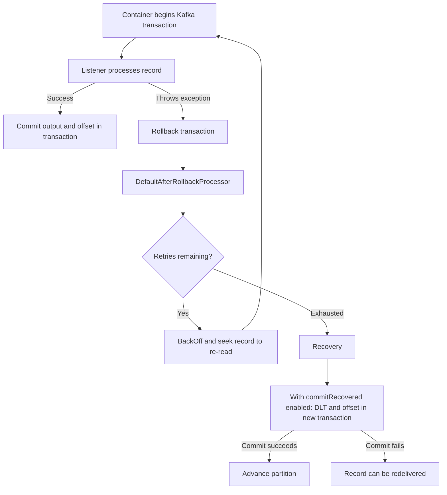

# `AfterRollbackProcessor` in Transactions

When a Spring Kafka listener container runs inside a Kafka transaction, each record processing step executes within a container-managed transaction. If the listener throws an exception, the transaction rolls back: Kafka records published in that transaction are not committed, and the processed record's offset is not acknowledged. The container must decide how to re-read the record after rollback.

`AfterRollbackProcessor` handles this step. The default implementation is `DefaultAfterRollbackProcessor`, which can seek to redeliver the record, apply retry/backoff, and invoke a recoverer when retries are exhausted. With proper configuration, it can also send the failing record to a DLT and commit the source offset in a new Kafka transaction.

## 1. Processing flow when a transaction rolls back

The container begins a Kafka transaction before invoking the listener. If the listener succeeds, records sent via `KafkaTemplate` and the consumer offset can be committed in the same transaction. If the listener throws an exception, the current transaction aborts; the container then invokes the after-rollback processor to handle the incomplete record.



For a record listener, the processor by default seeks back to the failing record and subsequent unprocessed records so they are redelivered. For a batch listener, the replay scope depends on batch semantics and the exception thrown by the listener; test with the exact listener type you use.

## 2. Role of `DefaultAfterRollbackProcessor`

`DefaultAfterRollbackProcessor` is the `AfterRollbackProcessor` implementation for transactional containers. It manages post-rollback retry state, applies `BackOff`, and decides when to call the recoverer. For example, `FixedBackOff(1_000L, 2L)` allows two retries after the first attempt; if those attempts still fail, the recoverer is invoked.

```java
@Bean
public DefaultAfterRollbackProcessor<String, OrderCreated>
        afterRollbackProcessor(
            KafkaTemplate<Object, Object> kafkaTemplate) {
    DeadLetterPublishingRecoverer recoverer =
        new DeadLetterPublishingRecoverer(kafkaTemplate);

    DefaultAfterRollbackProcessor<String, OrderCreated> processor =
        new DefaultAfterRollbackProcessor<>(
            recoverer, new FixedBackOff(1_000L, 2L));
    return processor;
}
```

The recoverer is called only after retries are exhausted or when an exception belongs to the configured non-retryable group. The recoverer must complete recovery cleanly. If it throws an exception, recovery has not succeeded and the record can be reprocessed.

If no custom recoverer is configured, the default implementation uses a logging recoverer. In production, choose a concrete action such as sending to a DLT or saving an idempotent audit record so records do not vanish from the pipeline without a trace.

## 3. Attaching the processor to a transactional listener container

The container must be configured with `KafkaTransactionManager`. The transaction manager and `KafkaTemplate` must share the same transactional `ProducerFactory`, configured with a unique `transactionIdPrefix` per appropriate producer instance. When the listener sends messages using the template bound to the active transaction, those messages join the container's transaction.

```java
@Bean
public ConcurrentKafkaListenerContainerFactory<String, OrderCreated>
        kafkaListenerContainerFactory(
            ConsumerFactory<String, OrderCreated> consumerFactory,
            KafkaTransactionManager<Object, Object> transactionManager,
            DefaultAfterRollbackProcessor<String, OrderCreated> afterRollbackProcessor) {
    var factory =
        new ConcurrentKafkaListenerContainerFactory<String, OrderCreated>();
    factory.setConsumerFactory(consumerFactory);
    factory.getContainerProperties()
        .setKafkaAwareTransactionManager(transactionManager);
    factory.setAfterRollbackProcessor(afterRollbackProcessor);
    return factory;
}
```

In modern Spring Kafka, container properties use `setKafkaAwareTransactionManager`. Some older versions use the `setTransactionManager` API; choose the API matching your project's dependency version. Crucially, the transaction manager must be attached to the exact factory used by `@KafkaListener`.

The listener lets exceptions escape when rollback is desired:

```java
@KafkaListener(
    topics = "orders",
    groupId = "order-processor",
    containerFactory = "kafkaListenerContainerFactory")
public void consume(OrderCreated event, Acknowledgment acknowledgment) {
    orderService.process(event);
    kafkaTemplate.send("order-events", event.orderId(),
        new OrderProcessed(event.orderId()));
    acknowledgment.acknowledge();
}
```

This example uses `AckMode.MANUAL_IMMEDIATE` as in the recovery configuration below; the listener acknowledges only after business processing and output sending. If `orderService.process` throws an exception, sending `OrderProcessed` in the same Kafka transaction also rolls back. If the listener catches the exception without rethrowing, the container may treat processing as successful and commit the transaction; only catch errors when intentionally handling and confirming the business outcome.

## 4. Sending to DLT and committing offsets in a new transaction

A key requirement is never losing records during recovery. If sending to the DLT succeeds while the source offset is uncommitted, the record may be redelivered and duplicated in the DLT. If the source offset commits while sending to the DLT fails, the record can be lost. We want both actions to succeed together or roll back together.

`DefaultAfterRollbackProcessor` supports this via `setCommitRecovered(true)` and `setKafkaTemplate(...)`. Once retries are exhausted, the processor starts a new Kafka transaction; the recoverer sends the record to the DLT and the source record's offset is sent into the same transaction. If the transaction commits, the DLT record and source offset take effect together. If the transaction aborts, neither commits. Use the configuration below instead of the minimal processor bean from the earlier section when this commit mechanism is needed.

```java
@Bean
public DefaultAfterRollbackProcessor<String, OrderCreated>
        afterRollbackProcessor(
            KafkaTemplate<Object, Object> kafkaTemplate) {
    DeadLetterPublishingRecoverer recoverer =
        new DeadLetterPublishingRecoverer(kafkaTemplate);
    recoverer.setFailIfSendResultIsError(true);

    DefaultAfterRollbackProcessor<String, OrderCreated> processor =
        new DefaultAfterRollbackProcessor<>(
            recoverer, new FixedBackOff(1_000L, 2L));
    processor.setCommitRecovered(true);
    processor.setKafkaTemplate(kafkaTemplate);
    return processor;
}
```

When `commitRecovered` is enabled, the container configuration must use `AckMode.MANUAL_IMMEDIATE` as required by the API. For example:

```java
factory.getContainerProperties()
    .setAckMode(ContainerProperties.AckMode.MANUAL_IMMEDIATE);
```

When using `MANUAL_IMMEDIATE` for a listener, the listener must acknowledge records after business logic completes according to the application's rules. The offset of a recovered record is managed by the after-rollback processor. Do not enable `commitRecovered` without understanding how acknowledgements and transactions coordinate in your version.

## 5. DLT needs compatible serializers and routing

`DeadLetterPublishingRecoverer` normally routes records from topic `orders` to `orders.DLT`, preserving the source partition with the default resolver. The destination topic must exist and have enough matching partitions. `KafkaTemplate` must have serializers compatible with key and value; when handling deserialization errors, records may contain raw byte arrays rather than domain objects.

The recoverer attaches source metadata such as topic, partition, offset, and exception details into DLT headers. DLT consumers should preserve these headers for investigation and replay. With `setFailIfSendResultIsError(true)`, DLT publish failures are reported back to the processor so the recovery transaction does not commit mistakenly.

## 6. Distinguishing `DefaultAfterRollbackProcessor` and `DefaultErrorHandler`

| Component | Primary role |
| --- | --- |
| `DefaultErrorHandler` | Handles listener container errors in flows not driven by container transaction rollback; controls retry, seek, and recovery. |
| `DefaultAfterRollbackProcessor` | Invoked after a listener's Kafka transaction rolls back; controls redelivery and post-rollback recovery. |

With a transactional listener container, an exception from the listener rolls back the transaction and the after-rollback processor handles what happens next. Do not configure both mechanisms expecting them to retry a single failure in one unified chain; decide the container's transaction manager and error strategy first before configuring.

## 7. Batch listeners and rollback scope

With a batch listener, the transaction typically spans the listener invocation for the batch. If one record causes the listener to throw an exception, the batch transaction rolls back, so Kafka outputs sent in that transaction are also canceled. The processor controls replay according to batch semantics and its configuration.

If the application needs to identify the exact failing record in a batch, the listener can use `BatchListenerFailedException` with a valid index in configurations that support these semantics. Verify behavior for your Spring Kafka version and test records before the error, the failing record, and records after the error. The batch index is the position in the list, not the Kafka offset.

Non-blocking retry via `@RetryableTopic` is incompatible with batch listeners or container transactions. If transactional batch processing is needed, use an after-rollback strategy and design retries around whole-batch rollback.

## 8. Scenarios to control

- **Listener catches exceptions:** if the exception is not thrown out, the transaction may commit despite unfinished business logic. Swallow exceptions only as an explicit decision.
- **DLT send fails:** the recoverer must fail; the recovery transaction must not commit the source offset.
- **Recovery transaction aborts:** the record can be redelivered; the recoverer and auxiliary operations must be idempotent.
- **Application restarts:** in-memory retry state can reset depending on configuration; do not rely on in-RAM counters as the sole business history.
- **DB side effects:** Kafka transactions do not automatically cover relational database transactions. Use outbox, inbox/idempotency, or an appropriate coordination mechanism if consistency between DB and Kafka is required.

## 9. Testing `AfterRollbackProcessor`

An integration test should run a listener inside a transactional container and send a record that causes the listener to fail twice before succeeding. Verify that transactions on the failing attempts roll back, Kafka outputs from failed attempts do not appear, and only the successful attempt commits outputs and offset.

Next, test retry exhaustion: the recoverer sends the record to the DLT in a new transaction and the source offset commits only when the recovery transaction succeeds. Intentionally make the DLT producer fail to verify the offset does not advance as though recovery had completed.

Also test a listener throwing an exception after sending a Kafka output, a listener catching exceptions, application restart mid-retry, and record redelivery. Use Embedded Kafka or Testcontainers with Awaitility to verify DLT records, source headers, and actual offsets.

## 10. Operations and observability

Monitor rollback counts, retries, recoveries, transaction commit errors, DLT send failures, and consumer lag per partition. Log topic, partition, offset, event ID, and exception type to correlate a rollback with the recovered record. Alert when retries persist or recovery transactions repeatedly abort.

`DefaultAfterRollbackProcessor` ties retries and recovery to the Kafka transaction lifecycle. When the transaction manager is configured properly, exceptions propagate out, and transactional recovery is used to publish to the DLT and commit offsets, the system can handle failing records while preserving consistency between emitted Kafka data and consumer progress.
