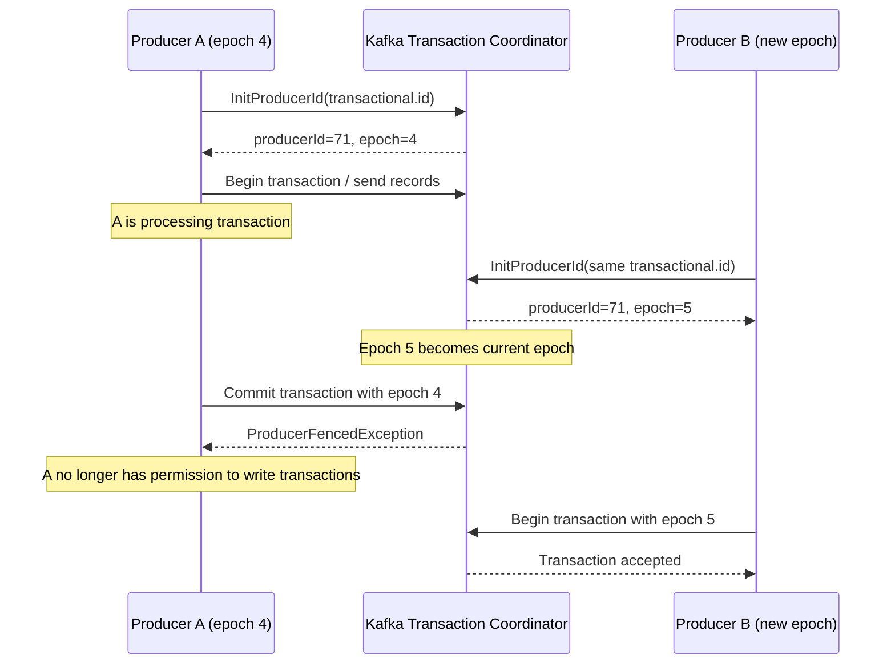

# Producer Fencing and How to Prevent It

In Kafka transactions, **producer fencing** means the broker rejects transactional requests from a producer because that producer has lost ownership of its `transactional.id`. The most common situation is another producer initializing with the same `transactional.id` and receiving a newer epoch. The older producer becomes stale (a zombie) and can no longer commit transactions.

Fencing is a mechanism protecting transactional correctness, not an ordinary network error. It prevents an old process from continuing to write data after a new process has taken over the same transactional identity.

This lesson explains the producer ID/epoch mechanism, causes of `ProducerFencedException`, how to set `transactionIdPrefix` in Spring Kafka, multi-replica management, refreshing idle producers, and production incident handling.

## 1. What is producer fencing?

Kafka transactions use `transactional.id` to identify a producer identity that can persist across multiple runs. Brokers use this identity to track transactions and distinguish the current producer from an old producer.

When a new producer initializes with the same `transactional.id`, Kafka assigns or updates the producer identity with a new epoch. The older producer holding a lower epoch is fenced. Any subsequent transactional request from the older producer is rejected by the broker.

Example:

- Producer A is running with `transactional.id=orders-slot-0`.
- A begins a transaction and writes some records.
- Process B initializes with the same `transactional.id`.
- B receives a newer epoch and becomes the current producer.
- A attempts to commit its old transaction and receives `ProducerFencedException`.

The broker ensures only the producer owning the current epoch may continue transaction operations for that identity.

`ProducerFencedException` is a fatal error for the fenced producer. Kafka requires closing that producer instance. You cannot keep using the same producer object and retry `send()` or `commitTransaction()` as if it were a transient error.

## 2. Producer ID, epoch, and `transactional.id`

Three concepts to distinguish:

| Component | Meaning |
|---|---|
| `transactional.id` | Stable transactional producer identity configured by the application |
| `producerId` | Numeric ID assigned by Kafka to the producer |
| `producerEpoch` | Generation number of the producer ID; a newer epoch invalidates requests from older epochs |

`transactional.id` is the logical name the application is responsible for managing. Kafka uses it to look up transaction state and issue the corresponding producer ID/epoch.

`producerId` and `producerEpoch` are sent in protocol requests. The broker checks the request's epoch against the current epoch. If the epoch does not match, the request is rejected.

Do not use `client.id` in place of `transactional.id`:

- `client.id` primarily identifies clients in logs, metrics, and quotas.
- `transactional.id` determines transaction ownership and participates in fencing.
- Two producers with the same `client.id` are not necessarily fenced.
- Two producers sharing the same `transactional.id` can fence each other even if their `client.id` values differ.

## 3. How does fencing happen?

The diagram below illustrates a new producer session taking over the same transactional ID:



This process protects the system when an old process hangs, loses connectivity, or does not know it has been replaced. When a new process takes over the same identity, Kafka can reject late operations from the old process.

Producer B does not need to wait for A to realize it is stale. The broker itself enforces ownership via epochs.

## 4. When is a producer fenced?

Common causes:

| Cause | What happens |
|---|---|
| Multiple replicas use the same prefix | Factories generate the same set of transactional IDs; a producer in one replica can fence another replica |
| Two processes run the same logical instance | A new process claims the old process's ID while the old process is still active |
| Overlapping rolling deployment | A new pod uses the same transactional ID before the old pod has fully stopped |
| Producer cache holds an ID too long | The broker expired the transactional ID due to inactivity; the old producer is retrieved and fenced on use |
| Custom factory generates colliding suffixes | Two producers are created with the same transactional ID even though they belong to two different factories |
| A manual producer and a Spring producer use the same ID | Both contend for transaction ownership |

Situations easily confused with fencing:

- A transaction exceeding `transaction.timeout.ms` is aborted by the coordinator; this does not mean another producer fenced the producer.
- Spring Kafka's `NoProducerAvailableException` usually means a transactional ID suffix could not be obtained from the cache strategy; this is a producer capacity issue, not broker fencing.
- `FencedInstanceIdException` relates to static consumer group member identity (`group.instance.id`); analyze it separately from `ProducerFencedException`.
- `OutOfOrderSequenceException` relates to idempotent producer sequences. Spring may evict the failing producer from the cache, yet it should not be conflated with fencing caused by `transactional.id`.

## 5. Intentional fencing vs. unintended fencing

Fencing is not always a design flaw. It is necessary behavior when a new run takes over the identity of an old run.

**Intentional fencing**

- A logical instance restarts.
- The new session reuses that instance's transactional ID.
- The broker fences the old session so a zombie producer cannot commit transactions.
- The new session continues operating with a new epoch.

**Unintended fencing**

- Two independent replicas are assigned the same transactional ID.
- Two unrelated factories accidentally produce the same suffix.
- Environment configuration shares one prefix across the whole deployment.
- A new pod starts writing transactions while the old pod is still treated as an independent instance.

The key investigative question is: **Are the two producers contending for the same transactional ID two sessions of the same logical instance, or two independent instances?**

If the same logical instance, fencing the old session is expected behavior. If two independent replicas, the ID configuration is wrong.

## 6. Recognizing `ProducerFencedException`

The Kafka client throws `org.apache.kafka.common.errors.ProducerFencedException`. Depending on timing and call path, the error can occur when:

- Initializing or beginning a transaction.
- Sending records in a transaction.
- Sending offsets to a transaction.
- Committing a transaction.
- Interacting with the transaction coordinator after another producer took over the ID.

Handling example with the raw Kafka client:

```java
import org.apache.kafka.clients.producer.KafkaProducer;
import org.apache.kafka.clients.producer.ProducerConfig;
import org.apache.kafka.clients.producer.ProducerRecord;
import org.apache.kafka.common.errors.ProducerFencedException;

String transactionalId = "orders-slot-0";
// producerProperties must include bootstrap.servers, serializers, and transactional.id.
producerProperties.put(ProducerConfig.TRANSACTIONAL_ID_CONFIG, transactionalId);
KafkaProducer<String, String> producer =
    new KafkaProducer<>(producerProperties);
ProducerRecord<String, String> record =
    new ProducerRecord<>("orders", "order-42", "order-created");

try {
    producer.initTransactions();
    producer.beginTransaction();
    producer.send(record);
    producer.commitTransaction();
}
catch (ProducerFencedException exception) {
    log.error(
        "Producer lost ownership of transactional.id={}",
        transactionalId,
        exception
    );

    throw exception;
}
finally {
    // Raw producer client must be closed after use.
    producer.close();
}
```

With Spring Kafka, `KafkaTemplate` and `DefaultKafkaProducerFactory` manage producer lifecycles. Let the exception propagate to the transaction boundary so the transaction rolls back or is marked failed, while the failing producer is removed from the factory cache when closing the wrapper. Do not hold onto a producer obtained from the factory and reuse it yourself after `ProducerFencedException`.

If the application wraps exceptions in `KafkaException`, inspect the `cause` chain to identify `ProducerFencedException`. Logging the root exception along with the transactional ID and instance ID helps pinpoint the cause.

Do not catch the error, log only, and return success. If a transaction was fenced, hiding the error can make the application report success when the transaction did not commit.

## 7. Configuring transactional IDs in Spring Boot

Spring Kafka enables transactions when `DefaultKafkaProducerFactory` has `transactionIdPrefix`. Spring Boot allows configuring it via:

```yaml
spring:
  kafka:
    bootstrap-servers: ${KAFKA_BOOTSTRAP_SERVERS}
    producer:
      transaction-id-prefix: ${KAFKA_TX_ID_PREFIX}
      properties:
        transaction.timeout.ms: 60000
```

`KAFKA_TX_ID_PREFIX` must differ across independent application instances. Spring Kafka appends a suffix to build transactional IDs for producers managed by the factory. For example, prefix `orders-slot-0-` can produce IDs such as `orders-slot-0-0`, `orders-slot-0-1` depending on allocated producers.

Do not configure a fixed `transactional.id` value shared across all producers or replicas. In Spring, use `transaction-id-prefix` so the factory manages suffixes.

If there are multiple `DefaultKafkaProducerFactory` beans inside one instance, each factory also needs its own namespace prefix. Two factories with the same prefix can generate the same initial suffix and contend for the same transactional ID.

## 8. Designing prefixes for multiple replicas

Suppose service `orders` has three replicas:

| Logical replica | Example prefix | Producer IDs issued by factory |
|---|---|---|
| Slot 0 | `orders-slot-0-` | `orders-slot-0-0`, `orders-slot-0-1`, ... |
| Slot 1 | `orders-slot-1-` | `orders-slot-1-0`, `orders-slot-1-1`, ... |
| Slot 2 | `orders-slot-2-` | `orders-slot-2-0`, `orders-slot-2-1`, ... |

Each slot has a separate namespace. Two independent replicas do not share a prefix.

### Using a stable instance identity

If fencing the old session is needed when an instance restarts, bind the prefix to a **stable logical slot**:

- StatefulSet ordinals such as `orders-0`, `orders-1`.
- An instance ID assigned by the deployment platform and preserved across restarts.
- A slot coordinated so only one owner is active at a time.

Environment variable example:

```yaml
env:
  - name: POD_NAME
    valueFrom:
      fieldRef:
        fieldPath: metadata.name
  - name: KAFKA_TX_ID_PREFIX
    value: "orders-$(POD_NAME)-"
```

With a StatefulSet, the ordinal-based pod name stays stable across pod replacements. When the new session of `orders-0` starts, it can take over the ID of the old `orders-0` session.

With a Deployment generating random pod names, the new pod name normally differs from the old pod name. When the prefix changes with the pod name, Kafka treats it as a different identity; the old producer is not automatically fenced just because a new pod replaced it. If protection against zombie processes is needed, design a stable logical slot/lease or ensure the old process has stopped before granting a new identity.

Do not generate a random UUID on every application startup if the goal is for the new session to fence the old session of the same logical instance. A new UUID creates a different transactional ID and does not take over the old ID.

### Rolling deployment

When deploying a new version, clearly define the strategy:

- If the new version takes over the same logical slot, reuse that slot's prefix. The old session can be fenced as soon as the new producer initializes transactions.
- If two versions must run in parallel as two independent writers, assign different prefixes. Kafka then does not fence them via transactional ID; the application must ensure they do not process the same work in a conflicting way.
- Never let deployment automation accidentally spin up multiple independent pods receiving the exact same static `KAFKA_TX_ID_PREFIX` variable.

Fencing causes any open transaction on the old producer to fail. Therefore, rollouts must tolerate transaction rollbacks and let listeners or jobs retry via an appropriate retry mechanism.

## 9. How does Spring Kafka generate suffixes?

When using `DefaultKafkaProducerFactory`, Spring Kafka maintains a cache of transactional producers. When a producer is closed through its wrapper, the producer can return to the cache for reuse instead of closing physically.

The transactional ID is formed from:

`transactionIdPrefix + suffix`

The factory issues suffixes so concurrent producers in the same factory get distinct IDs. From Spring Kafka 3.2 onward, `TransactionIdSuffixStrategy` manages suffix allocation and reuse; when `maxCache` is configured, suffixes can be reused within a bounded range.

With Spring Kafka 3.0 and later, EOS V2 is the only mode. Listener containers no longer need to create separate transactional IDs per group/topic/partition as in some older Spring Kafka 2.x examples. Use a unique prefix per application instance and let the factory manage suffixes.

Conceptual example:

| Factory prefix | Suffix | Transactional ID |
|---|---:|---|
| `orders-slot-0-` | `0` | `orders-slot-0-0` |
| `orders-slot-0-` | `1` | `orders-slot-0-1` |
| `orders-slot-1-` | `0` | `orders-slot-1-0` |

Suffixes only distinguish producers managed by the same factory under its strategy. They do not make prefixes across replicas unique. Two independent factories with the same prefix can still generate identical suffixes.

If `maxCache` is configured, the suffix count must suffice for concurrency and nested transactions. With `ConcurrentMessageListenerContainer` using `KafkaTransactionManager`, Spring Kafka documentation requires `maxCache` to be at least `concurrency`; nested transactions require accounting for extra concurrent producers. Running out of available suffixes can throw `NoProducerAvailableException`, which differs from `ProducerFencedException`.

## 10. Preventing fencing caused by expired transactional IDs

A transactional producer may sit in the cache unused for a very long time. Brokers have `transactional.id.expiration.ms` to expire a transactional ID when no transaction state updates arrive within the configured period.

When an old producer is retrieved after its ID has expired, modern Kafka clients can receive `ProducerFencedException` even without any consumer rebalance or new replica appearing.

Spring Kafka provides `maxAge` on `DefaultKafkaProducerFactory` since version 2.5.8. The factory refreshes producers exceeding the maximum age before reusing them.

Rule:

`maxAge < transactional.id.expiration.ms`

Choose a safe margin significantly smaller than the broker's expiration period. Do not set the two values equal because check schedules, caching, and processing time could allow a producer to be used right near the broker's ID expiration boundary.

For example, if the broker uses the 7-day default, you might set `maxAge` to 6 hours or 1 day depending on operational requirements. Confirm your cluster's actual setting before choosing.

Factory configuration:

```java
import java.time.Duration;
import org.springframework.kafka.core.DefaultKafkaProducerFactory;

DefaultKafkaProducerFactory<String, OrderEvent> producerFactory =
    new DefaultKafkaProducerFactory<>(producerProperties);

producerFactory.setTransactionIdPrefix(transactionIdPrefix);
producerFactory.setMaxAge(Duration.ofHours(6));
```

`producerProperties` is a Kafka producer configuration map containing bootstrap servers, serializers, security, and required settings. `transactionIdPrefix` must be the distinct prefix of this logical instance and factory.

If using Spring Boot auto-configuration, `spring.kafka.producer.transaction-id-prefix` can configure the transaction manager automatically. When `maxAge` is needed, configure the exact `DefaultKafkaProducerFactory` used by `KafkaTemplate` and `KafkaTransactionManager`; avoid creating a second factory solely to call `setMaxAge`.

`maxAge` solves the case of cached producers sitting idle too long. It **does not** fix two replicas sharing the same prefix.

## 11. Distinguishing transaction timeout from transactional ID expiration

The two settings mean different things:

| Setting | What does it control? | Consequence |
|---|---|---|
| `transaction.timeout.ms` | Maximum time an open transaction may remain active | Coordinator proactively aborts overdue transactions |
| `transactional.id.expiration.ms` | Time without transaction updates before the coordinator expires the transactional ID | Stale cached producers can be fenced upon reuse |
| `DefaultKafkaProducerFactory.maxAge` | Maximum age of producers managed by Spring's cache | Factory refreshes producers before the broker expires the ID |

Do not increase `transaction.timeout.ms` to cure `ProducerFencedException` caused by duplicate transactional IDs. The two settings address two different issues.

Transaction timeout must fit actual processing duration and the broker's `transaction.max.timeout.ms` limit. An overly long transaction can be aborted, yet that does not mean a second producer claimed the same ID.

## 12. Error handling in Spring applications

With `KafkaTemplate` running inside transactions, exceptions must propagate to the transaction boundary. Example:

```java
import org.slf4j.Logger;
import org.slf4j.LoggerFactory;
import org.springframework.kafka.core.KafkaTemplate;
import org.springframework.kafka.KafkaException;

public class OrderPublisher {

    private static final Logger log =
        LoggerFactory.getLogger(OrderPublisher.class);

    private final KafkaTemplate<String, OrderEvent> kafkaTemplate;

    public OrderPublisher(
            KafkaTemplate<String, OrderEvent> kafkaTemplate) {
        this.kafkaTemplate = kafkaTemplate;
    }

    public void publish(OrderEvent event) {
        try {
            kafkaTemplate.executeInTransaction(operations -> {
                operations.send("order-events", event.orderId(), event);
                return null;
            });
        }
        catch (KafkaException exception) {
            log.error(
                "Kafka transaction failed while publishing eventId={}",
                event.eventId(),
                exception
            );

            // Do not swallow the error: the caller must know the transaction failed.
            throw exception;
        }
    }
}
```

In production, inspect the cause chain to separate `ProducerFencedException` from other errors. The example above intentionally lets the exception propagate to the caller; it does not assume every `KafkaException` is fencing.

When the cause is identified as `ProducerFencedException`:

1. Log the transactional ID, instance/slot ID, producer client ID if available, transaction boundary, and root exception.
2. Let Spring Kafka terminate and evict the failing producer from the cache via the factory lifecycle.
3. Check whether another producer is using the same transactional ID.
4. Proceed only once the factory issues a valid producer and ID ownership is clear.
5. If the error stems from two independent replicas, fix prefix/deployment identity before retrying work.

Do not manually call `close()` on a producer managed by `KafkaTemplate`. With raw Kafka clients created directly by the application, a fenced producer must be closed and replaced with a new instance after fixing the root cause.

## 13. Why immediate retries usually fail to resolve fencing

`ProducerFencedException` is unlike a `TimeoutException` caused by a temporarily unresponsive broker.

If producer A was fenced because producer B took over the same ID:

- Retrying sends with A still uses the old epoch.
- Retrying commit with A is still rejected.
- Waiting through a backoff period does not make A's epoch newer.
- Only creating a new producer with a valid identity can proceed.

If the new producer continues using the same ID while another replica remains active, the new producer can be fenced again. This creates a fencing loop caused by misconfigured identity.

Retries make sense only after transactional ID ownership is resolved. Never configure infinite retries on `ProducerFencedException` without investigating the cause.

## 14. Common anti-patterns

| Anti-pattern | Consequence | Fix |
|---|---|---|
| Using one static prefix for all pods | Replicas fence each other | Prefix by logical instance |
| Generating a new UUID on every restart | Cannot fence zombies from the old session | Use stable slot identity when takeover is needed |
| Using `client.id` as transactional ID | Confuses the purpose of the two properties | Use `transaction-id-prefix` |
| Creating multiple factories with the same prefix | Factories can issue colliding suffixes | Separate namespace per factory |
| Retrying `ProducerFencedException` on the old producer | Repeated errors because the producer is fatal | Close/evict failing producer and fix ownership |
| Increasing transaction timeout to fix fencing | Does not solve duplicate IDs or stale epochs | Inspect prefixes and broker expiration |
| Keeping cached producers longer than broker expiration | Idle producers can be fenced on reuse | Set `maxAge` lower than expiration |
| Using `maxAge` instead of unique prefixes | Replicas still contend for the same ID | Fix uniqueness first |
| Catching exception and returning success | Application hides transaction rollback | Propagate errors to caller/container |
| Rolling out two writers on the same slot unplanned | Old session's transactions abort unexpectedly | Design intentional takeover/rollout |

## 15. Monitoring and logging for investigation

When a producer is fenced, logs must help identify who is contending for ID ownership.

Record:

- Service name and environment.
- Instance ID or logical slot.
- `transactionIdPrefix` and specific transactional ID if accessible.
- Producer `client.id`.
- Transaction start time and failure time.
- Failing operation: `beginTransaction`, `send`, `sendOffsetsToTransaction`, or `commitTransaction`.
- Topic/partition and event ID if a record is involved.
- Exception class, cause chain, and stack trace.

Useful loggers when higher verbosity is needed during investigation:

- `org.springframework.kafka.core.DefaultKafkaProducerFactory`
- `org.springframework.kafka.core.KafkaTemplate`
- `org.apache.kafka.clients.producer`

Enable DEBUG/TRACE only for the needed window because transaction logs can grow quickly. Do not log full payloads, tokens, or sensitive data while investigating fencing.

Set up metrics/alerts for:

- `ProducerFencedException` count by service and instance.
- Transaction rollback/abort count.
- Producers newly created or evicted from cache.
- `NoProducerAvailableException` error count.
- Instance restart/rollout counts.
- Producer transaction failures by operation.

`transactional.id` has high cardinality; it fits as a field in logs or traces rather than turning every ID into a metric label when instance counts are large.

## 16. Testing fencing against real Kafka

Integration tests should verify that the broker genuinely fences the old producer when a new producer uses the same transactional ID.

Kafka client-level test example:

```java
import static org.assertj.core.api.Assertions.assertThatThrownBy;

import java.util.HashMap;
import java.util.Map;

import org.apache.kafka.clients.producer.KafkaProducer;
import org.apache.kafka.clients.producer.Producer;
import org.apache.kafka.clients.producer.ProducerConfig;
import org.apache.kafka.clients.producer.ProducerRecord;
import org.apache.kafka.common.errors.ProducerFencedException;
import org.apache.kafka.common.serialization.StringSerializer;
import org.junit.jupiter.api.Test;

class ProducerFencingIntegrationTest {

    @Test
    void newerProducerFencesOlderProducer() {
        Map<String, Object> properties = transactionalProperties(
            "orders-test-slot-0"
        );

        Producer<String, String> oldProducer =
            new KafkaProducer<>(properties);

        Producer<String, String> newProducer =
            new KafkaProducer<>(properties);

        try {
            oldProducer.initTransactions();
            oldProducer.beginTransaction();
            oldProducer.send(
                new ProducerRecord<>("fencing-test", "key", "old-value")
            );
            oldProducer.flush();

            // Same transactional.id: the new producer receives a new epoch.
            newProducer.initTransactions();
            newProducer.beginTransaction();

            assertThatThrownBy(oldProducer::commitTransaction)
                .isInstanceOf(ProducerFencedException.class);

            newProducer.abortTransaction();
        }
        finally {
            oldProducer.close();
            newProducer.close();
        }
    }

    private Map<String, Object> transactionalProperties(String id) {
        Map<String, Object> properties = new HashMap<>();
        properties.put(
            ProducerConfig.BOOTSTRAP_SERVERS_CONFIG,
            System.getProperty("spring.kafka.bootstrap-servers", "localhost:9092")
        );
        properties.put(ProducerConfig.KEY_SERIALIZER_CLASS_CONFIG, StringSerializer.class);
        properties.put(ProducerConfig.VALUE_SERIALIZER_CLASS_CONFIG, StringSerializer.class);
        properties.put(ProducerConfig.TRANSACTIONAL_ID_CONFIG, id);
        return properties;
    }
}
```

The test requires a Kafka broker with active transaction state and the `fencing-test` topic created (or auto-create enabled in the test environment). You can pass the broker address via the `spring.kafka.bootstrap-servers` system property. Do not use mocks for epoch testing because fencing is enforced by the broker/transaction coordinator.

Additional tests:

| Test | Expected result |
|---|---|
| Two producers using the same transactional ID | New producer fences old producer |
| Two producers using different IDs | Both transactions operate independently |
| Two Spring factories using the same prefix | Test exposes suffix collision risk |
| Each replica uses a distinct prefix | No fencing between independent replicas |
| Cached producer exceeds `maxAge` | Factory creates a new producer before reuse |
| Transaction timeout | Transaction aborts; distinct from fencing |
| Rolling deployment takeover on same slot | New session takes over, old transaction fails cleanly |
| Replicas of same service with different slots | Both can commit transactions |

Do not merely check that the application started up. Verify both that the old transaction is rejected and that the new transaction can still commit.

## 17. Production incident response workflow

When receiving a `ProducerFencedException` alert, follow this sequence:

1. Extract the transactional ID from the exception/producer factory logs.
2. Find all instances, pods, and factories configured with the related prefix.
3. Determine whether those producers are independent replicas or sessions of the same logical slot.
4. Inspect rollouts, restarts, autoscaling, and whether an old pod could still be running.
5. If independent replicas share a prefix, fix configuration and redeploy with distinct prefixes.
6. If an old producer was intentionally replaced, verify the new producer owns the ID and new transactions work.
7. Check whether rolled-back transactions can be retried/replayed safely.
8. Monitor fencing rate and transaction rollbacks after recovery.

Do not delete transaction state or alter broker expiration to mask ID conflicts. Before intervening in the cluster, pinpoint exactly which producers contend for the transactional identity.

## 18. Pre-deployment checklist

- Each independent logical instance has a unique `transactionIdPrefix`.
- Each producer factory has its own namespace within an instance.
- Prefix comes from deployment configuration, not a cluster-wide constant.
- If zombie fencing after restarts is needed, logical slot identity stays stable across replacements.
- Rolling deployments account for transaction rollbacks when a new session takes over.
- Random UUIDs are not generated on every startup if fencing the old session is required.
- `maxAge` is smaller than the broker's `transactional.id.expiration.ms`.
- `transaction.timeout.ms` is chosen per processing time and broker limits.
- `maxCache` is large enough for concurrency and nested transactions when using a bounded suffix strategy.
- Fenced producers are removed from the current lifecycle; do not retry on old producers.
- Exceptions propagate so callers/containers know the transaction failed.
- Integration tests prove a new producer fences an old producer.
- Logs include instance ID, prefix, transaction ID, and failing operation.
- Alerts distinguish `ProducerFencedException`, transaction timeout, and `NoProducerAvailableException`.

## 19. Hands-on exercise

Create an integration test with two transactional producers:

1. Create producer A and producer B with the same `transactional.id`.
2. Initialize a transaction on A.
3. Initialize producer B with the same ID to acquire a new epoch.
4. Attempt to commit A's transaction and confirm A is fenced.
5. Commit a new transaction using B.
6. Change B's ID to a different value and confirm A and B no longer contend for the same identity.
7. Create two Spring application contexts using the same `transactionIdPrefix` to reproduce a multi-replica misconfiguration.
8. Fix the prefix by logical slot and verify the error disappears.
9. Configure a short `maxAge` in a test factory and observe a fresh producer being created when retrieved from cache.

Upon completion, be able to explain why differing `client.id` values do not prevent fencing, why `maxAge` does not replace unique prefixes, and why retrying with the same fenced producer cannot recover the transaction.

## 20. Key takeaways

- Fencing is Kafka's mechanism to stop an old producer from continuing transactions after a new producer takes over the same `transactional.id`.
- `producerId` and `producerEpoch` help brokers distinguish the current producer session from older ones.
- `ProducerFencedException` is fatal to the producer instance; evict that producer and resolve ownership before retrying.
- Spring Kafka constructs transactional IDs from `transactionIdPrefix` plus a factory-managed suffix.
- Prefixes must be unique across independent instances and across producer factories that could generate overlapping IDs.
- Use a stable logical instance ID when a new session should fence a zombie of the same slot.
- `maxAge` refreshes idle cached producers before `transactional.id.expiration.ms`; it does not fix duplicate prefixes.
- `transaction.timeout.ms` governs open transaction age, which differs from transactional ID expiration.
- `NoProducerAvailableException`, transaction timeout, and `FencedInstanceIdException` are separate situations requiring distinct classification.
- Never swallow fencing errors and never retry on a producer that has lost ownership.

Producer fencing helps Kafka preserve transaction correctness during application restarts, new deployments, or zombie processes. By managing transactional IDs per logical instance, configuring producer caches properly, and handling errors in line with the lifecycle, systems can safely replace producers without letting two sessions write transactions under one identity.

## References

- [Spring Kafka – Transactions](https://docs.spring.io/spring-kafka/reference/kafka/transactions.html)
- [Apache Kafka – ProducerFencedException API](https://kafka.apache.org/44/javadoc/org/apache/kafka/common/errors/ProducerFencedException.html)
- [Apache Kafka – Protocol](https://kafka.apache.org/protocol.html)
- [Apache Kafka – Broker Configs](https://kafka.apache.org/44/configuration/broker-configs/)
- [Apache Kafka – Producer Configs](https://kafka.apache.org/44/configuration/producer-configs/)

