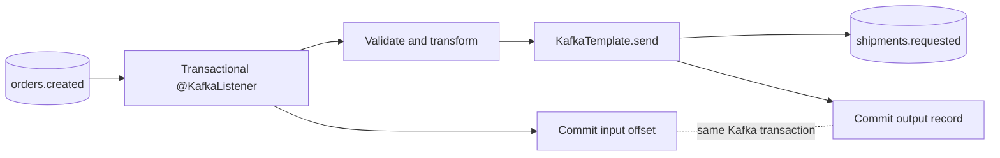
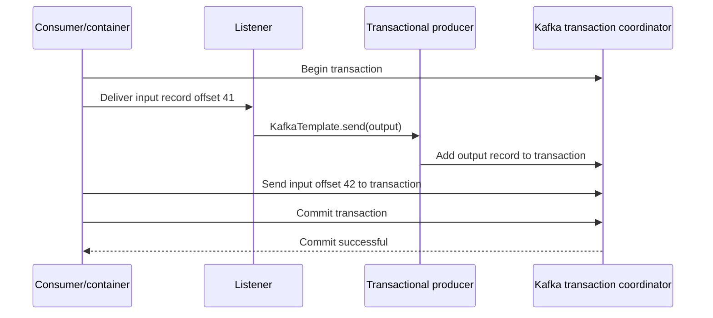

# Kafka read-process-write

Kafka read-process-write is a flow in which a consumer reads a record from an input topic, performs business processing, and emits a new record to an output topic. If the application only sends output with an idempotent producer, the output may avoid some duplicate records from producer retries, yet the input offset and output record can still be committed at two different times. Kafka transactions allow combining output publishing and input offset committing into the same transaction, providing exactly-once semantics for Kafka-to-Kafka flows.

In the `SPRING_KAFKA_MESSAGING` module, the producer uses `KafkaTemplate`, the consumer uses `@KafkaListener`, and the listener container manages consumer offsets. With a transactional listener, the container starts a Kafka transaction, the listener processes the record and sends output via a `KafkaTemplate` using the same transactional `ProducerFactory`; when the listener succeeds, output records and input offsets are committed together. If the listener fails, the transaction rolls back and uncommitted output will not be read by downstream consumers using `read_committed`.

## 1. What is read-process-write?

A read-process-write application typically has three steps:

1. Read an input event from a Kafka topic.
2. Transform or apply business logic to the event.
3. Send an output event to another topic.

For example, a service receives `OrderCreatedEvent`, validates shipping conditions, and emits `ShipmentRequestedEvent`:



The crucial point is that the output record and input offset must belong to the same Kafka transaction. If only the output is committed and the application stops before committing the input offset, the input may be redelivered and the output emitted again. If the input is committed first and the application stops before sending the output, the input event may be skipped without producing the corresponding output.

## 2. Why is producer idempotence not enough?

Kafka producer idempotence helps the broker recognize and eliminate duplicates from producer retries within a producer session/sequence. It does not automatically link sending output with the input consumer's offset.

| Mechanism | What does it protect? | Combines output and input offset? |
|---|---|---|
| Producer idempotence | Limits duplicates from retries by the same producer | No |
| Standard consumer offset commit | Persists consumer group progress | No |
| Kafka transaction for read-process-write | Commits or aborts output records together with input offsets | Yes |

To achieve exactly-once in a Kafka-to-Kafka flow, the application needs a transactional producer and consumer offsets sent into the same transaction. Spring Kafka integrates this via the transactional listener container and `KafkaTransactionManager`.

## 3. What scope does a Kafka transaction cover?

With properly configured read-process-write, a transaction can cover:

- Output records sent using `KafkaTemplate` within the current transaction.
- The offset of the input record or batch processed by the listener.
- Output partitions written by the transactional producer.

When commit succeeds, the output record and input offset become committed together. When aborted, output records are not visible to `read_committed` consumers and the input offset is not advanced by the aborted transaction.

Kafka transactions do not automatically cover databases, HTTP APIs, email, filesystems, or side effects outside Kafka. If a listener updates a database and then the Kafka transaction rolls back, the independent database transaction may still have committed. Exactly-once here refers to semantics for Kafka operations within the same transaction.

## 4. Configuring producer transactions

Spring Kafka requires a transactional producer factory. With Spring Boot, declare `spring.kafka.producer.transaction-id-prefix` so Boot configures a transactional producer factory:

```yaml
spring:
  kafka:
    bootstrap-servers: ${KAFKA_BOOTSTRAP_SERVERS:localhost:9092}
    producer:
      transaction-id-prefix: ${INSTANCE_ID:orders-transformer-}
      acks: all
      key-serializer: org.apache.kafka.common.serialization.StringSerializer
      value-serializer: org.springframework.kafka.support.serializer.JsonSerializer
    consumer:
      group-id: orders-transformer
      enable-auto-commit: false
      key-deserializer: org.apache.kafka.common.serialization.StringDeserializer
      value-deserializer: org.springframework.kafka.support.serializer.JsonDeserializer
      properties:
        isolation.level: read_committed
        spring.json.use.type.headers: false
        spring.json.value.default.type: com.acme.orders.OrderCreatedEvent
        spring.json.trusted.packages: com.acme.orders
```

`transaction-id-prefix` must be unique for each concurrently running application instance. Assign a distinct `INSTANCE_ID` to each pod/process; the default value in the example is only convenient for running a single local instance and must not be shared verbatim across multiple replicas.

When using Spring Kafka transactions, the factory manages transactional producers and transaction ID suffixes. Do not manually set the same fixed `transactional.id` for every instance. Producer transactions also require the Kafka cluster to have its transaction coordinator and internal transaction state properly configured.

`enable-auto-commit: false` lets the listener container manage input offsets. `isolation.level: read_committed` ensures the consumer reads only records from committed transactions if the input topic also has transactional producers.

## 5. Configuring `KafkaTransactionManager` and listener container

`KafkaTransactionManager` uses the same `ProducerFactory` as the `KafkaTemplate` emitting output. The listener container uses this transaction manager to start a transaction before invoking the listener and commit/roll back when the listener completes.

```java
import org.springframework.context.annotation.Bean;
import org.springframework.context.annotation.Configuration;
import org.springframework.kafka.config.ConcurrentKafkaListenerContainerFactory;
import org.springframework.kafka.core.ConsumerFactory;
import org.springframework.kafka.core.KafkaTemplate;
import org.springframework.kafka.core.ProducerFactory;
import org.springframework.kafka.transaction.KafkaTransactionManager;

@Configuration
public class ReadProcessWriteConfiguration {

    @Bean
    public KafkaTransactionManager<String, Object> kafkaTransactionManager(
            ProducerFactory<String, Object> transactionalProducerFactory) {
        return new KafkaTransactionManager<>(transactionalProducerFactory);
    }

    @Bean
    public KafkaTemplate<String, Object> transactionalKafkaTemplate(
            ProducerFactory<String, Object> transactionalProducerFactory) {
        return new KafkaTemplate<>(transactionalProducerFactory);
    }

    @Bean
    public ConcurrentKafkaListenerContainerFactory<String, OrderCreatedEvent>
            transactionalKafkaListenerContainerFactory(
                    ConsumerFactory<String, OrderCreatedEvent> consumerFactory,
                    KafkaTransactionManager<String, Object> kafkaTransactionManager) {

        var factory = new ConcurrentKafkaListenerContainerFactory<
                String, OrderCreatedEvent>();
        factory.setConsumerFactory(consumerFactory);
        factory.getContainerProperties().setKafkaAwareTransactionManager(
                kafkaTransactionManager
        );
        return factory;
    }
}
```

In the example, `transactionalProducerFactory` must be a factory configured with a transaction ID prefix, `StringSerializer` for keys, and an appropriate serializer for output values (e.g., `JsonSerializer`). `KafkaTemplate` and `KafkaTransactionManager` both receive that exact factory; this is the condition for send commands in the listener to participate in the transaction opened by the container. `ConsumerFactory` remains the factory reading `OrderCreatedEvent` from the input topic with the corresponding deserializer.

If Spring Boot already auto-configured the producer factory/template/transaction manager, those beans can be used instead of redeclaring them. When creating custom beans, name them and use `@Qualifier` if multiple factories/templates exist to avoid the listener and template using the wrong producer factory.

The transaction manager configuration API name may vary across Spring Kafka generations. In modern versions, use `setKafkaAwareTransactionManager`; in older projects, verify the corresponding API in the version being used and avoid copying deprecated configurations without checking.

## 6. Writing a read-process-write listener

Input and output events:

```java
import java.math.BigDecimal;

public record OrderCreatedEvent(
        String eventId,
        String orderId,
        BigDecimal total
) {}

public record ShipmentRequestedEvent(
        String eventId,
        String orderId
) {}
```

Listener reading the event, processing, and sending output using the transactional template:

```java
import org.springframework.kafka.annotation.KafkaListener;
import org.springframework.kafka.core.KafkaTemplate;
import org.springframework.stereotype.Component;

@Component
public class OrderToShipmentListener {

    private final KafkaTemplate<String, Object> kafkaTemplate;

    public OrderToShipmentListener(
            KafkaTemplate<String, Object> kafkaTemplate) {
        this.kafkaTemplate = kafkaTemplate;
    }

    @KafkaListener(
            topics = "orders.created",
            groupId = "orders-transformer",
            containerFactory = "transactionalKafkaListenerContainerFactory"
    )
    public void onOrderCreated(OrderCreatedEvent event) {
        if (event.total() == null || event.total().signum() <= 0) {
            throw new IllegalArgumentException("Order total must be positive");
        }

        ShipmentRequestedEvent output = new ShipmentRequestedEvent(
                event.eventId(),
                event.orderId()
        );

        kafkaTemplate.send("shipments.requested", event.orderId(), output);
    }
}
```

There is no need to call `executeInTransaction()` inside the listener when the container has already opened a Kafka transaction and the template uses the same producer factory. `send()` participates in the active transaction. When the method returns normally, the container commits the transaction along with the input offset; if the method throws an exception, the container rolls back.

If multiple output records are sent, all sends execute within the same transaction for that processing attempt. If any step fails and an exception rolls back the transaction, none of the outputs in that transaction are committed.

## 7. What happens when the listener succeeds?

Success flow of a record listener:

1. The container polls the input record.
2. The container begins a Kafka transaction using the transactional producer.
3. The listener processes the event.
4. `KafkaTemplate` sends the output record into the active transaction.
5. The container adds the next input offset to the transaction.
6. Kafka commits the transaction.
7. Downstream consumers using `read_committed` see the committed output.

The committed input offset is the next offset to read, not the offset of the record just processed. If the listener processes record offset `41`, the transaction typically records offset `42` for the corresponding partition.



## 8. What happens when the listener fails?

If the listener throws an exception before the transaction commits:

- The Kafka transaction is aborted.
- Output records sent within the transaction are marked aborted.
- The transaction's input offset is not committed.
- The input record may be redelivered after rollback per the error handling/after-rollback processor mechanism.
- `read_committed` consumers do not see outputs from the aborted transaction.

Do not swallow exceptions if you want the container to roll back. For instance, if the listener catches an exception, only logs it, and returns normally, the container may commit the transaction and input offset even though the business operation did not finish.

For transactional listeners, retry/recovery after rollback is typically coordinated by `DefaultAfterRollbackProcessor`. Configure appropriate backoff and DLT recovery; do not confuse this mechanism with non-blocking retry because non-blocking retry is not supported alongside container transactions with the same semantics.

## 9. `read_committed` on downstream consumers

Consumers reading the output topic must set `isolation.level=read_committed` if they want to see only records from committed transactions:

```yaml
spring:
  kafka:
    consumer:
      group-id: shipment-service
      properties:
        isolation.level: read_committed
```

With `read_uncommitted`, consumers can read even records belonging to uncommitted or aborted transactions. When the goal is observing output along the exactly-once transaction boundary, downstream consumers need `read_committed`.

`read_committed` only controls visibility of transactional records. It does not make a consumer handler exactly-once for databases or HTTP APIs, and it does not prevent the application from invoking logic again when a record is redelivered through another path.

## 10. Record listeners and batch listeners

With a record listener, the container typically opens one transaction per processed record. The corresponding input offset and output records from that attempt are committed together.

With a batch listener, the container processes a batch within a single transaction according to batch listener configuration. If the batch fails and the transaction rolls back, the batch's outputs are aborted along with the batch's offsets. Retry/recovery may need to reprocess the batch or identify the failing record according to configuration.

Choose record or batch listeners based on throughput, latency, and error requirements. Batching increases batch-processing efficiency but makes transactions larger; one error can roll back more outputs and increase retry overhead.

## 11. Exactly-once does not mean listener code runs only once

Exactly-once in Kafka read-process-write describes committed Kafka outcomes: input offsets and output records are committed atomically. During crashes, fencing, rebalances, or rollbacks, listener code can still be executed again.

For example, a listener runs part of its logic and then the process stops before transaction commit. The Kafka transaction aborts and the input offset has not advanced; the record is redelivered and the listener runs again. Output from the previous transaction is not visible to `read_committed`, so committed Kafka results are not duplicated by that incomplete execution.

Therefore:

- Do not treat exactly-once as a guarantee that a Java method is invoked only once.
- Do not perform side effects outside Kafka in a listener without an idempotency/transaction strategy.
- Keep processing steps pure or deterministic whenever possible.
- If there are side effects outside Kafka, use an inbox/idempotency key, transactional outbox, or an appropriate coordination mechanism.

## 12. Limits when working with databases or external systems

A Kafka transaction does not automatically commit alongside a database transaction. For example, a listener updates a database and then sends Kafka output in a transaction:

```text
Database commit succeeds
        |
        v
Kafka transaction aborts
        |
        v
Input record is redelivered
        |
        v
Database update may run again
```

To handle this situation:

- Use a stable `eventId` and unique constraint to detect already-processed events.
- Save an inbox/idempotency record together with the database update in a single database transaction.
- For database-to-Kafka publishing, consider transactional outbox and relay/CDC.
- For Kafka-to-Kafka, keep outputs and offsets in the same Kafka transaction.
- If multiple systems must coordinate, evaluate Saga/compensation rather than assuming one Kafka transaction covers everything.

## 13. Transaction IDs, producer fencing, and multi-instance operations

Each application instance needs its own transaction ID prefix. The Spring Kafka producer factory builds transactional producer IDs from the prefix and an internally managed suffix. If two instances use the same prefix, producers can fence each other and an instance will receive an error that its transaction was replaced.

When deploying multiple pods:

- Provide a unique `INSTANCE_ID` for each pod/process.
- Ensure the prefix is stable across an instance's lifecycle while never colliding with concurrently running instances.
- Monitor `ProducerFencedException`, transaction timeouts, and transaction abort rates.
- Choose `transaction.timeout.ms` appropriate to processing time; this value must not exceed the broker limit.
- Avoid holding a transaction open while waiting on slow external APIs.
- Check `max.poll.interval.ms` so processing does not take so long that the consumer leaves the group.

When an instance dies and is replaced, Kafka producer epoch/fencing prevents the old producer from continuing to commit transactions as if it were still a valid owner. This is an important part of maintaining transaction correctness across restarts and rebalances.

## 14. Testing read-process-write exactly-once

Integration tests should verify both commit and abort cases:

- **Success path:** send an input event, verify the output event appears to a `read_committed` consumer, and verify the input offset is committed.
- **Failure after send:** listener sends output and then throws an exception; verify the output transaction is aborted and does not appear to `read_committed`.
- **Redelivery:** after rollback, verify the input record can be redelivered and the subsequent successful attempt produces one committed output.
- **Downstream isolation:** compare `read_committed` with `read_uncommitted` to understand visibility of aborted records.
- **Restart/fencing:** stop an instance mid-transaction and restart with the proper prefix; verify incomplete transactions are not treated as committed.
- **Multiple output records:** send multiple outputs in one listener invocation and verify they commit/abort together.
- **Concurrent instances:** use distinct transaction ID prefixes and verify they do not unintentionally fence each other.

Tests should use Embedded Kafka or Testcontainers with a transaction-supporting broker. Create separate input/output topics, separate group IDs, and await conditions using Awaitility or polling with timeouts instead of fixed sleeps. The consumer verifying output must set `isolation.level=read_committed`.

## 15. Common mistakes

- **Enabling only producer idempotence and calling it EOS:** idempotence does not combine output and input offsets.
- **KafkaTemplate using a different ProducerFactory than the transaction manager:** sends do not participate in the listener container's transaction.
- **Not configuring a transaction ID prefix:** producer factory is not set up to create transactional producers.
- **Using duplicate transaction ID prefixes across instances:** producers fence each other.
- **Enabling auto commit for the input consumer:** offsets can advance outside the transaction managed by the container.
- **Downstream using `read_uncommitted`:** may observe records from aborted transactions.
- **Swallowing exceptions inside the listener:** the container may commit instead of rolling back.
- **Unnecessarily calling `executeInTransaction()` inside a transactional listener:** creates unintended nested/separate transaction boundaries; let the template join the current transaction.
- **Assuming database side effects are rolled back by Kafka:** Kafka transactions cover only Kafka records and offsets.
- **Holding transactions open too long:** can time out, increase aborts/rebalances, and hurt throughput.
- **Using non-blocking retry with a transactional listener:** the two mechanisms have compatibility limits; design retries around the transactional after-rollback flow.

## 16. Kafka read-process-write deployment checklist

- [ ] Producer factory has a transaction ID prefix.
- [ ] Prefix is unique per concurrently running instance.
- [ ] `KafkaTransactionManager` uses the proper transactional `ProducerFactory`.
- [ ] `KafkaTemplate` sending output uses the same `ProducerFactory` as the transaction manager.
- [ ] Listener container has the Kafka transaction manager attached.
- [ ] Consumer auto commit is disabled and the container manages offsets.
- [ ] Output records and input offsets reside in the same transaction.
- [ ] Consumers reading transactional results use `read_committed`.
- [ ] Listener lets exceptions escape when rollback is needed.
- [ ] Retry/recovery is configured according to transactional listener semantics.
- [ ] Side effects outside Kafka have idempotency or an outbox/inbox strategy.
- [ ] Integration tests verify success, abort, redelivery, isolation, and restart.

Kafka read-process-write achieves exactly-once when output records and input offsets are atomically committed in the same Kafka transaction, with a transactional producer factory properly shared between the listener container and `KafkaTemplate`. Downstream consumers require `read_committed` to see only committed results. This scope protects Kafka-to-Kafka flows; databases and external systems still require separate transaction boundaries or idempotency.
