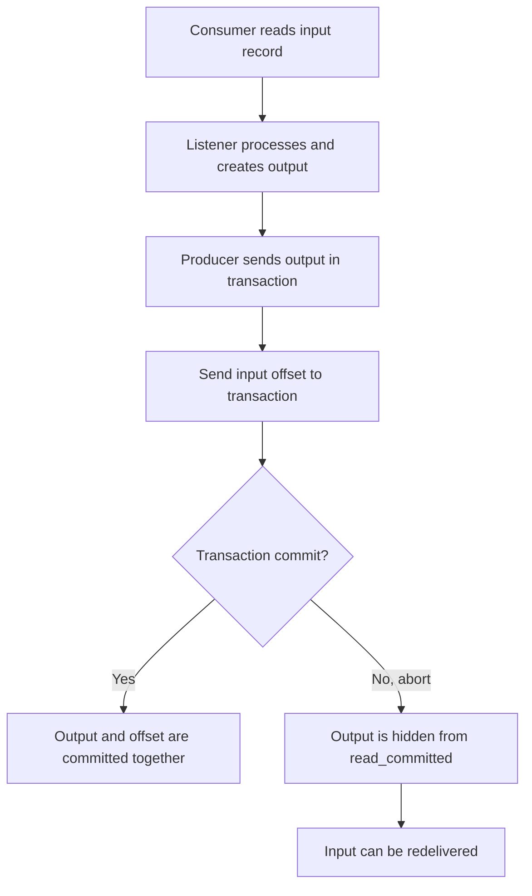

# Transactional producer and consumer

In a messaging flow, a consumer typically reads an event, processes it, and emits a new event. If the application sends output successfully but fails before committing the input offset, Kafka may redeliver the input and the application emits the output again. If it commits the offset before sending the output, a failure in between can lose the output. Kafka transactions resolve this gap by putting output publishing and input offset acknowledgment into the same Kafka transaction.

Spring Kafka supports transactional producers, `KafkaTransactionManager`, and listener container transactions to build consume-transform-produce flows with exactly-once semantics (EOS) within Kafka's scope. It is important to distinguish transactions used solely for sending multiple records from transactions that also include consumer offsets, while understanding the limits when processing also writes to a database or calls external services.

## 1. Why are transactions between producer and consumer needed?

Suppose the `order-projection` service reads `OrderCreated` events from topic `orders`, updates processing data, and sends `OrderProjection` to topic `order-projections`. If output and input offset are acknowledged separately, two failure scenarios can occur:

- Output has been written, but input offset is not committed: after a restart, input is read again and output may be written twice.
- Input offset is committed, but output is not written: Kafka does not redeliver the input, so the output may be lost.

Kafka transactions allow the producer to write output records and send input offsets into the transaction. When the transaction commits, both output and offset are committed together. If the transaction aborts, the output is not visible to `read_committed` consumers and the input offset is not acknowledged in that transaction, so the input can be reprocessed.



This is an atomic guarantee across Kafka operations belonging to the same transaction and the same cluster. It does not automatically cover databases, HTTP APIs, file systems, or systems outside Kafka.

## 2. Transactional producer and `transactional.id`

A transactional producer requires `transactional.id` so Kafka can manage transaction state and fence old producers. In Spring Kafka, applications typically configure `transactionIdPrefix` on the producer factory; the factory generates the complete ID by appending a distinct suffix for each allocated producer.

With Spring Boot, configure the prefix via `spring.kafka.producer.transaction-id-prefix`:

```yaml
spring:
  kafka:
    bootstrap-servers: localhost:9092
    producer:
      transaction-id-prefix: ${HOSTNAME:local}-order-service-
      key-serializer: org.apache.kafka.common.serialization.StringSerializer
      value-serializer: org.springframework.kafka.support.serializer.JsonSerializer
    consumer:
      group-id: order-projection
      isolation-level: read_committed
```

`HOSTNAME` or an instance ID variable must distinguish concurrently running replicas. Do not use the same fixed prefix for multiple pods, because producers may generate the same transactional ID range and fence each other. When a logical instance is replaced, reusing its identity helps the new producer fence any leftover old producer.

`transactional.id` and `transactionIdPrefix` are not interchangeable names:

| Property | Role |
|---|---|
| `transactional.id` | The actual ID Kafka associates with a transactional producer. |
| `transactionIdPrefix` | Prefix Spring Kafka uses to generate actual IDs managed by the producer factory. |
| `group.id` | Consumer group identifier; used when committing offsets, not a transactional ID. |
| `eventId` | Business identifier of an event; used by the application for tracing or preventing duplicate processing. |

When using Spring Boot auto-configuration, ensure `KafkaTemplate`, listener container, and transaction manager use the proper transaction-enabled producer factory. If creating a producer factory manually, call `setTransactionIdPrefix(...)` on that factory. Do not set a static `transactional.id` in properties when the factory is managing suffixes itself.

## 3. Producer-only transactions

If an operation needs to send multiple records and wants all of them to commit or abort together, `KafkaTemplate.executeInTransaction(...)` can be used. Example:

```java
public void publishOrderEvents(
        OrderCreated created,
        OrderAuditRecorded audit) {

    kafkaTemplate.executeInTransaction(operations -> {
        operations.send("orders", created.orderId(), created);
        operations.send("order-audit", audit.orderId(), audit);
        return null;
    });
}
```

Both records are sent in the same Kafka transaction. If the callback completes normally, the transaction is committed; if an exception escapes the callback, the transaction is aborted. `KafkaTemplate`'s producer factory must be configured as transactional, and both topics must belong to the same Kafka cluster.

Producer-only transactions are useful when a business operation emits multiple events that must be visible together. However, if the operation originates from a consumer, using `executeInTransaction` alone does not automatically add the input offset to that transaction. To coordinate consume-transform-produce, you must configure a transactional listener container with `KafkaTransactionManager`.

## 4. Configuring a consumer to participate in Kafka transactions

`KafkaTransactionManager` manages transactions on the producer factory. The listener container uses this transaction manager to start a transaction before invoking the listener. A `KafkaTemplate` using the same producer factory can participate in the active transaction. When the listener completes, the container sends the input offset into the transaction and commits.

Example creating a transaction manager:

```java
@Bean
public KafkaTransactionManager<String, Object> kafkaTransactionManager(
        ProducerFactory<String, Object> transactionalProducerFactory) {
    return new KafkaTransactionManager<>(transactionalProducerFactory);
}
```

Attaching the transaction manager to a listener container factory:

```java
@Bean
public ConcurrentKafkaListenerContainerFactory<String, OrderCreated>
        orderListenerFactory(
                ConsumerFactory<String, OrderCreated> consumerFactory,
                KafkaTransactionManager<String, Object> kafkaTransactionManager) {

    ConcurrentKafkaListenerContainerFactory<String, OrderCreated> factory =
            new ConcurrentKafkaListenerContainerFactory<>();
    factory.setConsumerFactory(consumerFactory);
    factory.getContainerProperties()
            .setKafkaAwareTransactionManager(kafkaTransactionManager);
    return factory;
}
```

`setKafkaAwareTransactionManager(...)` is the API used in modern Spring Kafka versions. If the project uses an older version, check the corresponding `ContainerProperties` API for that version. The `KafkaTemplate` injected into the listener must use the exact `transactionalProducerFactory` managed by `KafkaTransactionManager`; if it uses a different factory, send commands may not participate in the container's transaction.

Listener reading input, processing, and sending output:

```java
@KafkaListener(
        topics = "orders",
        groupId = "order-projection",
        containerFactory = "orderListenerFactory")
public void consume(OrderCreated event) {
    OrderProjection projection = projectionService.apply(event);
    kafkaTemplate.send(
            "order-projections",
            event.orderId(),
            projection);
}
```

In this model, the listener does not need to call `beginTransaction()` or `commitTransaction()` itself. The container opens the transaction, `KafkaTemplate` sends output into that transaction, and then the container adds the input offset to the transaction before committing. Configuring consumer `isolation.level=read_committed` ensures downstream consumers see only output from committed transactions.

## 5. What happens when the listener succeeds or fails?

With a transactional listener container, the outcome of the listener method determines the transaction:

| Scenario | Transaction outcome | Kafka-side behavior |
|---|---|---|
| Listener completes normally, sends succeed | Commit | Output and input offset are committed together. |
| Listener throws an exception before commit | Abort | Transaction output is not visible to `read_committed`; input may be redelivered. |
| Producer fails to send output | Transaction cannot commit as successful | Container handles the error and transaction aborts along the error path. |
| Producer is fenced | Transaction is no longer valid | Old producer cannot continue; inspect transactional ID and instance lifecycle. |
| Transaction timeout | Broker aborts expired transaction | Input may be reprocessed; inspect processing time and timeout. |

Example of a listener sending output and then throwing an exception:

```java
@KafkaListener(
        topics = "orders",
        groupId = "order-projection",
        containerFactory = "orderListenerFactory")
public void consume(OrderCreated event) {
    kafkaTemplate.send("order-projections", event.orderId(), toProjection(event));

    if (shouldFailForExample(event)) {
        throw new IllegalStateException("Force transaction rollback");
    }
}
```

If an exception escapes the listener and the transaction is aborted, output records sent in that transaction do not appear to `read_committed` consumers. The input offset is also not committed in the aborted transaction, so the record may be redelivered. In a real environment, the error handler may retry or recover the record; configure that policy consistently with transactions.

## 6. Role of `read_committed`

Kafka consumers have two main isolation levels:

| `isolation.level` | Behavior |
|---|---|
| `read_uncommitted` | May read records from uncommitted or aborted transactions. |
| `read_committed` | Returns only records belonging to committed transactions and non-transactional records per Kafka rules. |

In pipelines requiring exactly-once visibility, downstream consumers should use `read_committed`. Using `read_uncommitted` allows the application to see output from a transaction that is later aborted and process data that is not part of committed results.

`read_committed` has an operational implication: the consumer reads only up to the last stable offset (LSO), which is bounded by the earliest incomplete transaction in the partition. If a transaction stays open too long, records behind that transaction may not yet be returned to `read_committed` consumers even though they are already written to the log. Therefore, keeping transactions short and monitoring transaction timeouts is important.

## 7. Where are the limits of exactly-once semantics?

Kafka EOS guarantees that a Kafka consume-transform-produce flow can commit output records and input offsets as a unit. That does not mean all code in the listener runs strictly once.

For example, a listener calls an HTTP service to send an email and then throws an exception before the transaction commits. Kafka will redeliver the input and the listener may call HTTP again. A Kafka transaction cannot roll back an email that was already sent. Similarly, if the listener updates a database and then the Kafka transaction aborts, the database update does not roll back automatically with Kafka.

| Component | Covered by Kafka transaction? | How to handle |
|---|---|---|
| Output records sent by transactional producer from the same factory | Yes | Send within the listener transaction or a producer transaction. |
| Consumer group offsets sent into the same transaction | Yes, when using a transactional listener container or appropriate offset coordination API | Let the container manage offset transactions. |
| Downstream consumers reading output | Visibility controlled via `read_committed` | Configure isolation level and handle retries properly. |
| Database updates | Not automatically | Use idempotency, inbox/outbox, or appropriate transaction coordination. |
| HTTP, email, files, or side effects outside Kafka | No | Use idempotency keys, outbox, or compensating workflows. |

Therefore, listeners should still have idempotent logic. A stable event ID, unique constraint, or inbox table can prevent applying the same business logic multiple times when an input is redelivered. If both database writes and event publishing are required, transactional outbox is often the right design: the database transaction stores both the business change and an outbox record, and then a publisher emits the outbox to Kafka.

## 8. EOS V2 and operational conditions

Kafka supports exactly-once semantics V2 on modern broker/client versions. EOS V2 simplifies transaction management per consumer group and is the standard mode in modern Kafka versions. Spring Kafka uses transactional producers and offset coordination to implement consume-transform-produce. Compatible versions of Kafka client, broker, and Spring Kafka must be used together.

Key conditions:

1. The producer factory is configured as transactional with a `transactionIdPrefix` unique across running instances.
2. The listener container uses the exact `KafkaTransactionManager` managing that producer factory.
3. `KafkaTemplate` inside the listener uses the same producer factory so outputs participate in the container's transaction.
4. Downstream consumers use `read_committed` if they must see only committed data.
5. Transactions must complete within `transaction.timeout.ms`, and consumer processing time must be compatible with `max.poll.interval.ms`.
6. Source topics, destination topics, and offset transactions must belong to the same Kafka cluster; Kafka transactions do not create atomic commits across multiple independent clusters.
7. The broker transaction state log must be configured with appropriate replication and min ISR for fault-tolerant operation.
8. Business logic outside Kafka still needs idempotency or a separate coordination mechanism.

Avoid wrapping long-running work such as sequential HTTP service calls or waiting on user input inside a transaction. Long-lived open transactions reduce `read_committed` readability, increase timeout risk, and hold producer resources. Put only Kafka operations requiring atomic commit inside the transaction boundary.

## 9. Common errors

| Symptom | Possible cause | What to check |
|---|---|---|
| `ProducerFencedException` | Multiple instances use the same transactional ID or old producer was replaced | Check prefix, instance ID, and rolling deployment. |
| Output appears even though listener transaction aborted | Consumer is using `read_uncommitted` | Set `isolation.level=read_committed` for consumers requiring EOS visibility. |
| Input is redelivered after output was already sent | Output did not participate in the same transaction as the input offset | Check listener container transaction manager and `KafkaTemplate`'s producer factory. |
| Transaction timeout | Listener takes too long or backoff keeps the transaction open | Shorten transactions, adjust retries, and inspect `transaction.timeout.ms`. |
| Consumer lag increases even though broker still receives records | Long-open transaction holds LSO back or listener processes slowly | Monitor transaction duration, LSO, and listener duration. |
| Duplicate database writes after Kafka transaction aborts | Database side effect is outside the Kafka transaction | Use idempotency, inbox/outbox, or transaction coordination. |

Do not fix fencing errors by increasing retries indefinitely. Fencing usually indicates an identity collision or producer lifecycle conflict; fix the prefix and instance management. When a transaction aborts, determine whether the input may be redelivered and which side effects already occurred outside Kafka before deciding to retry.

## 10. Testing transactional producers and consumers

A test suite should verify what consumers read, offset status, and business effects:

- When the listener completes, output appears once to a `read_committed` consumer and the input offset is committed.
- When the listener sends output and throws an exception, the transaction output is not visible to `read_committed` and input is reprocessed according to policy.
- A `read_uncommitted` consumer can see records from uncommitted transactions; a `read_committed` consumer cannot see them.
- When two instances accidentally share a prefix, tests detect fencing; when prefixes differ, both instances can operate concurrently.
- When a producer or broker restarts while a transaction is open, verify the transaction is recovered or aborted per protocol and no input is lost.
- When a database or HTTP side effect is invoked before the transaction aborts, verify idempotency prevents repeated business effects.
- When a transaction runs long, verify transaction duration alerts, consumer lag, and poll limits behave properly.
- When publishing multiple output records, verify they commit or abort together in one transaction.

In logs and metrics, track transaction commit/abort, transaction duration, producer fencing, timeouts, listener failures, consumer lag, and redelivery counts. Log instance ID alongside transaction outcomes to investigate issues across replicas.

Transactional producers and consumers form the foundation for exactly-once semantics in Kafka pipelines: outputs and input offsets are committed as a unit, while `read_committed` controls what downstream sees. This guarantee covers only Kafka operations participating in the transaction; all database updates and external side effects still require idempotent design or a separate coordination mechanism.
