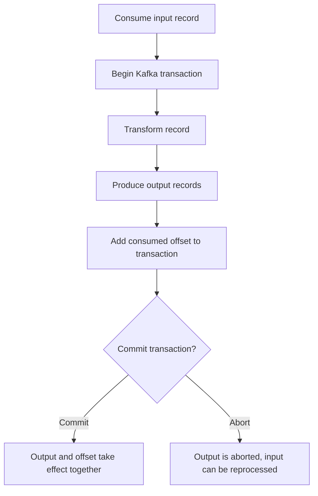
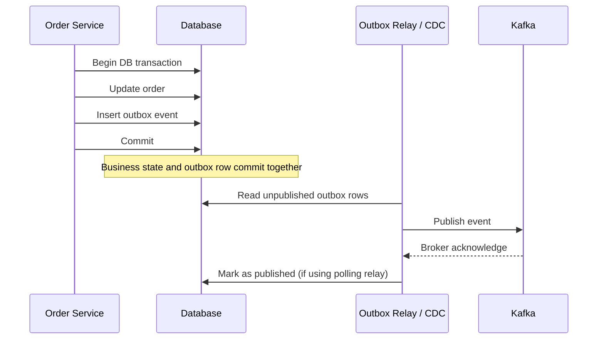

# Limits of exactly-once outside Kafka

Kafka supports transactions so an application can consume records, process them, and emit new records such that output records and input offsets are committed atomically. This is the foundation of exactly-once processing within Kafka's scope. However, a Spring Kafka application often also updates databases, calls HTTP APIs, sends emails, or performs tasks on external systems. Those operations do not automatically participate in Kafka transactions.

Therefore, exactly-once in Kafka should not be interpreted as a guarantee that an entire business flow happens strictly once end-to-end. Kafka can protect the Kafka data boundary; to maintain consistency with systems outside Kafka, the application needs to design transactional outbox, inbox/idempotency, API idempotency, or Saga as appropriate.

## 1. What does exactly-once in Kafka protect?

In a consume-transform-produce flow, a consumer reads a record from an input topic, processes it, and sends one or more records to an output topic. If using only independent offset commits and producer sends, the application can face a gap between the two operations:

- Sending output succeeds, but crashing before committing the offset: the input is redelivered and output may be sent again.
- Committing the offset before sending output: if sending fails afterward, the input is marked completed while output is missing.

Kafka transactions allow sending output records and input offsets within the same transaction. When the transaction commits, both take effect together. When the transaction aborts, output is not visible to consumers reading with `read_committed`, and the offset is not committed by that transaction.



The scope protected here is the Kafka operations participating in the transaction. An SQL statement, an HTTP call, or an outbound email does not automatically become part of that transaction.

## 2. Why does exactly-once not automatically extend to databases?

Suppose a listener receives `OrderCreated`, updates the orders table in PostgreSQL, and then emits `OrderAccepted` to Kafka. The database and Kafka are two systems with separate transaction managers. A Kafka transaction cannot automatically roll back an already completed commit in PostgreSQL.

If the application performs two independent operations, there are two common orderings, and both have failure windows.

**Write database first, send Kafka later:**

1. The database commits the order state.
2. The application sends an event to Kafka.
3. The application stops or Kafka is unavailable before publishing succeeds.

Result: the database has changed state, yet downstream never receives the event.

**Send Kafka first, write database later:**

1. Kafka commits the output event.
2. The application writes to the database.
3. The database fails or the application stops before the database commit.

Result: downstream has received the event, yet the database state has not been updated.

This is the *dual write* problem: a single business operation must write to two independent systems without a single shared transaction covering both.

| Operation order | Failure point | Possible consequence |
|---|---|---|
| Database then Kafka | DB commits, Kafka publish fails | New state exists, but event is missing |
| Kafka then database | Kafka commits, DB rolls back | Event exists, but DB state has not changed |
| Send Kafka, get timeout | Broker received it, but producer missed ack | Application cannot be sure whether publish succeeded |
| DB commits then consumer crashes | Offset not committed | Input is redelivered and DB may be updated again |

Simply swapping the order of the two commands does not eliminate the failure window. A mechanism is needed so business state and the intent to emit an event are stored durably together.

## 3. Transactional outbox solves dual writes

Transactional outbox stores the event to be emitted in a table within the same database transaction as the business change. After the database transaction commits, a relay process reads the outbox and publishes the event to Kafka.

Operational flow:



The crucial point is that the business change and the outbox row reside in the same database transaction. Therefore:

- If the database transaction rolls back, neither the business change nor the outbox row exists.
- If the database transaction commits, both the business change and the intent to emit the event are persisted.
- The relay can resume publishing after the service restarts.

Outbox does not turn the database and Kafka into a distributed transaction. It turns the dual write problem into a retryable and recoverable publishing process.

### Example outbox table structure

A minimal table might include:

```sql
CREATE TABLE outbox_event (
    event_id       UUID PRIMARY KEY,
    aggregate_id   VARCHAR(100) NOT NULL,
    aggregate_type VARCHAR(100) NOT NULL,
    event_type     VARCHAR(200) NOT NULL,
    payload        JSONB NOT NULL,
    created_at     TIMESTAMP NOT NULL,
    published_at   TIMESTAMP NULL
);
```

Column roles:

- `event_id`: stable identifier of the event, used for deduplication downstream.
- `aggregate_id`: ID of the business entity, commonly used as the Kafka key.
- `aggregate_type` and `event_type`: identify the entity type and event type.
- `payload`: event contents constructed at the time the business transaction commits.
- `created_at`: event creation timestamp.
- `published_at`: timestamp when the relay marks it published if using a polling relay.

Aggregate version, schema version, headers, or processing status can be added depending on operational needs. Avoid storing sensitive data in the payload if the event will be distributed widely.

### Writing business data and outbox in the same transaction

Example Spring service managing a database transaction:

```java
@Service
public class OrderApplicationService {

    private final OrderRepository orderRepository;
    private final OutboxRepository outboxRepository;

    public OrderApplicationService(
            OrderRepository orderRepository,
            OutboxRepository outboxRepository) {
        this.orderRepository = orderRepository;
        this.outboxRepository = outboxRepository;
    }

    @Transactional
    public void acceptOrder(UUID orderId) {
        Order order = orderRepository.findById(orderId)
                .orElseThrow();

        order.accept();

        OrderAccepted event = new OrderAccepted(
                UUID.randomUUID(),
                order.getId(),
                order.getVersion()
        );

        outboxRepository.save(OutboxEvent.from(event));
    }
}
```

Because both repositories share the same database transaction manager, the order state and the outbox row commit or roll back together. This service does not send to Kafka directly inside the transaction; the relay reads the outbox after commit.

In the example, the event ID is generated once and stored in the outbox. When the relay retries publishing the same row, the event ID remains unchanged. This is an important condition for consumers to recognize the same event across multiple deliveries.

## 4. Outbox relays can publish duplicates

A polling relay typically performs these steps:

1. Read unpublished outbox rows.
2. Send each event to Kafka.
3. Upon receiving successful publish acknowledgment, mark the row as published.
4. Repeat for the remaining rows.

There is a failure window: Kafka has received the event, but the relay crashes before marking `published_at`. When the relay runs again, the row is still seen as unpublished and is sent a second time.

Therefore, transactional outbox typically provides *at-least-once* publishing when the relay retries until successful. It does not guarantee that an event appears strictly once in Kafka.

That is why events need a stable `event_id` and consumers need idempotency. Design downstream to tolerate the same event being delivered multiple times.

### Polling relay and CDC relay

There are two common ways to transfer outbox records to Kafka:

| Approach | How it works | Considerations |
|---|---|---|
| Polling relay | Application queries unpublished rows and sends to Kafka | Needs locking, batch size, retries, publish marking, and data cleanup |
| CDC relay | Tool reads the database change log and emits outbox changes to Kafka | Needs connector operations, schemas, CDC offsets, and recovery handling |

CDC (*Change Data Capture*) is often implemented using tools such as Debezium. The connector reads the database transaction log and transforms outbox rows into Kafka records according to outbox event router configuration.

CDC reduces the need for continuous table polling, yet still requires monitoring the connector, replication slots or log retention, schemas, and lag. Never delete outbox/change logs arbitrarily before the connector has processed up to that position.

## 5. Preserving event ordering in the outbox

An aggregate can emit multiple events in business order: `OrderCreated`, `OrderPaid`, `OrderShipped`. If a relay publishes concurrently or multiple workers process the outbox without rules, events can arrive at Kafka out of order.

An incrementing version per aggregate can be added:

```sql
ALTER TABLE outbox_event
ADD COLUMN aggregate_version BIGINT NOT NULL;
```

Then:

- Generate the version in the same transaction that updates the aggregate.
- Use `aggregate_id` as the Kafka key so events of the same aggregate go to the same partition.
- Have the relay publish in version order within an aggregate's scope.
- Consumers can inspect the version to detect missing, duplicate, or out-of-order events.

Kafka preserves order within a single partition, but does not reorder events that were previously published out of order. If ordering is required, both the relay and the consumer must participate in enforcing that rule.

## 6. Consumer idempotency and the inbox pattern

Even when a producer or relay resends an event, a consumer can still ensure a database side effect is applied once by recording processed event markers.

An inbox/deduplication table can use a composite unique key with the consumer name:

```sql
CREATE TABLE processed_message (
    consumer_name VARCHAR(150) NOT NULL,
    event_id      UUID NOT NULL,
    processed_at  TIMESTAMP NOT NULL,
    PRIMARY KEY (consumer_name, event_id)
);
```

Upon receiving an event, the consumer does two things in the same database transaction:

1. Record `event_id` into `processed_message`.
2. Only when the event is recorded for the first time, apply the business change.

Example with PostgreSQL:

```sql
BEGIN;

WITH inserted AS (
    INSERT INTO processed_message (
        consumer_name,
        event_id,
        processed_at
    )
    VALUES (
        'billing-projection',
        :event_id,
        CURRENT_TIMESTAMP
    )
    ON CONFLICT (consumer_name, event_id) DO NOTHING
    RETURNING event_id
)
UPDATE account_projection
SET paid_total = paid_total + :amount
WHERE account_id = :account_id
  AND EXISTS (SELECT 1 FROM inserted);

COMMIT;
```

The `inserted` CTE returns a row only when the event ID is recorded for the first time. `UPDATE` executes only when the CTE produces a result. If the event already exists, the statement does not modify the projection and the transaction can finish normally.

If inserting the dedup marker and updating business data are in two separate transactions, a crash between the two steps can leave the system marking the event as processed without applying the business change, or applying the business change without recording the marker. Both operations must commit together.

### Consumer example with a database transaction

Logic can be structured in a service:

```java
@Service
public class BillingEventService {

    private final ProcessedMessageRepository processedMessages;
    private final AccountProjectionRepository projections;

    public BillingEventService(
            ProcessedMessageRepository processedMessages,
            AccountProjectionRepository projections) {
        this.processedMessages = processedMessages;
        this.projections = projections;
    }

    @Transactional
    public void apply(PaymentCaptured event) {
        boolean firstDelivery = processedMessages
                .insertIfAbsent("billing-projection", event.eventId());

        if (!firstDelivery) {
            return;
        }

        projections.addPaidAmount(
                event.accountId(),
                event.amount()
        );
    }
}
```

`insertIfAbsent` must be implemented using an atomic operation backed by a unique constraint, such as `INSERT ... ON CONFLICT DO NOTHING` in PostgreSQL. Do not read first and insert later without a unique constraint, because two consumers or two concurrent deliveries could both see the event as non-existent.

When the database transaction rolls back, both the inbox marker and the projection change roll back together. When it commits, both take effect together. If the Kafka offset is not yet committed and the record is redelivered, the next execution sees the event ID already exists and does not apply the side effect again.

## 7. Idempotency when calling HTTP APIs or payment services

The inbox pattern only protects changes within the same database transaction. If a consumer calls an API outside Kafka, such as a payment service, that API does not participate in the consumer's database transaction.

A risk example:

1. The consumer calls the API to create a payment transaction.
2. The provider creates the payment and returns success.
3. The response is lost on the network, or the consumer crashes before committing the offset.
4. Kafka redelivers the event.
5. The consumer calls the API again and may create a second payment.

If the API supports an idempotency key, use a stable key for the same business intent, usually derived from the event ID or payment request ID:

```http
POST /payments
Idempotency-Key: payment-request-8c2...
Content-Type: application/json
```

Upon receiving a repeated request with the same key, the provider should return the recorded result rather than performing the side effect again. The idempotency contract must be verified regarding key scope, key retention duration, concurrent request handling, and returning previous responses.

Do not generate a new idempotency key on each retry; doing so treats each request as a new operation. Also do not reuse one key for different transactions, as valid operations could be skipped.

If the external API does not support idempotency, the application cannot automatically guarantee exactly-once for the API side effect using Kafka transactions alone. In that case, one of the following approaches is needed:

- Persist request state and reconcile with the target system.
- Use a unique business transaction code that the target system can look up.
- Build a reconciliation workflow to detect and resolve transactions with unclear outcomes.
- Use a compensating action if the business permits, such as refunding a duplicate charge.

## 8. Retries and DLTs can also cause repeated processing

Retries, consumer restarts, rebalances, DLT replays, or manual operational actions can all cause an event to be delivered multiple times.

Examples:

- The consumer updated the database, but the offset was not committed yet.
- The listener failed after already calling an external API.
- The outbox relay published successfully but crashed before marking the row.
- An operator replays a record from the DLT after the event was partially processed.

Therefore, idempotency should be part of the consumer contract, not just a rare error-handling branch.

An event should keep a stable ID across the producer, retry topics, DLT, and replays. When replaying, decide whether to retain the original event ID for deduplication or create a new command with a new ID. Do not arbitrarily change the event ID during replay if the goal is to avoid reapplying the same side effect.

If business logic must intentionally be re-executed, create a replay request with its own identifier, link it to the original event, and audit it. This distinguishes technical redelivery from a new business action.

## 9. Sagas and compensating transactions

A long-running business process may span multiple services and databases. It is impractical to hold a distributed transaction open across calls to all services.

A Saga breaks the process into local transactions. Each service commits its own data and emits an event or command for the next step. If a step fails, the workflow can emit a *compensating action* to return the business state to an acceptable condition.

Order placement example:

| Step | Local transaction | Possible compensating action |
|---|---|---|
| 1 | Create order in PENDING state | Cancel order |
| 2 | Reserve inventory | Release inventory |
| 3 | Capture payment | Refund payment |
| 4 | Confirm order | Transition to requires-attention state |

Compensation is not a physical rollback like a database transaction. If an email has been sent or goods have shipped, that event cannot be erased from the outside world. A compensating action is a new business operation intended to correct state or mitigate impact.

A Saga can be coordinated centrally (*orchestration*) or coordinated via events among services (*choreography*). Both approaches need:

- A stable workflow ID or correlation ID.
- Current state and completed steps.
- Idempotency for commands/events.
- Timeouts and retry policies.
- Clear compensating actions.
- Mechanisms to handle stuck workflows and reconciliation.

Kafka transactions can protect individual consume-produce steps within Kafka, but they do not turn an entire Saga into a single atomic transaction.

## 10. Choosing a strategy by side-effect boundary

| Need | Suitable mechanism | Limitation to remember |
|---|---|---|
| Consume and produce within Kafka | Kafka transaction, offset with output | Covers only Kafka resources participating in the transaction |
| Write database and emit events | Transactional outbox | Relay may publish duplicates |
| Consumer updates database once per event ID | Inbox/dedup table + unique constraint | Dedup marker and business update must share the same DB transaction |
| Call external API | Idempotency key on target API | Depends on the API's contract and key retention duration |
| Multi-service workflow | Saga and compensating actions | Compensation is a new business operation, not a global rollback |
| Recovering ambiguous state | Reconciliation and audit | Must store enough identifiers and states to reconcile |

In many systems, these mechanisms are combined. A service may use Kafka transactions to read and emit Kafka events, transactional outbox to synchronize its database, inbox to prevent duplicate application, and idempotency keys for a payment API.

## 11. Testing failure windows

A design should be trusted only after testing the points where a process can stop. Do not test only the happy path.

| Simulated stop point | What to verify |
|---|---|
| Before DB commit | Neither business update nor outbox row exists |
| After DB commit, before relay publish | Outbox row persists and is published by the relay after restart |
| After Kafka publish, before marking outbox | Relay may republish; consumer successfully deduplicates |
| After inbox insert, before business update | Same DB transaction rolls back both |
| After business update, before Kafka offset commit | Event is redelivered, but inbox prevents reapplying |
| After API succeeds, before offset commit | Same idempotency key returns the previous result |
| During DLT replay | Event ID and replay policy prevent duplicate side effects |

Integration tests should use a test Kafka broker and a database with realistic transaction behavior. For outbox, test both polling relay/CDC and relay restart scenarios. For inbox, test two deliveries of the same event ID and two concurrent deliveries. For APIs, use a mock server simulating a timeout after the server has already executed the side effect.

Do not merely assert that the listener is invoked once. Kafka may invoke a listener multiple times while the system still preserves a single database side effect via idempotency. What must be verified is the final state and the actual number of side effects.

## 12. Observability and operations

To detect failure windows in production, monitor:

- Number of unpublished outbox rows and age of the oldest row.
- Outbox relay publish errors, retry counts, and CDC lag.
- Number of events deduplicated in the inbox.
- Number of API calls retried with the same idempotency key.
- Number of ambiguous-outcome transactions requiring reconciliation.
- Number of retry/DLT records and replay counts.
- Rate of Sagas timing out or running compensation.

Event ID, aggregate ID, correlation ID, and trace context help stitch logs across services. However, do not put sensitive data into Kafka headers, baggage, or logs merely for investigation convenience.

An outbox/inbox cleanup process is needed. Delete outbox rows only after the relay/CDC has safely processed them according to retention policy. Delete inbox dedup records only after a duration long enough that old events can no longer be replayed; deleting too early allows old events to cause side effects again.

## 13. Common misconceptions

| Misconception | Reality |
|---|---|
| Enabling Kafka transactions rolls back databases too | Kafka transactions do not automatically manage database transactions |
| Idempotent producer makes business operations run once | It protects publishing at the Kafka producer layer, not external side effects |
| Outbox guarantees an event is published only once | Relay may republish after a crash; consumers still need dedup |
| Consumer committing offset after DB update is enough | A crash between DB commit and offset commit can cause event redelivery |
| Using HTTP retries is safe | Without an idempotency contract on the API, retries can repeat side effects |
| Saga rolls back all services like a DB transaction | Sagas use local transactions and compensating actions |
| Exactly-once means the listener is invoked only once | Listener may run again; what is protected is committed results and non-duplicated side effects |

## 14. Design checklist

- [ ] Clearly identified the boundary between Kafka transactions and systems outside Kafka.
- [ ] Do not rely on Kafka transactions to roll back databases or HTTP APIs.
- [ ] If writing to a database and emitting events, transactional outbox or an equivalent coordination mechanism is used.
- [ ] Outbox events have stable IDs and the relay tolerates republishing.
- [ ] Consumers have an inbox/dedup when database changes must be protected from duplicate events.
- [ ] Dedup marker and business change reside in the same database transaction.
- [ ] External APIs support idempotency keys or have a reconciliation workflow.
- [ ] Retries and DLT preserve the original event ID with a clear replay policy.
- [ ] Multi-service workflows have appropriate Saga state, timeouts, and compensation.
- [ ] Tested crashes at points between commit, publish, offset, and API call.
- [ ] Metrics, logs, and audits exist to detect outbox backlog, duplicates, and ambiguous states.
- [ ] Outbox/inbox retention policies are long enough relative to retry and replay windows.

Kafka's exactly-once protects committing output records and input offsets within the same Kafka transaction. When business logic reaches outside Kafka, databases, APIs, and other services can fail independently. Transactional outbox persists event intent alongside business state; inbox and idempotency protect consumers from duplicate side effects; Sagas handle multi-service workflows. Reliable design requires clearly defining every transaction boundary, every failure window, and how each participating system recovers.

