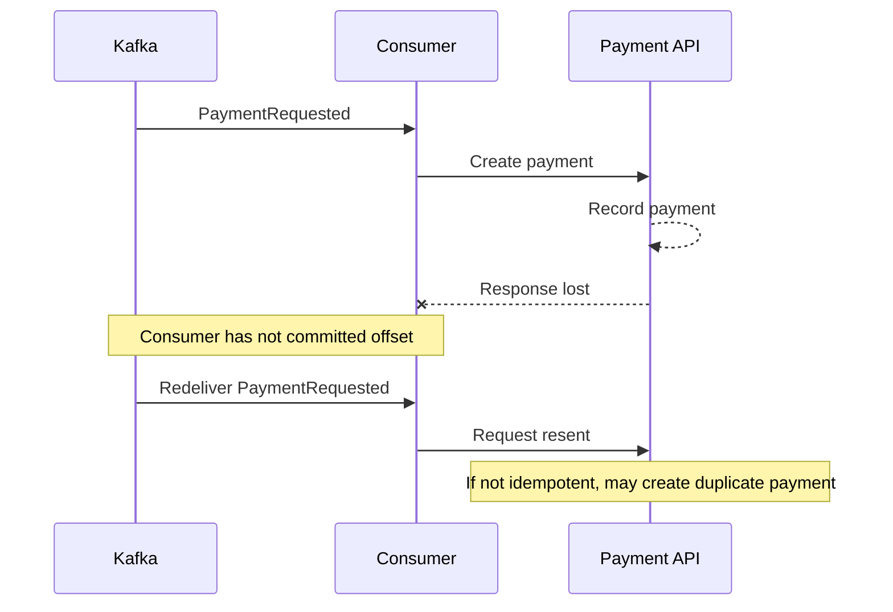
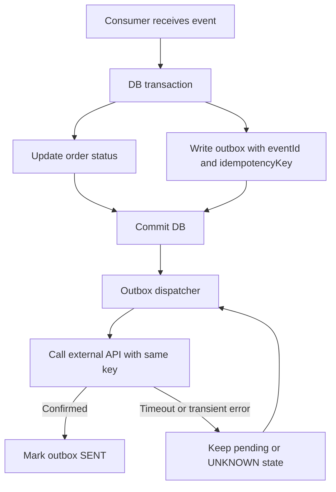

# Idempotency when calling external systems

A Kafka consumer may process an event inside a Kafka transaction and then call an HTTP API, send a payment command, or write data to another system. A Kafka transaction can guarantee that published Kafka records and consumer offsets commit or roll back together. That transaction does not cover an HTTP request or an external database's transaction.

Therefore, if a consumer calls an external service successfully but stops before committing the offset, Kafka may redeliver the event and the consumer calls the service again. Idempotency prevents repeated calls from creating additional side effects, such as charging twice or creating two shipment requests.

## 1. Why is Kafka's exactly-once not enough?

Kafka exactly-once semantics (EOS) focuses on reading and writing within Kafka: the consumer reads a record, processes it, publishes output, and commits the offset in one Kafka transaction. Consumers using `isolation.level=read_committed` read only records from committed transactions.

An HTTP request sits outside the Kafka transaction. Consider the scenario:

1. The consumer receives a `PaymentRequested` event.
2. The consumer calls the payment API; the provider creates the payment.
3. The response is lost on the network or the process stops before committing the offset.
4. The consumer restarts and receives the same event again.
5. If it calls the API as a new request, the customer may be charged a second time.



A Kafka transaction cannot roll back a payment already recorded by an external system. This boundary requires an idempotency protocol or a separate reconciliation process.

## 2. Using a stable idempotency key

An idempotency key identifies a single business operation. The client sends the same key for every retry of the same operation. The receiving service uses the key to recognize duplicate requests and return the saved result instead of executing the side effect again.

For example, with a payment event, a key can be built from the event ID and operation type:

```java
public Mono<PaymentResult> authorize(
        PaymentCommand command, String idempotencyKey) {
    return webClient.post()
        .uri("/payments/authorizations")
        .header("Idempotency-Key", idempotencyKey)
        .bodyValue(command)
        .retrieve()
        .bodyToMono(PaymentResult.class);
}

String key = event.eventId() + ":authorize-payment";
return paymentClient.authorize(command, key);
```

In the example, every retry of the same event must produce the same `idempotencyKey`. Do not generate a new UUID inside every call or retry, because the provider would treat each request as a new operation.

The key must represent the exact scope of the operation. One event may trigger multiple independent actions, such as authorize and capture; each action needs its own key. In multi-tenant or multi-merchant systems, the provider may require keys scoped by account or endpoint.

Prefer a stable event ID created by the producer and preserved across retries, replays, and topic transfers. Do not rely solely on Kafka offset as a business idempotency key: the same event republished may have a different offset even though it represents the same business operation.

## 3. Receiving service must store key and side effect together

Idempotency is reliable only when the receiving service persists the key marker durably. If the service checks the key only in a cache before executing business logic, two concurrent requests can both pass the check and create duplicate side effects.

An idempotency table can store scope, key, request hash, status, and generated response:

```sql
CREATE TABLE idempotency_record (
    scope         VARCHAR(120) NOT NULL,
    idempotency_key VARCHAR(200) NOT NULL,
    request_hash  VARCHAR(128) NOT NULL,
    status        VARCHAR(20) NOT NULL,
    response_body TEXT,
    created_at    TIMESTAMP NOT NULL,
    updated_at    TIMESTAMP NOT NULL,
    PRIMARY KEY (scope, idempotency_key)
);
```

The receiving service should process within a single database transaction:

1. Create the idempotency record using the unique key `(scope, idempotency_key)`.
2. If the key already exists, compare `request_hash`; if the contents differ, return a conflict error instead of reusing the key for a different command.
3. If the key is already completed, return the stored response.
4. If the key is new, perform the business change in the same transaction.
5. Save the response and completed status, then commit the transaction.

The unique constraint protects against race conditions when multiple requests with the same key arrive concurrently. When an insert conflicts, the service reads the existing record and returns the stored result once the initial transaction completes. Specific handling must match the database and isolation level in use.

The core requirement is that the idempotency record and the side effect in the same database must commit together. If an operation succeeds without persisting the idempotency marker, a subsequent retry can still execute the operation again.

## 4. Verifying request hash and handling in-progress states

One key must never represent two different payloads. For example, using the same key `evt-123:authorize-payment` while sending 100,000 VND the first time and 500,000 VND the next. The service must detect differing payloads via a normalized hash of business fields and return a conflict error; never return an old response for a command with different meaning.

If the API processes asynchronously or the operation is long-running, the record may have status `PENDING`, `SUCCEEDED`, or `FAILED`. A repeated request while `PENDING` can receive an in-progress response or a status lookup code. A repeated request when `SUCCEEDED` receives the saved result. Policies for `FAILED` must distinguish retriable errors from terminal errors.

Do not expire keys too early. Retention must be longer than the retry window, Kafka retention during which events can be replayed, and the window during which clients can resend requests. If a key expires while old events can still be replayed, duplicate operations can happen again.

## 5. What happens on timeout when outcome is unknown?

A timeout does not prove the request failed. The server may have committed the operation while the response was lost. This is an ambiguous outcome state. The consumer must not generate a new key to retry.

The appropriate workflow is:

- Record the key and operation status before calling the service.
- On timeout, keep the same key and retry according to the provider's policy, or query status by key/business reference.
- If the provider returns an existing result, update local state with that result.
- If still indeterminable, mark the operation `UNKNOWN` and send it to a reconciliation workflow rather than creating a new operation.

If the API supports querying by merchant reference or idempotency key, use it to reconcile. If the API does not support it, a unique business reference and a manual/automated check workflow are required before retrying risky operations.

## 6. When external systems do not support idempotency keys

If the receiving service does not support idempotency keys, the client cannot independently guarantee exactly-once for a non-idempotent side effect over the network. You can choose one of the following approaches:

- Use an API with operations that are idempotent by contract, such as `PUT` setting a resource to a deterministic state or a lookup API by business reference.
- Send a unique business reference code that the provider can use to detect duplicate commands.
- Persist commands in an outbox, retry with control, and reconcile results before resending an operation with an ambiguous outcome.
- Ask the provider to add idempotency or a status lookup mechanism if the side effect is high value.

An HTTP method alone is not enough to conclude a business operation is idempotent. `PUT` is defined as idempotent in terms of intended request effect, yet the specific endpoint must still honor that contract. A `POST` can be idempotent if the server supports keys; otherwise, resending usually creates a new resource.

## 7. Combining outbox and idempotency

Suppose a consumer receives `OrderConfirmed` and must record a call to a shipping service. If it writes the order status to the database and makes the HTTP call immediately, the process could stop between the two steps. Transactional outbox persists the intent to call the service alongside the data change in one database transaction.



Outbox ensures the call command is not lost between database commit and sending the request. The dispatcher may send duplicates if the process stops after the provider processes it but before the outbox is marked `SENT`. Therefore, outbox must pair with idempotency on the receiving side or a reconciliation workflow; outbox alone does not make HTTP side effects exactly-once.

If a consumer receives Kafka events and writes data to a database, an inbox/dedup table can store the event ID alongside the business change in one database transaction. When Kafka redelivers the event, the inbox recognizes the event was already processed and the consumer can safely acknowledge the offset after DB commit. When both updating a DB and emitting Kafka events are needed, combine inbox and outbox to manage both directions.

## 8. Retries, circuit breakers, and compensation

Idempotency allows retrying the same operation safely within the API's contract limits. Backoff reduces pressure when a service is failing; a circuit breaker prevents continuous calls when a dependency loses availability. These mechanisms solve different problems and are often combined.

Compensation in a Saga also differs from idempotency. If order placement succeeds but payment fails, a compensation command can release reserved inventory. Compensation is a reversing or offsetting business action; it does not prevent a single request from executing twice. Compensation commands also need their own idempotency keys.

## 9. Example of a safe consumer processing flow

```java
public void handle(PaymentRequested event) {
    String key = event.eventId() + ":authorize-payment";

    paymentAttemptRepository.ensurePending(
        key, event.orderId(), event.amount(), event.currency());

    try {
        PaymentResult result = paymentClient.authorize(
            event.orderId(), event.amount(), event.currency(), key);
        paymentAttemptRepository.markSucceeded(key, result.reference());
    } catch (TimeoutException ex) {
        // Must save UNKNOWN state in a durable transaction independent
        // of the Kafka transaction that will roll back when the exception is thrown.
        paymentAttemptRepository.markUnknown(key);
        throw ex; // Kafka retry will reuse the same event ID and same key.
    }
}
```

This is an outline of the coordination flow. `ensurePending` and status updates must have appropriate unique constraints/transactions; on retry, code must read existing state and never generate a different key. For `UNKNOWN` state, the implementation should query the provider first or send the same key if the API contract guarantees safe resending.

Do not hold a database transaction open across a long HTTP wait. Persist the operation status first, call the dependency outside that short transaction, and update the outcome in another transaction. An outbox dispatcher is suitable when calls must be stored durably and executed asynchronously.

## 10. Testing idempotency and operations

An essential test is sending the same event multiple times and verifying the external system creates only one side effect. Also test two concurrent requests with the same key, the same key with different payloads, timeouts after the server has committed, lost responses, process restarts before updating local state, and replaying events after a long time.

Monitor deduplicated request counts, conflicts from same key with different payloads, operations in `UNKNOWN` state, unsent outbox age, retry counts, and reconciliation duration. Log the idempotency key or a safe shortened form along with the event ID for tracing; do not log card details, tokens, or sensitive data.

Idempotency is the boundary protecting external side effects when Kafka redelivers events. Use stable keys for the same operation, require receiving services to store keys and outcomes atomically, treat timeouts as ambiguous outcomes, and combine outbox/inbox with reconciliation when needed. When an external system does not provide duplicate-request detection, you cannot claim that side effect is guaranteed exactly-once solely through Kafka transactions.
