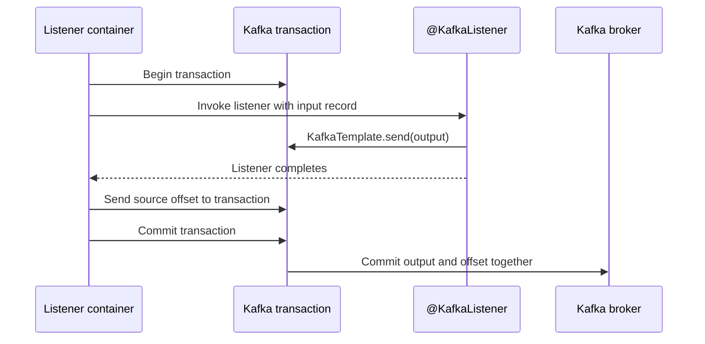
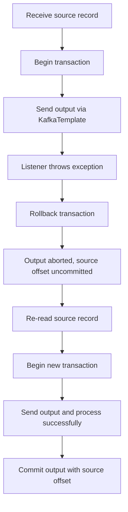

# Verifying exactly-once with failure injection

Exactly-once semantics (EOS) in Spring Kafka should be verified by intentionally failing the listener at different points during a Kafka transaction. A single normal successful execution does not prove EOS: a failure can occur after the application has sent output but before the source offset is committed. At that moment, the system must guarantee that output and offset commit together or roll back together.

For a `read → process → write` flow between Kafka topics, Spring Kafka uses Kafka transactions to put output sent by `KafkaTemplate` and the source offset into the same transaction. The listener may be invoked multiple times, yet consumers using `read_committed` see only output from committed transactions. Therefore, what must be proven is that **the committed Kafka effect appears only once**, not that the listener method is called strictly once.

## 1. What does exactly-once guarantee?

When a listener container is configured with `KafkaAwareTransactionManager`, the container begins a transaction before invoking the listener. Sends via `KafkaTemplate` using the same `ProducerFactory` join the active transaction. When the listener completes successfully, the container adds the source offset via `sendOffsetsToTransaction()` and commits the transaction. If the listener throws an exception, the transaction rolls back and the consumer is positioned to re-read the record.



If the listener fails after sending output:



Spring Kafka describes EOS for a read-process-write chain in Kafka: read and process have at-least-once semantics, while committed output is guaranteed exactly-once. The listener can run again after a rollback, rebalance, or restart; the transaction protects the published Kafka effect.

EOS does not automatically cover a database write, REST call, or email send. If the listener performs side effects outside Kafka, the target system must participate in an appropriate coordination mechanism or perform idempotent handling using an event ID/business key. A Kafka transaction cannot automatically roll back a completed HTTP call.

## 2. Configuration prerequisites before testing

**Enable a transactional producer.** Spring Kafka requires `DefaultKafkaProducerFactory` with `transactionIdPrefix`. With Spring Boot, configuring `spring.kafka.producer.transaction-id-prefix` causes Boot to auto-configure `KafkaTransactionManager` and attach it to the listener container.

```yaml
spring:
  kafka:
    producer:
      transaction-id-prefix: order-service-${INSTANCE_ID}-
    consumer:
      properties:
        isolation.level: read_committed
```

`INSTANCE_ID` must produce distinct prefixes across concurrently running instances. When manually configuring Spring Kafka, `KafkaTemplate` and `KafkaTransactionManager` must use the same transaction-capable `ProducerFactory`.

**Use a `read_committed` consumer to inspect output.** Kafka defaults to `read_uncommitted`, which still returns records belonging to aborted transactions. `read_committed` returns only non-transactional records and committed transactional records; aborted records are hidden. This mode also reads only up to the Last Stable Offset (LSO), i.e., the position before the first open transaction. Therefore, a test consumer may have to wait for a transaction to finish before seeing subsequent data.

**Use a compatible broker version.** Spring Kafka 3.0 and later only support EOS V2; this mode requires Kafka broker 2.5 or higher. There is no need to create a separate producer per `group.id/topic/partition` as in the legacy EOS mechanism.

**Let the container manage offsets.** With container transactions, the container sends offsets into the Kafka transaction. Do not commit offsets independently before the transaction finishes processing, as that breaks atomicity between output and source read position.

## 3. Designing a repeatable failure test

A basic test requires two topics:

- `orders`: input topic containing an order.
- `order-events`: output topic containing events created by the listener.

The listener sends output first, then intentionally throws an exception exactly once. The next invocation succeeds:

```java
@Component
class FaultInjectingOrderListener {

    private final KafkaTemplate<String, String> kafkaTemplate;
    private final AtomicBoolean failFirstAttempt = new AtomicBoolean(true);

    FaultInjectingOrderListener(KafkaTemplate<String, String> kafkaTemplate) {
        this.kafkaTemplate = kafkaTemplate;
    }

    @KafkaListener(topics = "orders", groupId = "order-eos-test")
    void consume(ConsumerRecord<String, String> record) throws Exception {
        kafkaTemplate.send(
                "order-events",
                record.key(),
                "processed:" + record.value()
        ).get(10, TimeUnit.SECONDS);

        if (this.failFirstAttempt.compareAndSet(true, false)) {
            throw new IllegalStateException("Injected failure after output send");
        }
    }
}
```

On the first attempt, `send()` is already acknowledged by the broker, yet the listener throws an exception before the container commits. Because the send participates in the container transaction, the first output is aborted along with the transaction. `AfterRollbackProcessor` puts the source record back so the listener retries. The second attempt sends a new output and returns normally; the container commits the output along with the source offset.

The fault-injection point must lie **inside the transaction**, after sending output and before the listener returns. Throwing an exception before `send()` does not test the most dangerous case where output has already been sent while the transaction has not committed.

## 4. Creating a test broker with Embedded Kafka

Add the test dependency `spring-kafka-test` or `spring-boot-starter-kafka-test` if using Spring Boot. `@EmbeddedKafka` creates a local broker; `KafkaTestUtils` helps create consumers and read records.

Example test declaration:

```java
@SpringBootTest(properties = {
        "spring.kafka.producer.transaction-id-prefix=eos-test-${random.uuid}-",
        "spring.kafka.consumer.auto-offset-reset=earliest"
})
@EmbeddedKafka(
        partitions = 1,
        topics = {"orders", "order-events"},
        brokerProperties = {
                "offsets.topic.replication.factor=1",
                "transaction.state.log.replication.factor=1",
                "transaction.state.log.min.isr=1"
        }
)
class ExactlyOnceFailureTest {
    // Inject KafkaTemplate, EmbeddedKafkaBroker, and listener here.
}
```

Replication factors of `1` are suitable for a single broker in tests. In real environments, configure replication factor and `min.insync.replicas` according to cluster availability requirements. Use separate topics per test or ensure consumers seek to the proper position to avoid data from previous tests skewing results.

Send the source record in an independent test transaction:

```java
kafkaTemplate.executeInTransaction(operations -> {
    operations.send("orders", "order-42", "created")
            .get(10, TimeUnit.SECONDS);
    return null;
});
```

Because the producer factory has transactions enabled, `executeInTransaction()` creates a local transaction for the source record. This transaction commits before the listener receives the record. `KafkaTemplate` used by the listener afterward will join the transaction started by the listener container.

## 5. Checking output with read_committed and read_uncommitted

Create two test consumers with separate `group.id` values, both reading topic `order-events` from the beginning. The first consumer uses `read_committed`; the second uses `read_uncommitted`:

```java
private Consumer<String, String> outputConsumer(
        EmbeddedKafkaBroker broker,
        String groupId,
        String isolationLevel) {

    Map<String, Object> properties =
            KafkaTestUtils.consumerProps(groupId, "false", broker);
    properties.put(ConsumerConfig.ISOLATION_LEVEL_CONFIG, isolationLevel);
    properties.put(ConsumerConfig.KEY_DESERIALIZER_CLASS_CONFIG, StringDeserializer.class);
    properties.put(ConsumerConfig.VALUE_DESERIALIZER_CLASS_CONFIG, StringDeserializer.class);

    return new DefaultKafkaConsumerFactory<String, String>(properties).createConsumer();
}
```

After waiting for the listener to be re-invoked and the transaction to succeed, read the output:

```java
try (Consumer<String, String> committed =
             outputConsumer(broker, "verify-committed", "read_committed")) {

    broker.consumeFromAnEmbeddedTopic(committed, "order-events");
    ConsumerRecord<String, String> record =
            KafkaTestUtils.getSingleRecord(committed, "order-events");

    assertThat(record.key()).isEqualTo("order-42");
    assertThat(record.value()).isEqualTo("processed:created");
    assertThat(KafkaTestUtils.getRecords(committed).count()).isZero();
}
```

`getSingleRecord()` requires exactly one record in the read. The next poll confirms there is no second committed output. This is the main assertion: even though the listener ran again, an application consumer sees only one committed output.

To observe the record belonging to the aborted transaction, read the same topic with `read_uncommitted`:

```java
try (Consumer<String, String> uncommitted =
             outputConsumer(broker, "verify-uncommitted", "read_uncommitted")) {

    broker.consumeFromAnEmbeddedTopic(uncommitted, "order-events");
    ConsumerRecords<String, String> records = KafkaTestUtils.getRecords(uncommitted);

    assertThat(records.count()).isEqualTo(2);
}
```

In this test, two physical records were sent: one belonging to the aborted transaction and one belonging to the committed transaction. `read_uncommitted` sees both; `read_committed` sees only the committed transaction's record. That proves the first transaction was aborted and its output was not published to isolation-compliant consumers.

## 6. Checking source offset committed with output

Checking only the output topic is not enough. You must verify that the listener's consumer group committed the source offset after the transaction succeeded. With one record on partition `orders-0`, the next offset must be `1`:

```java
try (AdminClient admin = AdminClient.create(Map.of(
        AdminClientConfig.BOOTSTRAP_SERVERS_CONFIG,
        broker.getBrokersAsString()))) {

    Map<TopicPartition, OffsetAndMetadata> offsets = admin
            .listConsumerGroupOffsets("order-eos-test")
            .partitionsToOffsetAndMetadata()
            .get(10, TimeUnit.SECONDS);

    assertThat(offsets.get(new TopicPartition("orders", 0)).offset())
            .isEqualTo(1L);
}
```

In a complete test, conditionally wait until the listener has executed at least twice and the group offset has appeared before asserting. Do not use fixed `Thread.sleep()` as proof of transaction completion; use Awaitility or a polling loop with timeout to await the desired state.

Three observations must align:

| Observation | Expected result | Meaning |
|---|---|---|
| Number of listener invocations | 2 | First fails, second succeeds; processing may repeat |
| Output with `read_committed` | 1 record | Only the committed transaction's output is published |
| Output with `read_uncommitted` | 2 records | One output belongs to the aborted transaction and one to the committed transaction |
| Group offset of `orders-0` | `1` | Source offset is committed after the successful attempt |

## 7. Recommended failure injection matrix

A thorough verification suite should cover multiple failure points. Not every case needs to be in the same test; each scenario should have a deterministic fault injection method and dedicated assertions.

| Fault injection point | Expected state | What to confirm |
|---|---|---|
| Before `KafkaTemplate.send()` | Transaction aborts, no output yet, offset uncommitted | Source record is redelivered and processed successfully afterward |
| After `send()` is acknowledged, before listener returns | First output aborts along with offset; retry creates new transaction | `read_committed` sees exactly one output; group offset advances after commit |
| Listener returns, but transaction has not completed | Broker decides transaction commit or abort; no half-output/half-offset state | After recovery, output and offset both reflect a single outcome |
| Application stops while transaction is open | Incomplete transaction is not treated as committed; producer recovered/fenced by transactional ID | After restart and transaction resolution, no committed output lacks offset or vice versa |
| Application stops after commit | Output and offset already committed | When consumer group restarts, source record produces no extra committed output |

Testing an exception after `send()` is usually the best first step because it directly reproduces a failure occurring between publish and commit. Testing process termination while a transaction is open or right around commit requires controlling processes and brokers at the integration/system test level; a plain Java exception does not fully simulate network failures or lost commit responses.

## 8. Scenarios that lead tests to wrong conclusions

**Only counting how many times the listener ran.** EOS does not guarantee the listener is invoked once. In the example, the listener running twice is expected; the first belongs to the aborted transaction.

**Using a `read_uncommitted` consumer to conclude output is duplicated.** This consumer intentionally sees records from aborted transactions. When verifying published effects, `read_committed` must be used.

**Only asserting output without checking offsets.** A single output does not prove the source offset was committed in the same transaction. Read the group offset using AdminClient or an equivalent testing API.

**Reading too early before the transaction finishes.** A `read_committed` consumer reads only up to LSO. An open transaction can temporarily hold back subsequent records from being returned. Wait for transaction commit/abort before concluding a record is absent.

**Creating duplicate transaction ID prefixes across instances.** Each concurrently running application instance needs its own prefix. Duplicate transactional IDs can cause producer fencing and make tests or applications fail intermittently.

**Using a single broker to infer cluster failover behavior.** Embedded Kafka is suitable for testing basic transaction flows. It does not prove replication behavior, leader loss, or simultaneous multi-broker failures. Those scenarios require Testcontainers or a multi-broker Kafka cluster with corresponding fault injection scenarios.

**Including a database in assertions as if Kafka transactions protect databases.** If a listener updates a database and then the Kafka transaction aborts, the database update does not automatically roll back unless there is a separate transaction manager/coordination. Testing external side effects requires idempotency, outbox/inbox, or explicitly designed coordination mechanisms.

## 9. Checklist before accepting EOS

- Producer factory has `transactionIdPrefix`; prefixes differ across concurrent instances.
- Broker meets version requirements for EOS V2 (Kafka 2.5 or higher for Spring Kafka 3.x+).
- `KafkaTemplate` in the listener uses the same transaction-capable `ProducerFactory` as `KafkaTransactionManager`.
- Listener container actually has the transaction manager configured.
- Consumers reading transactional output use `isolation.level=read_committed`.
- Tested fault injection after sending output but before the listener returns.
- Assertions check both committed output count and source group offset.
- Restart tests around open/commit transaction timing exist if operational requirements demand them.
- Side effects outside Kafka have idempotency or independent coordination mechanisms.

## 10. Takeaways

- EOS for read-process-write in Kafka is atomicity between Kafka output and source offset.
- The listener may still be invoked multiple times; what is guaranteed is that output from aborted transactions does not appear to `read_committed` consumers.
- The most important test is injecting a failure after `KafkaTemplate.send()` but before the listener completes.
- Use `read_committed` to count published outputs; use `read_uncommitted` to also observe aborted transaction outputs when diagnosing.
- Check the consumer group's committed offset to confirm offset and output completed together.
- Embedded Kafka tests basic transaction flows; testing broker failover requires a multi-broker cluster.
- Kafka EOS does not automatically extend to databases or services outside Kafka.

## References

- [Spring for Apache Kafka — Exactly Once Semantics](https://docs.spring.io/spring-kafka/reference/kafka/exactly-once.html)
- [Spring for Apache Kafka — Transactions](https://docs.spring.io/spring-kafka/reference/kafka/transactions.html)
- [Spring for Apache Kafka — Testing Applications](https://docs.spring.io/spring-kafka/reference/testing.html)
- [Apache Kafka — Consumer Configuration: isolation.level](https://kafka.apache.org/documentation/#consumerconfigs_isolation.level)
- [Apache Kafka — Design: Message Delivery Semantics](https://kafka.apache.org/documentation/#semantics)
