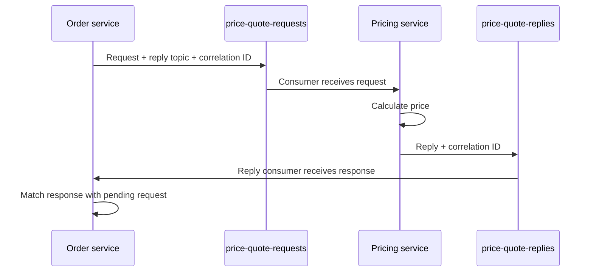

# Request-Reply Pattern on Kafka

Kafka is designed primarily for asynchronous event exchange, but applications can still build a request-reply pattern by combining a request topic, a reply topic, and a correlation ID. A client sends a request to Kafka and waits for a reply with the matching correlation ID. The request-handling service reads the record, executes the business logic, and publishes a response to the reply destination provided by the client.

Spring Kafka supports this pattern through `ReplyingKafkaTemplate` on the client side and `@KafkaListener` combined with `@SendTo` on the server side. The client can wait for the response with a timeout or continue processing asynchronously via a future.

Request-reply on Kafka is an application-level convention, not synchronous RPC provided by the broker. Both requests and replies are Kafka records; they can be delayed, redelivered, or arrive after a timeout. Therefore, correlation, timeouts, idempotency, and reply topics must be designed carefully.

## 1. What Is Request-Reply?

In the request-reply pattern, one side sends a request and expects a response directly related to that request.

For example, the Order service needs to ask the Pricing service for the current price of a SKU. The Order service sends a `PriceQuoteRequest`; the Pricing service reads the request, calculates the price, and returns a `PriceQuoteReply`.



The basic flow includes:

1. The client creates a request and sends it to the request topic.
2. The client attaches a reply topic (and optionally a reply partition) along with a correlation ID.
3. The server consumes the request, processes it, and produces a response.
4. The server publishes the response to the reply destination in the request metadata.
5. The client consumes the reply and uses the correlation ID to locate the pending future.
6. If the reply arrives before the timeout, the client receives the response; if time expires, the client handles the timeout.

Kafka only stores and delivers records. Matching requests with replies is the responsibility of the application and the request-reply library.

## 2. When Should You Use Request-Reply on Kafka?

Request-reply is suitable when a service needs a result from another service while still wanting to communicate over Kafka, leveraging Kafka ACLs, durability, consumer groups, and existing messaging infrastructure.

Suitable examples:

- Looking up information or performing calculations with relatively short response times.
- Asking a service to confirm a business decision.
- Integrating with a system that only communicates over Kafka while the client needs a corresponding result.

Request-reply should not be used as the default choice for all communication:

- If the client does not need an immediate response, publishing an asynchronous event/command is usually simpler.
- If the operation takes minutes or hours, use a workflow/status event instead of keeping a request waiting.
- If low latency and direct point-to-point communication between two services are needed, HTTP/gRPC may be a better fit.
- If an event needs to be broadcast to multiple services, an event topic with multiple consumer groups fits better than request-reply.

Request-reply still incurs Kafka latency, consumer scheduling, partition assignment, and server processing overhead. You should not assume it has the same latency or timeout behavior as an in-process function call.

## 3. Three Key Components: Request Topic, Reply Topic, and Correlation ID

| Component | Purpose |
| --- | --- |
| Request topic | Receives requests from clients |
| Reply topic | Receives responses from the server |
| Correlation ID | Links a response to its pending request |

Clients typically send reply metadata in Kafka headers:

- `KafkaHeaders.REPLY_TOPIC`: the topic name where the client wants to receive the response.
- `KafkaHeaders.REPLY_PARTITION`: the target partition for the reply if using a reply topic with specific partition routing.
- `KafkaHeaders.CORRELATION_ID`: the identifier used to match a reply with the corresponding request.

`ReplyingKafkaTemplate` automatically generates a correlation ID if the request does not already have one and manages a table of pending requests. It also attaches the reply topic/partition according to the reply container configuration. The server must preserve the correlation ID when sending the response; Spring Kafka's `@SendTo` handles this in the standard reply flow.

Do not confuse the Kafka correlation ID with a business request ID. The correlation ID serves to pair a request/reply within a specific invocation; a request ID can serve as a stable key for business deduplication when a client resends the same request.

## 4. Designing Request and Reply DTOs

Example of the Pricing service receiving a price quote request:

```java
package com.example.pricing.contract;

public record PriceQuoteRequest(
        String requestId,
        String sku,
        int quantity,
        String currency
) {}
```

The response should represent both successful results and business errors:

```java
package com.example.pricing.contract;

import java.math.BigDecimal;

public record PriceQuoteReply(
        String requestId,
        boolean success,
        BigDecimal total,
        String errorCode,
        String message
) {}
```

`requestId` is a business ID generated by the client. When the client retries the same command after a timeout, it can keep the same request ID so the server recognizes it as the same request. The Kafka correlation ID is still managed separately by `ReplyingKafkaTemplate` for each send/wait cycle.

Request/reply DTOs should be stable data contracts between services. Avoid passing JPA entities or internal classes with heavy dependencies directly. Use schema versioning or an event envelope if multiple services need to evolve contracts independently.

## 5. ReplyingKafkaTemplate on the Client Side

`ReplyingKafkaTemplate<K,V,R>` extends `KafkaTemplate`'s capabilities: it sends a request and waits for a response with a matching correlation ID. It requires two components:

- `ProducerFactory<K,V>` to send requests.
- `GenericMessageListenerContainer<K,R>` to consume the reply topic.

The reply container must subscribe to the right reply topic and have a consumer factory that deserializes responses into type `R`.

### 5.1. Configuring the Reply Consumer

Example configuration for the Order service client:

```yaml
spring:
  kafka:
    bootstrap-servers: ${KAFKA_BOOTSTRAP_SERVERS:localhost:9092}
    producer:
      key-serializer: org.apache.kafka.common.serialization.StringSerializer
      value-serializer: org.springframework.kafka.support.serializer.JsonSerializer
    consumer:
      group-id: ${KAFKA_REPLY_GROUP_ID:order-service-replies}
      enable-auto-commit: false
      key-deserializer: org.apache.kafka.common.serialization.StringDeserializer
      value-deserializer: org.springframework.kafka.support.serializer.JsonDeserializer
      properties:
        "[spring.json.trusted.packages]": com.example.pricing.contract
        "[spring.json.value.default.type]": com.example.pricing.contract.PriceQuoteReply

app:
  instance-id: ${HOSTNAME:local}
```

The consumer factory used by the reply container must have a value deserializer compatible with `PriceQuoteReply`. The request template's producer factory must serialize `PriceQuoteRequest` compatibly with the Pricing service's consumer.

### 5.2. Creating the Reply Container and Template

```java
package com.example.order.config;

import java.time.Duration;
import com.example.pricing.contract.PriceQuoteReply;
import com.example.pricing.contract.PriceQuoteRequest;
import org.springframework.beans.factory.annotation.Value;
import org.springframework.context.annotation.Bean;
import org.springframework.context.annotation.Configuration;
import org.springframework.kafka.config.ConcurrentKafkaListenerContainerFactory;
import org.springframework.kafka.core.ProducerFactory;
import org.springframework.kafka.listener.ConcurrentMessageListenerContainer;
import org.springframework.kafka.requestreply.ReplyingKafkaTemplate;

@Configuration
public class KafkaRequestReplyConfiguration {

    @Bean
    public ConcurrentMessageListenerContainer<String, PriceQuoteReply>
            repliesContainer(
                    ConcurrentKafkaListenerContainerFactory<String, PriceQuoteReply>
                            replyContainerFactory,
                    @Value("${app.instance-id:local}") String instanceId
            ) {
        var container = replyContainerFactory.createContainer("price-quote-replies");
        container.getContainerProperties().setGroupId(
                "order-service-replies-" + instanceId
        );
        return container;
    }

    @Bean
    public ReplyingKafkaTemplate<String, PriceQuoteRequest, PriceQuoteReply>
            replyingKafkaTemplate(
                    ProducerFactory<String, PriceQuoteRequest> requestProducerFactory,
                    ConcurrentMessageListenerContainer<String, PriceQuoteReply>
                            repliesContainer
            ) {
        var template = new ReplyingKafkaTemplate<>(
                requestProducerFactory,
                repliesContainer
        );
        template.setDefaultReplyTimeout(Duration.ofSeconds(8));
        return template;
    }
}
```

In a multi-instance environment sharing a reply topic, `app.instance-id` must be unique per instance (for example, the pod name). Each instance needs its own group ID to receive all replies and filter by correlation ID. If each instance uses a dedicated reply topic, the group ID can be chosen according to that topic's deployment policy.

`group-id` in consumer configuration is the default value of the consumer factory; `setGroupId()` on the reply container overrides the group ID for this container. When deploying multiple instances, ensure `HOSTNAME` or `app.instance-id` is genuinely unique.

Here the reply container subscribes to topic `price-quote-replies`; the group ID is set explicitly to manage reply reading progress. `ReplyingKafkaTemplate` uses this container to receive responses and complete the corresponding future.

The reply container must be started and receive a partition assignment before the client sends requests. You can wait for assignment at application startup or before accepting traffic:

```java
if (!replyingKafkaTemplate.waitForAssignment(Duration.ofSeconds(10))) {
    throw new IllegalStateException("Reply container has not been assigned partitions");
}
```

Only mark request-reply functionality as ready after the reply container is ready. If a request is sent before the reply consumer is active, the server may send a response that the client fails to consume.

The factory beans in the example must be configured with the right generics and serializers for requests and replies. If the application has multiple request/reply types, you can create specialized factories or use a serializer/deserializer supporting a common envelope.

## 6. Sending a Request and Waiting for a Reply

The client creates a `ProducerRecord` for the request topic and calls `sendAndReceive()`:

```java
package com.example.order.service;

import java.util.concurrent.TimeUnit;
import com.example.pricing.contract.PriceQuoteReply;
import com.example.pricing.contract.PriceQuoteRequest;
import org.apache.kafka.clients.consumer.ConsumerRecord;
import org.apache.kafka.clients.producer.ProducerRecord;
import org.springframework.kafka.requestreply.ReplyingKafkaTemplate;
import org.springframework.kafka.requestreply.RequestReplyFuture;
import org.springframework.stereotype.Service;

@Service
public class PricingClient {

    private final ReplyingKafkaTemplate<String, PriceQuoteRequest, PriceQuoteReply>
            replyingKafkaTemplate;

    public PricingClient(
            ReplyingKafkaTemplate<String, PriceQuoteRequest, PriceQuoteReply>
                    replyingKafkaTemplate
    ) {
        this.replyingKafkaTemplate = replyingKafkaTemplate;
    }

    public PriceQuoteReply requestQuote(PriceQuoteRequest request) throws Exception {
        ProducerRecord<String, PriceQuoteRequest> record = new ProducerRecord<>(
                "price-quote-requests",
                request.sku(),
                request
        );

        RequestReplyFuture<String, PriceQuoteRequest, PriceQuoteReply> future =
                replyingKafkaTemplate.sendAndReceive(record);

        // Confirm the request was acknowledged by the broker according to producer config.
        future.getSendFuture().get(5, TimeUnit.SECONDS);

        // Wait for the response; the template uses the configured default reply timeout.
        ConsumerRecord<String, PriceQuoteReply> replyRecord =
                future.get(10, TimeUnit.SECONDS);

        return replyRecord.value();
    }
}
```

`sendAndReceive()` returns a `RequestReplyFuture`. The future has two parts to distinguish:

- `getSendFuture()` completes when the request send finishes according to producer acknowledgment.
- The main future completes when a reply with the matching correlation ID is received; if the reply timeout expires, the future completes exceptionally.

Producer acknowledgment of the request does not mean the server has finished processing it. It only indicates that the Kafka producer sent the request according to the configured `acks` level. The client still has to wait separately for the response.

In the example, `future.get(10, TimeUnit.SECONDS)` is the waiting limit in the calling code. `setDefaultReplyTimeout(Duration.ofSeconds(8))` sets the template's default timeout; use a consistent timeout budget across the template, caller, and external API.

## 7. Asynchronous Handling Instead of Blocking Threads

`RequestReplyFuture` is a future, so the client is not forced to call `.get()`. In web applications or services with high concurrency, blocking threads synchronously for too long can exhaust the thread pool.

You can continue processing via callbacks:

```java
public CompletableFuture<PriceQuoteReply> requestQuoteAsync(
        PriceQuoteRequest request
) {
    ProducerRecord<String, PriceQuoteRequest> record = new ProducerRecord<>(
            "price-quote-requests",
            request.sku(),
            request
    );

    return replyingKafkaTemplate.sendAndReceive(record)
            .thenApply(ConsumerRecord::value);
}
```

In practice, handle request send failures, reply timeouts, and server exceptions separately. You can use `exceptionally`, `handle`, or map errors to API business exceptions. Do not turn all errors into empty success responses, as that masks the state of the target service.

## 8. Server Processing Requests and Returning Replies with @SendTo

On the server side, `@KafkaListener` receives the request. The method returns the response and `@SendTo` instructs Spring Kafka to publish the result. When the client sends the reply topic in a header, you can use `@SendTo` without specifying a fixed topic so the response goes back to the request's reply destination.

```java
package com.example.pricing.consumer;

import com.example.pricing.contract.PriceQuoteReply;
import com.example.pricing.contract.PriceQuoteRequest;
import com.example.pricing.service.PricingService;
import org.springframework.kafka.annotation.KafkaListener;
import org.springframework.messaging.handler.annotation.SendTo;
import org.springframework.stereotype.Component;

@Component
public class PriceQuoteListener {

    private final PricingService pricingService;

    public PriceQuoteListener(PricingService pricingService) {
        this.pricingService = pricingService;
    }

    @KafkaListener(
            topics = "price-quote-requests",
            groupId = "pricing-service"
    )
    @SendTo
    public PriceQuoteReply quote(PriceQuoteRequest request) {
        return pricingService.calculate(request);
    }
}
```

Spring Kafka uses the reply destination in the request header to send the response and preserves the correlation ID. If you use `@SendTo("price-quote-replies")` with a fixed topic, the server sends all responses to that topic; in that case, ensure the client reply consumer and correlation routing are designed accordingly.

The server must deserialize the request and serialize the reply compatibly with the agreed DTOs. Example Spring Boot configuration for the Pricing service:

```yaml
spring:
  kafka:
    bootstrap-servers: ${KAFKA_BOOTSTRAP_SERVERS:localhost:9092}
    consumer:
      group-id: pricing-service
      key-deserializer: org.apache.kafka.common.serialization.StringDeserializer
      value-deserializer: org.springframework.kafka.support.serializer.JsonDeserializer
      properties:
        "[spring.json.trusted.packages]": com.example.pricing.contract
        "[spring.json.value.default.type]": com.example.pricing.contract.PriceQuoteRequest
    producer:
      key-serializer: org.apache.kafka.common.serialization.StringSerializer
      value-serializer: org.springframework.kafka.support.serializer.JsonSerializer
```

`@SendTo` uses the `KafkaTemplate` attached to the listener container factory to send the response. If the application has a custom factory, ensure that factory has a reply template/producer serializer supporting `PriceQuoteReply` and permissions to write to the allowed reply topics.

If there is no reply topic header and `@SendTo` does not specify a destination, the server has no address to send the response to. Ensure requests always carry valid reply metadata or intentionally configure a static destination.

## 9. Returning Business Errors Instead of Letting the Client Time Out

Not every processing error should cause the server to throw an exception and leave the client waiting until timeout. For business errors that can be expressed as a result, return a response with a clear status:

```java
@KafkaListener(
        topics = "price-quote-requests",
        groupId = "pricing-service"
)
@SendTo
public PriceQuoteReply quote(PriceQuoteRequest request) {
    try {
        return pricingService.calculate(request);
    } catch (UnknownSkuException ex) {
        return new PriceQuoteReply(
                request.requestId(),
                false,
                null,
                "SKU_NOT_FOUND",
                "SKU not found"
        );
    }
}
```

The client receives the response and distinguishes `success=false` from a timeout or transport error. For transient technical errors, the server can throw an exception to trigger an appropriate retry policy. Agree on the error response contract between both services.

Do not return stack traces or internal details in the response. Use stable error codes and caller-safe messages; technical details should be logged with the correlation ID.

## 10. How Correlation ID Is Generated and Matched

The correlation ID is the key `ReplyingKafkaTemplate` uses to find the right future when a reply arrives. When using the template, the library automatically adds the correlation header to the request if needed. The server reply adapter copies the correlation header from the request to the reply.

Do not generate a different correlation ID for the reply. If sending a reply manually with `KafkaTemplate`, you must copy the exact correlation header from the request; otherwise, the client cannot match the response and will time out.

You can log the following values for tracing:

- Business `requestId` in the payload.
- Kafka correlation ID in the header.
- Request topic/partition/offset.
- Reply topic/partition/offset.
- Service instance handling the request.
- Duration from sending the request to receiving the reply.

The correlation ID and request ID can be linked together, but they serve two different purposes. The library's correlation ID typically lives only for the lifetime of the pending request in the template; the business request ID can persist much longer in databases and logs.

## 11. Reply Topics and Multiple Client Instances

Reply topics should be designed according to how clients are deployed. There are two common patterns.

### 11.1. Dedicated Reply Topic per Client Instance

Each client instance can use its own reply topic or a dedicated routed reply partition. The server reads `KafkaHeaders.REPLY_TOPIC` and sends the response to the right place. This pattern isolates responses well, but the number of topics/partitions grows with the number of instances and requires topic lifecycle management.

### 11.2. Sharing a Reply Topic

Multiple client instances can share a reply topic if each instance has its own consumer group to receive responses and `ReplyingKafkaTemplate` filters by correlation ID. When using a shared reply topic, configure the template to support a shared topic:

```java
replyingKafkaTemplate.setSharedReplyTopic(true);
```

Each client instance must have its own group ID. If all instances use the same group ID, Kafka splits reply records across instances; a response may arrive at an instance other than the one holding the pending future, causing the request to time out.

With a shared reply topic, each instance may read many responses that do not belong to its requests; the template discards responses without a pending correlation ID. This increases the number of records each instance reads and must be accounted for in consumer capacity.

Do not share the same reply topic and the same group ID across multiple client instances if each instance only holds pending requests in its own memory.

## 12. Reply Partition and Response Routing

When a reply topic has multiple partitions, the client may need responses sent to the partition its reply container is reading. `ReplyingKafkaTemplate` can attach a reply partition header based on the reply container's assignment. The server uses this metadata to send the response to the right partition.

Things to verify:

- The reply topic exists and the reply container has been assigned partitions.
- The target partition in the header is within the reply topic's partition range.
- The server producer has permission to write to the reply topic.
- If using a shared reply topic, configure `setSharedReplyTopic(true)` and a separate group ID for each client instance.
- If building a custom reply sender, respect both the reply topic and reply partition headers if the contract uses them.

Do not assume every reply goes back to the partition with the same number as the request partition. The reply partition belongs to the reply topic and is determined by the reply routing metadata, not automatically the request topic's partition.

## 13. Securing the Reply Destination

The `KafkaHeaders.REPLY_TOPIC` request header is just metadata sent by the producer. If the server trusts any value set by a client and has write access to many topics, a producer could ask the server to send responses to an unintended topic.

In multi-tenant or multi-producer environments:

- Only allow reply topics within a designated namespace.
- Configure ACLs so the server can only write to the necessary reply topics.
- Do not let untrusted clients arbitrarily choose target topics.
- Validate that the reply partition is within valid bounds.
- Do not put sensitive data onto a shared reply topic if multiple consumer groups can read it.

Both reply topics and request topics need appropriate ACLs, retention, replication, and monitoring. A correlation ID is not an authentication mechanism; it is only used for message pairing.

## 14. Timeouts and Late Replies

A timeout means the client did not receive a reply within the waiting window. It does not prove that the server has not processed the request.

A common scenario:

1. The client sends the request successfully.
2. The server receives the request but processes it slowly.
3. The client times out and returns an error to the caller.
4. The server still finishes processing and sends the reply.
5. The reply arrives after the client has already removed the pending correlation from the template.

A late reply cannot revive a timed-out request future. The template may record/log the late reply depending on configuration and version, but the caller has already received a timeout.

When encountering a timeout, the client needs to decide:

- Return a `PENDING/UNKNOWN` status to the caller and allow looking up the result later.
- Resend the request with the same business request ID if the server supports idempotency.
- Use a status event or query API to retrieve the result later.
- Increase the timeout if normal processing time exceeds the current budget.

Do not automatically retry a request with a new request ID without knowing whether the old request was already executed; doing so can cause duplicate business side effects.

## 15. Idempotency When Clients Retry Requests

Suppose a client sends an invoice creation command. The server creates the invoice successfully, but the reply is delayed or lost. The client times out and resends the request. If the server does not check the request ID, the invoice may be created twice.

The server should use the business `requestId` as an idempotency key:

```sql
CREATE TABLE handled_requests (
    request_id VARCHAR(100) PRIMARY KEY,
    response_json JSON NOT NULL,
    completed_at TIMESTAMP NOT NULL
);
```

Within the same database transaction, the server checks the request ID:

1. If the request ID is already completed, return the stored response.
2. If not present, execute the business logic.
3. Save the result and request ID in the same transaction.
4. Commit the transaction before sending the reply.

If two requests with the same request ID arrive concurrently, a unique constraint or an atomic lock/claim mechanism must protect execution. Do not simply query and then insert, because two consumers might both see the request as non-existent.

Idempotency makes handling duplicate requests/replies safer, but the request ID retention period must match the client's retry/replay window.

## 16. Request-Reply Does Not Create a Distributed Transaction

The request, the server's side effect, and the reply are separate steps. If the server updates the database but fails to publish the reply, the client may time out even though the business operation succeeded.

If the server publishes the reply before the database commits, the client may receive success while the database transaction later rolls back. Commit boundaries and the order of side effects must be clearly defined.

For critical business operations:

- Use an idempotency key to handle resent requests.
- Persist the request result in the same database transaction.
- Use an outbox if you need to guarantee the response/event is published after commit.
- Allow clients to look up status by request ID on timeout.
- Do not claim database exactly-once semantics just because `ReplyingKafkaTemplate` or Kafka transactions are used.

Kafka transactions can coordinate Kafka operations within an appropriate transaction, but they do not automatically include databases or HTTP calls.

## 17. Error Handling on Both Sides

Request-reply has two independent sides requiring error policies:

| Location | Error | How to Handle |
| --- | --- | --- |
| Client sending request | Broker/producer send failure | Report send error; do not wait for a reply as if the request succeeded |
| Client waiting for reply | Reply timeout | Return timeout/unknown; look up status or perform an idempotent retry |
| Server deserializing request | Invalid payload/schema | Use error handling/DLT for the request topic |
| Server processing logic | Transient error | Retry appropriately; do not send a fake success response |
| Server processing logic | Validation error | Return an error reply if it is an expressible business error |
| Server publishing reply | Producer/ACL/serialization failure | Record error, retry/recover per policy; client may time out |
| Client deserializing reply | Incompatible reply schema | Record consumer error and verify the DTO contract |

If the server throws an exception and produces no reply, the client usually only learns that no response arrived before the timeout. If you want the client to receive the error immediately, design an error response envelope or an error reply topic with correlation IDs.

## 18. Request-Reply with Static and Dynamic @SendTo

`@SendTo("topic-name")` fits when all responses go to a fixed topic. If each request has a different reply topic, use the reply-to header and `@SendTo` without specifying a fixed topic.

Static topic example:

```java
@KafkaListener(topics = "price-quote-requests", groupId = "pricing-service")
@SendTo("price-quote-responses")
public PriceQuoteReply quote(PriceQuoteRequest request) {
    return pricingService.calculate(request);
}
```

The example above specifies a static destination. If multiple clients read from the response topic, you still need correlation IDs and proper consumer group/reply routing so responses reach the client holding the pending request.

When using `ReplyingKafkaTemplate`, let the request carry the reply topic and use `@SendTo` without a fixed destination in the server listener so Spring Kafka replies to the right request.

## 19. Testing Request-Reply

Integration tests should run a real broker via Testcontainers or `@EmbeddedKafka`, verifying sending, correlation, and replying.

A basic scenario:

1. Create the request topic and reply topic.
2. Start the client's reply container and wait for partition assignment.
3. Start the server listener with `@SendTo`.
4. Send a request using `ReplyingKafkaTemplate`.
5. Verify the request reaches the server and the response is published to the reply topic.
6. Verify the future completes with a response containing the expected business request ID.
7. Send multiple concurrent requests and verify responses are matched to the right correlation IDs regardless of reply order.
8. Simulate a slow server to test timeouts and late replies.
9. Have the server return an error envelope to test business errors.
10. Test client retries with the same request ID and verify the server executes the side effect only once.

Tests should also verify:

- The client does not accept traffic before the reply container has an assignment.
- A missing reply topic or missing ACLs.
- A shared reply topic with a separate group ID per client instance.
- A reply missing a correlation ID or with a mismatched correlation ID.
- Server reply publishing failures.
- Request/reply schema changes between two services.

Use latches, futures, and assertions with timeouts instead of fixed `Thread.sleep()`. When testing multiple concurrent requests, intentionally return responses out of request order to prove correlation IDs work properly.

## 20. Observing Request-Reply in Production

Track the following:

| Metric/log | Meaning |
| --- | --- |
| Request send rate | Rate at which clients send requests |
| Request send failure | Producer failures when sending requests |
| Reply success rate | Ratio of requests receiving a response |
| Reply timeout rate | Ratio of callers not receiving a reply in time |
| End-to-end latency | Time from sending the request to receiving the reply |
| Pending request count | Number of futures currently waiting for a response |
| Late reply count | Number of responses arriving after timeout or with no pending request |
| Server processing latency | Processing time at the target service |
| Reply publish failure | Server errors when sending responses |
| Consumer lag | Lag of the request listener and reply container |

Logs should include the business request ID, Kafka correlation ID, topic/partition/offset, and service instance. Do not log full payloads if they contain sensitive data.

Set alerts when timeouts spike, the reply container loses assignment, request send failures increase, server reply publishing fails, or pending requests grow abnormally. Increased timeouts can stem from a slow server, consumer lag, rebalances, misconfigured reply routing, or an inactive client reply consumer.

## 21. Common Issues

| Symptom | Common Cause | How to Fix |
| --- | --- | --- |
| Client always times out even though server processed the request | Missing reply topic/partition header or reply container not running | Check reply metadata, container startup, and assignment |
| Response arrives but future does not complete | Correlation ID lost or modified | Use standard `@SendTo` or copy the exact correlation header when sending manually |
| Multiple client instances receive the wrong replies | Sharing a reply topic with the same group ID | Use a separate group ID per instance with a shared reply topic |
| Request sent successfully but no reply | Server listener not running, processing error, or reply publish failure | Check request group, server logs, and reply producer |
| Client times out and resends request causing duplicates | Server executed side effect but reply arrived late | Use a stable request ID and server-side idempotency |
| Reply arrives after timeout | Server processing takes longer than client timeout | Adjust timeout or provide a status lookup API |
| Reply fails to deserialize | Producer/server and client disagree on serializer/schema | Align DTOs, type mappings, and trusted packages |
| Invalid reply partition | Server cannot write to the requested partition | Check reply topic partition count and routing headers |
| Request sent to unintended reply topic | Server blindly trusts the reply topic header | Validate namespace and configure Kafka ACLs |
| Web threads exhausted | Callers block `.get()` for too long on request-handling threads | Use async futures, concurrency limits, and timeouts |

## 22. Request-Reply Design Checklist

Before taking request-reply into production, confirm:

1. Request topics and reply topics have clear naming, partitions, replication, and retention.
2. The client has an active reply container before sending requests.
3. `ReplyingKafkaTemplate` uses a properly typed producer factory and reply container.
4. Correlation IDs are generated and preserved in replies.
5. Business request IDs are separate from correlation IDs and used for idempotency.
6. Reply topics/group IDs are designed appropriately for multiple client instances.
7. Reply partition routing is compatible with partition assignments.
8. Timeouts account for queue wait time, consumer lag, server processing, and reply publishing.
9. Late replies are treated as normal occurrences and are observable.
10. Client request retries are controlled and the server is idempotent.
11. Error responses distinguish business errors, transport errors, and timeouts.
12. Reply destinations are restricted via validation and Kafka ACLs.
13. Tests cover concurrent requests, out-of-order responses, timeouts, late replies, and duplicate requests.
14. Metrics exist for send failures, reply timeouts, latency, pending requests, and reply publish failures.

Request-reply on Kafka lets clients send requests and receive responses across two asynchronous record streams. `ReplyingKafkaTemplate` manages correlation and futures on the client side; `@KafkaListener`/`@SendTo` helps the server return responses according to reply metadata. To make the pattern reliable, design reply topics/group IDs properly, set realistic timeouts, enforce idempotency for retried requests, and add observability for late replies and publish failures.

## 23. Self-Check

1. Why is Kafka request-reply an application convention rather than native broker RPC?
2. What roles do the request topic, reply topic, and correlation ID play?
3. What components does `ReplyingKafkaTemplate` need to operate?
4. How does `getSendFuture()` differ from the main future of `RequestReplyFuture`?
5. Where does `@SendTo` obtain the reply destination when no fixed topic is specified?
6. Why is a correlation ID different from a business request ID?
7. When multiple client instances share a reply topic, why does each instance need its own group ID?
8. Does a timeout prove that the server has not executed the request?
9. How do you prevent executing side effects twice when a client resends a request after a timeout?
10. Which metrics help distinguish slow server processing from misconfigured reply routing?
