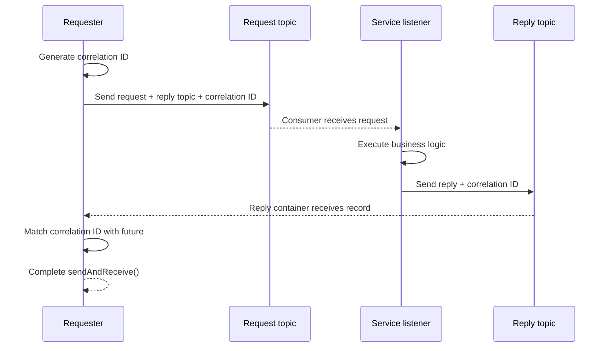

# ReplyingKafkaTemplate

`ReplyingKafkaTemplate` is a variant of `KafkaTemplate` that supports the request-reply pattern on Kafka. An application sends a request to a topic, waits for a service to process it, and receives the reply from another topic. Each request is tagged with a **correlation ID** so the template matches the reply to the right pending future, even when many requests run concurrently.

Unlike `KafkaTemplate.send()`, which only confirms record delivery, `ReplyingKafkaTemplate.sendAndReceive()` returns a future that completes when the corresponding reply arrives or when the wait times out. The server side typically uses `@KafkaListener` combined with `@SendTo` to send the result back to the reply address supplied by the request.

## 1. How Does Request-Reply Work on Kafka?

Request-reply uses two independent Kafka streams:

- **Request topic:** the client sends requests, and the server consumer reads and processes them.
- **Reply topic:** the server sends results, and the client runs a dedicated consumer container to receive replies.



General flow:

1. The requester calls `sendAndReceive()`.
2. `ReplyingKafkaTemplate` generates a unique correlation ID for the request and stores the pending future.
3. The template adds headers specifying where to send the reply and sends the request to the request topic.
4. The service receives the request, processes it, and sends a reply to the reply topic/partition.
5. The requester's reply container reads the reply, extracts the correlation ID, and completes the matching future.
6. If no reply arrives within the configured timeout, the future ends with a timeout exception.

`ReplyingKafkaTemplate` was introduced in Spring Kafka 2.1.3. The returned futures and `sendFuture` switched to `CompletableFuture` in Spring Kafka 3.0; older Spring Kafka 2.x projects may use `ListenableFuture`.

## 2. Three Key Headers

By default, `ReplyingKafkaTemplate` uses three headers:

| Header | Role |
|---|---|
| `KafkaHeaders.CORRELATION_ID` | Identifies the request to match the reply with the pending future. |
| `KafkaHeaders.REPLY_TOPIC` | The topic name where the server must send the reply. |
| `KafkaHeaders.REPLY_PARTITION` | Target partition for the reply; optional when the requester needs routing to a specific partition. |

The correlation header is the most critical piece. If the server fails to echo the correlation ID or alters its value, the requester cannot match the reply to the original request.

In a Spring `@KafkaListener` and `@SendTo` flow, the framework automatically echoes the correlation ID and reads the reply topic from the request headers. If the server does not use Spring Kafka, the server must read these headers itself and send the correlation ID back in the reply.

Kafka headers store values as `byte[]`. `REPLY_TOPIC` holds the bytes of the topic name; `REPLY_PARTITION` is a 4-byte integer in big-endian byte order. When building a non-Spring server, adhere to this encoding.

## 3. Configuring the Reply Container

`ReplyingKafkaTemplate` requires two components:

- `ProducerFactory` to send requests.
- `GenericMessageListenerContainer` to receive replies.

Example using the same `String` type for requests and replies:

```java
import java.time.Duration;

import org.springframework.context.annotation.Bean;
import org.springframework.context.annotation.Configuration;
import org.springframework.kafka.core.ProducerFactory;
import org.springframework.kafka.listener.ConcurrentMessageListenerContainer;
import org.springframework.kafka.config.ConcurrentKafkaListenerContainerFactory;
import org.springframework.kafka.requestreply.ReplyingKafkaTemplate;

@Configuration
public class RequestReplyConfiguration {

    @Bean
    ConcurrentMessageListenerContainer<String, String> repliesContainer(
            ConcurrentKafkaListenerContainerFactory<String, String> factory) {

        var container = factory.createContainer("orders.replies");
        container.getContainerProperties().setGroupId("orders-reply-client");
        return container;
    }

    @Bean
    ReplyingKafkaTemplate<String, String, String> replyingKafkaTemplate(
            ProducerFactory<String, String> producerFactory,
            ConcurrentMessageListenerContainer<String, String> repliesContainer) {

        var template = new ReplyingKafkaTemplate<>(producerFactory, repliesContainer);
        template.setDefaultReplyTimeout(Duration.ofSeconds(8));
        return template;
    }
}
```

Explanation:

- `factory.createContainer("orders.replies")` creates a container dedicated to reading the reply topic.
- `setGroupId(...)` sets the consumer group for the reply container.
- `ReplyingKafkaTemplate` uses the producer factory to send requests and the reply container to receive responses.
- `setDefaultReplyTimeout(...)` sets the default wait duration if a `sendAndReceive()` call does not pass an explicit timeout.

The container's lifecycle is managed alongside the template/Spring context. You can create the reply container from the Spring Boot auto-configured `ConcurrentKafkaListenerContainerFactory`. If configuring a separate consumer for replies, make sure the container's deserializer is compatible with the reply type `R`.

## 4. Sending Requests with sendAndReceive()

`sendAndReceive()` accepts a `ProducerRecord<K,V>` and returns a `RequestReplyFuture<K,V,R>`. This future represents the reply, while `getSendFuture()` indicates whether sending the request succeeded or failed.

```java
import java.util.concurrent.TimeUnit;

import org.apache.kafka.clients.consumer.ConsumerRecord;
import org.apache.kafka.clients.producer.ProducerRecord;
import org.springframework.kafka.requestreply.ReplyingKafkaTemplate;
import org.springframework.kafka.requestreply.RequestReplyFuture;
import org.springframework.kafka.support.SendResult;
import org.springframework.stereotype.Service;

@Service
public class OrderQueryClient {

    private final ReplyingKafkaTemplate<String, String, String> template;

    public OrderQueryClient(
            ReplyingKafkaTemplate<String, String, String> template) {
        this.template = template;
    }

    public String queryOrder(String orderId) throws Exception {
        ProducerRecord<String, String> request =
                new ProducerRecord<>("orders.requests", orderId, orderId);

        RequestReplyFuture<String, String, String> future =
                template.sendAndReceive(request);

        // Confirm the request has been received by the broker.
        SendResult<String, String> sendResult =
                future.getSendFuture().get(5, TimeUnit.SECONDS);
        System.out.println("Request stored at " + sendResult.getRecordMetadata());

        // Wait for the matching reply.
        ConsumerRecord<String, String> reply =
                future.get(10, TimeUnit.SECONDS);

        return reply.value();
    }
}
```

The two futures have distinct meanings:

- `future.getSendFuture()` completes when the producer finishes sending the request or fails.
- `future.get(...)` completes when the matching reply arrives or an error/timeout occurs.

You do not need to generate a correlation ID manually in standard cases; the template manages the correlation ID and adds the header to the request. Only customize the correlation strategy/header name when integrating with non-Spring systems or an existing header contract.

## 5. Handling Requests on the Server with @KafkaListener and @SendTo

On the service side, the listener method receives the request and returns the reply payload:

```java
import org.springframework.kafka.annotation.KafkaListener;
import org.springframework.kafka.annotation.SendTo;
import org.springframework.stereotype.Component;

@Component
public class OrderQueryListener {

    private final OrderQueryService orderQueryService;

    public OrderQueryListener(OrderQueryService orderQueryService) {
        this.orderQueryService = orderQueryService;
    }

    @KafkaListener(
            topics = "orders.requests",
            groupId = "order-query-service"
    )
    @SendTo
    public String handle(String request) {
        return orderQueryService.findOrder(request);
    }
}
```

`@SendTo` without a topic value means using `KafkaHeaders.REPLY_TOPIC` from the request. The Spring Kafka listener infrastructure sends the reply to that topic and echoes the correlation ID so the requester can match the result.

If you want to send replies to a fixed topic, you can use `@SendTo("orders.responses")`. For request-reply, prefer using the request's reply topic header when each requester has its own reply destination or when sharing a reply topic/partition with correlation IDs.

When using `@SendTo`, the server-side listener container factory needs a `KafkaTemplate` in its `replyTemplate` property to send results. Spring Boot usually auto-wires the auto-configured template into the default factory. If creating a factory manually, you must call `factory.setReplyTemplate(kafkaTemplate)`.

Example manually configured factory:

```java
import org.springframework.context.annotation.Bean;
import org.springframework.kafka.config.ConcurrentKafkaListenerContainerFactory;
import org.springframework.kafka.core.ConsumerFactory;
import org.springframework.kafka.core.KafkaTemplate;

@Bean
ConcurrentKafkaListenerContainerFactory<String, String> requestListenerFactory(
        ConsumerFactory<String, String> consumerFactory,
        KafkaTemplate<String, String> replyTemplate) {

    var factory = new ConcurrentKafkaListenerContainerFactory<String, String>();
    factory.setConsumerFactory(consumerFactory);
    factory.setReplyTemplate(replyTemplate);
    return factory;
}
```

`replyTemplate` here is a regular `KafkaTemplate` on the server side for publishing responses. Do not pass the requester's `ReplyingKafkaTemplate` into this property.

## 6. Starting the Reply Container Before Sending Requests

If the reply container uses `auto.offset.reset=latest`, ensure the container has been assigned partitions before sending the first request. If the server replies before the reply consumer is ready, the reply may sit before the new consumer's starting offset and the requester will wait until timeout.

Since Spring Kafka 2.8.8, `ReplyingKafkaTemplate` provides `waitForAssignment(Duration)`. This method can throw `InterruptedException`, so handle or declare the exception:

```java
void awaitReplyContainer() throws InterruptedException {
    if (!replyingKafkaTemplate.waitForAssignment(Duration.ofSeconds(10))) {
        throw new IllegalStateException("Reply container has not been assigned partitions");
    }
}
```

Call this step after the application context starts and before issuing the first request, such as in an `ApplicationRunner` or during readiness initialization. You do not need to call it before each individual request once the container is running stably.

With manual partition assignment (without Kafka group management), the timeout passed to `waitForAssignment()` must be greater than the container's `pollTimeout`, because the assignment notification only appears after the first poll.

## 7. Configuring Reply Topic and Partition

If the reply container listens to a single topic or a single `TopicPartitionOffset`, the template can infer the reply topic/partition automatically and set the corresponding headers. If the container listens to multiple topics or a pattern, the requester needs to specify the reply destination explicitly in headers.

Example setting the reply topic manually:

```java
import java.nio.charset.StandardCharsets;

import org.apache.kafka.common.header.internals.RecordHeader;
import org.apache.kafka.clients.producer.ProducerRecord;
import org.springframework.kafka.support.KafkaHeaders;

ProducerRecord<String, String> request =
        new ProducerRecord<>("orders.requests", "O100", "GET_ORDER");

request.headers().add(new RecordHeader(
        KafkaHeaders.REPLY_TOPIC,
        "orders.replies".getBytes(StandardCharsets.UTF_8)
));
```

Normally you do not need to set the correlation ID and reply topic headers manually if the reply container is configured with a single clear destination. Only set them manually when the container cannot infer the destination or when the server uses a custom header contract.

If `KafkaHeaders.REPLY_PARTITION` is set, the server must send the reply to the right partition. Spring `@KafkaListener` supports routing by this header. For a reply consumer manually assigned to a fixed partition, the reply container does not use group management and must be configured using `TopicPartitionOffset`.

## 8. Multiple Requester Instances and Shared Reply Topics

When deploying multiple requester instances, there are three common patterns:

| Pattern | How It Works | Trade-offs |
|---|---|---|
| Dedicated reply topic per instance | Each instance has its own topic to receive replies. | Easy isolation, but requires managing many topics. |
| Single reply topic, unique group ID per instance | Every instance receives every reply; only the instance with the matching correlation ID completes its future, while others ignore the reply. | Easy horizontal scaling, but every reply is broadcast to all instances, adding network traffic. |
| Single reply topic with dedicated partition per instance | Each instance consumes a fixed partition; the server routes replies via `REPLY_PARTITION`. | Reduces receiving unrelated replies, but requires managing partitions and manual assignment. |

With a shared reply topic, each requester instance needs a different `group.id`. If instances share the same group ID, Kafka distributes reply records across consumers; a reply can land on an instance that does not hold the matching future, causing the request on the other instance to time out.

When using a shared reply topic, you can call:

```java
replyingKafkaTemplate.setSharedReplyTopic(true);
```

This property lowers the log level for replies without a pending correlation ID from ERROR to DEBUG. It does not alter record distribution; every instance still receives replies and discards those not belonging to its own requests.

## 9. Timeouts and Handling Late Replies

You can set a default timeout on the template:

```java
replyingKafkaTemplate.setDefaultReplyTimeout(Duration.ofSeconds(8));
```

Or set a timeout per request:

```java
var future = replyingKafkaTemplate.sendAndReceive(request, Duration.ofSeconds(3));
```

If no reply arrives within that duration, the template completes the future with `KafkaReplyTimeoutException`. Additionally, if calling `future.get(timeout, unit)` with a shorter deadline than the reply timeout, the caller may receive `java.util.concurrent.TimeoutException` from the Java Future wait operation.

A timeout on the requester **does not cancel the sent request**, does not stop the server listener, and does not roll back business side effects. The server may still finish processing and send a reply after the requester has timed out. A late reply no longer has a matching future; the template ignores it and logs according to configuration.

Therefore:

- Set the reply timeout based on actual service latency and SLA.
- Do not retry a request immediately without knowing whether the server executed the side effect.
- Use a stable `requestId`/`idempotencyKey` in the payload so the server prevents duplicate processing when the client retries.
- Track timeouts, late replies, and the rate of unanswered requests.
- If a business deadline is needed, pass the deadline/expiry in the payload and let the server proactively reject expired requests.

## 10. Distinguishing Request Send Errors from Reply Errors

`RequestReplyFuture` provides `getSendFuture()` to separate request publish failures from request-reply errors:

| Scenario | Where Detected | Meaning |
|---|---|---|
| Producer fails to send request | `getSendFuture()` completes exceptionally; the reply future also completes exceptionally. | Broker, serializer, network, or producer encountered an error. |
| Request sent successfully but no reply | Reply future expires. | Server did not receive, did not reply, reply was lost/misrouted, or processing exceeded timeout. |
| Reply deserialization fails | Reply future completes exceptionally when using `ErrorHandlingDeserializer`. | Reply bytes could not be decoded per consumer config. |
| Server returns a business error | Depends on reply contract; may send an error payload or error header. | Client needs to convert the response error into an appropriate exception/result type. |

Example checking an error sent by the server in a header:

```java
import java.nio.charset.StandardCharsets;

replyingKafkaTemplate.setReplyErrorChecker(record -> {
    var errorHeader = record.headers().lastHeader("server-error");
    if (errorHeader == null) {
        return null;
    }

    String message = new String(errorHeader.value(), StandardCharsets.UTF_8);
    return new IllegalStateException(message);
});
```

`setReplyErrorChecker()` has been available since Spring Kafka 2.6.7. The function receives the reply `ConsumerRecord` and returns an exception if the reply represents an error, or `null` if the reply is valid. This is a header-contract error translation mechanism and does not automatically infer all business errors from payloads.

If replies use JSON or complex formats, configure `ErrorHandlingDeserializer` for the reply consumer. When deserialization fails, the future can complete exceptionally with a cause containing `DeserializationException`.

## 11. Using Message<?> and Generic Reply Types

Since Spring Kafka 2.7, `ReplyingKafkaTemplate` supports request/reply with Spring `Message<?>`. If the converter/deserializer knows the reply type from configuration or metadata, you can call:

```java
RequestReplyMessageFuture<String, String> future =
        template.sendAndReceive(message);
```

If the reply has a generic type or lacks type metadata, pass a `ParameterizedTypeReference`:

```java
import java.util.List;
import java.util.concurrent.TimeUnit;

import org.springframework.core.ParameterizedTypeReference;
import org.springframework.kafka.requestreply.RequestReplyTypedMessageFuture;

RequestReplyTypedMessageFuture<String, String, List<OrderView>> future =
        template.sendAndReceive(
                requestMessage,
                new ParameterizedTypeReference<List<OrderView>>() {}
        );

List<OrderView> orders = future.get(10, TimeUnit.SECONDS).getPayload();
```

This is useful when one template receives multiple response types or when the server is not a Spring application and does not send Spring-style type headers.

If the server listener returns `Message<?>`, ensure the reply carries the right topic/key/correlation headers per the contract. From Spring Kafka 2.5 onward, the framework can populate missing reply topic and echo missing correlation/reply partition headers in supported cases; with custom message/header mappers or non-Spring servers, verify the actual headers.

## 12. Customizing Correlation Headers

By default, the template uses `KafkaHeaders.CORRELATION_ID`. You can change header names when integrating with a server that does not use Spring Kafka:

```java
replyingKafkaTemplate.setCorrelationHeaderName("request-correlation-id");
replyingKafkaTemplate.setReplyTopicHeaderName("response-topic");
replyingKafkaTemplate.setReplyPartitionHeaderName("response-partition");
```

Custom header names have been supported since Spring Kafka 2.3. If a non-Spring requester sends a correlation header under a custom name, from Spring Kafka 3.0 you can configure `correlationHeaderName` on the server's listener container factory so the framework echoes that exact header. Prior to 3.0, the server had to echo custom correlation headers manually.

Do not reuse the same correlation ID across multiple concurrent pending requests in the same template. Correlation IDs must be unique across pending requests to avoid mis-matching replies.

## 13. When Multiple Replies Are Needed for One Request

`ReplyingKafkaTemplate` fits when each request has one corresponding reply. If one request needs to gather multiple replies from multiple services/partitions, Spring Kafka provides `AggregatingReplyingKafkaTemplate` to collect multiple replies sharing the same correlation ID.

With a multi-reply pattern, clearly define:

- Aggregation completion condition: enough replies, enough service groups, or timeout reached.
- How to identify each responder to avoid double-counting.
- Behavior when one responder fails or does not respond.
- Ordering and how results are merged.
- Maximum reply collection size and waiting time limit.

Do not use `ReplyingKafkaTemplate` assuming a single request will automatically wait for every service to respond; by default, the future completes as soon as one reply matches the correlation ID.

## 14. Architectural Limitations to Consider

Request-reply on Kafka is useful for short queries with clear SLAs that need to leverage Kafka infrastructure. However, it remains asynchronous communication over a log, not synchronous RPC over a direct connection between two services.

| Limitation | Consequence |
|---|---|
| Client must maintain a reply consumer container | Consumes consumer resources, connections, and group coordination overhead. |
| Request and reply are two independent publishes | Server may process the request but fail to publish the reply. |
| Timeout does not cancel server-side processing | Client times out while side effects may still happen. |
| Late replies have no remaining future | Client does not receive results from an already timed-out future. |
| Shared reply topic broadcasts replies | Each requester instance receives and discards unrelated replies. |
| Request-reply does not automatically create exactly-once business processing | Requires proper idempotency, deduplication, and transactions. |
| Kafka does not guarantee response deadlines | Consumer lag, rebalances, retries, and broker load cause variable latency. |

Consider HTTP/gRPC for short calls needing low latency, strict deadlines, or synchronous RPC error propagation. Use Kafka request-reply when there is a specific architectural reason, such as communicating through the event backbone, where the requester can tolerate timeouts/asynchrony and both sides manage correlation, retries, and idempotency.

## 15. Testing Request-Reply

Integration tests should verify the entire path: request, server listener, reply topic, and correlation:

1. Ensure the request topic and reply topic exist before sending.
2. Start the reply container and wait for `waitForAssignment()` to succeed.
3. Send the request and verify `getSendFuture()` completes successfully.
4. Verify the server receives the right payload/key and sends the reply to the reply topic.
5. Verify the reply carries the matching correlation ID and the future receives the expected response.
6. Send multiple concurrent requests and verify replies are not cross-matched.
7. Test timeouts when the server does not respond.
8. Test late replies arriving after timeout and verify they do not falsely complete another future.
9. Test deserialization errors and `replyErrorChecker`.
10. When running multiple requester instances, test a shared reply topic with separate group IDs or dedicated partition assignments.

Conceptual assertion snippet:

```java
RequestReplyFuture<String, String, String> future =
        replyingKafkaTemplate.sendAndReceive(request, Duration.ofSeconds(5));

assertThat(future.getSendFuture().get(5, TimeUnit.SECONDS)).isNotNull();
ConsumerRecord<String, String> reply = future.get(8, TimeUnit.SECONDS);
assertThat(reply.value()).isEqualTo("ORDER_FOUND");
```

This is an illustrative assertion snippet. Complete tests need isolated topics/group IDs, waiting for container assignment, polling/awaiting futures with bounded timeouts, and cleaning up containers after the test. Do not use fixed `Thread.sleep` to guess when a reply has arrived.

## 16. Common Issues

| Symptom | Cause | How to Fix |
|---|---|---|
| Request sent successfully but future times out | Server did not reply, wrong reply topic, or reply container not yet assigned. | Check `@SendTo`, reply headers, group ID, and `waitForAssignment()`. |
| Future does not complete even though reply is in topic | Correlation ID was not echoed or was altered. | Check `KafkaHeaders.CORRELATION_ID` on both request and reply. |
| Reply container receives no records | Container not started, subscribed to wrong topic, or group offset already at end of log. | Check lifecycle, topic, assignment, and `auto.offset.reset`. |
| Multiple requester instances time out randomly | Shared reply topic but sharing the same group ID. | Use a separate group ID per instance or assign separate partitions. |
| Reply arrives at another instance and is ignored | Instances share a topic and correlation ID does not belong to current instance. | This is expected behavior; enable `sharedReplyTopic` to reduce noisy logs. |
| Server does not know where to send reply | Request missing `KafkaHeaders.REPLY_TOPIC` or multi-topic container prevents template from inferring it. | Set the reply topic header or use a reply container listening to one clear topic. |
| Reply sent to wrong partition | Invalid `REPLY_PARTITION` or server ignores the partition header. | Align partition routing and manual assignment. |
| Reply JSON deserialization fails | Reply consumer uses an incompatible deserializer. | Align serializer/deserializer and use `ErrorHandlingDeserializer` if needed. |
| Client retry makes server execute logic twice | Timeout does not cancel original request; client sends a new request. | Use a stable idempotency key/request ID and deduplicate on the server. |

## 17. Key Takeaways

- `ReplyingKafkaTemplate` provides request-reply via `sendAndReceive()`.
- The requester requires a producer factory and a reply listener container.
- `RequestReplyFuture` exposes `getSendFuture()` to check request delivery and the main future to await the reply.
- `CORRELATION_ID` pairs replies with requests; `REPLY_TOPIC` and `REPLY_PARTITION` route replies.
- `@KafkaListener` combined with `@SendTo` without a destination uses the request's reply topic header.
- The server-side listener container factory needs `replyTemplate` to send results.
- Wait for reply container assignment before the first request when using `auto.offset.reset=latest`; `waitForAssignment()` is available since Spring Kafka 2.8.8.
- A shared reply topic requires a separate group ID per requester instance or dedicated partitions.
- Timeouts do not cancel requests or server processing; late replies no longer have a matching future.
- Use `replyErrorChecker`, `ErrorHandlingDeserializer`, and idempotency for safe error handling.
- `AggregatingReplyingKafkaTemplate` is for gathering multiple replies.
- Request-reply on Kafka does not automatically provide exactly-once business processing or RPC-like latency SLAs.

`ReplyingKafkaTemplate` helps build request-reply on Kafka by combining a request producer, a reply consumer, and correlation IDs. For stable operation, configure the reply container with the right topic/group, ensure the server echoes correlation and routes replies accurately, set intentional timeouts, handle late replies, and protect side effects with idempotency. Use this pattern for requests with bounded processing times and clear response contracts.

## References

- [Spring for Apache Kafka — Sending Messages and ReplyingKafkaTemplate](https://docs.spring.io/spring-kafka/reference/kafka/sending-messages.html)
- [Spring for Apache Kafka — Forwarding Listener Results using @SendTo](https://docs.spring.io/spring-kafka/reference/kafka/receiving-messages/annotation-send-to.html)
- [Spring Kafka — ReplyingKafkaTemplate API](https://docs.spring.io/spring-kafka/api/org/springframework/kafka/requestreply/ReplyingKafkaTemplate.html)
- [Spring Kafka — RequestReplyFuture API](https://docs.spring.io/spring-kafka/api/org/springframework/kafka/requestreply/RequestReplyFuture.html)
- [Spring Kafka — KafkaReplyTimeoutException API](https://docs.spring.io/spring-kafka/api/org/springframework/kafka/requestreply/KafkaReplyTimeoutException.html)
