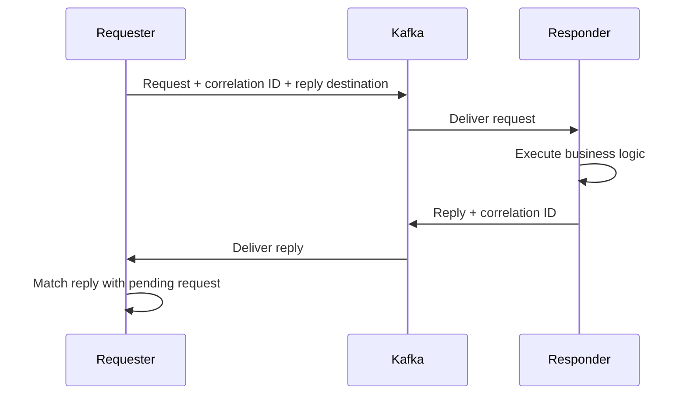

# When Not to Use Request-Reply

Spring Kafka supports the request-reply pattern: one application sends a request to Kafka, and another service processes it and sends a reply to a response topic. The sender pairs the reply with the request using a correlation ID and can await the result via `ReplyingKafkaTemplate`. This is useful when two services need to exchange a request with a short, time-bounded result.

However, Kafka is designed for asynchronous event streams and distributed log storage. If every operation must wait for a reply, the application turns a messaging stream into multi-hop RPC over the broker. That increases latency, couples availability to the responding service, and introduces timeouts, late replies, and duplicate processing cases. This lesson helps identify when not to use request-reply and choose a better communication pattern.

## 1. What Does Request-Reply Actually Create?

In request-reply, the caller sends a request record to a request topic. The record usually carries metadata about where to send the reply and a correlation ID. The handling service processes the request and sends a reply record to the designated topic. The caller consumes the reply, looks up the matching correlation ID, and completes the pending call.



With Spring Kafka, `ReplyingKafkaTemplate` manages sending requests and matching replies via correlation IDs. The caller can use `RequestReplyFuture` to await the result. The processor can use `@KafkaListener` combined with `@SendTo` to send replies back to the reply address specified in headers.

Example on the requester side:

```java
RequestReplyFuture<String, OrderRequest, OrderReply> future =
        replyingKafkaTemplate.sendAndReceive(
                new ProducerRecord<>("order-requests", request.orderId(), request));

ConsumerRecord<String, OrderReply> replyRecord =
        future.get(3, TimeUnit.SECONDS);

OrderReply reply = replyRecord.value();
```

The code calls `get()`, so the current thread blocks for up to three seconds. Because the API returns a future, the application can compose asynchronously rather than blocking threads. The responder can return the result as follows:

```java
@KafkaListener(topics = "order-requests")
@SendTo
public OrderReply handle(OrderRequest request) {
    return orderService.createOrder(request);
}
```

For the example to work, `ReplyingKafkaTemplate` must be configured with a reply listener container subscribed to the reply topic; the responder must read the reply destination from headers and have permission to publish to that topic. The snippet above illustrates the core exchange and omits full bean configuration, serializers, security, and error handling.

Request-reply does not turn Kafka into a direct synchronous connection between two services. The request and reply remain two independent records written, stored, delivered, and consumed via the broker. The caller merely creates an RPC-like experience by holding a call open awaiting the matching correlation ID.

## 2. Do Not Use Request-Reply for Events That Need No Immediate Answer

If an application only needs to announce that an event happened, request-reply creates an unnecessary round trip. For instance, `OrderCreated` is emitted so multiple services can update projections, send emails, or compute reports. Those services can process independently; the order-creating service does not need to wait for all of them to reply.

In that case, use asynchronous event notification:

```java
kafkaTemplate.send("order-events", order.id(),
        new OrderCreated(order.id(), order.createdAt()));
```

The producer confirms delivery per producer configuration, then moves on with its work. Consumers process when they have capacity under their own consumer groups. There is no need for a reply topic per event consumer.

Request-reply is a poor fit when:

- The event merely announces a state change or business occurrence.
- Multiple independent consumers need to receive the same event.
- The publisher does not need to know at emit time when each consumer finishes processing.
- Processing outcomes may arrive minutes or hours later.

If progress tracking is needed, consumers can emit separate status events such as `OrderProcessingStarted`, `OrderReady`, or `OrderFailed`. Interested parties subscribe to those events and update state asynchronously.

## 3. Do Not Use for Long-Running Work or Unpredictable Completion Times

Request-reply fits short, time-bounded work with small results. If the responder must run large reports, process video, wait for human approval, call many external systems, or execute multi-step workflows, the requester may have to hold the call waiting for a very long time.

Several problems arise:

- Calling application threads are held if code blocks on `Future.get()` or similar mechanisms.
- The requester must manage timeouts, cancellations, reconnects, and cases where the client disconnected while work continues running.
- Replies may arrive after the requester has timed out or restarted.
- The responder may finish the work while the reply is lost or never received by the requester.
- A large backlog of pending calls consumes memory and correlation-tracking resources.

A timeout only means the requester did not receive a reply within the allotted time. It does not prove the responder did not execute the business logic. If the requester resends the request after a timeout, the logic may run twice unless an idempotency key and deduplication mechanism exist.

For long-running work, use a submit-and-track pattern:

1. The client sends a command or job creation request.
2. The service acknowledges receipt and returns a `jobId`.
3. Workers process asynchronously and emit status events.
4. The client queries status or receives a callback/webhook upon completion.

This pattern decouples acceptance time from completion time. Kafka continues delivering commands and events, while job state is stored in a queryable store.

## 4. Do Not Use as a Replacement for Low-Latency Synchronous APIs

If a user interface needs an immediate answer to render a page, validate input, or return the result of an interactive action, HTTP or gRPC is usually a better fit. Those protocols provide a direct request-response model, deadlines, status codes, authentication, and familiar call observability.

Putting request-reply over Kafka into an interactive path adds multiple hops:

1. The application sends the request to the broker.
2. The broker writes and distributes the request.
3. The consumer picks up the request on its poll schedule and processes it.
4. The responder publishes the reply.
5. The broker writes and distributes the reply.
6. The requester matches the correlation ID and returns the result to the caller.

Latency also depends on consumer lag, partition count, rebalances, broker load, and responder processing time. Request-reply can still suit internal tasks with looser response times, but it should not be used by default as a synchronous API for every request.

| Need | Usually Better Choice |
|---|---|
| Short data fetch needing an immediate answer | HTTP or gRPC |
| Broadcasting events for multiple services to handle independently | Kafka event notification |
| Sending a command and receiving completion status later | Kafka command + status event / job ID |
| Multi-step workflow with retries and long waits | Workflow engine, saga, or asynchronous orchestration |
| Short internal request, small result, explicit timeout | Kafka request-reply may be considered |

There is no rule that request-reply over Kafka is always wrong. The deciding factors are latency, processing duration, concurrency volume, timeout tolerance, and whether both sides truly need an immediate result.

## 5. Do Not Use When Fan-Out or Multiple Independent Replies Are Needed

Kafka consumer groups distribute records among consumers within the same group. When multiple services need the same event, each service typically uses its own consumer group. That is Kafka's natural fan-out.

Request-reply raises harder questions: is the requester waiting for one reply or many? If there are multiple responders, you must define:

- How many responses count as enough?
- Wait for all responders or just one responder?
- How to identify which responder answered?
- What happens if one responder is offline or replies late?
- When the timeout expires, are partial results acceptable?

If the business process needs to aggregate responses from multiple services, it is usually better modeled as an asynchronous aggregation workflow. The requester emits an event carrying a `correlationId` or `workflowId`; each service emits its own result; an aggregator persists state and completes once defined criteria are met. This explicitly models partial results and per-branch timeouts.

## 6. Do Not Use When Temporal Availability Coupling Is Unacceptable

In request-reply, the caller depends on the responder actively consuming requests and publishing replies within the wait window. If the responder is down, consumer lag rises, or the reply topic is unhealthy, calls slow down or time out even though the broker durably stored the request.

This creates temporal coupling: the caller wants to finish the current operation, whereas the responder may only process once it recovers. If the goal is durable work intake to be processed as capacity becomes available, asynchronous commands fit better.

Situations where request-reply should be avoided:

- The responder frequently scales to zero or has long cold-start times.
- Consumer groups may rebalance while callers are waiting.
- Systems have staggered maintenance windows or asynchronous downtime.
- The caller must keep functioning even while the responder is temporarily offline.
- There are many downstream steps with unstable completion times.

Kafka retains requests in the topic per retention settings, but that does not guarantee the requester receives a reply before its deadline. If eventual processing is acceptable, acknowledge receipt of the request and track completion via events or job state.

## 7. Do Not Use Without a Timeout, Correlation, and Late-Reply Strategy

Request-reply requires managing correlation IDs and reply destinations. The requester must pair each reply to its pending request; if a correlation ID is missing, duplicated, or no longer in waiting memory, the reply cannot complete the original call.

Situations that require explicit design:

| Scenario | Risk | Required Handling |
|---|---|---|
| No reply before deadline | Caller times out even though request may have processed | Define timeout, indeterminate result state, and status query mechanism. |
| Reply arrives after timeout | Reply has no remaining waiter | Log late reply, discard or persist for reconciliation per policy. |
| Request is resent | Responder may execute business logic again | Use a stable request ID/idempotency key. |
| Requester restarts | Pending correlation memory is lost | Do not rely on in-memory waiters as durable state; use a job/status store if recovery is needed. |
| Reply topic unavailable | Responder cannot answer | Monitor publish failures, bound retries, and define recovery procedures. |
| Wrong or unauthenticated reply | Risk of false matching or untrusted data | Verify correlation, sender source, schema, and access permissions. |

`ReplyingKafkaTemplate`'s timeout limits how long the requester waits for a reply. It does not cancel in-flight processing on the responder and does not roll back side effects already performed. If a caller times out after the responder created an order, resending the request can create a second order without idempotency.

With request-reply, correlation IDs must be uniquely generated per pending request. The reply container must subscribe to the right reply topic and have a topology that routes replies back to the waiting requester. When scaling requesters across multiple instances, verify reply distribution and partitioning so a configuration never prevents an instance from receiving replies to requests it sent itself.

## 8. Do Not Create One Reply Topic per Request

Creating temporary topics per individual request causes topic counts to grow rapidly, burdens controllers/brokers, and complicates operations. In standard request-reply designs, use a shared reply topic or a managed set of reply topics, then distinguish requests using correlation IDs and routing metadata.

A shared reply topic must be designed around partitions, consumer groups, and reply routing. If replies must return to a specific requester instance, an explicit routing strategy is required. Never assume that all instances subscribing to one reply topic under the same consumer group will receive every reply; Kafka distributes partitions within a group, assigning each partition to one consumer at a time.

Managing reply topics also requires proper retention, requester/responder ACLs, compatible schemas, and alerts when reply backlogs grow. If replies remain retained longer than correlations stay valid, define a policy for handling expired records.

## 9. If You Still Use Request-Reply, Keep Its Scope Tight

Request-reply can be a sound choice when all of the following hold:

- The request represents a short operation with relatively stable completion time.
- Only one reply is needed, or clear aggregation rules exist.
- The result is small, not a large data stream.
- The caller has a finite deadline and tolerates indeterminate timeout states.
- Requester and responder have strategies for correlation, routing, and late replies.
- Business logic enforces idempotency against resent requests.
- Reply topics, partitions, consumer groups, and access controls are designed for actual instance counts.
- Metrics exist for request rate, reply latency, timeouts, late replies, and pending correlations.

Implementation principles:

1. Use `ReplyingKafkaTemplate` with a clearly managed reply listener container.
2. Set reply timeouts from business SLAs; do not use a huge timeout to mask a slow responder.
3. Avoid blocking listener or request threads when futures can be composed asynchronously.
4. Keep request IDs stable when retrying the same operation and deduplicate on the responder.
5. Design structured error responses distinguishing business errors, transient errors, and timeouts.
6. Monitor late replies and clean up correlation state with an appropriate lifecycle.

## 10. Quick Decision Guide by Scenario

| Question | If the answer is "yes" | Direction |
|---|---|---|
| Is an immediate result needed in an interactive request? | Yes, low latency and tight deadline | Prefer HTTP/gRPC. |
| Only announcing that an event occurred? | Yes | Emit an asynchronous event; do not await a reply. |
| Could work take long or wait on human approval? | Yes | Use a job ID, status events, or workflow. |
| Need multiple services to respond independently? | Yes | Use fan-out and an asynchronous aggregator. |
| Must the caller keep working when the responder is offline? | Yes | Use asynchronous commands/events and track state. |
| Short task, single reply, clear timeout, and idempotent? | Yes | Request-reply may be appropriate. |

Request-reply is a useful integration pattern within a narrow scope: exchanging a request and a short result over Kafka when both sides need explicit correlation. For event notifications, long workflows, fan-out, low-latency interactive APIs, or systems that must continue when responders are offline, asynchronous messaging or HTTP/gRPC is usually simpler and better suited. Choosing the right communication pattern lets Kafka shine at durable event delivery without turning every message into a blocking remote call.
