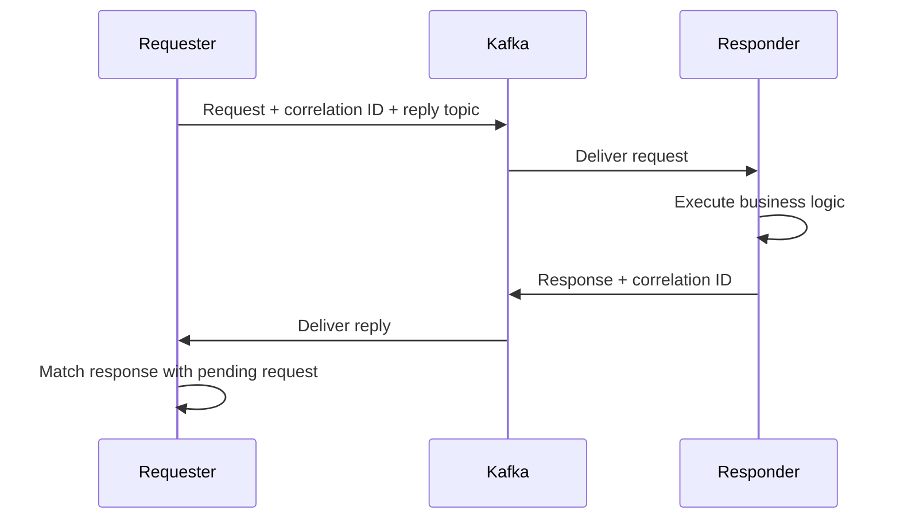
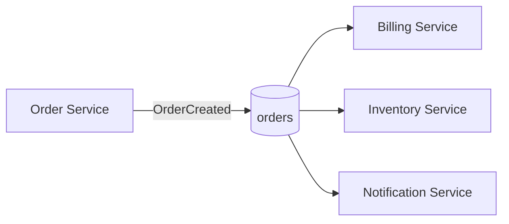

# Comparing Request-Reply and Event-Driven

In a Spring Kafka application, two services can exchange information in multiple ways. One service can send a request and wait for a corresponding response, or emit an event for interested services to consume and process on their own. Both approaches use Kafka topics and records, yet establish very different communication contracts.

Request-reply fits when the caller needs the result of an operation before continuing its current flow. Event-driven fits when the publisher only needs to announce an occurrence and does not depend on a specific consumer responding immediately. Request-reply often feels like a remote function call; event-driven decouples publisher from receivers and suits asynchronous processing.

The two patterns are not mutually exclusive. A system can use request-reply for short queries needing a response while using event-driven messaging to notify multiple services of business state changes.

## 1. Two Communication Patterns

### Request-Reply

The caller sends a request to a topic along with metadata telling the server where to send the response and which request it belongs to. The server consumes the request, processes it, and sends a response to a reply topic. The caller listens to the reply topic and pairs the response with the pending request.



In Spring Kafka, `ReplyingKafkaTemplate` supports this pattern. The `sendAndReceive(...)` API sends the request and returns a future representing the matching response.

### Event-Driven

The publisher emits an event describing what happened, such as `OrderCreated`. The publisher does not need to know which consumers will receive the event or how many consumers care. Services register their own consumer groups to process the event for their respective purposes.



Each consumer group maintains its own offsets and processing progress. Billing, Inventory, and Notification can process the same event independently, at different speeds and times.

## 2. Comparing Request-Reply and Event-Driven

| Criterion | Request-Reply | Event-Driven |
|---|---|---|
| Goal | Obtain the result for a specific request | Announce that an event occurred |
| Communication flow | Request followed by a corresponding response | Producer emits event, consumers handle independently |
| Does the sender wait? | Usually waits for a response within a window | Usually does not wait for consumer processing |
| Coupling between sides | Knows reply topic and correlation ID | Only needs to know topic/event contract |
| Number of receivers | Usually one logical responder per request | Can have multiple consumer groups |
| Response time | Requires explicit timeouts | Processing can be long-running and asynchronous |
| Ordering | Responses matched by correlation ID, not necessarily in request order | Ordering guaranteed within a partition |
| Failure handling | Timeouts, late replies, request retries | Consumer retries, DLT, event replay |
| Coupling | Higher, as requester depends on response contract | Lower, as producer does not depend on specific consumers |
| Best suited for | Short lookups or operations needing immediate results | Business notifications, multi-service integration, async workflows |

One distinction to keep clear: request-reply may be implemented with two Kafka messages, but that does not make it pure event notification. A request expresses intent to be processed; a response answers that specific request. Event-driven messaging announces facts that happened so multiple parties can react autonomously.

## 3. Request-Reply Is Not HTTP Over Kafka

Request-reply over Kafka can expose a synchronous-looking API at the application layer, yet transport remains asynchronous:

- The request is written to Kafka and consumed by the responder on its poll schedule.
- The response is written to the reply topic and consumed by the requester via a listener container.
- The requester holds a future waiting for the matching correlation ID.
- Response time depends on consumer lag, responder load, partitions, and processing duration.

Therefore, avoid using request-reply to build long synchronous chains of service calls across multiple topics. Each hop waiting for a response adds latency and compounds dependency on responder availability.

If a requester needs responses within a few hundred milliseconds while the responder can take several seconds, reconsider using Kafka for that call path. HTTP/gRPC may suit short queries needing low latency; Kafka suits durable, asynchronous data exchange that tolerates latency.

## 4. Request-Reply in Spring Kafka with ReplyingKafkaTemplate

Spring Kafka provides `ReplyingKafkaTemplate` to implement request-reply. This template pairs a request-sending producer with a reply listener container that receives responses.

A simple configuration using topics `price-requests` and `price-replies`:

```java
@Configuration
public class RequestReplyConfiguration {

    @Bean
    ConcurrentMessageListenerContainer<String, String> repliesContainer(
            ConsumerFactory<String, String> consumerFactory) {

        ContainerProperties properties =
                new ContainerProperties("price-replies");

        properties.setGroupId("price-requester");

        return new ConcurrentMessageListenerContainer<>(
                consumerFactory,
                properties
        );
    }

    @Bean
    ReplyingKafkaTemplate<String, String, String> replyingKafkaTemplate(
            ProducerFactory<String, String> producerFactory,
            ConcurrentMessageListenerContainer<String, String> repliesContainer) {

        return new ReplyingKafkaTemplate<>(
                producerFactory,
                repliesContainer
        );
    }
}
```

In this example, the producer factory sends requests and the reply container consumes responses using `String` for both key and value. Real applications can use DTOs and corresponding serializers for requests and responses.

The reply container must be started and assigned partitions before sending the first request. The reply consumer's `group.id` configuration must also account for how many requester instances are running.

## 5. Server Handling Requests and Sending Replies

The server uses `@KafkaListener` to receive requests. The method can return a value and use `@SendTo` to publish the response:

```java
@Component
public class PriceRequestListener {

    private final PricingService pricingService;

    public PriceRequestListener(PricingService pricingService) {
        this.pricingService = pricingService;
    }

    @KafkaListener(
            topics = "price-requests",
            groupId = "pricing-service")
    @SendTo
    public String handle(String sku) {
        return pricingService.getPrice(sku).toString();
    }
}
```

When using `@SendTo` without specifying a target topic, Spring Kafka can use the reply topic passed in the request's headers. `ReplyingKafkaTemplate` adds the headers needed so the server knows where to send the response and how to link it back to the original request.

If using `@SendTo("price-replies")` to specify a fixed topic, ensure that topic matches what the requester's reply container is listening to. With multiple requester instances, a fixed reply topic needs an appropriate distribution and consumer group strategy so responses reach the right requester.

Listener methods can also return DTO objects instead of `String`. Request, response, and reply container serializers/deserializers must agree on the schema used by both sides.

## 6. Sending Requests and Waiting for Responses

The requester creates a `ProducerRecord` and calls `sendAndReceive`:

```java
@Service
public class PriceClient {

    private final ReplyingKafkaTemplate<String, String, String> template;

    public PriceClient(
            ReplyingKafkaTemplate<String, String, String> template) {
        this.template = template;
    }

    public String getPrice(String sku) throws Exception {
        ProducerRecord<String, String> request =
                new ProducerRecord<>("price-requests", sku, sku);

        RequestReplyFuture<String, String, String> future =
                template.sendAndReceive(request);

        SendResult<String, String> sendResult =
                future.getSendFuture().get(5, TimeUnit.SECONDS);

        ConsumerRecord<String, String> reply =
                future.get(5, TimeUnit.SECONDS);

        return reply.value();
    }
}
```

`sendAndReceive` returns a `RequestReplyFuture`. There are two parts to pay attention to:

- `getSendFuture()` indicates whether the producer sent the request successfully.
- The main future completes when a response with the matching correlation ID arrives, or ends in a timeout/error.

Do not simply await the reply while ignoring request send errors. If the producer failed to send the request, waiting for a response will not help. The example uses a 5-second timeout for both futures solely for illustration; applications should configure a time budget aligned with SLAs and actual processing times.

APIs and generic signatures may vary slightly across Spring Kafka versions. Verify your exact dependency version before copying examples into an application.

## 7. Correlation ID, Reply Topic, and Reply Partition

Request-reply needs metadata so responses return to the right place and pair with the right call.

Key headers include:

| Header | Role |
|---|---|
| Correlation ID | Identifies the request awaiting a response |
| Reply topic | Tells the responder which topic to send the response to |
| Reply partition | Can specify the target partition for the response when configured for specific partitions |

`ReplyingKafkaTemplate` manages the correlation ID and necessary reply headers. When a response returns, the template uses the correlation ID to find the matching pending future.

A correlation ID is not an idempotency key. The correlation ID pairs a response with a request; an idempotency key helps the server recognize an already-executed business request to prevent duplicate side effects on retries.

If building request-reply manually without the template, the application must manage the correlation ID → future map, timeouts, cleaning up expired futures, handling late replies, and ensuring correlation IDs are never reused while a request is still pending. Using `ReplyingKafkaTemplate` avoids implementing most of this machinery yourself.

## 8. Timeouts and Late Responses

A timeout does not mean the server canceled request processing. For instance, the requester waits 5 seconds and times out, while the server is updating a database and sends a reply at second 7. The requester has finished its call, while the server may still complete the business operation.

Therefore, timeouts must be understood as a limit on how long the requester waits for a response:

- Do not conclude that the request was not processed.
- Do not automatically resend the request immediately without knowing whether the server may have executed side effects.
- Log the request ID/correlation ID to investigate late responses.
- Design idempotency if retrying a request could trigger duplicate side effects.
- Choose timeouts based on consumer lag, processing time, and SLAs.

Once a request expires, a later response may no longer have a matching future. Monitor late replies and avoid treating them as valid responses for a new request.

You can configure a default timeout on the template using your version's API, or use an overload taking a timeout when calling `sendAndReceive` if supported. Wherever configured, establish a clear end-to-end time budget for the entire flow.

## 9. Multiple Requester Instances and Shared Reply Topics

When running multiple requester instances, ensure responses are consumed by the instance holding the matching future.

Suppose instance A sends a request waiting for correlation ID A, and instance B sends a request waiting for correlation ID B. If both reply containers share one consumer group on the same reply topic, Kafka splits partitions among consumers in the group. A's reply may be delivered to B. B lacks the corresponding future and cannot complete A's call.

Design options:

- Give each requester instance its own reply topic.
- Use a shared reply topic where each requester instance has its own consumer group, so each instance receives replies and its template completes only futures with matching correlation IDs.
- Use an explicit partition/routing strategy so responses are delivered to the right requester instance.

Giving each requester its own group makes every instance read all replies on the shared topic, then ignore replies not belonging to its pending futures. This can increase consumed data volume with many instances. Weigh fan-out cost and reply topic retention carefully.

Never share a single fixed group ID across all requester instances unless a routing mechanism guarantees replies reach the exact instance holding the request.

## 10. Event-Driven with @KafkaListener and Consumer Groups

In event-driven architecture, the producer simply emits events:

```java
@Service
public class OrderPublisher {

    private final KafkaTemplate<String, OrderCreated> kafkaTemplate;

    public OrderPublisher(
            KafkaTemplate<String, OrderCreated> kafkaTemplate) {
        this.kafkaTemplate = kafkaTemplate;
    }

    public void publish(OrderCreated event) {
        kafkaTemplate.send(
                "orders",
                event.orderId().toString(),
                event
        );
    }
}
```

Interested services register independent listeners:

```java
@KafkaListener(
        topics = "orders",
        groupId = "billing-service")
public void onOrderCreated(OrderCreated event) {
    billingService.createInvoice(event);
}

@KafkaListener(
        topics = "orders",
        groupId = "inventory-service")
public void reserveInventory(OrderCreated event) {
    inventoryService.reserve(event);
}

@KafkaListener(
        topics = "orders",
        groupId = "notification-service")
public void notifyCustomer(OrderCreated event) {
    notificationService.sendOrderConfirmation(event);
}
```

The three consumer groups have separate offsets, so each service receives the event and progresses independently. When multiple instances belong to the same group, Kafka distributes partitions across instances to share load; instances within the same group do not each receive every record.

The producer does not need to know these three services exist. A new consumer group can be added later for analytics or auditing without modifying the producer, provided the event contract remains compatible.

## 11. Coupling and System Evolvability

Request-reply introduces protocol-level coupling:

- The requester must know the request topic and request format.
- The requester must run an active reply container.
- The responder must understand reply routing headers or target topics.
- Both sides must agree on response schemas, errors, and timeouts.
- The requester depends on the responder's availability at call time.

Event-driven architecture reduces coupling in time and consumer identity. The producer emits events without knowing whether consumers are currently running. Consumers can process later, replay from offsets, or add new groups.

However, event-driven does not mean zero coupling. Producers and consumers still depend on event schemas, business semantics, keys, partitioning, and retention policies. Schema changes require versioning and backward compatibility so older consumers do not break.

## 12. Errors and Business Responses

Request-reply requires conventions for representing success and failure. Avoid merely throwing exceptions that leave the requester waiting until timeout when the server has already identified a business error.

A response envelope can include:

```java
public record PriceResponse(
        String requestId,
        boolean success,
        String errorCode,
        String message,
        BigDecimal price) {
}
```

The server returns a success response or a structured error response. For example:

- `success = true`: price result is present.
- `success = false`: SKU does not exist or lookup is unauthorized.
- `errorCode`: stable error code for the requester to handle.
- `message`: controlled message suitable for logging or display.

Infrastructure failures such as server crashes, missing consumers, reply publish failures, or timeouts still need separate handling. You can combine retry/DLT for the request listener, but must define what the requester receives when a request lands in the DLT with no normal response.

In event-driven systems, consumers can retry independently and route failed events to a DLT. The producer does not need a synchronous response; processing outcomes can be published as separate events such as `InvoiceCreated`, `InventoryReserved`, or `OrderRejected`.

## 13. Reliability, Duplicates, and Idempotency

Kafka request-reply does not automatically guarantee every request and response happens exactly once. Scenarios that can create duplicates:

- The requester resends a request after timeout even though the server finished processing.
- The server completes business logic but crashes before sending the reply.
- The server sends the reply successfully, but the requester restarts before receiving it.
- A consumer reprocesses a request after a rebalance or uncommitted offset.

Include a stable `requestId` in the payload or business header. The server can persist processed request IDs and their results so resent requests return the same result rather than repeating side effects.

If the response carries critical business value, persist request state and responses in a database to support recovery across restarts. Do not rely solely on in-memory futures, as pending futures are lost when the requester process stops.

In event-driven systems, consumers also need idempotency because Kafka may redeliver records under configured delivery semantics. Consumer groups and offsets track progress, but do not automatically make database updates or external API calls exactly-once.

## 14. When Should You Choose Which Pattern?

| Scenario | Consider | Reason |
|---|---|---|
| Short data lookup where the caller needs the result to proceed | Request-reply | Explicit matching response and timeout |
| Broadcasting that an order was created | Event-driven | Multiple services can react autonomously |
| Invoking a long-running service | Event-driven with status/result events | Avoids keeping callers blocked for long periods |
| Calculating prices or quick eligibility checks | Request-reply or HTTP/gRPC | Immediate decision needed in the calling flow |
| Multiple independent consumers need the same event | Event-driven | Each consumer group progresses independently |
| Multi-step workflow | Event-driven/Saga | Each step runs asynchronously and recovers independently |
| Need a response while accepting asynchronous processing | Request-reply over Kafka | Decouples transport from caller via futures and correlation |

A practical rule: if the caller needs a result immediately to decide the next step, request-reply may fit. If the caller only needs to announce an event for other parties to act on, event-driven is usually simpler and more loosely coupled.

## 15. Testing and Observability

For request-reply, integration tests should verify:

1. Request is sent to the right topic and key.
2. Reply container received partition assignment before sending.
3. Server receives request and sends response to the right reply topic.
4. Correlation ID pairs the response with the right future.
5. Multiple concurrent requests do not receive each other's responses.
6. Timeout triggers when the server does not reply.
7. Late responses do not complete a different request.
8. Server errors or DLT follow an explicit policy.
9. Resent requests with the same request ID do not repeat side effects.

For event-driven, verify:

1. Producer emits events with the right schema and key.
2. Independent consumer groups all receive the event.
3. Multiple instances within a group split partitions as expected.
4. Retries/DLT do not drop events.
5. Consumers are idempotent when receiving the same event again.
6. Schema evolution does not break existing consumers.

Monitor request rate, reply rate, p50/p95/p99 latency, timeout rate, late replies, pending future count, consumer lag, retries, and DLTs. For event-driven flows, monitor lag per consumer group to identify which service is falling behind.

Do not put sensitive payloads or personal data into correlation IDs, headers, or logs. Use random IDs or controlled technical identifiers.

## 16. Selection and Implementation Checklist

- [ ] Confirmed whether the caller truly needs a response before proceeding.
- [ ] Request-reply has an active reply topic and reply container.
- [ ] Correlation ID pairs requests and responses accurately.
- [ ] Reply container has group ID and partition routing matching the requester instance count.
- [ ] Timeouts reflect SLAs and are not mistaken for server-side cancellation.
- [ ] Request ID/idempotency key stays stable across retries.
- [ ] Server has conventions for success and business error responses.
- [ ] Event-driven uses separate consumer groups per service needing all events.
- [ ] Event schemas have versioning and backward compatibility.
- [ ] Consumers are idempotent with appropriate retry/DLT configuration.
- [ ] Integration tests cover concurrent requests, timeouts, late replies, and duplicates.
- [ ] Metrics exist for latency, timeouts, lag, retries, and DLTs.

Both request-reply and event-driven patterns can be implemented with Spring Kafka, yet they serve two distinct communication contracts. `ReplyingKafkaTemplate` sends requests and awaits responses via correlation IDs; event-driven messaging lets producers announce events for multiple consumer groups to handle independently. Choose request-reply when the caller needs a time-bounded result, and choose event-driven when you want to decouple services in time, scalability, and independent processing progress.

